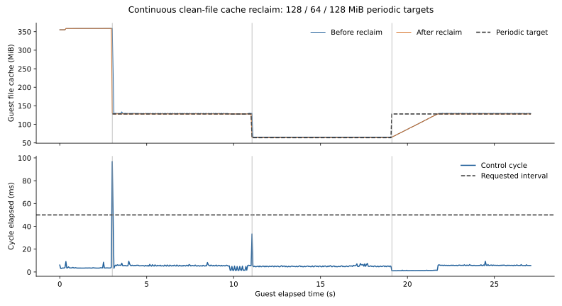
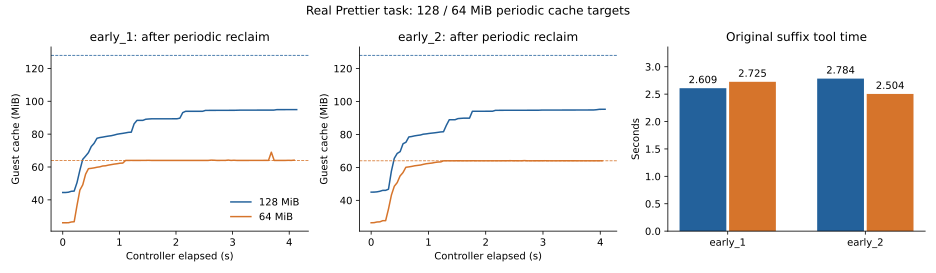

# 持续文件缓存控制完成：两个目标可用，真实任务读取量增加（2026-10-18）

已完成一个专用guest的128→64→128 MiB短验证，以及原Prettier真实双分支的128、64 MiB各一次，共3次实跑、62个实际任务动作。持续周期回收可用；缩小目标后，两个分支的guest设备读取量分别增加46.47%和56.05%，工具耗时分别变化+4.45%和−10.06%，并行后缀总耗时变化−1.18%。本对没有得到一致的任务减速方向。

短验证中缓存随目标下降，调高后也随读取重新增长；8 MiB匿名检查区和1 MiB共享内存文件内容保持，匿名检查区2048页在前后均驻留，交换量为零。真实任务保持原动作、顺序、退出码、补丁、恢复与原进程检查，原官方结果仍为0通过/2失败。当前完成的是周期目标控制，不是瞬时硬上限。

## 控制的是周期回收目标，不是每时刻的硬上限

每50 ms读取guest独立缓存成员表，计算当前容量超过目标的页数，再请求私有guest内核尝试回收这部分页。成员表容量仍包含普通文件缓存和shmem；回收接口只遍历普通文件映射，跳过shmem，并复用内核的`invalidate_mapping_pages()`。该操作只移出干净页，即不需要再写回文件的页，同时跳过被guest用户进程映射、加锁或正在写回的页。它不遍历匿名页，不调用全局slab回收，也不读取文件内容。

新增接口为`/proc/asb_cache_reclaim`，只在专用诊断内核`6.1.175-asb-cache-v3-reclaim`中提供。写入值是请求回收的4096字节页数，读取可获得请求数、处理的缓存条目数、扫描数和内核耗时。并发情况下处理条目数可包含影子条目，不能把它直接当成减少的缓存量；实际容量继续从独立成员表读取。

补丁见`patches/agentenv-cache-metadata/linux-6.1.175-cache-reclaim.patch`。源码复用Linux 6.1.175 `fs/drop_caches.c`的inode遍历与引用保护，并调用`mm/truncate.c`已有的干净、未映射页失效函数，未改变原`drop_caches`行为。回收顺序按文件系统、inode及文件偏移遍历，不是正常内存回收的最近使用顺序；后续性能结论对应此项策略。当前按4096字节页验证，未验证HugeTLB文件等其他配置。

脏页、共享内存及正在映射的页可能使目标达不到；周期之间的新读取也会使缓存暂时超过目标。本方法没有在每次加入缓存前检查容量。Linux原有[一次清理接口](https://docs.kernel.org/admin-guide/sysctl/vm.html#drop-caches)本身也不限制缓存增长，因此不将反复全量清理当作容量控制。

## 先核对真实接口，再单独关闭本guest的后台回收

实测guest使用cgroup v2，memory控制器存在，根`memory.reclaim`存在且可写，交换区未启用。实际6.1.175源码的该接口只接受回收量，使用通用回收路径，不能按新版命令指定逐请求`swappiness=0`来保证只处理文件页。因此本轮选择单独的文件缓存接口，不降低总内存上限，也不填充匿名内存制造压力。

原有DAMON_RECLAIM确实开启，工作线程号为72；实测参数列表没有启动命令行携带的`skip_anon`。本轮只在自有guest内关闭它，确认工作线程退出后进行控制，结束时恢复开启并确认线程重新出现。原服务和已有guest的参数不变。

## 两个目标的实际控制范围

新建256 MiB普通文件并正常写回，随后持续读取，每次512 KiB，读取后等待20 ms。先观察3秒，再按128、64、128 MiB各运行8秒；每段最后约3秒用于下表比较。没有读取真实任务文件或锁住检查文件。控制作用于整guest的可回收文件页，不是只对新建文件做丢弃建议。

| 阶段 | 目标/MiB | 周期回收前范围/MiB | 回收前均值/MiB | 回收后范围/MiB |
| --- | ---: | --- | ---: | --- |
| 第一次高目标 | 128 | 128.000–130.004 | 128.812 | 128.000–128.500 |
| 低目标 | 64 | 65.441–65.504 | 65.468 | 64.000–64.500 |
| 再次高目标 | 128 | 128.949–130.004 | 129.490 | 128.000–128.891 |

两档范围明确分开，调高后也能恢复增长。严格超过目标的现象仍存在：按相邻回收前读数保持不变估计，三个比较窗口分别约2.313/3.016、3.017/3.017、3.017/3.017秒高于目标。该估计依赖采样间隔，不是连续事件计时，也不表示超过目标的幅度很大；幅度见表。

共539次控制观测、412次非零回收请求；请求写入累计1.182秒，最长一次89.653 ms。控制循环CPU累计2.632秒，最长循环96.832 ms，初始大幅回收时超过50 ms周期。整个guest验证程序CPU为4.345秒，含文件写入、读取、内容检查与控制；这些数字不当作真实任务减速率。

匿名页总量为76.320–109.418 MiB，包含程序和元数据缓冲的变化，不能描述为完全不变；已知8 MiB匿名检查区内容及前后驻留保持，且未被计入文件缓存表。共享内存检查文件同样保持。只回收文件页的作用范围由内核选择路径和这些实测共同支持。

现有不暂停采集取得28个配对点，原始成员表与物理页号独立复算通过。此次没有快照，host只确认VMM RAM映射中的对应物理页；不是最新四来源恢复路径的再次验证，未知容量继续单列。



## 真实任务与证据入口

真实任务对照按同一共同11步、两个各10步原后缀执行128和64 MiB各一次，使用相同新诊断内核、2 CPU/4096 MiB、四来源采集、GET_DATA和2页策略。第一组同时验证新接入路径，通过后执行第二组，没有增加启动验证。只在两个恢复guest运行原后缀期间启用控制，停止后恢复各自DAMON，再执行原官方检查；准备与收尾计时不计入后缀时间。

| 目标/MiB | 分支 | 控制期间回收后缓存范围/MiB | 回收次数 | 原后缀工具耗时/秒 | guest设备读取/MiB |
| --- | --- | --- | ---: | ---: | ---: |
| 128 | A（early_1） | 44.461–94.949 | 0 | 2.609 | 58.313 |
| 128 | B（early_2） | 44.973–95.266 | 0 | 2.784 | 58.105 |
| 64 | A | 26.043–69.004 | 58 | 2.725 | 85.410 |
| 64 | B | 26.395–64.117 | 49 | 2.504 | 90.672 |

128 MiB目标在本任务中没有触发回收，实际需求只增长到约95 MiB；没有为了达到目标而预读或填充缓存。64 MiB组在需求增长后多数回收后读数约64 MiB，但A出现一次69.004 MiB：回收前64.125 MiB，请求32页并处理32条，随后读数反而增加，说明该次前后观察间仍有新缓存加入。该点保留，不把周期目标改写成硬上限。

两个后缀并行用时为4.042→3.994秒（−1.18%），工具耗时合计5.393→5.229秒（−3.04%）。设备读取量来自控制器开始至停止期间的guest计数，包含准备、停止与监控活动；窗口分别约4.08–4.18秒，不是仅工具调用的精确读量，更不是host物理磁盘读取量。缺页与逐设备数值保存在证据中。

两组从各自重放的相同逻辑前缀保存，而非复用同一份实际快照；控制开始时缓存约45 MiB对26 MiB，初始状态也有差异。先128后64且每档一次，不能把全部时间变化归因于缓存容量，也不能把负差值当作加速收益。当前交付的是控制有效性与本对实际影响。

控制器每guest整段CPU，128组A/B为0.277/0.318秒，64组为0.411/0.390秒；64组请求写入累计0.121/0.091秒。两组准备阶段分别0.324/0.332秒，停止阶段0.241/0.235秒，均在后缀并行计时之外。控制器生命周期分别36.492/36.447秒，包含原其他检查和清理，不与分项重复相加。本对没有关闭控制器的组，不能据此分离控制开销与缓存不足的全部影响。



两组四来源物理采样分别14/13点和15/14点，共56点、24对重叠观测、224次无缺失查询，独立物理集合和跨guest去重通过。按guest元数据区间选取控制窗口内的每分支4点，128组host确认量A/B分别为114.094–130.531、115.199–131.180 MiB，64组为74.508–79.383、77.281–80.715 MiB；对应未知guest容量最大分别1.707/4.199、2.633/1.371 MiB，仍单列。host读取可能延伸到guest元数据区间之外；这些确认量变化不能直接解释为VMM归还了多少内存。

整个运行的原物理图还包含停止控制后的独立检查和官方评测，不能把那一段缓存再次增长当成控制器仍开启时失效。当前不扩展为完整三任务或整个沙箱生命周期的容量限制。

本机短验证与任务结果统一保存在`.artifacts/cache-capacity-20261018/`；短验证实际运行目录为`.artifacts/storage-isolated-service/20261018T032551Z-2596875/guest-cache/`。新内核和构建记录为`.artifacts/agentenv-cache-reclaim-kernel-20261018/`，原诊断内核保留。内核构建通过与实际运行通过分开记录。

真实任务运行目录分别为`20261018T033611Z-2600964`和`20261018T033845Z-2604981`，完整分析见本机`task-report/summary.json`。[脱敏数值、配置、成本与验证](evidence/cache-capacity-control-20261018.json)同时包含短验证及真实任务，两种范围分开。

69项相关离线检查通过，实际未发生任务失败或重复实跑。12 GiB短验证卷运行中最低可用42.617 GiB；两个24 GiB任务卷启动前均超过50 GiB，运行中最低分别30.560/30.461 GiB。自有VM、snapshot、私有服务、卷、挂载、loop与RAM输入缓存均已回收，原服务和12个VMM保持；没有替换原服务、改host内核、清host缓存或新增采集暂停。

只读重建短验证报告，不启动沙箱：

```bash
python3 -B scripts/report_guest_cache_capacity.py \
  --source .artifacts/storage-isolated-service/20261018T032551Z-2596875/guest-cache \
  --output .artifacts/cache-capacity-report-new
```

真实任务离线报告入口为`scripts/report_guest_cache_capacity_task.py --runs .artifacts/cache-capacity-20261018/task-runs.json --output 新目录`。实际执行通过私有双分支入口显式指定`--prettier6604-cache-target-mib 128|64`及新诊断内核；未指定时不启动控制器，旧内核和起始缓存实验入口保持原行为。

本阶段已达到控制可用、真实任务与恢复保持、成本量化和资源回收的完成条件。随后按新授权完成了[同一实际快照的64→128 MiB反向对照](CACHE_CAPACITY_SAME_SNAPSHOT.md)，没有重跑本页数据。新对照确认了同一快照仍不保证恢复后的实际起始缓存接近，并保留一次私有服务恢复的条件；本页原数值和结论范围保持。严格硬上限、压缩或多层后端及更多任务另定范围。

后续保存前停止后台回收的一对验证和两类控制的离线汇总也已完成，推荐入口及各次结果的使用范围见[缓存控制汇总](CACHE_CONTROL_SUMMARY.md)。
