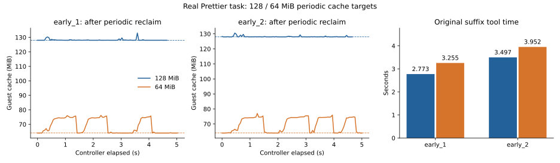

# 保存前停止后台回收的缓存控制对照（2026-10-18）

已实现并完成一对同快照64→128 MiB真实Prettier双分支对照。共同父guest保存前停止DAMON（guest内原有的后台内存回收功能）并等待线程退出，四个恢复guest均继承关闭状态，后缀结束后恢复父guest原来的开启状态。**这项改动可用，本次控制前的初始差异已降到A分支8 KiB、B分支4 KiB。**

64 MiB组的两个后缀并行耗时4.936秒，128 MiB组4.461秒，前者多10.63%；guest设备读取量A/B多41.73%/68.89%。原51动作、退出码、最终补丁、文件与原进程恢复及官方结果保持。本对完成，没有追加轮次或重跑任务。

## 同一父guest先停止，恢复后先检查

新选项只用于明确启用的同快照容量对照，旧入口默认行为不变。实际顺序为：

1. 共同11步完成，保存父guest原DAMON状态`Y`，请求停止，等待`enabled=N`且`kdamond_pid=-1`，记录停止后容量，再调用原快照保存接口。
2. 从同一份实际快照恢复64 MiB组的A/B，先确认后台回收关闭，再启动常规监控、文件/进程恢复检查和缓存物理采集，随后开始容量控制与两个原10步后缀。
3. 停止容量控制时，显式恢复父guest原状态`Y`并确认线程已启动，再执行官方检查。
4. 第一组guest及采集器结束后，确认服务无sandbox，把16份已释放的provider槽位观测文件归档，再从同一快照恢复128 MiB组；只执行20步后缀，不重跑前缀或重新保存。

本次两组在同一私有服务内连续完成，没有设备创建失败、服务重启或卷恢复。释放文件归档在实际连续路径中通过，旧文件和记录保留；[上一对](CACHE_CAPACITY_SAME_SNAPSHOT.md)包含私有服务恢复的事实不改变。

共同父guest停止前后逻辑缓存为186.660/186.664 MiB。四个恢复guest在最早状态检查中均为190.574 MiB；这比父guest稍高，检查命令和恢复本身仍会产生缓存活动。最早读数相同不意味着后续每张页或host缓存状态完全相同。

复用已有`6.1.175-asb-cache-v3-reclaim`私有内核、分段provider、GET_DATA和2页查询策略，guest均为2 CPU/4096 MiB。只调整自有guest后台回收时机，没有修改host内核或原服务、预读填充、锁定任务页或新增采集暂停；原生保存接口按既有流程执行。

## 实际容量分开，周期回收仍有超目标

容量来自从启动起记录的独立guest缓存成员表，包含普通文件与共享内存缓存页，每页4096字节。每50 ms按超目标数量尝试清理干净、未映射的普通文件页，共享内存不在回收范围。范围覆盖控制准备、后缀和停止之前的全部控制周期，官方检查在此窗口之后。

| 目标/MiB | 分支 | 首次回收前/MiB | 首次回收后/MiB | 全部回收后范围/MiB | 回收后采样均值/MiB | 非零请求次数 |
| --- | --- | ---: | ---: | --- | ---: | ---: |
| 64 | A | 190.996 | 64.004 | 64.000–76.164 | 68.719 | 98 |
| 64 | B | 190.969 | 64.004 | 64.000–76.992 | 69.881 | 100 |
| 128 | A | 191.004 | 128.000 | 128.000–133.000 | 128.199 | 88 |
| 128 | B | 190.973 | 128.207 | 127.996–130.551 | 128.156 | 92 |

此前B分支起始差异为82.520 MiB；本次为0.00390625 MiB，即4 KiB，A为8 KiB。保存前停止已固定住本次恢复准备期间的DAMON状态，两档也都在首次控制时从约191 MiB实际回收到目标附近。历史日志仍没有逐页回收线程记录，不据此追溯指定旧差异的每张页由谁回收。

64组最高回收后值明显超过目标。A对应请求2936页、处理164个条目，B请求4148页、处理1753个条目；脏页、映射页及并发新增都可能影响剩余量，当前记录未逐项分离。条目可能包含影子条目，处理数不直接换算成释放字节。**本方法是周期回收目标，不是每时刻硬上限，也不是按最近最少使用顺序回收。**



## 本对读取量和耗时影响

| 指标 | 64 MiB | 128 MiB | 64相对128 |
| --- | ---: | ---: | ---: |
| A原后缀工具合计/秒 | 3.255 | 2.773 | +17.37% |
| B原后缀工具合计/秒 | 3.952 | 3.497 | +13.02% |
| 两个后缀工具合计/秒 | 7.207 | 6.270 | +14.94% |
| 两个后缀并行耗时/秒 | 4.936 | 4.461 | +10.63% |
| A guest设备读取/MiB | 173.742 | 122.586 | +41.73% |
| B guest设备读取/MiB | 209.098 | 123.805 | +68.89% |

设备读取窗口为64组A/B的5.077/5.056秒、128组的4.698/4.705秒，包括控制准备、停止和监控活动；它不是原工具的精确读量，也不是host物理磁盘读取量。guest交换使用均为零。

容量控制进程整段CPU，64组A/B为1.145/1.271秒，128组为0.849/0.922秒；回收请求写入累计分别0.849/0.968秒及0.503/0.562秒。两组控制准备分别0.202/0.302秒，停止分别0.242/0.239秒，在并行后缀计时之外。请求写入包含内核执行等待，与进程CPU及工具时间不能相加为总成本。

本对说明较低周期目标伴随更多设备读取和更长后缀耗时。两组都启用控制器、内核元数据及物理采集，较低目标的控制CPU也更高；没有关闭控制器的基线，不能分离纯容量作用和控制开销。固定64→128顺序的一对仍受host缓存及运行波动影响，不推算稳定减速比例。第一组生命周期包含共同前缀与保存，第二组不含，不比较整段生命周期。

## host物理计数和未知量分别保留

64组A/B取得18/17点，128组15/14点，共64物理点、27对重叠观测、256次无缺失查询。VMM内存、直接快照设备缓存、单层原始快照文件缓存及可归属provider缓冲四来源物理页集合和跨guest去重独立复算通过。

仅选guest元数据读取区间完整落在控制窗口内的点，得到下表。host查询可能延伸到该元数据区间之外；这些数值是采样点范围，不是整段每个时刻的上下界。

| 目标/MiB | 分支 | 点数 | host确认物理量/MiB | 未确认guest容量最大/MiB | 内容归属未知的provider驻留量/MiB |
| --- | --- | ---: | --- | ---: | --- |
| 64 | A | 5 | 101.656–112.363 | 5.438 | 3.762–3.883 |
| 64 | B | 5 | 92.879–113.531 | 12.008 | 3.812–3.883 |
| 128 | A | 4 | 198.613–206.176 | 6.762 | 3.453–3.617 |
| 128 | B | 4 | 204.656–207.141 | 2.586 | 3.379–3.621 |

同一缓存内容可在host有多个物理副本，确认量可以大于guest逻辑容量；缓存回收也不等于VMM把相同大小内存归还host。两种未知量含义不同，继续分别记录，不记零、不相加或补入确认物理并集。停止控制后的官方检查继续采样，其缓存增长不属于控制开启时的范围。

## 完成条件、证据和入口

原共同11步加两组各20步，共51实际动作，四个恢复guest身份不同。动作顺序、预期失败、关键输出、补丁、文件和原进程恢复均保持；每个分支官方结果仍为0通过/2失败，实验检查通过与原任务失败分开判定。71项相关离线用例通过，实际日志另外核对了停止早于保存、恢复状态检查早于监控/边界检查、原状态恢复早于官方检查的顺序。

原始数据在`.artifacts/storage-isolated-service/20261018T063705Z-2635357/`，其中`prettier6604/`为64组，`prettier6604-128/`为128组。比较报告与冻结源码在`.artifacts/cache-capacity-same-snapshot-20261018T063547Z-2634910/`；状态与顺序核对回执为`.artifacts/cache-capacity-parent-damon-20261018/verification.json`。[脱敏数值](evidence/cache-capacity-parent-damon-20261018.json)保留曲线、成本、差值和未知量，不含原始物理页号或日志。

24 GiB卷启动前可用51.712 GiB，运行最低27.711 GiB，清理后51.400 GiB；满足启动前超过50 GiB及20 GiB保护量加6 GiB余量。自有guest、快照、私有服务、挂载、loop和成功卷已回收，原服务与12个VMM身份保持，旧失败记录和可恢复备份继续保留。

相同配置的实跑入口如下，会创建并清理新的私有实验资源；本轮已执行一次，不为再次确认而重跑：

```bash
bash scripts/run-cache-capacity-same-snapshot.sh --damon-before-checkpoint
```

只读重建本次比较报告：

```bash
python3 -B scripts/report_cache_capacity_same_snapshot.py \
  --storage .artifacts/storage-isolated-service/20261018T063705Z-2635357 \
  --wrapper .artifacts/prettier-snapshot-cache-pair/20261018T063547Z-2634921 \
  --output .artifacts/cache-capacity-parent-damon-report-new
```

本段完成。下一步建议供检查：只离线汇总起始缓存干预和持续容量控制的现有结果，给出推荐入口、已观察任务影响及适用范围；数值和引用对应原数据即结束，不启动新沙箱。严格硬上限、稳定减速比例及其他任务覆盖另定范围。

上述[离线汇总](CACHE_CONTROL_SUMMARY.md)已按新授权完成，本阶段结束，无需追加实跑。
