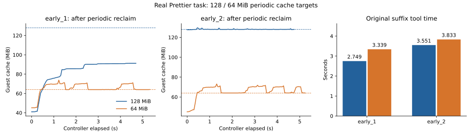

# 同一快照的64→128 MiB缓存目标对照（2026-10-18）

已从同一份实际快照完成64、128 MiB两组原Prettier双分支，实际51动作。64 MiB组的两个后缀并行耗时为5.178秒，128 MiB组为4.552秒，前者多13.75%；两个分支的guest设备读取量分别多196.38%和76.14%。原动作、退出码、补丁、保存状态、原guest进程恢复及官方结果保持。

本轮还确认了一个重要限制：**相同保存状态不保证恢复后开始控制时的缓存容量接近。** B分支两组实际起始缓存为45.125、127.645 MiB。本次中途还恢复了私有服务，因此上述差值是本对观察，不能全部归因于容量目标；没有追加轮次或重跑成功任务。

## 前缀只执行一次，第二组只执行后缀

原共同11步只保存一次。先从该快照恢复A、B两个guest执行64 MiB组，结束后再从同一快照恢复两个新guest执行128 MiB组。第二组复制前缀证据用于检查，没有冷启动、保存或前缀执行调用。两个组的快照身份和保存记录完全相同，四个恢复guest身份各不相同，文件边界和原进程身份/进度检查均通过。

本轮实际动作数为11+20+20=51。第二组`action_count`和`actual_action_count`均为20，`reused_action_count`为11，`verified_action_count`为31；复用证据不再计入实际工具时间。每个恢复分支均保持官方0通过/2失败，平台及实验检查通过与原任务未修复分开记录。

复用已有`6.1.175-asb-cache-v3-reclaim`私有guest内核、相同分段provider二进制、2 CPU/4096 MiB、GET_DATA和2页查询策略。每50 ms请求回收超目标的干净普通文件页，控制期间停止各自guest的DAMON后台回收，结束时恢复。没有预读填满128 MiB，没有锁定任务页、清host全局缓存或新增采集暂停。回收策略和作用范围见[原控制方法](CACHE_CAPACITY_CONTROL.md)。

## 两档容量和本对任务影响

下表容量来自独立guest缓存成员表，包含普通文件与shmem；回收接口不回收shmem。范围覆盖控制准备、原后缀及停止之前的控制周期，不含后续官方检查。

| 目标/MiB | 分支 | 开始控制前首个读数/MiB | 周期回收后范围/MiB | 回收请求次数 | 原后缀工具耗时/秒 | guest设备读取/MiB |
| --- | --- | ---: | --- | ---: | ---: | ---: |
| 64 | A | 45.219 | 45.219–73.836 | 91 | 3.339 | 171.727 |
| 64 | B | 45.125 | 45.125–73.109 | 93 | 3.833 | 201.422 |
| 128 | A | 41.051 | 41.051–91.215 | 0 | 2.749 | 57.941 |
| 128 | B | 127.645 | 127.645–129.680 | 86 | 3.551 | 114.352 |

64 MiB组相对128 MiB组，A工具耗时多21.48%，B多7.94%，工具合计多13.85%，两个后缀并行耗时多13.75%。128 MiB组A未达到目标，B则持续触发回收，不能把两个分支都描述为“128 MiB不触发回收”。设备读取窗口为64组A/B的5.365/5.292秒及128组4.748/4.796秒，包含准备、停止和监控，不是工具调用的精确读量，也不是host物理磁盘读取量。

64 MiB组的短时超限比此前一对更明显。A最高一次回收前73.902 MiB，请求2535页、处理977个条目，随后仍有73.836 MiB；B对应为74.348 MiB、请求2649页、处理1361个条目、回收后73.109 MiB。接口未处理足够条目，前后读取期间也有并发变化；已有记录不能把剩余量准确拆成脏页、映射页和新增页。处理条目数可能包含影子条目，不直接换算成释放字节。**当前方法维持的是周期目标，不是严格上限。**

两组控制器每guest整段CPU，64组A/B为1.118/1.264秒，128组为0.327/0.934秒；请求写入累计分别为0.766/0.932秒和0/0.509秒。两组准备分别0.301/0.434秒，停止分别0.239/0.235秒，均在并行后缀计时之外。第一组生命周期包含前缀与保存，第二组不包含，故不比较两者生命周期。



相同快照下A起始差4.168 MiB，B起始差82.520 MiB。随后[离线核对](CACHE_CAPACITY_INITIAL_GAP.md)确认，B大差异主要在首次物理采样区间、原后缀和非零容量回收之前形成：64组132.016→45.129 MiB，128组128.281→127.641 MiB。恢复检查和采集就绪发生在控制器关闭DAMON之前，具体逐页回收来源未记录；建议把停止时机提前到共同父guest保存之前，尚未改在线路径。此前独立保存、128→64顺序的一对并行时间变化为−1.18%，本次为+13.75%；两次均保留原差值，不合并成固定减速率。

## 物理量继续独立复算，未知量分开保留

64组取得15/14点，128组16/15点，共60个物理点、25对重叠观测和240次无缺失查询。四来源物理页集合及跨guest去重独立复算通过，页大小4096字节。没有改变来源确认条件或把未知量补入物理并集。

按guest元数据读取区间完整落在控制窗口内选点，64组每分支5点，128组每分支4点。64组host确认物理量A/B为85.625–103.410、96.422–106.410 MiB；128组为107.305–124.719、208.668–221.594 MiB。对应未确认guest容量最大分别14.953/6.785及2.305/13.250 MiB；内容归属未知的provider驻留量另存证据，不与guest未知容量相加。

host查询可能延伸到guest元数据区间之外；确认量可包含同一缓存内容的多个物理副本，因此可以大于guest逻辑量。这些变化也不等于VMM向host归还的内存量。停止控制后的官方检查仍继续采样，不把后续缓存增长视为控制开启时失效。

## 一次诊断文件冲突，保留64组并从原快照补完128组

第一次连续执行在64组成功后失败：删除最后一个guest释放了共享内存设备；128组重新申请同一设备号时，16个槽位任务都报`File exists`，随后RPC等待30秒超时。128组此时尚未执行任务，两个未取得sandbox身份的采样器也按失败记录。首个失败边界是诊断观测文件创建，不是任务执行或容量控制。

源码`AgentENV/storage/ublk/src/slot_observation.rs`用进程号、设备号、队列和槽号组成文件名，并以`create_new(true)`打开；释放时把状态写为5后解除映射，但保留文件。因此同一进程再次分配同一设备号会碰到旧文件。没有延长超时或无新假设地重试。

最小改动是在两个条件之间，等guest、控制器和采集器结束并确认服务无sandbox后，核对全部槽位均为偶数序号、长度0、状态5，再把观测目录整体归档，创建新的空目录。不覆盖旧inode或丢弃证据，不修改原服务、后端二进制或缓冲归属协议。文件级回归复现旧文件冲突，确认归档后同名新文件可创建、旧内容保持；活动或未完成槽位会拒绝归档。

第一次服务已按原失败清理流程退出，故先将24 GiB卷完整备份为2,432,465,237字节，解压SHA-256与源卷一致后，按既有清理授权回收源卷。空闲恢复到51.982 GiB，再在新的24 GiB私有卷恢复完整原状态。恢复时再次检查解压字节数与哈希，保留旧FAIL、日志和64组数据，只执行原快照的128组两个后缀。这不是成功64组的重跑，也不是重新保存近似快照。

恢复后的128组通过。直接在一个不中断私有服务内执行归档后完成两组的入口，本次只有离线顺序/归档检查；实测完成的一对包含上述私有服务重启。重启及恢复卷会改变host缓存状态，是本对性能解释的条件之一。

## 证据、资源和后续

首次目录为`.artifacts/storage-isolated-service/20261018T040255Z-2612260/`：外层FAIL保持，`prettier6604/`的64组为PASS，原128组设备创建失败也保留。恢复目录为`20261018T040834Z-2620471/`：外层及128组PASS，包含显式旧/新私有服务绑定和同一快照恢复证据。旧卷备份是当前可恢复输入，继续本地保留。

完整离线结果在`.artifacts/cache-capacity-same-snapshot-20261018/report/summary.json`，两组独立物理报告在其`physical/report/`和`physical/report-128/`。[脱敏数值与条件](evidence/cache-capacity-same-snapshot-20261018.json)保留原差值、容量曲线、读取量、成本及未知量，不包含原始物理页号或日志。

56项相关离线用例通过。首次24 GiB卷启动前54.360 GiB可用，运行最低30.358 GiB；恢复卷启动前51.982 GiB，最低27.981 GiB，20 GiB保护量及6 GiB余量保持。自有guest、快照、私有服务、挂载和loop均已回收，恢复成功卷已删除；原服务与12个VMM身份保持。首次FAIL的完整压缩备份和记录保留，没有暂存、提交或推送。

只读重建比较报告：

```bash
python3 -B scripts/report_cache_capacity_same_snapshot.py \
  --storage .artifacts/storage-isolated-service/20261018T040255Z-2612260 \
  --recovery .artifacts/storage-isolated-service/20261018T040834Z-2620471 \
  --wrapper .artifacts/cache-capacity-same-snapshot-20261018/physical \
  --output .artifacts/cache-capacity-same-snapshot-report-new
```

新的从头执行入口为`bash scripts/run-cache-capacity-same-snapshot.sh`；本次没有为验证不中断入口追加一对。失败续接复用现有私有存储入口的`--prettier6604-capacity-recovery 失败目录`，只适用于64组已通过、128组恢复设备创建失败且完整备份已核验的本轮状态。

本阶段数据和检查齐全，停止实跑。随后按新授权完成了[起始差异离线定位](CACHE_CAPACITY_INITIAL_GAP.md)，选择建议在共同父guest保存前固定后台回收状态；本页原数据和性能解释条件保持。后续最小改动及一对验证的建议见该报告，未因离线定位自动追加实跑。

保存前停止的独立选项随后已按新授权[完成一对新验证](CACHE_CAPACITY_PARENT_DAMON.md)，两组在同一私有服务连续通过，释放文件归档在该路径实际验证。本页原始一对仍按包含私有服务恢复的条件解释，不与新对照合并计算稳定减速率。
