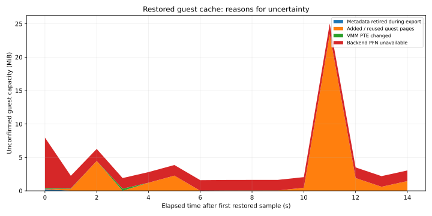
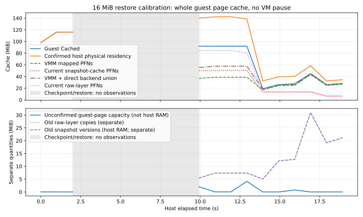
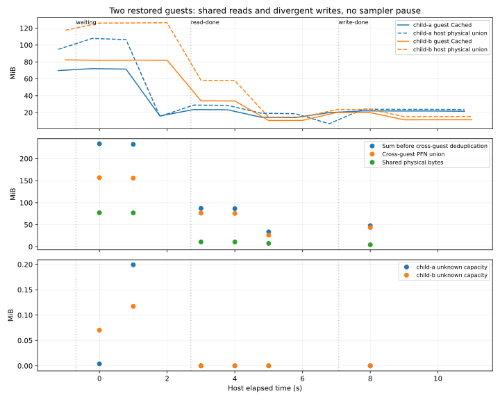

# 缓存驻留：未知容量、原始内存层与双guest验证

后续磁盘清理：用户已授权回收失去用途的旧镜像备份；本页提到的部分失败归档现已删除，原FAIL和raw保留，具体以[清理清单](IMAGE_BACKUP_CLEANUP_20261015.md)为准。

## 2026-10-15结果

已按顺序完成现有数据的未知容量分类、原始内存层驻留短校准，以及双guest共享和分支修改短验证。采集不额外暂停、不读取任务文件来补齐驻留、不锁定文件；校准负载的读取与修改明确记录，正常checkpoint暂停单列。没有重复Prettier完整轨迹或此前三任务实验，原Prettier的448份任务文件哈希保持。

当前host量覆盖三类当前缓存副本：VMM映射、直接File后端的ublk页缓存、对应的原始内存层文件页缓存。均取得PFN（物理页号）后按集合去重，写时复制留下的旧快照内容单列。单guest各层可以保留不同的物理副本，因此物理并集可以高于guest逻辑缓存容量。provider内部临时/匿名缓冲未归属，未知guest容量也不是未测host内存的上限。

## 现有未知容量的离线分类

对此前Prettier恢复后15点和短校准恢复后10点，逐页结合前后guest生命周期、三次VMM页表、前后实际映射及后端PFN分类。分类互斥，优先列出元数据失效、新增/复用、页表变化，再判断后端与映射；各项相加严格等于原报告的未知容量，不改原始物理计数。

| Prettier采样点 | 未知容量 | 导出时失效 | 新增或复用 | VMM页表变化 | 直接后端未取得PFN |
| --- | ---: | ---: | ---: | ---: | ---: |
| 恢复首点 | 2,041页 / 7.973 MiB | 63页 | 11页 | 28页 | 1,939页 / 7.574 MiB |
| 最大未知点，第11点 | 6,406页 / 25.023 MiB | 0页 | 5,999页 / 23.434 MiB | 0页 | 407页 / 1.590 MiB |

这两个点均没有未知容量归入匿名映射缺PTE、映射区段变化、换出或文件PFN冲突。匿名映射中已有稳定VMM驻留页的部分本来就已确认，不能把所有匿名映射页另加为未知。首点主要缺少直接后端PFN；峰值主要来自采样期间新增或复用的guest页，不能将25.023 MiB统称为漏计的host RAM。

此前短校准的首点未知13,091页 / 51.137 MiB，分为新增/复用57页、VMM页表变化514页、后端PFN变化305页、未取得后端PFN12,215页。旧raw中的零值不能进一步区分当时后端不驻留与无法取得PFN，保留这一限制；不能补出已回收资源在历史时刻的物理量。



离线入口：

```bash
python3 -B scripts/report_cache_unknown.py \
  .artifacts/storage-isolated-service/20261015T075346Z-1921832/prettier6604 \
  --output .artifacts/cache-unknown-recheck
```

两次分类各有两份报告，JSON/CSV/SVG/PNG各4文件一致；原采集目录148/98文件哈希保持。证据位于`.artifacts/cache-unknown-20261015/{prettier,calibration}-{a,b}`。

## 下层格式与一次短恢复校准

已完整阅读AgentENV子目录适用指令，只读检查本地源码版本`2f48c9c78ec58e4d73c49aa07cb81d984a4a4184`的快照生成、LSMT索引、层读取和本地文件路径。LSMT是记录逻辑地址到层文件偏移的索引格式。源码规定本地内存层保持原始格式，发布到远端时才可能压缩；本轮没有修改或重建Rust后端。

为了核对实际文件格式，使用此前失败卷的完整备份，在RAM文件系统中解压、核对原始SHA-256后只读挂载。实际内存配置为一个不可变原始层，471,330,816字节、4 GiB逻辑容量、83段索引，`ioEngine=0`。检查后挂载、loop及RAM副本均释放，原压缩备份保持。此检查只证明格式与路径，不能代表此前运行的驻留状态。

新增`snapshot_layer_metadata.py`只支持本轮实际遇到的单个本地原始层。按512字节扇区解析逻辑起点、长度、物理偏移和零区间；4 KiB guest内存页须对应一个完整、对齐的数据区间才纳入。头、尾和索引按页与数据分开，只读取这些元数据，不读取数据区。tar/zfile包装、多层叠加、零区间或不完整关联明确拒绝或保留未知，没有估计填补。

在线还核对私有服务中实际打开的层文件、配置digest/大小及设备/inode身份，再复用`mincore`和内核`filemap_get_entry`查询。查询没有映射或读取数据内容。VMM、直接后端和原始层三个物理页集合分别保存；原始层与ublk缓存通常是不同副本，不能因内容相同直接扣成一份，只有相同PFN才去重。

一次成功短校准使用2 CPU/4096 MiB、guest内核`6.1.175-asb-cache-v3`、host内核`6.19.9+`。沿用16 MiB已知文件的等待、读取4 MiB、修改4 MiB三个动作；文件内容、保存状态及guest进程身份检查通过。保存前3点、恢复后10点；恢复后首点如下。

| 量 | MiB |
| --- | ---: |
| guest Cached | 91.906 |
| VMM与直接后端当前物理并集 | 55.465 |
| 对应原始内存层的当前物理页 | 84.555 |
| 三层当前物理并集 | 140.020 |
| 只测前两层时的未知guest容量 | 36.535 |
| 纳入原始层后的未知guest容量 | 2.004 |
| 原始层中旧快照内容，单列 | 5.418 |

原始层新增确认8,840个guest页。三层物理量高于guest Cached是已观察到的多份物理副本，不是逻辑缓存变大，也不是跨guest去重结果。采样覆盖与缓存状态不同，不能用这一短校准替代旧Prettier的下层驻留测量；旧120.703 MiB仍不能事后补算。



采集线程累计3.228 CPU秒，两个BPF进程另计0.930 CPU秒；guest发布CPU见脱敏JSON。恢复后每点平均331.803 ms、最大469.640 ms，全13点平均275.223 ms。直接后端与原始层各20次查询，合计550,498页次，缺失结果均0。使用同步BPF表，不使用逐事件输出流；没有开关采集对照，不报告任务减速百分比。

运行`.artifacts/storage-isolated-service/20261015T081431Z-1934688/guest-cache`；最终报告`.artifacts/cache-unknown-20261015/lower-report-final-{a,b}`的3文件一致，121份采集文件哈希保持。新增`audit_lower_cache.py`用独立逐页集合运算复算，并核对保存的LSMT偏移与查询文件身份；与在线数组计数完全一致。

## 双guest共享与分支修改

一个16 MiB合成短路径同时覆盖两个恢复实例的共享读取和不同分支修改：父guest建立文件并保存，删除父VM，再从同一快照恢复两个host VMM。两个guest的PID、启动时间和boot ID都匹配保存状态，host身份分别重新关联。先等待，再各读取前4 MiB，最后将接着的4 MiB分别修改为B和C。采样关闭后核对完整文件内容，两份最终哈希不同；没有调用模型或完整任务轨迹。

每个guest独立采样13点，分别由独立host进程查询，避免并发查询混用BPF表。跨guest去重只选取两个采样窗口有时间重叠、且完整落在同一动作阶段内的样本，每个样本只配对一次。取得等待2对、读取3对、修改1对，共6对；重叠29.27–178.16 ms。这是有重叠的区间观测，不是同时暂停取得的原子快照。未配对时段不补点，图中并集只画有效配对点。

| 阶段中的示例配对 | 两个guest的host量相加（MiB） | 跨guest物理并集（MiB） | 相同PFN扣除（MiB） |
| --- | ---: | ---: | ---: |
| 等待，第一对 | 233.867 | 156.844 | 77.023 |
| 读取，第一对 | 87.027 | 76.230 | 10.797 |
| 修改，一对 | 47.781 | 43.445 | 4.336 |

每对都独立复算`并集=两量之和−交集`，各guest确认量也从raw重算。两个实例实际关联到同一只读内存ublk设备及同一层文件。旧快照版本未混入当前集合。阶段之间guest回收和缓存集合持续变化，不能把共享量的下降全部归因于分支修改；分支隔离由明确的字节检查和最终哈希另行验证。



采集线程累计分别3.072/3.396 CPU秒，BPF进程另计1.060/1.170 CPU秒，guest发布累计0.0287/0.0312 CPU秒。每点平均261.758/286.330 ms、最大392.763/458.580 ms；缺失查询结果0。guest重复加入、遗漏移出和越界计数均0；第二个guest有36条导出期间失效记录，已计入未知，未当作事件丢失。局部CPU时间不等于整个任务的性能影响，探针对其他进程的过滤成本也未单独量化。

首次双guest运行`20261015T082334Z-1939758`保留FAIL。首个失败是采集器停止KVM注册跟踪后，关联代码仍将新出现、尚无捕获记录的第二个VMM纳入候选。修正仅排除没有捕获注册记录的候选，已捕获候选仍须通过RAM区段、进程身份及guest标记核对；补最小回归用例。第二个采集器的流中断发生于随后清理期间，不记为独立平台原因。首轮没有有效配对结果，不计PASS。

失败卷压缩备份1,981,696,729字节，解压哈希核对通过后按持续授权定向回收24 GiB源卷，保留原FAIL、全部日志和备份。备份后host空闲约48.79 GiB，不满足24 GiB卷所需超过50 GiB的启动条件。依据成功短校准5.176 GiB的观测峰值及明确预算，复验改为22 GiB固定卷：20 GiB主机保护量、6 GiB余量保持，启动须超过48 GiB；复制输入后实际剩16.822 GiB，超过14 GiB要求，涵盖4 GiB内存快照、2 GiB两实例工作写入、4 GiB恢复临时空间和2 GiB余量。本调整仅用于合成双guest短验证，未修改Prettier的24 GiB配置。

修正后一次成功运行`.artifacts/storage-isolated-service/20261015T082741Z-1942973/guest-cache`；报告`.artifacts/cache-unknown-20261015/pair-report-final-{a,b}`的4文件一致，342份任务/采集文件哈希保持。功能通过、物理配对通过和清理通过分别核对，没有为增加配对点或改善比例加轮数。

## 核对、资源与后续计划

56项相关检查通过：未知分类1、层元数据3、直接后端4、持续采集15、隔离存储25、原整缓存7、双VMM关联回归1。相关Python编译、bash入口语法和文档差异检查通过。原始数据未覆盖，所有物理地址、LSMT索引和运行时日志只留本机。脱敏计数、阶段、成本、配置及哈希见[本轮证据](evidence/cache-residency-followup-20261015.json)，本地总核对为`.artifacts/cache-unknown-20261015/verification.json`。

成功下层校准与双guest验证的卷内观测占用峰值分别5.176/5.031 GiB，host空闲最低26.659/26.785 GiB。VM、snapshot、采集器、私有服务、挂载及loop均已回收；只读备份检查的RAM副本也已释放。原服务和12个VMM保持，收尾约48.14 GiB可用，失败备份保留。未暂存、提交或推送。

本阶段的三项交付已完成，停止追加实验。后续优先把原始层读取作为显式配置接入统一任务入口，并复用旧raw离线核对报告兼容性；若要验证真实任务的下层驻留与分支测量，再单独选择一次已有冻结轨迹，不重跑三任务完整单路径。压缩/多层快照、provider内部缓冲和统计稳定性能比较仍分别列为后续范围。当前48.14 GiB不能启动24 GiB卷；下一次真实任务实验须先解决实际磁盘预算，不能套用本次22 GiB合成短路径配置。

复现命令（前两条启动新实验，第三条仅离线复算）：

```bash
bash scripts/validate-isolated-storage.sh --snapshot-lower-cache-calibration \
  --diagnostic-guest-kernel .artifacts/agentenv-cache-kernel-20261015-v3/vmlinux.bin
bash scripts/validate-isolated-storage.sh --snapshot-cache-pair \
  --diagnostic-guest-kernel .artifacts/agentenv-cache-kernel-20261015-v3/vmlinux.bin
python3 -B scripts/report_snapshot_cache_pair.py \
  .artifacts/storage-isolated-service/20261015T082741Z-1942973/guest-cache \
  --output .artifacts/snapshot-cache-pair-recheck
```

后续进展：显式配置及一次真实Prettier第24步恢复已经通过；真实双分支首次在计数检查处失败，已本地修复但未追加guest复验。以[后续报告](PRETTIER_RAW_LAYER_CACHE.md)及最新计划为准，本页保留本阶段结果。
