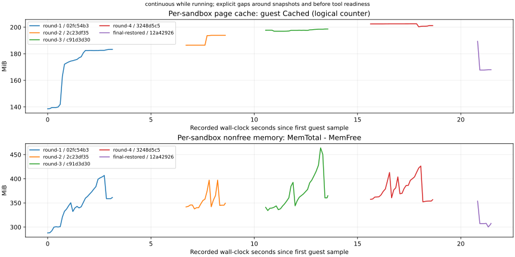
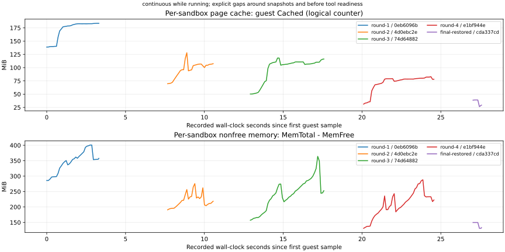
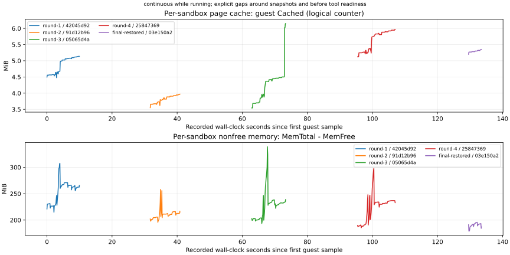
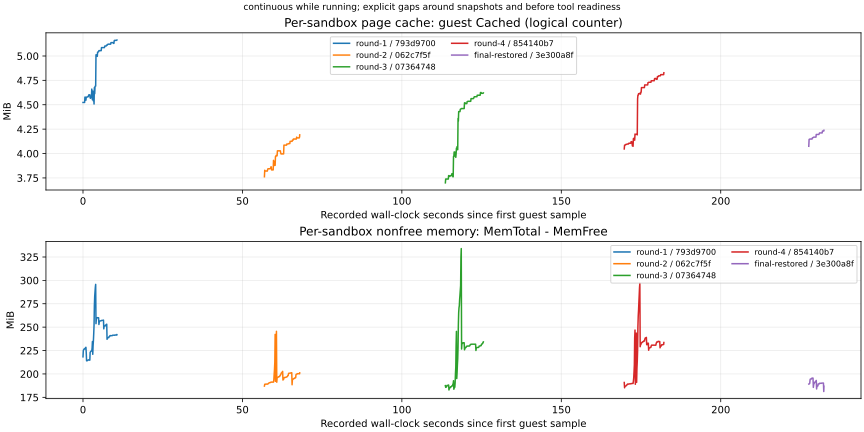

# Exp2：四轮实验接入与复现

2026-10-12，学长Exp2三组现已完成：AgentENV保留缓存、AgentENV清guest缓存、TrEnv-X原生snapshot及可写盘模板提升，各一次。每组原四轮32个动作和四次恢复通过，三组终态源码/patch一致，原聚焦Jest及oracle通过。持续曲线、阶段耗时、资源清理和独立复算均完成。原20 ms runner保持，新增100 ms持续采样和恢复状态探针，统计性能比较不包含在本轮。

## 空间清理

九份旧TrEnv-X镜像归档释放26.59 GiB，空闲34.63→61.20 GiB。当前输入、原始日志、样本、配置、代码、归档哈希和长期checkpoint包保留。每份检查归档SHA-256、原gzip/tar验证、资源已清理、保留标记及活动引用，删除后九项既有归档清理审计均通过。详见[公开回执](evidence/storage-cleanup-exp2-20261012.json)；本机完整记录为`.artifacts/storage-cleanup-20261012/`。

## 新入口与首个失败

输入配置为`configs/exp2-prettier6604.json`，固定原38个文件哈希、四轮各8步、原预期退出码全零和镜像digest。入口为`platform-exp2-preserve.json`与`platform-exp2-drop.json`，每次32 GiB固定卷，大于58 GiB主机空闲才运行；两配置顺序执行。宿主机page cache不清除。

第一次`.artifacts/platform-tasks/20261012T025743Z-796182`在初始化进度时失败，尚未运行任务动作。首个失败是Prettier镜像没有`/workspace`目录，已补显式创建目录并增加回归用例；不是原轨迹或checkpoint失败。私有服务、VM、挂载和loop清理通过，原服务及VM身份不变。失败卷完整备份2.145 GiB，解压哈希与32 GiB原卷一致后按持续授权回收源卷，备份和全部FAIL记录保留。

失败外层记录：`.artifacts/storage-isolated-service/20261012T025902Z-797026`。修正后两配置各一次真实运行均PASS，原准备失败保持FAIL，不覆盖记录。

## 两配置实际结果

两组共64个原动作、八次完整VM保存与恢复。每组均核对四个边界的源码、三个`/tmp`案例、准确轮次进度、进程身份、256 KiB匿名内存及已删除文件的打开描述符；只执行下一轮，第四次恢复后不重复任务动作。最终源码和patch的SHA-256跨配置相同。原第3轮Jest为1/1、第4轮为6/6通过，格式化oracle通过；独立任务测试未运行。

| 配置 | 工具执行之和（秒） | 控制器生命周期（秒） | guest持续样本 | 非空闲内存观测峰值（MiB） | 卷内占用观测峰值（GiB） |
| --- | ---: | ---: | ---: | ---: | ---: |
| 保留缓存 | 8.426 | 28.033 | 122 | 463.87 | 6.61 |
| guest清缓存 | 12.372 | 33.593 | 163 | 400.80 | 6.85 |

每次五个沙箱身份均有内存、CPU、块设备I/O及host VM进程CPU/I/O/RSS/PSS曲线，覆盖初始实例与四次恢复后的实例。样本为约100 ms持续采样，观测峰值可能漏掉瞬时峰值。每轮工具用时、四次checkpoint、restore至工具可用、状态核对、清缓存及全部控制器事件在统一报告中分开保存；生命周期包含这些操作，不重复相加。

| 轮后 | 保留缓存：保存前Cached（MiB） | 清缓存：清除前Cached（MiB） | 清缓存：保存时Cached（MiB） | 清缓存：恢复后首次Cached（MiB） |
| --- | ---: | ---: | ---: | ---: |
| 1 | 183.33 | 183.61 | 58.62 | 62.32 |
| 2 | 193.99 | 107.46 | 38.94 | 42.06 |
| 3 | 198.68 | 117.03 | 33.70 | 38.50 |
| 4 | 201.32 | 79.93 | 23.98 | 27.65 |

每个清缓存点的Cached实际下降，恢复后首次观测仍较低，随后工具执行会重新填充。各轮开始时`Cached+Buffers−Shmem`估计为：保留组155.54/214.89/226.39/244.57 MiB，清缓存组155.73/81.39/62.10/35.57 MiB。二者与物理文件页量不同，不能混称。

本次清缓存组工具之和高于保留组，但每配置仅一次，且drop=3同时影响slab、两组顺序和热状态未随机化；这里只报告实测数值，不将全部差值归因于page cache，也不估计方差或监控开销。没有清主机缓存、调整内存预算或修改原动作。





| 配置 | 成功统一入口 | 原始数据 | 自动报告 |
| --- | --- | --- | --- |
| 保留缓存 | `.artifacts/platform-tasks/20261012T030341Z-800232` | `.artifacts/storage-isolated-service/20261012T030459Z-800877/prettier6604` | `.artifacts/platform-tasks/report-20261012T030341Z-800232` |
| guest清缓存 | `.artifacts/platform-tasks/20261012T030636Z-803055` | `.artifacts/storage-isolated-service/20261012T030755Z-804092/prettier6604` | `.artifacts/platform-tasks/report-20261012T030636Z-803055` |

两份自动报告分别与独立复算的17个文件逐字节一致，910份raw哈希未变。公开摘要见[本轮证据](evidence/exp2-agentenv-20261012.json)，复算记录在`.artifacts/platform-tasks/exp2-review-20261012/`。五项新回归及已有任务入口、隔离卷、原生归档相关测试通过。

两次本次VM、四个snapshot、采集器、私有服务、32 GiB卷、挂载、loop和RAM准备缓存全部回收，原服务及VM身份保持。主机最小观测空闲约27.03 GiB，高于20 GiB保护量；收尾空闲约59.03 GiB。失败准备卷的2.145 GiB完整备份继续保留。

## TrEnv-X四轮及三组汇总

复用学长原`exp2-multi-rounds/systems/trenvx/client.py`中的模板提升函数和本机原Exp2模板。初始镜像、VM内存及可写盘全部复制到私有32 GiB卷；每轮原生snapshot保存内存，再以最新实例可写盘和该快照构建临时模板，修正JSON中的私有磁盘路径。仅不可变rootfs用硬链接共享，内存与可写盘独立复制，并保留全零块的空洞以减少磁盘占用；对应历史Btrfs共享数据块复制（reflink）的基础镜像共享语义，不改源模板或共享服务。本机模板由原派生Docker标签标识，另记录全部镜像文件、CH、kernel及提升代码SHA-256；未重新从digest构建，版本和准备方式区别保留。

四个恢复边界都核对完整VM状态：进程PID/启动标记/boot_id相同，256 KiB匿名内存、已删除文件的打开描述符及替换路径内容保持，运行计数继续增加；源码、三个临时案例和准确轮次进度一致。只执行下一轮，第4次恢复后不重复动作。因此本次是原生内存快照与磁盘状态恢复，区别于学长Exp3的仅文件层继承，不将这一结论外推到Exp3 fork。

| 配置 | 工具之和（秒） | 四次checkpoint之和（秒） | 四次restore至工具可用之和（秒） | 模板提升之和（秒） | 控制器生命周期（秒） | guest持续样本 |
| --- | ---: | ---: | ---: | ---: | ---: | ---: |
| AgentENV保留缓存 | 8.426 | 3.531 | 1.075 | 0.000 | 28.033 | 122 |
| AgentENV清guest缓存 | 12.372 | 4.348 | 1.140 | 0.000 | 33.593 | 163 |
| TrEnv-X清guest缓存 | 7.763 | 7.081 | 14.787 | 7.288 | 274.198 | 505 |

本机均为2 CPU/4096 MiB，每组顺序使用五个沙箱身份。工具之和来自原guest runner，只含动作测量；restore列包括首次内存读取和工具可用检查。控制器生命周期已包含工具、保存/恢复、状态核对、传输、采集控制和清理，不能重复相加；不包含平台镜像准备及卷归档。TrEnv-X外层调用429.284秒，另有镜像归档113.483秒；它们与核心控制器范围不同。

| 配置 | 各轮开始时逻辑文件缓存估计（MiB） | guest非空闲内存观测峰值（MiB） | 单VM PSS最大观测值（MiB） |
| --- | --- | ---: | ---: |
| AgentENV保留缓存 | 155.54 / 214.89 / 226.39 / 244.57 | 463.87 | 528.93 |
| AgentENV清guest缓存 | 155.73 / 81.39 / 62.10 / 35.57 | 400.80 | 558.48 |
| TrEnv-X清guest缓存 | 21.04 / 15.34 / 15.28 / 15.66 | 333.92 | 462.28 |

guest值来自`/proc/meminfo`，PSS来自各自VMM的`smaps_rollup`，分别报告。TrEnv-X只读DAX根文件映射容量为3806 MiB，不属于guest RAM，也不是实际驻留量；本轮未做PFN物理扫描，不能按guest内存差额推断总物理内存收益。两后端的内核、VMM、DAX、缓存策略、模板准备及工具桥接不同，不能用这些一次性数字作公平速度或纯page cache因果结论。

### 控制器成本的实际来源

TrEnv-X控制器比工具之和长，主要时间确实在控制操作中：55次监控控制调用合计72.390秒，五次实例删除及SDK关闭合计82.591秒；四次runner调用合计18.227秒，包含7.763秒guest动作。其余串行调用合计100.486秒，包含状态、内存读取、传输、保存/恢复与提升。异步`monitor-collect`长调用与这些阶段重叠，已从该汇总排除，不重复相加。

原三组记录中，五次删除及SDK关闭各约16.52秒，代码明确含1.5秒的异步清理等待及随后SDK关闭。服务端Delete请求响应仅0.066–0.109毫秒，表示接收删除请求，不代表完整VM清理耗时；不能把客户端全部16.52秒当作VM删除本身。后续已单独验证关闭顺序并完成一次四轮复验，见下一节；原三组数据不改写。

### SDK关闭顺序优化

在同一个私有服务、同一复制模板下，顺序启动两个临时VM，各执行一次相同的实际工具调用，分别测量删除请求、固定清理等待和SDK关闭。先删除VM再关闭SDK时，关闭阶段耗时15.016秒；先关闭SDK连接再发删除请求时，关闭阶段为2.82毫秒。两次工具输出相同，原生List为空、所属cgroup没有剩余进程。SDK关闭路径含RPC/WebSocket关闭；本次直接定位到SDK关闭阶段，没有单独测量其内部各函数。

| 短对照顺序 | SDK关闭（毫秒） | 删除请求（毫秒） | 固定等待（秒） | 三阶段合计（秒） |
| --- | ---: | ---: | ---: | ---: |
| 先删除VM，再关闭SDK | 15015.81 | 3.76 | 1.502 | 16.521 |
| 先关闭SDK，再删除VM | 2.82 | 4.48 | 1.502 | 1.509 |

桥接入口已改为先关闭连接、再删除VM，保留原1.5秒清理等待，并保存各阶段原始计时；即使关闭报错也尝试删除本次实例。随后只复验TrEnv-X原四轮一次，AgentENV两组不重跑。32个冻结动作、四个完整VM恢复边界、进程/匿名内存/打开文件/轮次进度、原聚焦Jest及oracle全部通过；最终源码和patch与原三组一致。五个正式沙箱身份仍有持续内存、CPU、I/O及host VMM曲线。

| 范围 | 原删除顺序（秒） | 先关闭连接的复验（秒） |
| --- | ---: | ---: |
| 五次删除及SDK关闭之和 | 82.591 | 7.556 |
| 55次监控控制调用之和 | 72.390 | 73.214 |
| 四次runner调用之和 | 18.227 | 17.844 |
| 其他串行调用之和 | 100.486 | 94.702 |
| guest工具执行之和 | 7.763 | 7.693 |
| 控制器生命周期 | 274.198 | 193.849 |

关闭顺序短对照直接说明15秒等待可以消除；完整复验的控制器用时减少80.349秒，其中删除及关闭阶段减少75.036秒。其余阶段也有变化，不将全部差额都归因于本次修改，不把顺序执行各一次当作统计性能比较。guest工具用时包含在runner和生命周期中，不能重复相加。

复验命令：

```bash
bash scripts/validate-isolated-trenvx.sh --automatic-window --mode exp2 --diagnose-exp2-delete
```

该命令先做两实例短对照，随后走统一入口所用的相同四轮控制器；普通`use-platform run configs/platform-exp2-trenvx.json`直接使用新关闭顺序，不重复短对照。外层证据为`.artifacts/storage-isolated-trenvx/20261012T041534Z-845285`，原始数据为其`raw/20261012T041535Z-845300/replay`，删除分段计时在同级`delete-timings.json`。

五次正式SDK关闭合计25.42毫秒；五沙箱持续采样共490点，guest非空闲内存观测峰值331.48 MiB、单VMM PSS观测峰值461.19 MiB，仍分别报告。两次离线复算的16个报告文件逐字节一致，508份原始文件哈希未变，45项相关测试通过。此处直接报告目录没有统一工作流的附加元数据文件，因此为16份，不与旧工作流17份混计。第一次离线绘图使用SDK专用Python，因缺少matplotlib失败，记录保留；改用已有系统Python后通过，没有安装依赖或重跑任务。

两个诊断VM、五个正式VM、四个临时模板、私有服务及cgroup全部回收；gzip/tar归档校验后成功32 GiB卷、挂载、loop自动回收，原模板文件哈希与其他VM身份不变。卷内占用观测峰值17.22 GiB，host最低可用28.94 GiB，结束后60.97 GiB。外层调用359.248秒包含短对照、准备、193.849秒核心控制器及113.443秒归档，范围重叠，不能相加。

完整收尾和离线复算见[优化证据](evidence/exp2-delete-order-20261012.json)，本机复算位于`.artifacts/exp2-delete-order-review-20261012/report-{1,2}`。原三组结果继续保留，本次优化不改变Exp2功能已完成的结论。该次同步监控控制合计73.214秒，后续已合并往返，见下一节。

### 合并监控控制调用

2026-10-12后续一次复验仅优化TrEnv-X Exp2的监控控制路径：首次把四份采样代码合并上传；四次完整VM恢复后复用快照中的代码，在工具就绪检查中核对每份SHA-256。目录和初始阶段标记由采集器在第一个样本前创建，停止时改用单个Python进程写阶段标记，省去`bash -lc`。原动作、20 ms runner、100 ms持续采样、1秒host PSS采样及恢复检查保持；其他任务入口仍使用原控制流程。

| 监控控制操作 | 修改前调用数 | 本次调用数 | 修改前之和（秒） | 本次之和（秒） |
| --- | ---: | ---: | ---: | ---: |
| 采样代码上传 | 20 | 1 | 24.473 | 2.279 |
| 创建目录 | 5 | 0 | 5.811 | 0.000 |
| 更新阶段标记 | 10 | 5 | 23.106 | 5.984 |
| 就绪检查 | 5 | 5 | 2.166 | 2.343 |
| 停止采集器 | 5 | 5 | 6.266 | 5.796 |
| 进程回收检查 | 5 | 5 | 5.838 | 6.068 |
| 下载采样数据 | 5 | 5 | 5.553 | 5.887 |
| 合计 | 55 | 26 | 73.214 | 28.355 |

首次上传从四个文件变成一个目录；恢复后不是跳过核验，五个就绪回执都有四份代码的实际哈希，四次继承全部匹配。本次32个冻结动作、四次恢复后的文件/进度/原进程/匿名内存/打开文件、原聚焦Jest及oracle通过，最终源码/patch与原三组及上次优化相同。五次采集器停止与回收通过，五个沙箱分别有99/91/103/115/40个持续样本，合计448个；内存、CPU、I/O及host VMM指标均有实际数据。

| 范围 | 仅优化关闭顺序（秒） | 本次合并监控控制（秒） |
| --- | ---: | ---: |
| 监控控制之和 | 73.214 | 28.355 |
| 五次删除及SDK关闭之和 | 7.556 | 7.542 |
| 四次runner调用之和 | 17.844 | 18.108 |
| 其他串行调用之和 | 94.702 | 100.021 |
| guest工具执行之和 | 7.693 | 8.012 |
| 控制器生命周期 | 193.849 | 154.484 |

本次监控控制少29次、减少44.859秒，控制器总用时减少39.365秒；其他阶段有波动，不将所有变化都归因于本次修改。异步`monitor-collect`与这些阶段重叠，不重复相加。这是控制调用优化及功能复验，不是关闭/开启采样的开销比较，也不是统计性能比较；Exp2未新增物理PFN扫描或独立任务测试。

命令仍为`bash scripts/use-platform.sh run configs/platform-exp2-trenvx.json`，成功工作流为`.artifacts/platform-tasks/20261012T044204Z-858374`；raw为`.artifacts/storage-isolated-trenvx/20261012T044204Z-858382/raw/20261012T044204Z-858410/replay`，其中`runtime-monitor.json`记录本次合并模式、继承标记及实际代码哈希。统一入口自动报告及两次新目录复算的17份文件逐字节一致，454份原始文件哈希未变；32项相关测试通过，原控制模式的真实进程测试也保持通过。公开数据见[控制调用优化证据](evidence/exp2-monitor-control-20261012.json)，本机核对及复算位于`.artifacts/exp2-monitor-control-review-20261012/`。

guest非空闲内存观测峰值338.89 MiB、单VMM PSS观测峰值471.56 MiB，分别报告；观察峰值随运行变化，不据此推断物理缓存收益。外层调用298.465秒含准备、154.484秒核心控制器及113.431秒归档，不能重复相加。五个VM、四个临时模板、私有服务、cgroup及成功32 GiB卷、挂载和loop均回收，原模板文件哈希及其他VM身份不变；卷内占用观测峰值18.09 GiB、host最低可用28.96 GiB，收尾60.96 GiB。本轮控制调用优化完成，不追加相同完整复验；后续研究按尚缺任务/后端/调度组合推进。



### 复现、证据及收尾

```bash
bash scripts/use-platform.sh run configs/platform-exp2-trenvx.json
```

使用独立网络、挂载和进程空间（namespace），32 GiB固定卷，沿用TrEnv-X大于60 GiB的启动门槛，宿主机20 GiB保护量不变。首次在空间检查处失败，尚未运行VM：入口原按58 GiB放行，与已有60 GiB检查不一致。两处现已对齐，新增回归通过；空白失败卷完整备份核验后回收，旧Xarray失败镜像2.226 GiB因已被新结果替代且不作为输入获授权回收，日志和原始数据保留。记录在`.artifacts/exp2-trenvx-review-20261012/preparation-cleanup.json`。

成功统一入口为`.artifacts/platform-tasks/20261012T033825Z-822322`；原始数据为`.artifacts/storage-isolated-trenvx/20261012T033825Z-822338/raw/20261012T033825Z-822353/replay`。本轮四个快照/临时模板、五个VM、采集器、私有服务、cgroup、mount、loop及成功32 GiB卷均回收，原模板和其他VM保持。已完成卷内归档gzip/tar核验，保留哈希后随成功卷回收。主机最小观测空闲29.02 GiB，收尾约61.02 GiB。

三组使用同一报告版本分别在两个新目录复算，各17个文件一致，共1375份raw哈希未变。AgentENV旧自动报告保留，新报告补模板提升列，不重跑任务。公开汇总见[三组证据](evidence/exp2-three-configurations-20261012.json)；本机复算位于`.artifacts/platform-tasks/exp2-three-config-recomputed-{a,b}/`。

原TrEnv-X本轮`list`字段来自SDK客户端登记，最终资源清理由服务正常退出、空cgroup及loop记录独立核实。后续代码已改为原生List接口；5项相关回归和无VM的私有空服务实际查询通过，记录在`.artifacts/exp2-trenvx-review-20261012/native-list-route/`。未改写旧raw，初次辅助查询的无默认路由失败记录保留；它不是四轮实验失败。



Exp2功能复现阶段到此完成，原独立任务测试、物理页分析和统计重复属于后续研究，不追加相同长测。下一步优先优化已观察到的控制调用成本；Exp3剩余任务/后端/调度组合按独立配置推进。

## 测量范围

原动作与原runner不改。新增每沙箱100 ms内存/CPU/I/O和host VM进程采样，以及恢复前后的文件、轮次进度、进程身份、匿名内存、打开文件核对。采样在保存前停止并回收，恢复后重启；暂停或重建期间不补造样本。原20 ms runner仍测每轮工具执行，新增调用时间包含在生命周期内，不能将本次绝对耗时当作旧报告复算。

清缓存组只在guest执行`sync`及`drop_caches=3`；它同时影响文件页和可回收slab。记录每轮开始、清缓存前、保存时及恢复后的逻辑内存，不把它等同物理PFN扫描。原两个聚焦Jest及格式化oracle核对，独立任务测试另列未运行。
