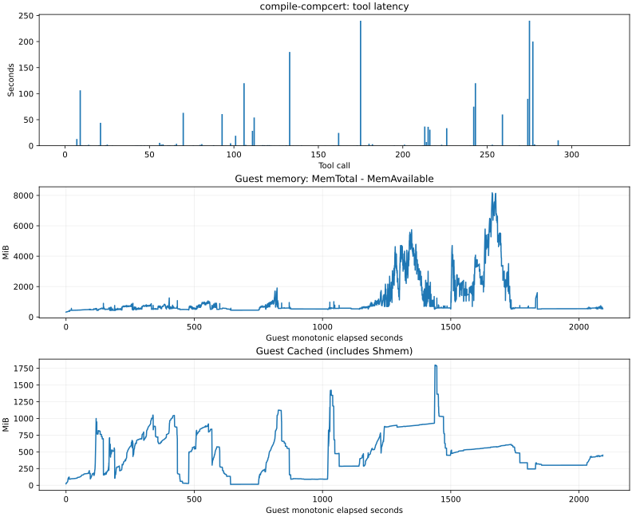
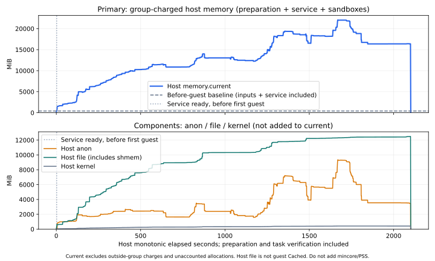
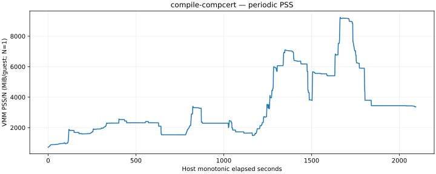

# CompCert 编译：实跑与严格验收（2026-11-09）

[五项总记录](EXTERNAL_FIVE_MEASUREMENT_20261109.md)。本页持续更新当前选定运行的原始回执、采集和验收；归档脚本仅只读这些数据。

完整原轨迹 318 步，脚本/辅助输入逐字节匹配，全部退出码严格匹配；2 vCPU / 32768 MiB，N=1。

|验收维度|实际状态|
|---|---|
|原控制器 / 原 native / 原外层|PASS / PASS / PASS|
|原 measurement_status|COMPLETE|
|保存的采集证据|齐全，三类采集器回执 PASS；终点身份、时点及统计复核通过|
|原检查器|PASS，实际退出 0，预期 0|
|primary 镜像字节身份|精确匹配|

实际 guest MemTotal 为 32892444 KiB，符合32 GiB配置扣除内核保留后的范围。初始固定Ubuntu镜像没有Python，使用静态C meminfo采样器；原生计数模式回执为 native_meminfo_only=True。九个后台任务均有完成等待且退出0；没有以发出后台命令代替任务完成。

## 原输入、命令与检查范围

固定上游：`results/agentenv/compile-compcert/runs/compile-compcert-20261025T060658Z-978362`，提交 `cbe767b2aa23ceb59875b1cb0a7a6141c749312a`。全部原命令保留在该目录的 `replay-inputs.json`，本次逐文件核对了下载保留的原脚本和辅助文件。精确 SHA256 见本页 [audit.json](evidence/external-five-20261109/compile-compcert/audit.json)。

实际 manifest：`sha256:f60236a4fe55bbb3c573210fe0fcd91551f4ee97c417453cd4985be074b35411`。primary manifest：`sha256:f60236a4fe55bbb3c573210fe0fcd91551f4ee97c417453cd4985be074b35411`。

原检查器命令：

```bash
set -e
export PATH=/usr/local/sbin:/usr/local/bin:/usr/sbin:/usr/bin:/sbin:/bin
cd /tmp/CompCert
./ccomp -version
printf 'int main(void) { return 6*7 == 42 ? 0 : 1; }\n' > /tmp/asbp_smoke.c
./ccomp /tmp/asbp_smoke.c -o /tmp/asbp_smoke
/tmp/asbp_smoke
```

范围：local artifact/smoke check only; recorded trajectory completion is independent of official benchmark correctness。未扩充成官方隐藏判题或完整上游测试验收。

功能证据：

|后台步骤|等待前步骤|屏障补等秒数|后台退出|
|---:|---:|---:|---:|
|86|88|6.959852|0|
|102|107|0.002080|0|
|132|134|0.002122|0|
|174|176|0.003384|0|
|241|245|61.543341|0|
|258|260|0.002344|0|
|273|276|0.000640|0|
|276|278|0.000605|0|
|299|304|48.499466|0|

表中是原显式sleep之外的屏障补等时间，使用guest单调时钟差值，不是后台整段构建耗时。接续动作只在完成标记出现后执行。

## 时间与逐工具结果

|时段|秒|
|---|---:|
|任务窗口|2097.039111|
|原工具累计|1975.020215|
|replay 调用|2092.583660|
|结果下载|0.332574|
|控制器整轮（含检查/清理）|2098.134194|
|外层整轮|2101.462799|
|cold-create 调用（含首次本地镜像转换；详见原事件）|2.740004|

任务窗口从 host 控制器入口、创建前开始，到原路径和结果下载返回结束；终点查询和原检查另列。guest/host 时钟不直接相减；无保存/恢复。原 sleep 和非零退出计入工具累计；后台完成等待另列，不将并发累计视为墙钟占比。

[全部逐工具起止、耗时、退出码 TSV](evidence/external-five-20261109/compile-compcert/tools.tsv)。预期非零退出：步骤 1→2, 步骤 2→1, 步骤 10→8, 步骤 22→2, 步骤 28→1, 步骤 56→8, 步骤 58→2, 步骤 61→127, 步骤 65→1, 步骤 66→1, 步骤 71→126, 步骤 87→2, 步骤 89→1, 步骤 103→2, 步骤 105→1, 步骤 107→127, 步骤 113→1, 步骤 114→1, 步骤 115→1, 步骤 117→8, 步骤 118→1, 步骤 136→2, 步骤 161→1, 步骤 166→1, 步骤 179→1, 步骤 191→1, 步骤 207→1, 步骤 228→1, 步骤 248→1, 步骤 260→1, 步骤 265→1, 步骤 293→2, 步骤 295→2。

## 内存物理量与曲线

终点 PSS/N：**3367.691 MiB/guest，N=1**；指定初始下层 mincore：**281.691 MiB**，共 3 个按 device:inode 去重的文件。覆盖不足标记：`False`。各物理量互有重叠，不相加或相减构造总内存/共享收益；upper 与其他未查对象保持未知。

|范围|current 观测峰值 MiB|current 样本中位数 MiB|file 观测峰值 MiB|file 样本中位数 MiB|
|---|---:|---:|---:|---:|
|full|22050.676|13041.387|12492.852|10317.797|
|task|22050.676|13041.387|12487.605|10317.801|
|replay|22050.676|13041.418|12479.762|10317.863|

创建前同组基线：current 408.277 MiB，file 299.473 MiB。cgroup 覆盖本轮准备、控制器及私有服务后代；不是全机内存。guest `MemTotal−MemAvailable` 观测峰值 8175.070 MiB，Cached 观测峰值 1797.656 MiB；Cached 含 Shmem，不重复相加。







终点查询发生在任务/下载结束后、原检查器之前。VMM 绑定 sandbox ID、PID/start_ticks/boot_id 与自有 cgroup；下层身份与初始清单一致。P1 前后同组 current/file、各文件身份及 resident bytes 见 audit.json 的 endpoint。

## 采集成本

|采集器|有效点数|观测秒数|CPU 秒|最大采样间隔秒|
|---|---:|---:|---:|---:|
|host|21000|2101.460260|6.311672|0.101693|
|guest|20888|2092.704161|1.888455|0.125598|
|vmm|20926|2094.206459|97.615509|0.105233|

|终点/设置查询|墙钟秒|CPU 秒|
|---|---:|---:|
|初始身份/监控设置|0.043531|0.008524|
|终点 PSS|0.038395|0.038190|
|终点 mincore|0.005346|0.005347|

guest 与 host 普通计数周期 0.1 秒，PSS 周期 1 秒；有效 PSS 点数与全部 VMM 扫描点数不同，见回执的 pss_samples。采样管理调用逐次计时保留；以上是观察到的采集 CPU/查询耗时，不解释为任务减速率。未新增采样开关对照。

周期PSS有效点数 2093，实际最大PSS间隔 1.006325 秒，观测峰值 9229.984 MiB/guest。上表vmm成本包含普通扫描和周期PSS，不猜测分摊成两份CPU。

另有 5 次只读进度查询，墙钟累计 0.453751 秒；父/子进程 CPU 在 audit.json 的 extra_management_queries 中单列，独立于原工具累计。

## 清理、限制与原始路径

自有 guest、私有服务、挂载/loop、relay 均已清理；本批源服务在全部任务结束后停止并移除。成功卷删除，失败现场与固定输入保留。全机存在外部 VMM 变化，自有源服务身份检查通过；本记录不声称独占主机或因果性能。

[批次清理回执](evidence/external-five-20261109/batch-cleanup.json)。原始路径保留如下，未搬移、覆盖或重新查询已删除 VMM 的历史 PSS/mincore：

```text
controller: /home/rashen/work/AgentSandboxBench/.artifacts/storage-isolated-service/20261109T125247Z-212698/external-workload
native: /home/rashen/work/AgentSandboxBench/.artifacts/storage-isolated-service/20261109T125247Z-212698
outer: /home/rashen/work/AgentSandboxBench/results/external-five/20261109T125247Z-212672
primary: /home/rashen/work/AgentSandboxWorkloadResults/results/agentenv/compile-compcert/runs/compile-compcert-20261025T060658Z-978362
```

[源文件 SHA256、完整身份/成本/基线与审计结果](evidence/external-five-20261109/compile-compcert/audit.json)。正式阅读入口位于 docs/records；原 results 内自动报告作为历史产物保留。

## 先前失败轮次（保留）

|原外层目录|完成动作数|原外层 / 控制器|具体失败|
|---|---:|---|---|
|`/home/rashen/work/AgentSandboxBench/results/external-five/20261106T110725Z-3501391`|318|FAIL / FAIL|原 apt 依赖安装失败，后续工具发生退出码不一致|

各次退出码差异、原错误、命中错误的原日志路径与 SHA256 均在本页 audit.json 的 previous_failed_attempts 中。纠正运行与失败轮次分开保存，未覆盖失败现场。
