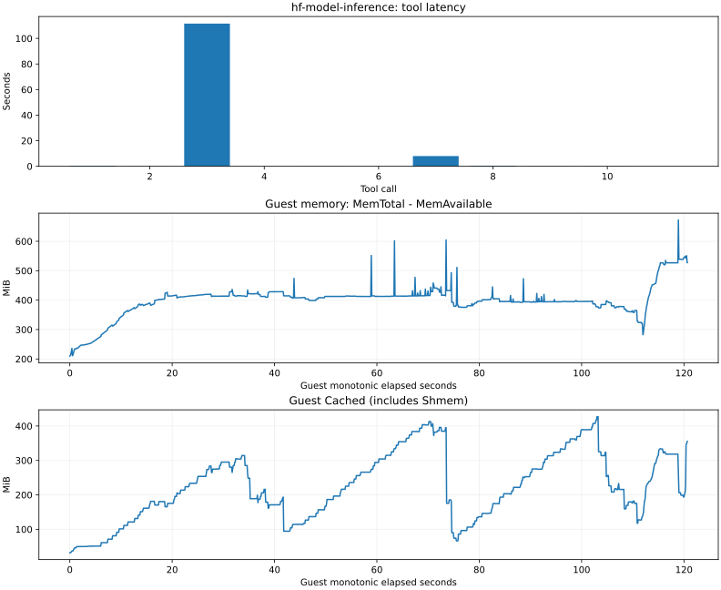
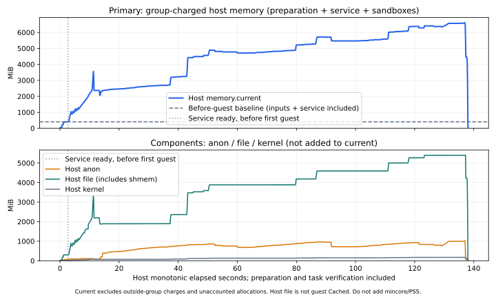
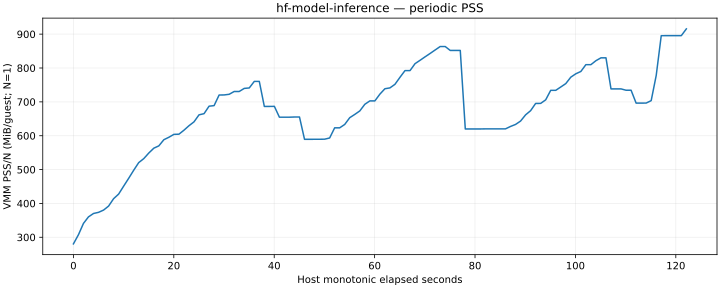

# HF 模型推理：实跑与严格验收（2026-11-09）

[五项总记录](EXTERNAL_FIVE_MEASUREMENT_20261109.md)。本页持续更新当前选定运行的原始回执、采集和验收；归档脚本仅只读这些数据。

完整原轨迹 11 步，脚本/辅助输入逐字节匹配，全部退出码严格匹配；2 vCPU / 8192 MiB，N=1。

|验收维度|实际状态|
|---|---|
|原控制器 / 原 native / 原外层|PASS / PASS / PASS|
|原 measurement_status|COMPLETE|
|保存的采集证据|齐全，三类采集器回执 PASS；终点身份、时点及统计复核通过|
|原检查器|PASS，实际退出 0，预期 0|
|primary 镜像字节身份|精确匹配|

**当前原生全链路 PASS。** 修复下载结果目录多拼 `input/` 的错误后，按用户授权完成一次完整纠正运行；11步、原检查器退出0、measurement_status=COMPLETE及清理均取得真实PASS回执。旧FAIL/INCOMPLETE回执保持原样，在先前失败轮次中保留。此页更新为当前运行的指标和曲线。

HF配置仅给该guest设置 `HF_HUB_DISABLE_XET=1`，固定模型版本及原命令不变。

## 原输入、命令与检查范围

固定上游：`results/agentenv/hf-model-inference/runs/hf-model-inference-20261025T054751Z-972885`，提交 `cbe767b2aa23ceb59875b1cb0a7a6141c749312a`。全部原命令保留在该目录的 `replay-inputs.json`，本次逐文件核对了下载保留的原脚本和辅助文件。精确 SHA256 见本页 [audit.json](evidence/external-five-20261109/hf-model-inference/audit.json)。

实际 manifest：`sha256:a88d98a849e81bf42754973d1ed58f5971eb76315bf94d2b19cabedd7d7af9c7`。primary manifest：`sha256:a88d98a849e81bf42754973d1ed58f5971eb76315bf94d2b19cabedd7d7af9c7`。

原检查器命令：

```bash
python3 - <<'PYCHECK'
import json,urllib.request
for text,want in [('I love this excellent movie','positive'),('This is a horrible terrible movie','negative')]:
 r=urllib.request.Request('http://127.0.0.1:5000/sentiment',data=json.dumps({'text':text}).encode(),headers={'Content-Type':'application/json'})
 with urllib.request.urlopen(r,timeout=30) as f:d=json.load(f)
 assert d['sentiment']==want,d
 assert abs(sum(d['confidence'].values())-1)<1e-4,d
print('local service functional checks passed')
PYCHECK
```

范围：local functional/artifact check; not the official benchmark hidden verifier。未扩充成官方隐藏判题或完整上游测试验收。

功能证据：

```json
{
  "sentiment_positive_negative": "ORIGINAL_CHECKER",
  "backend": "CPU"
}
```

## 时间与逐工具结果

|时段|秒|
|---|---:|
|任务窗口|134.100805|
|原工具累计|120.523696|
|replay 调用|120.589943|
|结果下载|0.035764|
|控制器整轮（含检查/清理）|134.502743|
|外层整轮|138.096762|
|cold-create 调用（含首次本地镜像转换；详见原事件）|11.452779|

任务窗口从 host 控制器入口、创建前开始，到原路径和结果下载返回结束；终点查询和原检查另列。guest/host 时钟不直接相减；无保存/恢复。原 sleep 和非零退出计入工具累计；后台完成等待另列，不将并发累计视为墙钟占比。

[全部逐工具起止、耗时、退出码 TSV](evidence/external-five-20261109/hf-model-inference/tools.tsv)。预期非零退出：步骤 4→64, 步骤 7→127, 步骤 8→1, 步骤 10→1。

## 内存物理量与曲线

终点 PSS/N：**927.129 MiB/guest，N=1**；指定初始下层 mincore：**1578.855 MiB**，共 6 个按 device:inode 去重的文件。覆盖不足标记：`False`。各物理量互有重叠，不相加或相减构造总内存/共享收益；upper 与其他未查对象保持未知。

|范围|current 观测峰值 MiB|current 样本中位数 MiB|file 观测峰值 MiB|file 样本中位数 MiB|
|---|---:|---:|---:|---:|
|full|6605.918|4810.234|5397.645|3882.922|
|task|6604.758|4810.750|5395.457|3882.930|
|replay|6603.266|4872.230|5395.383|3883.023|

创建前同组基线：current 401.621 MiB，file 299.488 MiB。cgroup 覆盖本轮准备、控制器及私有服务后代；不是全机内存。guest `MemTotal−MemAvailable` 观测峰值 672.457 MiB，Cached 观测峰值 427.227 MiB；Cached 含 Shmem，不重复相加。







终点查询发生在任务/下载结束后、原检查器之前。VMM 绑定 sandbox ID、PID/start_ticks/boot_id 与自有 cgroup；下层身份与初始清单一致。P1 前后同组 current/file、各文件身份及 resident bytes 见 audit.json 的 endpoint。

## 采集成本

|采集器|有效点数|观测秒数|CPU 秒|最大采样间隔秒|
|---|---:|---:|---:|---:|
|host|1381|138.094170|0.430509|0.100129|
|guest|1200|120.668669|0.819543|0.123772|
|vmm|1226|122.597452|2.114698|0.100151|

|终点/设置查询|墙钟秒|CPU 秒|
|---|---:|---:|
|初始身份/监控设置|0.033189|0.007012|
|终点 PSS|0.012242|0.012101|
|终点 mincore|0.034604|0.034606|

guest 与 host 普通计数周期 0.1 秒，PSS 周期 1 秒；有效 PSS 点数与全部 VMM 扫描点数不同，见回执的 pss_samples。采样管理调用逐次计时保留；以上是观察到的采集 CPU/查询耗时，不解释为任务减速率。未新增采样开关对照。

周期PSS有效点数 123，实际最大PSS间隔 1.001040 秒，观测峰值 915.641 MiB/guest。上表vmm成本包含普通扫描和周期PSS，不猜测分摊成两份CPU。

## 清理、限制与原始路径

自有 guest、私有服务、挂载/loop、relay 均已清理；本批源服务在全部任务结束后停止并移除。成功卷删除，失败现场与固定输入保留。全机存在外部 VMM 变化，自有源服务身份检查通过；本记录不声称独占主机或因果性能。

[批次清理回执](evidence/external-five-20261109/batch-cleanup.json)。原始路径保留如下，未搬移、覆盖或重新查询已删除 VMM 的历史 PSS/mincore：

```text
controller: /home/rashen/work/AgentSandboxBench/.artifacts/storage-isolated-service/20261109T141646Z-425349/external-workload
native: /home/rashen/work/AgentSandboxBench/.artifacts/storage-isolated-service/20261109T141646Z-425349
outer: /home/rashen/work/AgentSandboxBench/results/external-five/20261109T141645Z-425320
primary: /home/rashen/work/AgentSandboxWorkloadResults/results/agentenv/hf-model-inference/runs/hf-model-inference-20261025T054751Z-972885
```

[源文件 SHA256、完整身份/成本/基线与审计结果](evidence/external-five-20261109/hf-model-inference/audit.json)。正式阅读入口位于 docs/records；原 results 内自动报告作为历史产物保留。

## 先前失败轮次（保留）

|原外层目录|完成动作数|原外层 / 控制器|具体失败|
|---|---:|---|---|
|`/home/rashen/work/AgentSandboxBench/results/external-five/20261106T094817Z-3463200`|2|FAIL / FAIL|原模型下载超时；TimeoutExpired，完整轨迹未结束|
|`/home/rashen/work/AgentSandboxBench/results/external-five/20261109T054724Z-2626258`|11|FAIL / FAIL|下载结果目录多拼input/，原检查器已退出0，但原生回执FAIL|

各次退出码差异、原错误、命中错误的原日志路径与 SHA256 均在本页 audit.json 的 previous_failed_attempts 中。纠正运行与失败轮次分开保存，未覆盖失败现场。
