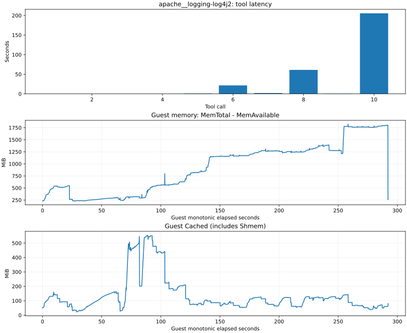
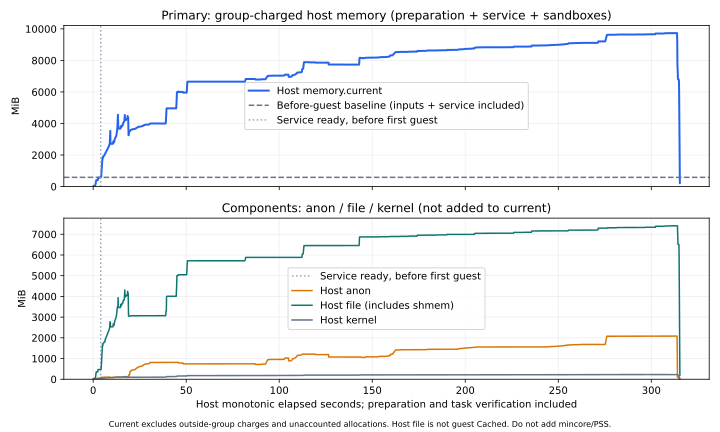
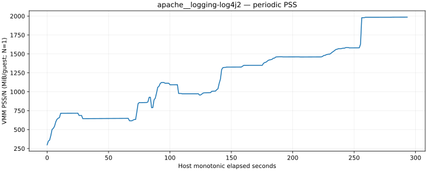

# Log4j2：实跑与严格验收（2026-11-09）

[五项总记录](EXTERNAL_FIVE_MEASUREMENT_20261109.md)。本页持续更新当前选定运行的原始回执、采集和验收；归档脚本仅只读这些数据。

完整原轨迹 10 步，脚本/辅助输入逐字节匹配，全部退出码严格匹配；2 vCPU / 8192 MiB，N=1。

|验收维度|实际状态|
|---|---|
|原控制器 / 原 native / 原外层|PASS / PASS / PASS|
|原 measurement_status|COMPLETE|
|保存的采集证据|齐全，三类采集器回执 PASS；终点身份、时点及统计复核通过|
|原检查器|FAIL，实际退出 141，预期 141|
|primary 镜像字节身份|不相同：显式固定重建输入|

**原检查器退出 141 仍为 FAIL。** 原命令跳过测试；Maven BUILD SUCCESS 和五条 class 路径已核对。固定基础镜像、原 Containerfile 与源码提交重建是上游文档规定的方法，新 OCI 摘要明确单列，不能声称恢复了 primary 的原始镜像字节。

固定源码提交：`204d8251295dfa816b9b28d8d9cfaebab500f415`。固定基础镜像：`ghcr.io/jetbrains-research/envbench-jvm@sha256:e6dbfbdc8f67e420b029440eb54988514bf7d9eca005ce5bad530a823414d388`。原 Containerfile SHA256：`ec21d8411ff88efa4a1df1fb53846192ab32383b9e99c4d2c1c8adece52133ff`。新旧身份和显式来源回执的 SHA256 均在 audit.json 中保留。

## 原输入、命令与检查范围

固定上游：`results/agentenv/apache__logging-log4j2/runs/apache__logging-log4j2-20261025T055131Z-974499`，提交 `cbe767b2aa23ceb59875b1cb0a7a6141c749312a`。全部原命令保留在该目录的 `replay-inputs.json`，本次逐文件核对了下载保留的原脚本和辅助文件。精确 SHA256 见本页 [audit.json](evidence/external-five-20261109/apache__logging-log4j2/audit.json)。

实际 manifest：`sha256:16af38e068d0de35a0bda38b675e2c57a6fc91c67e17edd1f267e44963ca1fc6`。primary manifest：`sha256:62640316ab1c15923796d7731028e8bdc594c8cbce2243d5d1db522912b5a990`。

原检查器命令：

```bash
cd /data/project/apache__logging-log4j2@204d8251295dfa816b9b28d8d9cfaebab500f415 && test -d log4j-api/target/classes && test -d log4j-core/target/classes && find . -path '*/target/classes/*.class' | head -5
```

范围：local artifact/smoke check only; recorded trajectory completion is independent of official benchmark correctness。未扩充成官方隐藏判题或完整上游测试验收。

功能证据：

```json
{
  "compilation": "PASS",
  "tests": "SKIPPED_BY_ORIGINAL_COMMAND",
  "checker": "REPORTED_SEPARATELY"
}
```

## 时间与逐工具结果

|时段|秒|
|---|---:|
|任务窗口|309.470096|
|原工具累计|292.015340|
|replay 调用|292.106133|
|结果下载|0.082075|
|控制器整轮（含检查/清理）|310.103883|
|外层整轮|315.353241|
|cold-create 调用（含首次本地镜像转换；详见原事件）|15.712950|

任务窗口从 host 控制器入口、创建前开始，到原路径和结果下载返回结束；终点查询和原检查另列。guest/host 时钟不直接相减；无保存/恢复。原 sleep 和非零退出计入工具累计；后台完成等待另列，不将并发累计视为墙钟占比。

[全部逐工具起止、耗时、退出码 TSV](evidence/external-five-20261109/apache__logging-log4j2/tools.tsv)。预期非零退出：步骤 6→1。

## 内存物理量与曲线

终点 PSS/N：**1986.125 MiB/guest，N=1**；指定初始下层 mincore：**2568.371 MiB**，共 11 个按 device:inode 去重的文件。覆盖不足标记：`False`。各物理量互有重叠，不相加或相减构造总内存/共享收益；upper 与其他未查对象保持未知。

|范围|current 观测峰值 MiB|current 样本中位数 MiB|file 观测峰值 MiB|file 样本中位数 MiB|
|---|---:|---:|---:|---:|
|full|9732.812|8210.219|7408.719|6879.309|
|task|9727.996|8235.191|7405.816|6884.229|
|replay|9727.371|8542.688|7404.512|6897.543|

创建前同组基线：current 585.488 MiB，file 478.621 MiB。cgroup 覆盖本轮准备、控制器及私有服务后代；不是全机内存。guest `MemTotal−MemAvailable` 观测峰值 1823.270 MiB，Cached 观测峰值 554.926 MiB；Cached 含 Shmem，不重复相加。







终点查询发生在任务/下载结束后、原检查器之前。VMM 绑定 sandbox ID、PID/start_ticks/boot_id 与自有 cgroup；下层身份与初始清单一致。P1 前后同组 current/file、各文件身份及 resident bytes 见 audit.json 的 endpoint。

## 采集成本

|采集器|有效点数|观测秒数|CPU 秒|最大采样间隔秒|
|---|---:|---:|---:|---:|
|host|3153|315.350439|0.984607|0.100153|
|guest|2909|292.264922|1.267961|0.132174|
|vmm|2936|293.734444|6.630486|0.100155|

|终点/设置查询|墙钟秒|CPU 秒|
|---|---:|---:|
|初始身份/监控设置|0.036996|0.010523|
|终点 PSS|0.033036|0.032647|
|终点 mincore|0.059912|0.059863|

guest 与 host 普通计数周期 0.1 秒，PSS 周期 1 秒；有效 PSS 点数与全部 VMM 扫描点数不同，见回执的 pss_samples。采样管理调用逐次计时保留；以上是观察到的采集 CPU/查询耗时，不解释为任务减速率。未新增采样开关对照。

周期PSS有效点数 294，实际最大PSS间隔 1.001205 秒，观测峰值 1986.125 MiB/guest。上表vmm成本包含普通扫描和周期PSS，不猜测分摊成两份CPU。

## 清理、限制与原始路径

自有 guest、私有服务、挂载/loop、relay 均已清理；本批源服务在全部任务结束后停止并移除。成功卷删除，失败现场与固定输入保留。全机存在外部 VMM 变化，自有源服务身份检查通过；本记录不声称独占主机或因果性能。

[批次清理回执](evidence/external-five-20261109/batch-cleanup.json)。原始路径保留如下，未搬移、覆盖或重新查询已删除 VMM 的历史 PSS/mincore：

```text
controller: /home/rashen/work/AgentSandboxBench/.artifacts/storage-isolated-service/20261109T124211Z-195058/external-workload
native: /home/rashen/work/AgentSandboxBench/.artifacts/storage-isolated-service/20261109T124211Z-195058
outer: /home/rashen/work/AgentSandboxBench/results/external-five/20261109T124210Z-195034
primary: /home/rashen/work/AgentSandboxWorkloadResults/results/agentenv/apache__logging-log4j2/runs/apache__logging-log4j2-20261025T055131Z-974499
```

[源文件 SHA256、完整身份/成本/基线与审计结果](evidence/external-five-20261109/apache__logging-log4j2/audit.json)。正式阅读入口位于 docs/records；原 results 内自动报告作为历史产物保留。
