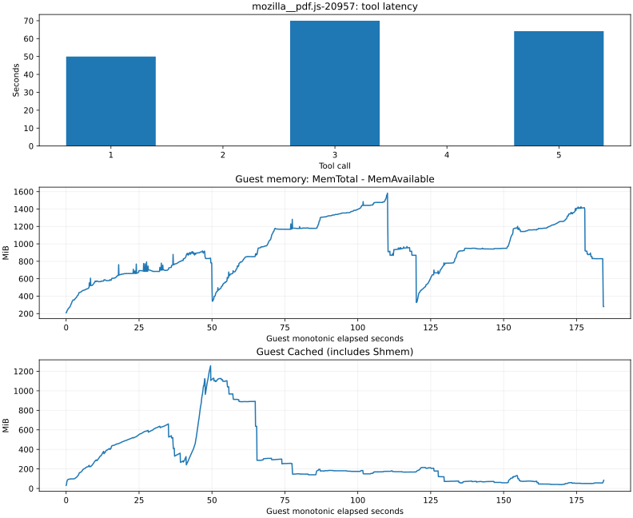
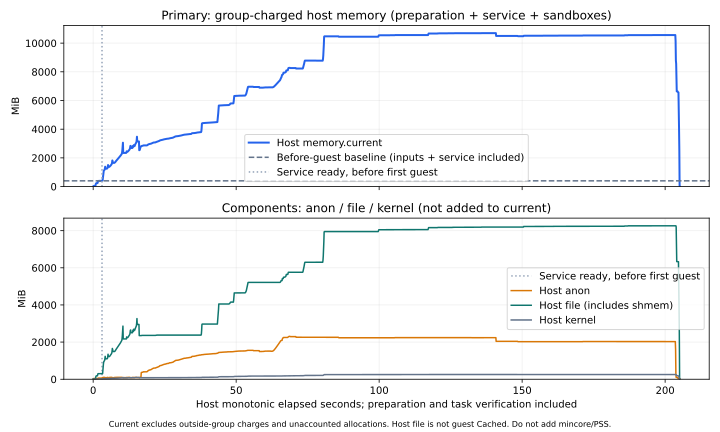
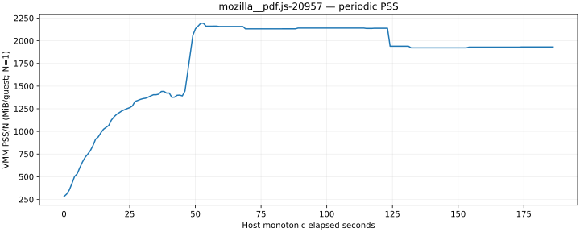

# PDF.js #20957：实跑与严格验收（2026-11-09）

[五项总记录](EXTERNAL_FIVE_MEASUREMENT_20261109.md)。本页持续更新当前选定运行的原始回执、采集和验收；归档脚本仅只读这些数据。

完整原轨迹 5 步，脚本/辅助输入逐字节匹配，全部退出码严格匹配；2 vCPU / 8192 MiB，N=1。

|验收维度|实际状态|
|---|---|
|原控制器 / 原 native / 原外层|PASS / PASS / PASS|
|原 measurement_status|COMPLETE|
|保存的采集证据|齐全，三类采集器回执 PASS；终点身份、时点及统计复核通过|
|原检查器|PASS，实际退出 0，预期 0|
|primary 镜像字节身份|精确匹配|

## 原输入、命令与检查范围

固定上游：`results/agentenv/mozilla__pdf.js-20957/runs/mozilla__pdf.js-20957-20261025T070430Z-983806`，提交 `cbe767b2aa23ceb59875b1cb0a7a6141c749312a`。全部原命令保留在该目录的 `replay-inputs.json`，本次逐文件核对了下载保留的原脚本和辅助文件。精确 SHA256 见本页 [audit.json](evidence/external-five-20261109/mozilla__pdf.js-20957/audit.json)。

实际 manifest：`sha256:c56d745e25d78c0bcec99846906f933d714ee8bc7ae82d3ddf2a8153aba5aaca`。primary manifest：`sha256:c56d745e25d78c0bcec99846906f933d714ee8bc7ae82d3ddf2a8153aba5aaca`。

原检查器命令：

```bash
test -d /testbed/node_modules && test -d /testbed/build
```

范围：local functional/artifact check; not the official benchmark hidden verifier。未扩充成官方隐藏判题或完整上游测试验收。

功能证据：

```json
{
  "cli_runs": 2,
  "specs_each": 1127,
  "failures_each": 0,
  "pending_each": 56
}
```

## 时间与逐工具结果

|时段|秒|
|---|---:|
|任务窗口|200.225824|
|原工具累计|184.101446|
|replay 调用|184.188280|
|结果下载|0.056189|
|控制器整轮（含检查/清理）|200.883925|
|外层整轮|205.157040|
|cold-create 调用（含首次本地镜像转换；详见原事件）|13.731900|

任务窗口从 host 控制器入口、创建前开始，到原路径和结果下载返回结束；终点查询和原检查另列。guest/host 时钟不直接相减；无保存/恢复。原 sleep 和非零退出计入工具累计；后台完成等待另列，不将并发累计视为墙钟占比。

[全部逐工具起止、耗时、退出码 TSV](evidence/external-five-20261109/mozilla__pdf.js-20957/tools.tsv)。预期非零退出：无。

## 内存物理量与曲线

终点 PSS/N：**1931.742 MiB/guest，N=1**；指定初始下层 mincore：**2048.020 MiB**，共 9 个按 device:inode 去重的文件。覆盖不足标记：`False`。各物理量互有重叠，不相加或相减构造总内存/共享收益；upper 与其他未查对象保持未知。

|范围|current 观测峰值 MiB|current 样本中位数 MiB|file 观测峰值 MiB|file 样本中位数 MiB|
|---|---:|---:|---:|---:|
|full|10699.383|10482.297|8261.199|8048.480|
|task|10699.383|10500.766|8260.227|8048.488|
|replay|10699.383|10513.418|8258.891|8054.926|

创建前同组基线：current 400.105 MiB，file 299.469 MiB。cgroup 覆盖本轮准备、控制器及私有服务后代；不是全机内存。guest `MemTotal−MemAvailable` 观测峰值 1582.695 MiB，Cached 观测峰值 1256.254 MiB；Cached 含 Shmem，不重复相加。







终点查询发生在任务/下载结束后、原检查器之前。VMM 绑定 sandbox ID、PID/start_ticks/boot_id 与自有 cgroup；下层身份与初始清单一致。P1 前后同组 current/file、各文件身份及 resident bytes 见 audit.json 的 endpoint。

## 采集成本

|采集器|有效点数|观测秒数|CPU 秒|最大采样间隔秒|
|---|---:|---:|---:|---:|
|host|2051|205.153451|0.690881|0.100154|
|guest|1832|184.327022|0.889338|0.128576|
|vmm|1864|186.415956|6.375225|0.100248|

|终点/设置查询|墙钟秒|CPU 秒|
|---|---:|---:|
|初始身份/监控设置|0.038120|0.008880|
|终点 PSS|0.037709|0.037158|
|终点 mincore|0.053985|0.053986|

guest 与 host 普通计数周期 0.1 秒，PSS 周期 1 秒；有效 PSS 点数与全部 VMM 扫描点数不同，见回执的 pss_samples。采样管理调用逐次计时保留；以上是观察到的采集 CPU/查询耗时，不解释为任务减速率。未新增采样开关对照。

周期PSS有效点数 187，实际最大PSS间隔 1.000946 秒，观测峰值 2193.020 MiB/guest。上表vmm成本包含普通扫描和周期PSS，不猜测分摊成两份CPU。

## 清理、限制与原始路径

自有 guest、私有服务、挂载/loop、relay 均已清理；本批源服务在全部任务结束后停止并移除。成功卷删除，失败现场与固定输入保留。全机存在外部 VMM 变化，自有源服务身份检查通过；本记录不声称独占主机或因果性能。

[批次清理回执](evidence/external-five-20261109/batch-cleanup.json)。原始路径保留如下，未搬移、覆盖或重新查询已删除 VMM 的历史 PSS/mincore：

```text
controller: /home/rashen/work/AgentSandboxBench/.artifacts/storage-isolated-service/20261109T124921Z-209770/external-workload
native: /home/rashen/work/AgentSandboxBench/.artifacts/storage-isolated-service/20261109T124921Z-209770
outer: /home/rashen/work/AgentSandboxBench/results/external-five/20261109T124920Z-209746
primary: /home/rashen/work/AgentSandboxWorkloadResults/results/agentenv/mozilla__pdf.js-20957/runs/mozilla__pdf.js-20957-20261025T070430Z-983806
```

[源文件 SHA256、完整身份/成本/基线与审计结果](evidence/external-five-20261109/mozilla__pdf.js-20957/audit.json)。正式阅读入口位于 docs/records；原 results 内自动报告作为历史产物保留。

## 先前失败轮次（保留）

|原外层目录|完成动作数|原外层 / 控制器|具体失败|
|---|---:|---|---|
|`/home/rashen/work/AgentSandboxBench/results/external-five/20261106T092140Z-3447868`|5|FAIL / FAIL|原安装/下载连接中断，CLI 检查未满足|
|`/home/rashen/work/AgentSandboxBench/results/external-five/20261106T110207Z-3499119`|5|FAIL / FAIL|原安装/下载连接中断，CLI 检查未满足|

各次退出码差异、原错误、命中错误的原日志路径与 SHA256 均在本页 audit.json 的 previous_failed_attempts 中。纠正运行与失败轮次分开保存，未覆盖失败现场。
