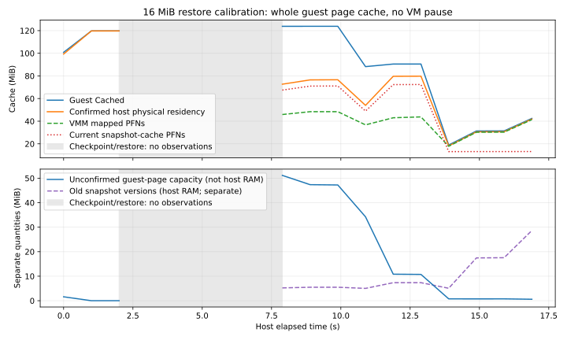
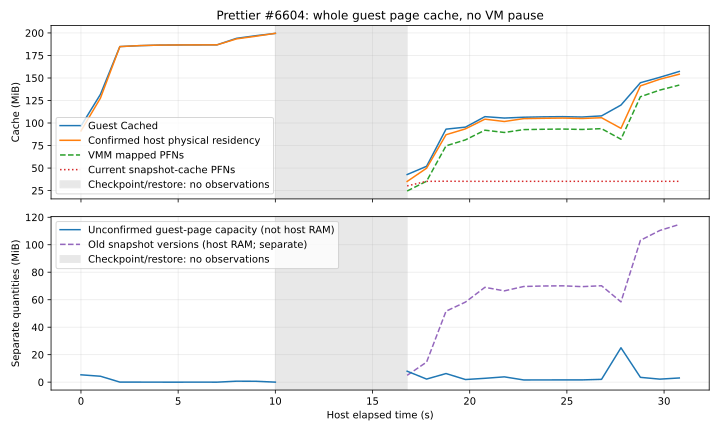
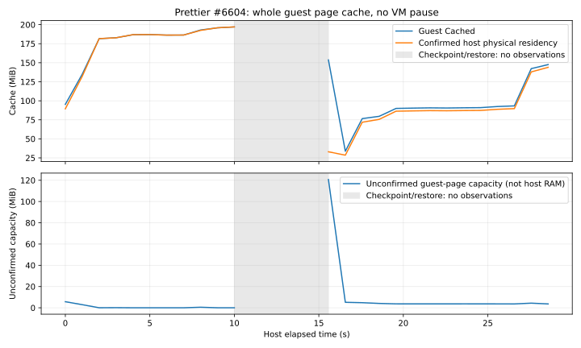
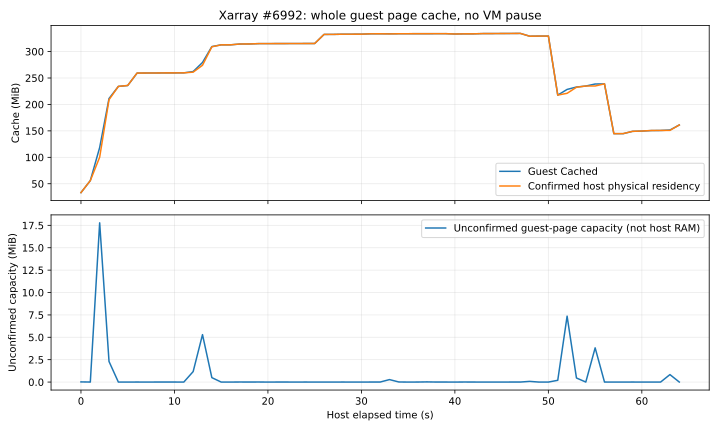
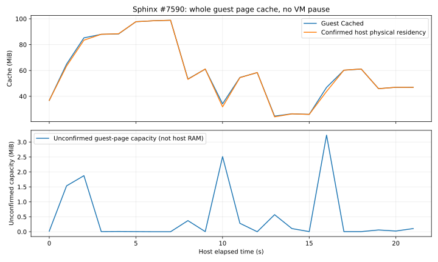
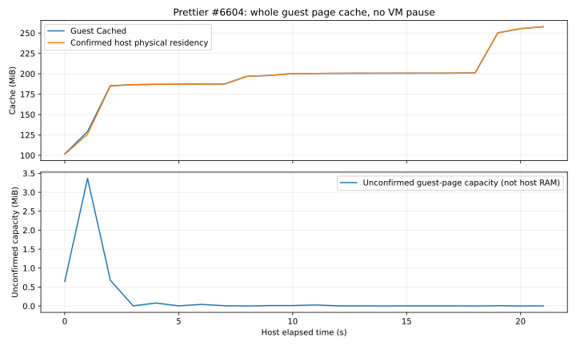
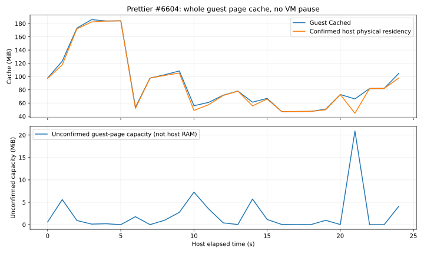
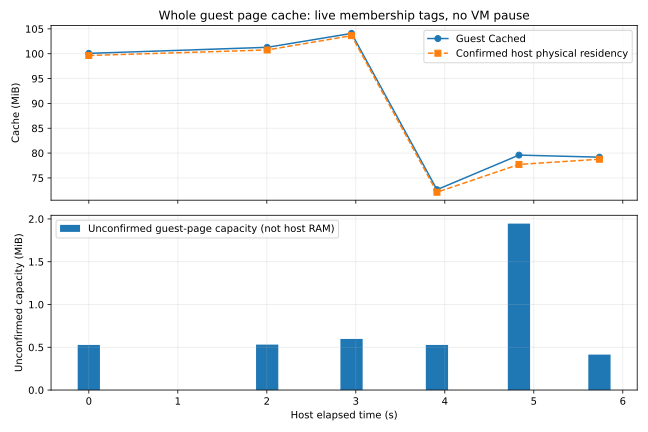
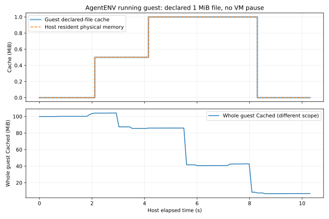

# 文件缓存物理页：测量方法与校准

## 当前结论：不暂停测量阶段验证完成（2026-10-17）

现行方案的含义、版本、覆盖、成本、未知量及使用范围统一见[阶段验收说明](CACHE_MEASUREMENT_VALIDATION.md)。最新四来源已完成[一次真实双分支](PROVIDER_REAL_PAIR.md)：14/13点、11对重叠观测、108次查询和独立物理去重通过；首对相加190.074 MiB、去重155.531 MiB。三任务、完整恢复和旧三层结果各按原来源保留，不重跑，不追加相近校准。下方记录按当时版本理解，尤其最早provider槽位校准的未知量不代表后续GET_DATA增强结果。

## 2026-10-15：一次槽位缓冲短校准完成，驻留与内容归属分开

已为一个私有、非池化内存设备实现最小槽位元数据，并固定源码、补丁、构建和实际二进制哈希。仅做一次短恢复校准，保存前3点、恢复后10点；文件内容、原进程连续性、原三层独立计数及清理通过。后端完成3,853次完整读取，但10点均无跨配对读取保持有效的内容记录，因此新增可归属缓冲物理量为0，正值归属实跑仍未观察到。

只读PFN查询确认3.9375 MiB完整缓冲页驻留，另有23张混合边界页，内容归属未知并单列；不将其加入当前guest缓存并集，也不把未知guest容量换算为缓冲量。首个恢复点guest逻辑90.781 MiB、原三层物理并集136.371 MiB、未知guest容量2.191 MiB，新增观测保持这两个物理/未知结果。2项Rust和53项Python检查通过，两份各3文件报告一致；135份本次raw及1,082份已有任务证据哈希保持。原服务和12个VMM保持，临时资源已释放。

准备阶段一次配置字段缺失失败未创建服务或VM，原FAIL和校验备份保留。成本、正常checkpoint暂停、曲线及完整边界见[本轮报告](PROVIDER_SLOT_CALIBRATION.md)。本阶段停止追加实验，已有完整任务与双分支直接复用；后续先离线核对只读设备协议能否提供更长的可靠内容归属时间。


## 2026-10-15：后端缓冲归属与原始层后未知量离线核查

36个已有恢复点的剩余未知容量已按页身份、VMM页表与两层后端PFN重新分类，与原三层未知数逐点一致。真实双分支21点均为新增/复用或页表变化；单次恢复15点中，无后端PFN每点最多7页，后端PFN变化最多2页。现有较大未知量主要处于采样变化类别，不把它全部归为后端缓冲。

后端源码有可复用的用户态槽位缓冲，但已有接口/记录没有可验证的内容归属与有效期。缓冲可以属于已确认guest页的额外副本，因此不能用未知容量换算缓冲物理量，也不能记为零；默认4 MiB/设备是源码参数推导，非实际驻留。当前二进制与源码对应关系需在新探针前固定，未修改服务或启动VM。具体证据、曲线、两项检查、报告兼容性及后续最小校准条件见[离线核查](PROVIDER_CACHE_AUDIT.md)。既有三层并集与跨guest去重结果保持。

## 2026-10-15：真实Prettier双分支的逻辑缓存与物理共享通过

共同11步保存一次、两个原始10步后缀在一次复验中通过，实际31动作；计数原子写入修复已在真实恢复路径通过，原官方失败保持。两个guest分别11/10点，8对有效重叠观测；首对逻辑缓存88.699/93.031 MiB，各自三层物理并集122.961/124.016 MiB，相加246.977 MiB、跨guest去重176.738 MiB，相同PFN重复计数扣除70.238 MiB。未知guest容量1.566/5.125 MiB单列，不当host物理量。

两个新报告及入口报告4文件一致，610份本次raw与旧448/472份任务文件哈希保持；成功资源回收、原服务及12个VMM保持。完整路径、成本、正常保存暂停、磁盘零块稀疏化、曲线及范围见[真实双分支报告](PRETTIER_REAL_PAIR_CACHE.md)与[脱敏证据](evidence/prettier-real-pair-cache-20261015.json)。不扩展为provider缓冲、压缩/多层或稳定性能已覆盖，本阶段停止追加运行。

## 2026-10-15：原始层统一配置及真实Prettier恢复通过

显式原始层配置与一次Prettier第24步恢复通过，保存前10点、恢复后15点。恢复首点guest逻辑164.805 MiB，VMM与直接后端并集76.309 MiB，三层当前物理并集226.609 MiB；额外确认20,184个guest页，未知guest容量88.438→9.594 MiB。不同层副本与旧版本分别处理，未知量不当host内存。正常checkpoint暂停、接口耗时和采样空缺分开记录。

一次真实双分支尝试在进程计数空读处被检查器中止，缺少有效联合物理采样和两个后缀的最终检查，保留FAIL。已修复原子计数写入与等待分配时停止，仅完成本地回归，不追加轮次。82项本地检查、单次两份13文件报告一致性及本次472份/旧448份任务文件哈希通过；资源清理及失败卷完整备份通过，当前约49.09 GiB，下一次24 GiB启动前仍须超过50 GiB。

详细结果、成本、曲线、失败边界及后续计划见[Prettier原始层报告](PRETTIER_RAW_LAYER_CACHE.md)与[脱敏证据](evidence/prettier-raw-layer-cache-20261015.json)。原始层成功不扩大为压缩/多层、provider缓冲或真实双分支已通过。

## 2026-10-15：后续未知容量、原始内存层与双guest验证已完成

已完成25个已有恢复点的未知容量分类；一次新增短校准取得原始内存层驻留PFN，首点未知容量36.535→2.004 MiB；双guest共享和分支内容隔离短验证通过，每guest13点、6对有效重叠采样。三个层级的当前副本按物理页去重，旧快照副本单列。原完整任务没有重复，原Prettier448份任务文件哈希保持。

详细方法、首次双guest失败及修正、22 GiB卷预算、56项检查、成本、曲线和结论边界独立记录在[后续测量报告](CACHE_RESIDENCY_FOLLOWUP.md)，脱敏数据见[证据](evidence/cache-residency-followup-20261015.json)。provider内部缓冲、压缩/多层快照和真实任务双实例仍未覆盖。当前约48.14 GiB空闲，不满足24 GiB卷启动条件；本阶段已收尾，不再加轮数。

## 2026-10-15：快照内存后端驻留校准与一次Prettier恢复验证完成

已补上直接`File`后端的驻留物理页读取，并完成一次成功短校准和一次Prettier第24步恢复验证。两个成功运行均不额外暂停、不由采集器读取文件内容、不锁定任务文件、不清空缓存；正常checkpoint暂停单列。原三任务单路径和此前25点恢复结果直接保留，没有重跑它们。旧120.703 MiB仍是当时未确认的guest容量，不能用本轮数据补算成旧运行的host内存。

### 地址、页身份与去重

复核当前`AgentENV/src/sandbox/firecracker/instance.rs:load_snapshot_file`及`sandbox.rs`调用，实际恢复后端是OverlayBD提供的ublk设备，Firecracker以私有文件映射使用它。先用成功的KVM RAM注册把guest页换成host虚拟地址，再用该时刻实际VMA（虚拟内存映射区段）的起点和文件偏移换到后端页：`host = slot.host + guest_pfn*4096 - slot.guest`，`offset = VMA.offset + host - VMA.start`。本次低地址RAM为0–3 GiB，高地址RAM从4 GiB开始；高地址区对应后端3 GiB以后的内容，不能把guest物理地址直接当后端偏移。实际区段、设备/inode身份、偏移及每点前后映射均保留本机。

新增`snapshot_cache_residency.py`复用现有KVM关联、maps解析、guest元数据和VMM pagemap读取。在独立的、没有访问内容的后端映射上调用`mincore`查询驻留，通过本机Linux 6.19.9+的`filemap_get_entry`返回值取得PFN（物理页号），用BTF内核类型信息和`vmemmap_base`换算。主机小文件检查确认查询后PTE仍不驻留，之后显式读取所得PFN与查询一致。该实现只验证过本机x86-64内核，不声称适用于任意内核。

每个采样点核对guest缓存页前后生命周期、三次VMM页表项和两次后端PFN。物理量按集合分别报告VMM、对应当前缓存的后端、交集及并集。稳定的文件PTE须与后端PFN相符；私有匿名PTE是当前写时复制页，其旧后端页另列，不加入当前并集；无PTE时只补入能确认身份且两次稳定的后端页。无后端PFN、匿名重映射、换出、身份或映射变化均保留未知guest容量，不当作零host RAM，也不与确认量相加称实测总量。

查询通过同步BPF表传递结果，没有逐事件输出流；缺失的查询结果归入未知。Prettier的30次查询共请求821,990页次，缺失内核结果为0，文件PTE与后端PFN冲突为0。guest元数据表从启动覆盖普通文件和shmem缓存，4 KiB基页；重复加入、遗漏移出和越界计数均0。恢复首点有63条记录在导出期间失效，按原规则记为未知，并非遗漏事件；host页表变化最多80页、无换出。采集器逐点保存变化后的映射，不沿用已变为匿名映射的旧文件偏移。

**覆盖范围是VMM映射与直接File后端的页缓存。** 下层OverlayBD编码/压缩文件和provider内部缓冲没有逐页归属，不把它们的整文件驻留替代当前缓存物理量。未知量仍有上述范围及采样变化的影响；本轮完成的是新增确认路径及下界测量，不是把全部guest容量转换成完整host占用。跨沙箱物理页去重尚未运行。

### 16 MiB短校准

2 CPU/4096 MiB、诊断guest内核`6.1.175-asb-cache-v3`保持。明确的校准负载建立并读取16 MiB文件一次，保存后删除父VM并恢复，依次等待、读取前4 MiB、修改接着的4 MiB。采集期间不预读其余文件页。校准文件内容、原进程PID/启动时间/boot ID保持及恢复检查通过；文件页回收和重建正常保留，不要求16 MiB始终驻留。

取得保存前3点、恢复后10点。恢复后采集就绪首点guest Cached 123.805 MiB；VMM确认45.898 MiB、当前后端67.469 MiB、交集40.672 MiB、并集72.695 MiB，补入6,860页，即26.797 MiB；另有51.137 MiB guest容量未确认，旧后端5.227 MiB单列。全段最多补入36.641 MiB。指定文件在等待阶段已确认少量无VMM映射的后端页，读取阶段重新出现映射；修改阶段的1,024页全部观察到私有匿名映射，对应旧后端页另列。逐页核对见本地`calibration-audit.json`，不能将全guest曲线误称为16 MiB文件本身的曲线。



首轮真实校准`20261015T074602Z-1914805`为FAIL：原实现要求RAM始终保持原文件映射，且负载检查要求文件PTE始终全部存在。已在首个失败边界停止，保留原FAIL；按实际匿名重映射和文件页回收修正后只复验这条短路径一次。AgentENV确实启用guest DAMON回收与空闲页报告，但没有单独追踪首轮映射变化的触发调用，不把其原因写成已经验证。失败卷完整压缩备份约1.869 GiB，解压大小及SHA-256核对通过后按持续授权定向回收24 GiB源卷，日志、配置、raw和完整备份保留。

成功运行`.artifacts/storage-isolated-service/20261015T074940Z-1918184/guest-cache`；两份最终报告`.artifacts/cache-backing-20261015/calibration-report-final-{a,b}`，3文件逐字节一致，采集目录98文件哈希保持。host采集线程累计2.604 CPU秒，guest发布累计0.0416 CPU秒；恢复后每点配对读取平均264.337 ms、最大384.868 ms。校准早于新增BPF进程CPU记录，未取得该独立进程的CPU值，不补估计。临时VM、snapshot、服务、卷及loop均回收，原资源保持。

### 一次Prettier第24步恢复

沿用统一配置`platform-prettier6604-checkpoint-live-cache.json`，只新增本次测量验证。一次29步在第24步保存、删除父VM并恢复执行最后5步；动作哈希、顺序、退出码、边界文件和进度、关键输出、最终补丁及独立检查通过，进程计数79→120且身份保持。原官方0通过/2失败保持，不将平台通过当作模型修复成功。

| 阶段 | 点数 | guest Cached（MiB） | host确认物理并集（MiB） | 未知guest容量最大值（MiB） |
| --- | ---: | ---: | ---: | ---: |
| 保存前 | 11 | 96.664–199.516 | 91.230–199.574 | 5.355 |
| 恢复后 | 15 | 42.789–157.254 | 35.137–154.203 | 25.023 |

恢复后采集就绪首点：VMM 24.500 MiB、当前后端30.168 MiB、交集19.531 MiB、并集35.137 MiB，补入2,723页，即10.637 MiB；未知guest容量7.973 MiB，旧后端4.969 MiB单列。全段后端最多补入14.445 MiB；另列的旧后端最高114.750 MiB，这部分可能位于已经复用的guest物理地址，不能称为当前guest文件缓存。原始`host_confirmed_cache_bytes`继续保存原VMM下界，新增`host_current_union_bytes`供新报告绘图，原数据不覆盖。



目标间隔1秒，停止旧采集至新采集就绪6.225秒，两端采样相距6.780秒；曲线保留空缺。启动内核查询时guest继续运行，因此首点不是恢复接口刚返回的瞬间，不能用它与旧首点153.648 MiB的差值解释缓存收益。后端和VMM同样是在一个短区间内读取，图中峰值是观测值，不是原子时刻的精确峰值。

工具执行合计13.709秒，含保存恢复的冻结重放23.882秒，控制器46.735秒；冷启动CLI 12.926秒、checkpoint CLI 2.738秒、restore CLI 0.163秒、官方评测调用3.535秒。这些阶段有包含关系，CLI用时不等于纯暂停用时。host采集线程累计7.167 CPU秒，独立BPF进程另计0.480 CPU秒，guest发布累计0.112 CPU秒；全部26点配对读取平均308.180 ms、恢复后15点平均445.104 ms、最大618.305 ms，guest位图复制持锁最长53.843 µs。匿名发布缓冲仍16.008 MiB；没有本轮开关采集对照，不给任务减速百分比，不沿用旧开销值。

### 复算、清理及后续范围

独立标量计数器`audit_snapshot_cache.py`逐页重算两次成功运行的VMM/后端交集、并集、旧版本和未知量，与在线数组计数完全一致。两份Prettier统一报告13文件逐字节一致，448份任务文件重新核对哈希保持；其中采集目录148文件。校准和采集相关44项检查通过（后端4、持续采集15、隔离存储25），7个Python文件编译检查和两个bash入口语法检查通过。没有重新运行未修改的内核构建或三任务完整实验。

统一运行`.artifacts/platform-tasks/20261015T075227Z-1920937`，storage为`20261015T075346Z-1921832`，报告`.artifacts/cache-backing-20261015/prettier-report-{a,b}`。总核对结果`.artifacts/cache-backing-20261015/verification.json`，独立资源收尾为同目录`closeout.json`；脱敏计数、曲线、时延、配置和代码哈希见[本轮证据](evidence/snapshot-cache-residency-20261015.json)。PFN、设备地址、原始日志和运行时镜像只留本机。

两次成功运行均使用24 GiB固定卷，启动前可用空间分别约50.77/50.74 GiB，均超过50 GiB；卷内观测占用峰值约5.177/6.416 GiB，host观测空闲最低26.770/26.736 GiB。成功VM、snapshot、采集器、私有服务、挂载和loop均已回收；Prettier只读RAM输入缓存已释放。原服务及12个VMM保持，收尾约50.66 GiB可用。失败备份保留，没有删除其他工作负载，没有暂存、提交或推送。

本阶段结束：直接后端驻留、物理页去重、写时复制分项、短校准及一次真实恢复验证均已交付。剩余未知容量和下层后端逐页归属明确保留；是否继续追踪下层后端、双实例/分支或其他任务恢复，另按后续范围安排，不追加本轮轮数或性能门槛。

复现入口（前两条会启动新实验，查看已有结果优先用后两条）：

```bash
bash scripts/validate-isolated-storage.sh --snapshot-cache-calibration \
  --diagnostic-guest-kernel .artifacts/agentenv-cache-kernel-20261015-v3/vmlinux.bin
bash scripts/use-platform.sh run configs/platform-prettier6604-checkpoint-live-cache.json
python3 -B scripts/audit_snapshot_cache.py \
  .artifacts/storage-isolated-service/20261015T075346Z-1921832/prettier6604 \
  --output .artifacts/snapshot-cache-audit-recheck.json
bash scripts/use-platform.sh report .artifacts/platform-tasks/20261015T075227Z-1920937 \
  --output .artifacts/snapshot-cache-report-recheck
```

## 2026-10-15：第24步恢复后的不暂停采样通过，文件后端驻留需单列

统一入口`platform-prettier6604-checkpoint-live-cache.json`一次完成29步，在第24步后保存、删除父VM、恢复并只执行后5步。原动作哈希、顺序、退出码、源码、补丁、关键输出和独立检查通过；保存边界的文件与24步进度相同，guest探针PID、启动时间和boot ID保持，计数82→104。官方原结果仍0通过/2失败，不将平台恢复成功当作模型修复成功。

采集在保存前结束，恢复时重新抓取KVM RAM布局并关联新的VMM；host进程身份不同，guest启动身份相同。保存前11点、恢复后14点，约1秒间隔。采集本身不暂停VM；正常checkpoint自身的暂停单列。停止旧采集至新采集就绪约4.758秒，两端采样时刻相距5.568秒，图中保留空缺，不插值。

| 阶段 | 配对点 | guest Cached范围（MiB） | host已确认驻留范围（MiB） | 未确认guest页容量最大值（MiB） |
| --- | --- | --- | --- | --- |
| 保存前 | 11 | 95.273–197.047 | 89.457–197.047 | 5.723 |
| 恢复后 | 14 | 33.723–153.648 | 28.539–143.957 | 120.703 |



**恢复后须区分“VMM页表未映射”和“host完全没有物理占用”。** 实际Firecracker日志确认`/snapshot/load`采用`File`后端，路径为本次`/dev/ublkb105`；本机代码为`AgentENV/src/sandbox/firecracker/instance.rs:load_snapshot_file`及其`sandbox.rs`调用。恢复后首点guest Cached为153.648 MiB，host已确认驻留32.984 MiB，30,878页没有驻留PTE（页表项），另有22页变化或未确认，合计120.703 MiB容量。后续未映射页降到930页，但不能根据它们未映射就断言快照后端没有缓存。

当前host数字是VMM RAM映射中已确认PFN（物理页号）的去重下界。恢复后缺少映射的页，其快照内存后端可能仍有host驻留缓存，这部分本轮未测。报告将未映射、换出及变化页容量全部纳入未确认曲线；容量不是已测host物理量，不能与确认量相加作为实测总量。旧raw字段`host_nonresident_pages`在此仅指采样时VMM PTE不驻留。保存前不存在此类未映射页；此前三任务单路径也没有这个现象，原结果保留。

本轮结论分为三部分：**已验证**的是完整恢复续跑、采样重新关联及VMM映射中物理页的确认计数；**尚未测量**的是这些guest缓存页对应的快照内存后端驻留；**待验证的解释**是后端可能保留了尚无VMM映射的物理页。120.703 MiB不能直接写成漏计的host内存，也不是host物理占用上限。这里讨论的是保存guest内存状态的快照后端，不是任务rootfs镜像层的普通文件缓存，两者不能替代。

本轮工具执行合计14.281秒，含保存/恢复的冻结重放22.884秒，控制器34.882秒；冷启动CLI 3.428秒、checkpoint CLI 3.126秒、restore CLI 0.172秒、官方评测调用3.151秒。CLI用时不是纯VMM暂停或远端持久化用时，阶段存在包含关系，不能相加当端到端时间。host采集线程累计1.887 CPU秒，guest 50次发布累计0.095 CPU秒，配对读取平均104.161 ms；位图复制持锁最长43.850 µs。重复加入、遗漏移出、地址越界、失效记录均0。恢复后host映射变化最多16页，按原规则归入未确认；无换出。未做本轮恢复的开关采集对照，不套用旧Prettier百分比。

实际运行：

```bash
bash scripts/use-platform.sh run configs/platform-prettier6604-checkpoint-live-cache.json
bash scripts/use-platform.sh report .artifacts/platform-tasks/20261015T071419Z-1896169 --output .artifacts/<新的报告目录>
```

统一运行`.artifacts/platform-tasks/20261015T071419Z-1896169`；raw为`.artifacts/storage-isolated-service/20261015T071537Z-1897070/prettier6604`。初次自动报告只将变化页计入未确认曲线；发现文件恢复场景后直接修正离线报告，没有重跑沙箱。应使用`.artifacts/cache-restore-20261015/report-a`或同版本重新生成的报告，原运行旁`report-correction.json`记录替代关系。两份修正报告13文件逐字节一致，408份raw哈希保持；52项相关离线检查通过。脱敏数据见[本轮证据](evidence/prettier-live-cache-restore-20261015.json)。

按已有授权删除7份旧失败镜像，共12.461 GiB；保留日志、配置、原FAIL、三个任务输入、受保留标记保护的checkpoint及最新有效证据，清单见`.artifacts/cache-restore-20261015/cleanup.json`。本次24 GiB固定卷内观测峰值6.390 GiB，运行期间host空闲最低28.706 GiB，结束约52.6 GiB。VM、snapshot、采集器、私有服务、挂载、loop及RAM缓存均回收，原服务和12个原VMM保持。

本阶段结束：恢复后的继续采样、身份重新关联和分段报告已完成。旧raw没有后端驻留/PFN数据，相关VM和设备也已回收，不能事后补算。下一步先核对地址换算并完成一次短恢复校准，在资源存活时读取对应后端的驻留物理页，与VMM已映射物理页去重；不通过采集器预读或触发所有缺页强行补齐读数。校准通过后，再以一次Prettier第24步恢复验证新增测量，不重跑三任务完整单路径。具体步骤、空间预算和结束条件统一见[下一步实验计划](../EXPERIMENT_PLAN.md#下一步恢复后快照内存后端的物理驻留测量)。新方法的双实例/分支采集及稳定开销对照仍是后续工作。


## 2026-10-15：三任务完整单路径的不暂停缓存测量完成

Xarray已通过统一入口运行一次完整35步，并取得65个不暂停的guest缓存/host物理驻留配对点。与此前Prettier、Sphinx的真实结果一起，三任务的新方法已有完整单路径、正确性、持续曲线、阶段时延和可复算报告。以下选取每任务一个成功采集运行，共99个动作、109个配对点；没有重跑前两项任务，没有修改平台代码或重新运行未变化的单元测试。

### 三任务同范围数据

共同条件为AgentENV、2 CPU/4096 MiB、诊断guest内核`6.1.175-asb-cache-v3`及优化后的常驻采集器，物理配对目标间隔1秒。guest逻辑量取`Cached`，host量取这批页对应的已确认驻留物理页并去重；未确认页容量另列，不当作零或已测host RAM。数值均是对应采样的观测峰值，不是精确瞬时峰值。

| 任务 | 动作/配对点 | guest Cached峰值（MiB） | host确认驻留峰值（MiB） | 未确认容量最大值（MiB） |
| --- | ---: | ---: | ---: | ---: |
| Prettier #6604 | 29 / 22 | 257.648 | 257.648 | 3.363 |
| Sphinx #7590 | 35 / 22 | 98.852 | 98.871 | 3.230 |
| Xarray #6992 | 35 / 65 | 334.254 | 334.262 | 17.777 |

| 任务 | guest工具用时之和（秒） | 冻结重放（秒） | 控制器生命周期（秒） | 原官方测试结果 |
| --- | ---: | ---: | ---: | --- |
| Prettier #6604 | 12.340 | 14.599 | 26.190 | 0通过 / 2失败 |
| Sphinx #7590 | 10.532 | 13.650 | 26.722 | 24通过 / 1失败 |
| Xarray #6992 | 33.407 | 36.319 | 70.835 | 945通过 / 12失败 |

不同任务的动作、镜像内容、测试数量及缓存状态不同，以上只说明采集覆盖和实际观测，不据此判断缓存容量对时延的因果。host驻留峰值可能略高于邻近Cached，读取时刻和内核计数更新不同，不能用差值认定共享收益。当前各沙箱内去重，未做这三任务同时运行后的跨VM物理页并集。Prettier的单对采集影响已在下文报告；Sphinx和Xarray没有新的开关对照，不套用前者百分比。

### Xarray结果、曲线与时延

本轮65个配对点覆盖约64秒，guest Cached为33.230–334.254 MiB，host确认驻留为33.285–334.262 MiB；变化期间的未确认guest页容量0–17.777 MiB单列。最大采样间隔1.00014秒，全程不暂停，不主动预读或锁定任务文件。元数据和邻近Cached差−500至+188 KiB，原文计数保留，不强行调整相等。重复加入、缺失移出、越界、失效记录，以及host映射变化、非驻留和换出记录均0。



原35步的动作哈希、顺序、SIGPIPE诊断策略、关键输出、最终源码/补丁及独立检查通过。诊断PASS、严格FAIL分别保留；没有修改原失败探索或扩大允许差异。最终源码与参考文件哈希一致，最终patch逐字节一致。原957项任务测试945通过/12失败/0跳过，完整结果与此前独立评测参考相同，平台没有把模型修复失败改成任务成功。

冷启动调用4.048秒，独立任务评测调用22.241秒，其他总时延见上表；重放和评测是生命周期中的阶段，不能再相加当作总时间。本轮不包含checkpoint/restore，旧时延不混入。host采集线程累计6.296 CPU秒，guest共130次发布累计0.406 CPU秒；配对读取平均127.736 ms、最大160.250 ms，位图复制持锁最长57.928 µs。这些是局部采集成本，不等于任务整体减速。

### 证据、复算和清理

```bash
bash scripts/use-platform.sh run configs/platform-xarray6992-live-cache.json
bash scripts/use-platform.sh report .artifacts/platform-tasks/20261015T065544Z-1881793 --output .artifacts/<新的报告目录>
```

已有结果优先使用第二条离线复算。统一运行目录`.artifacts/platform-tasks/20261015T065544Z-1881793`；原始数据`.artifacts/storage-isolated-service/20261015T065740Z-1883035/python-backbone`；自动报告`.artifacts/platform-tasks/report-20261015T065544Z-1881793`；复算目录`.artifacts/live-cache-xarray-20261015/report-recount`。208份新采集raw哈希核对，原逐页计数器独立复算通过，统一报告12文件逐字节相同。本轮无代码变化，复用此前12项平台分发和25项隔离存储测试证据，未声称重新执行。完整三任务选定运行、配置、代码哈希和Xarray结果见[脱敏证据](evidence/xarray-live-cache-unified-20261015.json)。

本次VM、私有服务、8 GiB卷、loop及只读RAM缓存均回收，卷内观测占用峰值0.941 GiB；主机约40.2 GiB可用。原共享服务及12个原VMM身份保持，host内核和原服务的guest内核未更换。物理页号、运行时镜像和原始日志只留本机。

本阶段三任务单路径测量完成，不追加相近运行。下一阶段核对同一诊断内核下的新checkpoint边界和容量，再补保存/恢复后继续采样；正常checkpoint自身的暂停单列，测量不额外暂停。旧内核snapshot不作为新元数据表的恢复证据，多实例的新方法后续单列。

## 2026-10-15：统一入口接入与Sphinx完整任务通过

不暂停采集现已接入`use-platform check/run/report`，通过显式配置`live_cache_kernel`选择诊断guest内核。复用现有生命周期、任务控制器及原正确性检查，统一报告保留内存/CPU/I/O和阶段时延，增加`live-cache/`配对数据与曲线。原配置和旧暂停分析保持，各方法分开报告。

| 任务 | 新方法的实际覆盖 |
| --- | --- |
| Prettier #6604 | 已有29步实跑复用；本轮统一配置/分发及报告通过，11文件两次复算一致，没有重复启动沙箱 |
| Sphinx #7590 | 本轮通过统一入口真实完成35步及22个配对点，12文件报告独立复算一致 |
| Xarray #6992 | 本节为此前Sphinx阶段记录；其后完整35步及65点已通过，见本页首节 |

### Sphinx数据与任务结果

固定2 CPU/4096 MiB，诊断内核仍为`6.1.175-asb-cache-v3`，采集器仍为上一节优化后的版本。约1秒间隔的22个配对点覆盖约21秒，全程不暂停，不主动预读或锁定任务文件。指标范围、按host物理页去重和未知量规则与Prettier相同。

| 指标 | 实测值 |
| --- | --- |
| guest Cached | 24.688–98.852 MiB |
| 同范围host确认驻留 | 24.125–98.871 MiB |
| 未确认guest页容量 | 0–3.230 MiB，单列，不是已测host RAM |
| guest工具用时之和 | 10.532秒 |
| 控制器视角冻结重放 | 13.650秒 |
| 控制器总生命周期 | 26.722秒 |
| 冷启动调用 / 独立评测调用 | 3.026 / 4.201秒 |
| host采集线程 / guest发布累计CPU | 1.252 / 0.057 CPU秒 |
| 每点配对读取 | 平均80.187 ms，最大111.927 ms |



这是采样中的观测范围，两个量在相邻时刻读取；host峰值比邻近Cached略高，元数据与Cached相差0–156 KiB，没有强行改成相等。不能用差值认定共享收益。重复加入、缺失移出、地址越界、失效记录及host映射变化、非驻留、换出记录均0，位图复制持锁最长54.710 µs。本任务没有开关采集对照；上述局部成本不等于任务减速，不能套用Prettier的单对百分比。

35步的动作哈希、顺序、原退出码策略、关键输出、最终源码/补丁及独立检查通过。沿用已批准的`sphinx-pipeline-v2`诊断策略，只允许原两处精确管道规则；诊断PASS、严格FAIL分别保留，没有扩大允许差异。官方25项测试仍24通过/1失败、0跳过，失败项`tests/test_domain_cpp.py::test_expressions`；官方结果及最终补丁哈希与原参考完全一致。平台完成重放和测量，不代表原模型完整修复任务。

### 统一报告及证据

运行命令：

```bash
bash scripts/use-platform.sh run configs/platform-sphinx7590-live-cache.json
bash scripts/use-platform.sh report .artifacts/platform-tasks/20261015T053014Z-1859773 --output .artifacts/<新的报告目录>
```

真实统一运行目录`.artifacts/platform-tasks/20261015T053014Z-1859773`，原始数据`.artifacts/storage-isolated-service/20261015T053138Z-1860659/python-backbone`，自动报告`.artifacts/platform-tasks/report-20261015T053014Z-1859773`，复算目录`.artifacts/live-cache-unified-20261015/sphinx-report-recount`。全部12文件逐字节一致，79份新采集raw哈希核对；12项平台配置/分发测试、25项隔离存储测试通过。三份CLI离线检查保存在`.artifacts/live-cache-unified-20261015/*-check.json`。代码、配置和报告来源见[脱敏证据](evidence/sphinx-live-cache-unified-20261015.json)。

Prettier用本机新的报告引用文件关联此前成功storage结果，再由相同统一报告入口生成`prettier-report-b`和`-c`，11文件一致。引用文件明确标记只复用历史运行；不是本轮新VM证据。最初引用文件的工作流格式错误及同名输出拒绝记录保留，改用新目录后通过，未修改原数据或重跑任务。

本次VM、服务、8 GiB卷、loop和只读RAM缓存均已回收；卷内观测占用峰值0.686 GiB，主机约40.5 GiB可用。原共享服务及12个VMM身份保持。当时下一步为Xarray，现已完成，见本页首节；恢复和多实例的新方法另行扩展，不重复本轮Sphinx或旧暂停实验。

## 2026-10-15：完整Prettier冻结路径的不暂停缓存曲线通过

本轮完成当前阶段目标：用常驻采集器运行Prettier #6604原29步冻结工具路径，全程不暂停，自动生成整guest逻辑page cache与对应host确认驻留物理量的曲线。原动作哈希、执行顺序、预期退出码、关键输出、最终补丁和独立检查通过。原模型任务的官方测试仍0通过/2失败，与原参考结果一致；平台保持任务结果，不把原修复失败改为成功。

### 优化版：计数保持，采集成本下降

在相同内核、资源、任务及1秒采样周期下，已完成采集器`array-accounting-batched-export-v2`的完整29步与一次先关后开的对照。内核仍为`6.1.175-asb-cache-v3`，本轮只修改采集代码，没有重编内核。动作哈希、顺序、退出码、最终补丁、独立检查和原官方0通过/2失败的结果均保持。

优化版22点覆盖约21秒，guest Cached为101.828–257.648 MiB，host确认驻留为101.320–257.648 MiB；两者观测峰值均257.648 MiB。未确认guest页容量0–3.363 MiB另列。全程不暂停，不预读或锁定任务文件；匿名采集缓冲容量仍16.008 MiB。重复加入、缺失移出、地址越界、失效记录及host映射变化、非驻留、换出记录均0。缓存快速变化部分仍按同样规则保留未知量。



优化只针对上一轮已观察到的重复工作：guest启动时完整检查匿名页排除，逐次发布保留头部格式和错误计数检查；host每份元数据只完整解析一次，使用现有NumPy做整数数组配对；连续匿名地址批量读取，所有覆盖页的host映射仍在读取前后核对。二进制raw格式不变，原逐页计数器保留作独立复算，没有放宽页身份、去重、驻留或未知量判断。

旧25个测量点逐项得到完全相同的计数；同一组raw的一次离线解析/计数CPU用时0.570→0.054秒，下降约90.6%。这是同输入的代码成本比较，不能当作完整任务加速比例。在线局部成本如下，因实际缓存变化不同，按点/次报告观察值：

| 采集自身成本 | 优化前 | 优化后 |
| --- | ---: | ---: |
| host线程累计CPU用时 | 5.399秒/25点 | 1.979秒/22点 |
| host每点平均CPU用时 | 215.98 ms | 89.95 ms |
| guest发布累计CPU用时 | 0.744秒/50次 | 0.099秒/44次 |
| guest每次发布平均CPU用时 | 14.88 ms | 2.24 ms |
| 每点配对读取平均用时 | 268.41 ms | 120.52 ms |

优化版开启、关闭新增采集各一次，原有轻量监控及内核元数据表均开启，2 CPU/4096 MiB、固定镜像及原冻结runner保持：

| 时延范围 | 开启新增采集（秒） | 关闭新增采集（秒） | 本轮差值 |
| --- | ---: | ---: | ---: |
| guest工具用时之和 | 12.340 | 12.139 | +1.65% |
| 控制器视角冻结重放 | 14.599 | 14.460 | +0.96% |
| 控制器总生命周期 | 26.190 | 25.415 | +3.05% |

本轮实际顺序是先关后开，与首轮相反；采集器实现也发生变化，因此两轮不能合并当作顺序平衡的重复。当前单对差值较小，功能及局部成本下降已验证；不将它称为统计稳定开销，也不声称已分离内核元数据表本身的成本。两次缓存曲线和峰值不同，未做缓存容量或冷热状态控制，不能把峰值差直接归因于采集优化。

开启组`.artifacts/storage-isolated-service/20261015T050604Z-1849409/prettier6604`，关闭组`20261015T050357Z-1845589/prettier6604`。包装入口为`.artifacts/live-prettier-cache-20261015-v2-on`及`-v2-control`；新79份采集raw哈希核对通过，原逐页计数器复算后JSON/SVG/PNG逐字节一致，复算目录`.artifacts/live-prettier-cache-report-20261015-v2-recount`。离线旧数据核对及代码哈希在`.artifacts/live-cache-optimization-20261015/offline-accounting.json`；本轮15项相关测试通过，25项未改动隔离存储测试证据复用。公开[优化证据](evidence/live-prettier-cache-optimized-20261015.json)只含计数、范围及哈希，物理页号保留本机。

两次本次VM、服务、8 GiB临时卷、loop及RAM缓存均回收；卷内观测峰值约0.728/0.662 GiB，磁盘恢复约40.55 GiB可用。原共享服务及12个原VMM保持。本轮结束，不追加相近验证；后续将新采集接入统一配置入口及其他任务。以下保留优化前首轮数据和方法，当前入口默认使用优化版。

### 首轮数据（优化前）

| 指标 | 实测值及范围 |
| --- | --- |
| guest逻辑page cache | `/proc/meminfo Cached`，47.078–185.891 MiB |
| 对应host确认驻留物理量 | 44.605–184.125 MiB，按不同host物理页号去重 |
| 未确认guest页容量 | 0–20.902 MiB，读取区间内变化的页，另列而不算作零 |
| 配对采样 | 25点、约24秒，目标间隔1秒，最大相邻间隔1.00014秒 |
| 原始配对数据 | 38,785,072 bytes；含两次guest页表元数据及host页表条目 |
| 元数据错误 | 重复加入、缺失移出、地址越界及导出期间失效记录均0 |
| 位图复制持锁 | 本轮观测最长46.794 µs，没有暂停VM |



以上峰值均为对应采样中的观测峰值，不是精确瞬时峰值。guest Cached和host物理量在邻近时刻读取，两个峰值不一定出现在同一点，不能用峰值差推断共享收益。缓存变化最快的一点有20.902 MiB未确认页容量；图中host曲线仅表示已确认部分，不将这段缺口隐藏或补成准确总量。元数据页数与邻近Cached计数差为−3.371至+0.133 MiB；变化期间的采样时间差及分CPU计数批量更新尚未单独分离，不据此认定漏记。本轮未观测到host非驻留、换出或映射变化，未强制测试这些情况。

### 首轮常驻发布及开销（优化前）

复用前节已通过的`6.1.175-asb-cache-v3`诊断guest内核和实际KVM RAM定位，不重新构建内核。`guest_cache_exporter.py`在私有匿名内存中等待host请求，读内核缓存表、Cached并发布；奇偶序号标记更新中/完成。`live_task_cache.py`直接访问本次VMM的独立控制页，请求前后两次发布，核对页身份并读取host映射；不在每个测量点启动新进程或调用CLI。采集文件放在任务目录之外，不修改冻结动作。

匿名发布缓冲区容量16.008 MiB，预先填充并锁定，仅用于稳定采集元数据；不锁定或预读任务文件。这是采集器数据结构容量，不是测得的任务page cache或host额外物理驻留量。诊断内核的16.25 MiB静态表容量另见前节，不与缓存物理量混加。

host每点从首次请求至配对计数平均268.410 ms、最大460.295 ms，未含随后raw写盘；整个host采集线程累计5.399 CPU秒，guest共发布50次，发布部分累计0.744 CPU秒。这些是局部采集成本，不直接代表任务减速比例。

为得到第一份实际用时比较，在同一诊断内核、同一固定镜像、2 CPU/4096 MiB、同一29步及原100 ms轻量监控下，先开新增采集，再关新增采集，各运行一次：

| 时延范围 | 开启新增采集（秒） | 关闭新增采集（秒） | 本轮差值 |
| --- | ---: | ---: | ---: |
| guest工具用时之和 | 14.042 | 12.127 | +15.79% |
| 控制器视角冻结重放 | 16.721 | 14.419 | +15.97% |
| 控制器总生命周期 | 28.759 | 24.256 | +18.56% |

开启组冷启动调用2.746秒、原官方评测调用3.903秒；五个冻结段的控制器用时分别1.044、0.871、1.494、4.980、8.315秒。完整阶段数据以ns保存，见[脱敏结果](evidence/live-prettier-cache-20261015.json)。本轮未做checkpoint/restore，不将旧数据混入本次时延。

两组的最终源码文件哈希、最终补丁、冻结runner和原任务结果一致。**这是先开后关的一对观察，未消除顺序和缓存冷热差异，不是稳定开销估计，不能把差值全部归因于采集。** 内核元数据表在两组都启用，不能据此估计该内核表本身的影响。当前已知采集CPU和解析成本较明显，下一步先用保存的raw优化重复解析及页表读取，再验证优化版本；不为得到更小百分比重复当前长测，也不新增验收阈值。

### 首轮证据和复现（优化前）

开启组：`.artifacts/storage-isolated-service/20261015T040303Z-1830135/prettier6604`。关闭组：`.artifacts/storage-isolated-service/20261015T040613Z-1834645/prettier6604`。包装入口结果：`.artifacts/live-prettier-cache-20261015-first`及`-control`。离线复算目录：`.artifacts/live-prettier-cache-report-20261015-recount`，与开启组report的JSON/SVG/PNG逐字节一致；33项相关测试通过。物理页号只在本机raw中保留，公开JSON只有计数、哈希和明确范围。

```bash
python3 -B scripts/run_live_prettier_cache.py --output .artifacts/<新的任务目录> --kernel .artifacts/agentenv-cache-kernel-20261015-v3/vmlinux.bin
python3 -B scripts/report_live_task_cache.py .artifacts/storage-isolated-service/20261015T040303Z-1830135/prettier6604 --output .artifacts/<新的报告目录>
```

第一条为真实实验，前提见[使用说明](../USAGE.md)；已有结果优先用第二条离线复算。关闭组在第一条加`--cache-sampling off`，保留原轻量监控。默认监控的guest内存、CPU/I/O和host RSS/PSS报告仍在各storage目录`report/`，不是这里host缓存物理量的替代项。

两次均成功回收本次服务、VM、8 GiB临时卷、loop和只读RAM缓存；卷内观测峰值分别约0.698/0.662 GiB，磁盘回到约40.62 GiB可用。原共享服务及12个原VMM保持。完整任务曲线已完成，下一阶段优化采集成本；其他任务、恢复后和多实例的新方法覆盖另行扩展。

## 2026-10-15：整guest缓存元数据与host物理占用通过

本轮已从指定文件校准推进到整guest缓存：在AgentENV临时诊断guest中，从启动起维护普通文件和shmem（tmpfs/共享内存）缓存页表，再把这批guest页映射到host物理页。6组配对读数、普通文件和tmpfs的包含检查、匿名页排除检查均通过，全程未暂停VM。下方原内核1 MiB指定文件结果保留为前一阶段校准，不再代表当前覆盖上限。

### 两个量及未确认部分

- **guest逻辑page cache**：guest的`/proc/meminfo Cached`，原单位KiB，归档换算成bytes、图表用MiB。包含shmem；不把Shmem再相加，也不包含Buffers和SwapCached。
- **对应的host物理占用**：对元数据中同一生命周期的guest缓存页，利用实际KVM RAM布局找到host页表，核对多次读取的映射，并按不同的驻留host物理页号去重，乘4096 bytes。它是读取区间内已确认部分，不是整VMM RSS/PSS，也不是host镜像层缓存。
- **未确认guest页容量**：读取期间新增、移出或身份变化使当前页无法与host驻留量配对的部分，按页数×4096单列。它不是已测得的host RAM，不算作零，也不直接加到物理量冒充准确总量。采样不暂停，两个量在相邻时刻读取；不声称原子瞬时快照。

| 观测点 | guest Cached（MiB） | host确认驻留（MiB） | 未确认guest页容量（MiB） |
| --- | ---: | ---: | ---: |
| 1 | 100.070 | 99.641 | 0.527 |
| 2 | 101.285 | 100.754 | 0.531 |
| 3 | 104.090 | 103.633 | 0.598 |
| 4 | 72.641 | 72.117 | 0.527 |
| 5 | 79.594 | 77.715 | 1.945 |
| 6 | 79.176 | 78.762 | 0.414 |



本轮guest Cached范围72.64–104.09 MiB，host确认量72.12–103.63 MiB，未确认容量0.41–1.95 MiB；没有把二者差值称为共享收益。元数据计数与邻近Cached差0–144 KiB，读取期间变化及内核分CPU计数批量更新都可能贡献，尚未分离各自影响。本次无host映射变化、非驻留或换出记录；一次原有guest页在后一次读取时已移出或换身份，未按旧身份继续计数。guest心跳77→309。

### 实现、构建和测量成本

`patches/agentenv-cache-metadata/linux-6.1.175.patch`在文件缓存和shmem加入、移出、替换、迁移路径维护独立位图与页身份标记，不修改`struct page`布局，不以LRU回收队列代替Cached范围。表从guest启动起启用，覆盖采集前已有页；排除块设备缓存和仅swap缓存。页号复用时生成新身份；重复加入、缺失移出、越界计数非零会使解析失败，本次均0。只读root接口为`/proc/asb_pagecache`，每次先复制位图，再输出标记；读取期间消失的记录单列。

本次固定4 KiB页、4 GiB guest，标记表可表示8 GiB物理地址范围以覆盖RAM空洞；静态容量16.25 MiB，是数据结构容量，**不是实测host额外驻留量**。未强制测试页迁移、交换或大页；诊断构建关闭透明大页，后续能力另测。位图复制使用短自旋锁，即短时间内保护共享表，未调用暂停VM接口。本次持锁最长37.58 µs；12次接口读取平均1.468 ms、最大3.793 ms，不含Python进程启动、控制调用及完整任务影响。

构建采用官方Linux 6.1.175源码和固定Firecracker CI配置（提交`9fbc98e4dc05d03e1f00902ba4bb796395465099`）生成`6.1.175-asb-cache-v3`。这不是原AgentENV厂商二进制及配置的精确重建。显式开启元数据表、内嵌配置、DAMON_RECLAIM、命令行virtio-MMIO设备、PCI/MSI，关闭透明大页；guest保留原AgentENV启动策略。补丁、源码、配置和ELF哈希见[脱敏证据](evidence/whole-guest-cache-20261015.json)。只向私有临时服务复制内核，不更换host内核或原服务的guest内核。

host采集在`scripts/run_guest_cache_metadata.py`中复用KVM RAM定位，`kernel_cache_metadata.py`按页身份及host驻留条目配对。当前每次读取仍启动guest Python进程并经CLI传输，采集本身可能改变缓存；这不是零开销方案，影响尚未做对照。下一步改为常驻发布，接入完整冻结任务，再量化影响。

### 原始证据、失败记录与清理

成功运行：`.artifacts/storage-isolated-service/20261015T034459Z-1821447/guest-cache`。环境为2 CPU/4096 MiB、固定Prettier #14400缓存镜像，未执行冻结轨迹或模型调用。两次独立离线报告为`.artifacts/whole-guest-cache-report-20261015-a`及`-b`，JSON/SVG/PNG全部逐字节一致；5项元数据回归、25项隔离存储测试通过。原始物理页号和内核镜像仅留本机。

此前三次失败分别为`20261015T032538Z-1704709`（Docker不能挂载原服务proc命名空间下输入，改为卷内复制）、`20261015T032900Z-1706303`（v1缺命令行MMIO设备）、`20261015T033612Z-1761582`（v2 virtio队列EINVAL，v3补PCI/MSI后启动通过）。未单独分离PCI与MSI的作用。失败日志及完整备份保留，压缩备份分别约0.106/1.744/1.744 GiB，解压哈希核验后按持续授权回收源卷，不将失败计为成功采样。

成功服务、VM、loop、挂载及12 GiB临时卷已回收；卷内观测峰值4.726 GiB，清理后主机可用40.67 GiB。原共享服务及12个原VMM身份保持。本阶段已完成全guest范围的功能验证；完整任务曲线和新采集影响验证是下一阶段，不再重复本次启动和已知页校准。

## 2026-10-15：AgentENV运行期间的guest缓存与host物理占用关联通过

以下保留本日较早的指定文件验证；其后已完成上方全guest诊断验证，文中的待办按当时范围理解。

当前优先测量同一批缓存的两个量：每个guest中的逻辑page cache，以及它们在host实际驻留的物理内存。本轮打通原AgentENV guest到host的连续读取，覆盖一个已知文件；整guest全部缓存的页表来源仍待补齐。新方法不暂停VM，不使用整VMM RSS/PSS或host镜像层缓存替代目标量。

### 实现和读数

guest端`guest_live_cache_probe.py`在独立4 KiB元数据页中发布本次文件各偏移的缓存PFN、阶段、递增计数和整guest Cached。元数据用序号标记：采样及改变文件缓存前先写奇数，发布完成改为偶数。host端`probe_agentenv_live_cache.py`复用成功KVM RAM注册记录，映射guest物理页到VMM地址，再读取host pagemap两次；仅接受元数据前后相同的完整发布，确认驻留后按host PFN去重。`live_cache_metadata.py`提供字段解码和离线计数，未知/变化、非驻留及换出页单列。

guest逻辑文件缓存量来自该文件实际驻留页数×4096；host物理量来自其对应的不同驻留物理页数×4096，均以bytes保存、图中用MiB。整guest `/proc/meminfo Cached`另列，包含更多文件及tmpfs等，不与指定文件的物理量直接作差。host不读取文件页内容，只读取元数据和页表；这条校准路径未使用guest内核事件。

| 校准阶段 | 配对样本数 | guest指定文件逻辑缓存 | host实际驻留物理内存 |
| --- | ---: | ---: | ---: |
| 未加载 | 21 | 0 | 0 |
| 加载一半 | 20 | 524,288 bytes | 524,288 bytes |
| 全部加载 | 20 | 1,048,576 bytes | 1,048,576 bytes |
| 再次读取 | 20 | 1,048,576 bytes | 1,048,576 bytes |
| 定向释放 | 20 | 0 | 0 |
| 完成确认 | 1 | 0 | 0 |

修正版共102样本全部对应，host映射变化、非驻留、换出页均0；guest递增计数15→116。host单次读取平均1.548 ms、最大3.231 ms，最大样本间隔103.75 ms。这只是host扫描阶段成本，未量化正常任务整体开销。整guest Cached观测范围6.77–104.21 MiB，图中独立展示；没有据此推断其变化原因。



### 证据、修正和结论边界

首轮`.artifacts/agentenv-live-cache-20261015-first`取得102样本。代码复核发现缓存切换之前没有先使旧页号表失效，存在短暂读到旧表的窗口；已补奇数标记，并只复验此约11秒路径一次。首轮raw和代码快照保留，不将修正后的协议追认给旧运行。

修正版为`.artifacts/agentenv-live-cache-20261015-consistent`，两个独立离线报告目录为`.artifacts/agentenv-live-cache-report-20261015-a`及`-b`，各3份summary/SVG/PNG逐字节一致。报告从原始元数据及host页表条目重新计数；5项回归通过，覆盖guest Cached范围区分、共享PFN去重、映射变化、非驻留、隐藏PFN和缺失记录。公开[摘要](evidence/agentenv-live-cache-20261015.json)不含页号。

使用原项目服务及已缓存Prettier #14400镜像、2 CPU/4096 MiB，只执行1 MiB已知文件负载，没有重跑冻结任务或调用模型。为保证已知大小的校准，本次文件已填充范围和4 KiB元数据被临时mlock，释放前解除文件锁定；锁定页仍属文件缓存，不能沿用旧LRU条件筛掉。guest保持运行，未改内核或DAMON设置，没有暂停API、全局清缓存、服务重启或新镜像归档。本次两个VM和BPF探针已清理，原12个VMM身份保持。

已完成的是不暂停的guest→host关联及指定范围曲线。下一步复用这部分，只补整guest缓存页集合及运行中更新来源；原guest缺少已验证的filemap事件接口，全量接入方式仍需实现。正常任务不沿用本次文件锁定，不主动加载冷文件；整沙箱范围及新采集开销另行验证，不再重复已通过校准。

## 2026-10-15：独立元数据表与不暂停测量

组会调整：当前主要使用AgentENV，TrEnv-X实现和后端比较留到后期。新的page cache测量不暂停沙箱；用户确认先采用独立元数据表，不要求立即修改guest的`struct page`。此前暂停点结果保留为历史分析证据，不作为本方法的验证。

### 测量什么，为什么有意义

| 指标 | 含义与计算 | 能回答的问题 |
| --- | --- | --- |
| guest `Cached` | 每个VM的`/proc/meminfo`计数，原单位KiB；包含tmpfs/共享内存，不与Shmem相加 | 每个沙箱内核报告的缓存如何随执行变化；现有约100 ms曲线可继续使用 |
| guest文件缓存页容量 | 表中当前仍属于声明文件缓存范围的不同guest物理页数×页大小；大folio按其中基础页数计算 | VM内有多少物理页用来缓存该范围的文件；与累计分配量、文件大小和LRU冷热状态区分 |
| host实际驻留量 | 上述guest页经实际KVM RAM映射关联到host，确认驻留后按不同host物理页号计数 | 这些guest缓存页当前在宿主机实际占用多少RAM；guest页号不能直接作为host页号 |
| 多实例去重量 | 对各VM确认的host物理页号取并集后乘页大小；每VM关联量与联合量分别列出 | 物理页是否真正共享；不能只按相同文件名或相同内容去重 |

这些指标层级不同，不能相加。host镜像层缓存与guest缓存也分开：共享镜像层不保证guest缓存共享。新事件方案以文件缓存成员身份计数，不再把`LRU`标志当作缓存成员的充分定义；被锁定等非LRU文件页仍可能属于page cache。缓存页移出后即使还被其他引用持有，也不再计作该文件的page cache。

### 元数据表怎样更新

建议表项包含VM身份/恢复代次、物理页号、文件设备及inode、文件页偏移、folio阶数和事件版本。folio是Linux批量管理的一组相邻内存页，阶数n对应2ⁿ个基础页。加入文件缓存时登记，移出时撤销；PFN再次被使用时记录新的身份。仅监听内存分配会把匿名页等算进来，且无法知道页何时不再属于文件缓存，因此不能替代加入/移出记录。

固定Linux 6.1.175源码的[filemap事件定义](https://github.com/gregkh/linux/blob/v6.1.175/include/trace/events/filemap.h)已有PFN、设备号、inode、文件页偏移和folio阶数；[filemap实现](https://github.com/gregkh/linux/blob/v6.1.175/mm/filemap.c)在成功加入、单个移出和批量移出路径调用对应事件。仅有这两个事件还不保证长期完整：页迁移、folio拆分及恢复后身份要单独核对。不能按进程PID过滤整个沙箱缓存，因为预读、回写和回收也可能由内核线程执行。guest内采集按VM区分，host采集共享镜像时按声明的设备/inode和实际打开文件区分。

采集启动前已有的缓存必须有初始集合，否则表只描述已覆盖的新页。不能将一个空表直接解释为“整个沙箱缓存为零”。后续需采用有生命周期同步的初始枚举与事件对账，或从guest足够早的缓存加入路径开始维护表；未补齐前明确写新增页或指定文件范围。记录事件缺失/表容量问题，有缺失时标注不完整。正式采集优先在内核侧维护表及聚合计数，再周期导出；本次原型逐条导出只用于校准，不能承诺同样的监控开销。

整个过程不暂停VM，不同步读取所有页，输出带时间范围的在线观测。需要host映射时复用实际KVM RAM布局和pagemap读取，对变化/未知另列；重复读取一致不等于全系统原子快照。不通过主动读入文件内容来制造驻留。PFN、inode清单和原始事件保留本机，不上传Git。

### 实际完成的短校准

`scripts/probe_page_cache_metadata.py`只对本次host新建8 MiB普通文件挂两个filemap事件，Python独立表记录当前成员；没有启动或暂停VM。初始未写入文件经mincore确认无缓存，随后读取，再仅对本文件执行POSIX_FADV_DONTNEED。mincore用于独立检查哪些文件页已驻留，检查不访问文件内容。

| 边界 | 元数据表计数（bytes） | mincore驻留量（bytes） |
| --- | ---: | ---: |
| 开始 | 0 | 0 |
| 读取完成 | 8,388,608 | 8,388,608 |
| 定向释放后 | 0 | 0 |

真实入口退出0，累计加入和移出均8 MiB，688条事件，读取时独立复算2,048个不同物理页及2,048个不同文件偏移，终态表为空；文件和BPF探针已回收。实际观察到阶数0、2、4、6、8的大folio，均按基础页数计量。4项回归覆盖页复用、退出缓存、大folio大小、缺失加入和错误文件身份。原始记录为`.artifacts/page-cache-metadata-20261015-host/`，公开[摘要](evidence/page-cache-metadata-host-20261015.json)和[曲线](evidence/page-cache-metadata-host-20261015.svg)不含物理页号。

```bash
# 一次新的host已知文件校准；不是AgentENV guest实验
python3 -B scripts/probe_page_cache_metadata.py --output .artifacts/<新的结果目录>
python3 -B -m unittest discover -s tests -p test_page_cache_metadata.py
```

### AgentENV接入条件与下一步

当前服务保存的guest内核为固定6.1.175，ELF SHA-256为`cd7c5a06a2026a2d8a0cddf60b41a5d76a6ac025e54439eb3ee5c9e57a60c67b`。本次只读符号检查未找到filemap tracepoint、tracepoint注册或kprobe注册入口，未找到嵌入构建配置；仍有普通filemap函数和BPF加载函数，后者不能证明支持事件挂载。已有[guest实测](evidence/guest-tracefs-capability-20260930.json)记录tracefs不可用。本次没有为重复确认而新建VM。

上述host事件校准不能计为guest事件验证。后续已在原guest内核上通过指定文件的采样元数据页完成host关联，见本报告最上方实测；该路径不依赖tracefs。整guest事件表仍需寻找对应构建配置和源码，必要时准备独立guest诊断内核并记录差异。整沙箱初始覆盖与新采集开销需如实验证。TrEnv-X和旧暂停长测不在当前执行计划中。

## 2026-10-07：最终暂停点物理计数及任务验证完成

本轮最终协议两后端各5个完整任务后的暂停点均通过准确内核类型/内容校准、host物理页去重与独立复算；类型、mapping和host未知均0。AgentENV file-LRU物理量范围151.188–310.723 MiB，TrEnv-X 36.938–37.043 MiB；每个点的普通文件/块设备/分配器元数据、快照回退和跨类型重复在[统一摘要](evidence/third-acceptance-final-20261007.json)，回退已包含在合计中。扫描后的源码/patch、独立功能、官方4个断言和清理全部通过。

冻结点校准与恢复后区间变化分开。只回收本次3页的短验证证明旧区间FAIL时文件和任务仍正确，历史FAIL保留；新协议记录变化并在物理点之后验证内容，读文件成本计入分析。限定集合的物理指标通过，不外推非LRU、guest DAX内容、全部任务逐文件归属或provider匿名内存；host backing/元数据另列，与guest/cgroup/PSS不相加。详见[最终验收](ACCEPTANCE_REVIEW_20261001.md#2026-10-07本机exp1第三项验收收尾)。这些后续研究缺口不再作为本机单轨迹初步验收前置条件。

当前结论与复算入口见[固定初步验收交付](ACCEPTANCE_REVIEW_20261001.md#固定初步验收交付)。下方保留历史过程，旧日期的未完成项和下一步不能直接当作当前状态。

<details>
<summary>历史实验记录（点击展开）</summary>

## 2026-10-07：类型0页已确认，新任务复查出现缓存回收

**本轮补齐了inode=1、mode=0的实际来源证据：它们属于ext4分配器的内部缓存，不是普通任务文件内容。** 判断同时要求实际address_space指向该inode、inode指向实际super_block、super_block操作表等于准确加载内核的ext4_sops，以及其私有ext4结构中的s_buddy_cache指针等于该inode。不是仅凭编号推断。AgentENV 6.1.175的该字段偏移为736，TrEnv-X 6.1.134为704；两份准确ELF的ext4_mb_init_backend机器码分别证实，TrEnv-X另有DWARF验证。不能共用偏移。

私有原始记录增加`allocation-owner-proof.json`和`allocation-owner-pages.bin`，保存相关字段所在RAM页、字段地址与字节、稳定host映射及哈希。离线报告重新解码字节，并与独立导出的页结构、mapping和已知inode关系核对；篡改buddy指针会拒绝。内核地址、PFN和原始页不公开。详见[脱敏结果与哈希](evidence/allocator-cache-followup-20261007.json)和[TrEnv-X曲线及物理组成](evidence/allocator-cache-trenvx-20261007.svg)。历史未知点缺少这些字段，不回填分类或改写raw。

| 新运行 | 全局结果 | 冻结点分类/host物理核对 | 说明 |
| --- | --- | --- | --- |
| AgentENV `20261007T031039Z-3389375` | 已验证通过 | 27,371页、106.917969 MiB；分配器元数据18页、72 KiB；未知0 | 短校准，3个已知热页/冷页/硬链接、恢复计数及清理通过；无完整轨迹 |
| AgentENV `20261007T031101Z-3389659` | 执行失败 | 78,493页、306.613281 MiB；分配器元数据944页、3.687500 MiB；未知0 | 26步、patch与扫描前官方4个断言通过；暂停点已知页内容/类型及独立复算通过，但恢复后的校准页不驻留，扫描后官方检查未执行 |
| TrEnv-X `20261007T031150Z-3390073` | 已验证通过 | 9,479页、37.027344 MiB；分配器元数据14页、56 KiB；未知0 | 同一VM先校准再完整26步，扫描后源码/patch、官方4个断言、清理及离线复算全部通过 |

AgentENV失败是新的首个失败边界，未重跑：校准开始3页为PASS，暂停时内容和内核字段匹配；恢复运行后同一文件身份不变，但3页变为NONRESIDENT。旧区间检查还记录19,073页移出文件LRU集合、27页加入。不能把这一间隔当作缓存完全稳定；冻结点准确物理量仍有效，不使全局FAIL变为PASS。实际boot开启DAMON自动回收，但本轮没有隔离它与其他回收因素，**回收原因未确定，也未证明是新采集造成**。失败没有执行扫描后的任务测试，不能宣称其应用结果通过。

TrEnv-X最终冻结点普通文件1,633页/6.378906 MiB、块设备7,832页/30.593750 MiB、分配器元数据14页/0.054688 MiB；host和mapping未知均0、跨类型重复页0。最终35页通过原已驻留的私有RAM快照回退，含在37.027344 MiB中，不另加。重放前校准为7,692页，回退46页；冷/稀疏fixture仍不驻留，未主动读入。普通file-LRU不包括DAX文件内容；整镜像/快照backing缓存仍有独立原始数据，不能全部称为任务内容或与VMM PSS相加。

实际命令（仅本轮）：

```bash
bash scripts/run-agentenv-kernel-cache.sh fixture  # 退出0
bash scripts/run-agentenv-kernel-cache.sh task     # 退出1，不重试
bash scripts/run-trenvx-kernel-cache.sh            # 退出0
python3 -B scripts/report_file_inventory.py .artifacts/allocator-cache-followup-20261007.json \
  .artifacts/agentenv-whole-cache/20261007T031039Z-3389375 \
  .artifacts/agentenv-whole-cache/20261007T031101Z-3389659 \
  --trenvx .artifacts/trenvx-service-smoke/20261007T031150Z-3390073 \
  --plot-trenvx docs/records/evidence/allocator-cache-trenvx-20261007.svg
```

离线命令退出0，输出需不存在；对失败运行仅核对已保存的冻结点，不补造后续验证。32项相关回归、准确TrEnv-X DWARF、Python/bash语法检查和针对真实receipt的篡改拒绝检查通过。收尾`.artifacts/allocator-cache-closeout/20261007-current/result.json` PASS：API为空、原12个Firecracker和CPU策略不变、无本次VMM/cgroup/loop/工作目录遗留；成功TrEnv-X镜像按既有授权回收，原始数据及哈希保留，前次失败和参考checkpoint归档哈希再次通过。本轮raw约611.80 MiB，收尾46.20 GiB；最低空间见脱敏摘要，保留20 GiB保护线，无全局清缓存、服务重启或暂存提交。

第三项仍部分完成。类型0来源这一缺口本轮已关闭；先处理AgentENV“冻结点正确但恢复后缓存变化”的校准/任务验证边界，再固定方案做五对影响对照。非LRU文件页、全任务DAX内容与provider归属仍未完整，不用重复重放代替缺失接口；不以两个后端的file-LRU差值判断共享收益。以下为此前记录。

## 2026-10-07：内核位号修正与两后端同范围复验

**发现并修正一个影响范围结论的真实错误，两后端现在都完成准确file-LRU物理量核对。** 内核内部 `PG_lru=4`、`PG_active=5`，对外 `/proc/kpageflags` 的 `KPF_LRU=5`。旧新内核读取器直接使用5，把活跃页当成文件LRU集合。准确AgentENV ELF的 `folio_isolate_lru` 实际执行 `btrq $0x4`；TrEnv-X固定6.1.134的DWARF枚举与机器码均证实4。修正版每次读取内核必须验证该机器码，TrEnv-X还验证页大小及inode/address_space/super_block字段的实际DWARF布局；不按版本号或另一内核猜偏移。

### 撤回范围与原始数据保留

`20261006T113429Z-3351777`、`20261006T114119Z-3353667`两次旧内核点的host去重数对于其所选集合成立，但完整file-LRU范围判FAIL。**撤回115.953 MiB作为完整缓存的说法。** 原始receipt、页结构、host页记录和源码快照不改写；公开旧摘要追加修正说明，旧SVG加撤回提示。同一旧完整页结构按位4复算得到58,130页，旧选择仅29,684页；没有当时漏选页的hostPFN，不能离线伪造正确物理量，也不能用新一次运行与旧数相减当作偏差。

此前直接从kpageflags位5选页的guest采样/整沙箱观测、五对旧分析开销及checkpoint结果不受这处新内核选择器错误影响。旧暂停receipt仍只证明其暂停前选定集合的host映射保持稳定，不等于新冻结点的实时文件LRU集合。

### 本轮实际运行

| 后端/运行编号 | 顺序与结果 |
| --- | --- |
| AgentENV `20261007T023414Z-3379984` | 修正版已知文件短校准PASS，不含完整轨迹 |
| AgentENV `20261007T023458Z-3380362` | 短校准通过后的一次独立完整26步、源码/patch、扫描前后官方4/4、原VM恢复计数和清理PASS |
| TrEnv-X `20261007T024017Z-3382199` | 重放前校准在实际内核路径检查处FAIL，没有执行冻结工具动作；错误是只接受全局路径，而实际配置指向本次模板的 `run/vmlinux`。暂停救援、SDK/服务/cgroup/loop清理PASS；失败镜像压缩、内容比对和哈希通过并保留 |
| TrEnv-X `20261007T024457Z-3383845` | 修正实际模板路径与固定内核哈希检查、记录名称冲突后，先校准通过再执行完整26步；两次内核物理点、文件冷热/硬链接校准、源码/patch、扫描后官方4/4、原VM恢复和清理PASS |

全部为固定Prettier #14400输入、单路径、2CPU/4096MiB/4KiB页，没有checkpoint、内核升级、服务重启、CPU策略变化或全局清缓存。TrEnv-X在同一个私有VM先校准再重放，改变了准备过程，不能与AgentENV这一独立运行直接作性能或内存收益比较。冻结动作本身未变。

TrEnv-X第一次的实际模板配置路径在失败归档中保留；修正版通过GET vm.info核对本次模板路径及实际文件SHA-256，guest运行文本符号与准确ELF共同重定位验证通过。短校准的477页和最终点的449页没有VMM PTE，但在私有RAM快照缓存中驻留。桥接仅映射mincore已驻留的对应文件页，核对文件身份、内容、页偏移及两次host物理映射；不读取冷页、不把未映射页自动计零，也不重复计入与已映射RAM共享的物理页。

### 最新完整任务的物理组成

以下是原VM暂停后所有SystemRAM内按内核LRU及非swap-backed标记选择的集合。host编号隐藏或改变会拒绝/记未知；非LRU与DAX文件内容另列，不宣称覆盖这些范围。

| 指标 | AgentENV | TrEnv-X |
| --- | ---: | ---: |
| file-LRU选定页数 | 57,336 | 9,480 |
| host物理页去重合计 | 234,848,256 B / **223.968750 MiB** | 38,830,080 B / **37.031250 MiB** |
| 普通文件页 | 49,961页 / 195.160156 MiB | 1,633页 / 6.378906 MiB |
| 块设备缓存页 | 7,116页 / 27.796875 MiB | 7,833页 / 30.597656 MiB |
| inode类型0、未解释 | 259页 / 1.011719 MiB | 14页 / 0.054688 MiB |
| 快照缓存回退（已包含在合计中） | 0 | 449页 |
| host未知 / 证明非驻留 / 跨类型重复页 | 0 / 0 / 0 | 0 / 0 / 0 |
| 新物理范围与原始页独立复算 | PASS | PASS |
| inode类型完整分类 | PARTIAL | PARTIAL |

两个后端未解释的记录都集中于各自ext4设备的inode=1、mode=0。这提供了具体排查对象，尚未证明它们是何种元数据，保留为未解释类型；不是未知host物理量。普通文件没有逐一内容核验或完整任务路径归属，`whole_task_file_content_physical_bytes`仍null。TrEnv-X的DAX内容不走普通file-LRU；host整镜像/元数据和RAM快照缓存仍单独统计，不能把223.969与37.031 MiB差值直接称为共享收益或内存节省。

[新脱敏摘要](evidence/kernel-cache-scope-correction-20261007.json)包含旧点范围FAIL、新AgentENV八次历史/当前记录复算、TrEnv-X两个物理点和完整任务验证。[AgentENV曲线及组成](evidence/kernel-cache-agentenv-20261007.svg)、[TrEnv-X曲线及组成](evidence/kernel-cache-trenvx-20261007.svg)将guest逻辑计数、host资源和一个物理点分开，物理柱状图不是缓存时间曲线。地址、PFN、inode指针、实际VMM配置和完整日志只保存在本机。

### 实际命令、成本与收尾

```bash
bash scripts/run-agentenv-kernel-cache.sh fixture
bash scripts/run-agentenv-kernel-cache.sh task
bash scripts/run-trenvx-kernel-cache.sh
python3 scripts/report_file_inventory.py /tmp/kernel-cache-recount.json \
  .artifacts/agentenv-whole-cache/20261006T111132Z-3346217 \
  .artifacts/agentenv-whole-cache/20261006T111317Z-3346813 \
  .artifacts/agentenv-whole-cache/20261006T112747Z-3350315 \
  .artifacts/agentenv-whole-cache/20261006T112906Z-3350620 \
  .artifacts/agentenv-whole-cache/20261006T113429Z-3351777 \
  .artifacts/agentenv-whole-cache/20261006T114119Z-3353667 \
  .artifacts/agentenv-whole-cache/20261007T023414Z-3379984 \
  .artifacts/agentenv-whole-cache/20261007T023458Z-3380362 \
  --trenvx .artifacts/trenvx-service-smoke/20261007T024457Z-3383845 \
  --trenvx-failure .artifacts/trenvx-service-smoke/20261007T024017Z-3382199 \
  --closeout .artifacts/kernel-cache-closeout/20261007T025150Z/result.json
```

两个AgentENV入口退出0。TrEnv-X入口先退出1，定位路径和记录名称问题后再运行一次退出0；失败和成功不覆盖。上述离线复算逻辑实际执行并PASS，输出路径需不存在。27项必要回归与Python/bash语法检查通过，包含内部/对外位号区分、漏选非活跃LRU防护、页表、冷快照拒绝、共享映射拒绝、回退去重、实际模板别名仍检查哈希及记录名称稳定性；真实pahole布局检查通过。命令参数错误曾在离线检查中发现并修正，没有因此启动VM。

新AgentENV分析11.074秒、内核子阶段2.855秒、暂停窗口7.181秒、全程30.645秒；TrEnv-X重放前校准21.676秒、最终分析22.458秒、最终内核子阶段1.526秒、暂停窗口8.568秒、全程148.885秒。这些阶段有包含关系，不能相加或外推旧配对百分比；目前没有新方案匹配开关对照。详见[阶段成本与内存口径](EXP1_METRICS_AUDIT.md#2026-10-07修正版内核分析的成本与组成)。

收尾 `.artifacts/kernel-cache-closeout/20261007T025150Z/result.json` PASS：项目API为空，原12个Firecracker、CPU策略和恢复参考归档保留，所有本次VM/工作目录/cgroup/loop清理通过。失败镜像2.94 GiB及原始数据保留，压缩/内容比对/哈希复检通过；TrEnv-X成功镜像按既有授权回收，仅留raw和镜像哈希。四次raw加失败归档约3.60 GiB，TrEnv-X全阶段最低观测空闲35.72 GiB，大于20 GiB保留线，收尾46.80 GiB；AgentENV没有连续空闲记录，不宣称其瞬时最低值。未暂存、提交或推送。

第三项整体仍部分完成，准确file-LRU物理范围已补齐。下一步只针对类型0/非LRU/DAX归属核对，再固定新方案做已约定五对开关对照；不重做旧目录遍历、旧扫描长测或有效checkpoint证据。以下为历史记录，其中旧内核完整缓存判断以本节撤回为准。


## 2026-10-06：暂停后的内核文件缓存归属与物理页核对

**新进展：在AgentENV原VM暂停之后，直接读取实际guest内核的页结构和文件映射，得到一个完整file-LRU集合的host物理量，不再依赖暂停前的guest分类。** 这是明确的分析边界；“完整”仅指实际 System RAM 中按该口径选中的集合，不代表所有非LRU文件页、全部任务文件内容或共享provider占用都已归属。

### 实际实验与失败边界

六次结果位于 `.artifacts/agentenv-whole-cache/`；四次成功、两次失败，不覆盖原记录。均为2CPU、4096 MiB、4KiB页、同一固定Prettier #14400镜像digest、单路径、不保存checkpoint；保留host缓存，无全局guest/host清缓存。

| 运行编号 | 内容 | 实际结果 |
| --- | --- | --- |
| `20261006T111132Z-3346217` | 已知热页、冷文件、硬链接、稀疏/空文件、符号链接校准 | PASS，6条普通路径合并为5个inode，3个物理页12KiB；冷/稀疏文件在前后均未读入缓存；不含完整任务 |
| `20261006T111317Z-3346813` | 完整26步后遍历可见ext4文件、原VM暂停及前后校验 | 任务/官方四断言/清理PASS，文件归属PARTIAL；85,310条路径、85,174个inode，136条硬链接别名合并 |
| `20261006T112747Z-3350315` | 首次读取实际VMM内核配置 | FAIL，`GET /boot-source`返回400；已改用固定源码的`GET /vm/config`，暂停救援与清理PASS |
| `20261006T112906Z-3350620` | 首次关联guest数据符号 | FAIL，guest kallsyms不导出所需数据符号；改用准确ELF与四个实际运行文本符号的共同重定位，清理PASS |
| `20261006T113429Z-3351777` | 原VM暂停时内核类型短校准 | 校准和清理PASS；5,653页22.082 MiB；14页类型0，严格分类PARTIAL。早期raw记录classification PASS不改写，离线摘要明确收紧判断 |
| `20261006T114119Z-3353667` | 完整26步后暂停、内核归属及host页核对、恢复后再验证 | 任务、官方四断言、物理范围、清理PASS；类型分类PARTIAL，25页类型0 |

遍历路径的方案在完整任务中核实2,511个物理页9.809 MiB，只占该方案稳定guest缓存57.891 MiB的16.94%；48.082 MiB仍未归属，333条文件页记录未知，两个活动日志文件身份变化。前次采集16.95秒，两次累计25.92秒，guest采集程序CPU18.65秒、最大RSS253.26 MiB。该方案会访问大量目录元数据，不能用已核实文件子集代替全缓存，也不继续扩大全目录遍历。

### 新冻结点的覆盖与独立复算

使用加载中的实际内核ELF SHA-256 `cd7c5a06a2026a2d8a0cddf60b41a5d76a6ac025e54439eb3ee5c9e57a60c67b`，而不是只相信6.1.175版本号。该ELF无BTF/DWARF，本次根据其四段实际机器码确定字段，核对guest文本符号重定位和页表几何；已知3页逐项核对设备号、inode与页偏移，tmpfs计数页排除。所有RAM范围来自实际iomem和KVM注册，不按固定4GiB地址截断。

原VM暂停期间导出全 System RAM 的64字节页结构，按LRU及非swap-backed标记选页，再读取文件映射inode类型和host pagemap。物理编号隐藏、映射变化或不支持的复合页均拒绝或保留未知。离线从完整页结构重新选择PFN、检查与页所有者/host记录集合完全一致，逐类型host物理页去重，并再次核对RAM范围、源码快照、机器码哈希、fixture、冻结轨迹、源码/patch与官方断言。

| 完整任务冻结点指标 | 页数 | 去重物理量 |
| --- | ---: | ---: |
| file-LRU合计 | 29,684 | 121,585,664 B = 115.953125 MiB |
| 普通文件页 | 23,353 | 95,653,888 B = 91.222656 MiB |
| 块设备缓存页 | 6,306 | 25,829,376 B = 24.632813 MiB |
| inode类型0、未解释 | 25 | 102,400 B = 0.097656 MiB |
| host映射未知 / 跨类型重复物理页 | 0 / 0 | 0 B |

普通文件集合涉及6,007个device/inode组合。块设备缓存可能含文件系统元数据或原始块，不能全部叫任务文件内容。类型0保留未知；所有普通文件尚未逐个核对内容、任务路径或host层来源。`whole_task_file_content_physical_bytes`仍为null，非LRU文件页、provider匿名内存与共享层独占归属尚未支持，跨VM共享收益未验证。

旧探针仍保留：最新任务的暂停前分类集合在暂停时有508个未知页，旧measurement为PARTIAL。这与新冻结点的host未知零不同；不把新集合当成旧集合的成功复查，也不能将两者相加或相减解释缓存回收。guest暂停只冻结guest执行，不冻结host迁移或共享服务；host页表重复核对仍需保留。

### 成本、配置与复现

新任务全程29.287秒，内核数据解码1.816秒，整个分析10.138秒；暂停请求至恢复计数验证6.112秒，含接口与检查，不是精确冻结时长。读取原已host驻留的内核元数据75.715 MiB，分析控制器最大RSS1051.69 MiB，另列于服务cgroup之外。新流程只有一次任务运行，没有匹配开关对照，不能沿用旧扫描的+33.82%作为其开销。更多组成和阶段数据见[指标报告](EXP1_METRICS_AUDIT.md#2026-10-06新的暂停分析成本与内存组成)。

实际 `GET /vm/config` 记录guest启用了DAMON自动回收，`min_age=100000`、`quota_ms=20`、`quota_sz=1073741824`、`quota_reset_interval_ms=500`、`skip_anon=Y`。这里只核实实际启动配置，未独立改变回收开关，不能认定全部缓存减少由它造成。

实际执行的成功入口及离线复算命令如下，全部退出0；两次失败只执行过一次，不因修复改写：

```bash
bash scripts/run-agentenv-file-inventory.sh fixture
bash scripts/run-agentenv-file-inventory.sh task
bash scripts/run-agentenv-kernel-cache.sh fixture
bash scripts/run-agentenv-kernel-cache.sh task
python3 scripts/report_file_inventory.py /tmp/file-inventory-report.json \
  .artifacts/agentenv-whole-cache/20261006T111132Z-3346217 \
  .artifacts/agentenv-whole-cache/20261006T111317Z-3346813 \
  .artifacts/agentenv-whole-cache/20261006T112747Z-3350315 \
  .artifacts/agentenv-whole-cache/20261006T112906Z-3350620 \
  .artifacts/agentenv-whole-cache/20261006T113429Z-3351777 \
  .artifacts/agentenv-whole-cache/20261006T114119Z-3353667
```

输出路径须不存在。17项必要回归通过，分别覆盖文件清单、页表读取及离线选页/去重/隐藏PFN拒绝；Python和bash语法检查通过。公开[脱敏摘要](evidence/file-inventory-kernel-cache-20261006.json)和[内存曲线与单点物理组成图](evidence/file-inventory-kernel-cache-20261006.svg)保留聚合数值、配置与哈希；PFN、内核地址、完整inode清单、VMM配置和日志仅留本机。收尾检查 `.artifacts/file-inventory-closeout/20261006T115248Z/result.json` PASS，原12个Firecracker、CPU策略与参考恢复归档保留，无本次VM/工作目录/loop遗留，API为空。本批raw约541.48 MiB，收尾空闲50.47 GiB；没有连续最低空闲记录，不声称运行中最低值。未暂存、提交或推送。

第三项整体仍部分完成，范围准确性有明确进展。下一步先做TrEnv-X对应内核的已知文件短校准，并解释类型0与非LRU范围；不重复目录遍历、当前开销长测或有效checkpoint证据。


此前2026-10-05补充：[多层来源检查、真实可写层确认及隐藏 PFN 防护](#2026-10-05多层文件来源真实可写层与隐藏-pfn-检查)。文件来源支持已有新证据；本轮没有新增物理页计数。两后端历史同一组三文件的内容及物理页归属证据保留，完整任务物理缓存及跨 VM 去重仍为部分完成。

此前 AgentENV Exp1 已增加 host 映射读取前后的 guest 页类型复查：59,105 页均仍符合文件页分类，映射及复算通过。此结果仍不是完整任务文件内容物理量，范围和剩余缺口见本文末尾；原 TrEnv-X 已知文件结果保持其原有范围。

**首次 Exp1 发现的匿名页已用真实 checkpoint 层复现，并定位到冷页读取时 KVM 异步缺页处理的可写页面请求。** 同一份源码在热缓存双 VM 中共用 4 页；冷文件先读的一组共占 5 页，额外匿名副本内容不变。这是单个文件的诊断，不是完整任务内存收益。原先 1/16 MiB 已知文件校准通过及普通账号权限失败记录均保留。

同伴的检查基线为 `3232be5`，工作目录 `/home/rashen/work/AgentSandboxBench`；其 IncrementalDAX 子模块和本地服务二进制尚未准备。本次 root 复验在 `/home/yyxie/agentenv_experiment` 的 `main` 合并提交 `de4c806` 上运行，固定的 IncrementalDAX 源码版本为 `a9bc7deadb68a6e24b7242eab343dfedf953ea38`，Cloud Hypervisor 版本为 `9e0056eb750096f3bf8ed491c345ef9241fd527e`。没有升级源码或构建新的 CH/guest kernel，也没有操作同伴的工作树。

## 四种口径与页面归属

| 口径 | 读取方法与范围 | 当前校准状态 |
| --- | --- | --- |
| 虚拟机内部内存 | guest `/proc/meminfo`、页大小、`/proc/iomem`；不等于 host 物理量 | 双 VM DAX 和首次 Exp1 恢复诊断均已记录边界数据 |
| 宿主机资源组 | 指定 cgroup 的 `memory.current/stat`；包含该组所有成员 | host 小负载所在 session 组含其他进程，不能作为沙箱占用 |
| VM 进程 PSS | 核对 PID/start ticks/exe/socket/cgroup 后读取 `smaps_rollup` | DAX 校准和首次 Exp1 恢复诊断均已记录 VMM PSS |
| 文件内容物理页 | 文件 inode/device 和数据偏移 → VMM 映射 → resident host PFN；所有 VM 合并去重 | 已知 lower 文件校准通过；首次 Exp1 续跑后页面归属失败 |

这四种量分别保存，**不相加**。ext4 文件大小、磁盘分配块、DAX 映射容量和映射 PSS 均不代替文件内容的实际驻留物理量。文件尾部覆盖一页时计完整物理页。

独立脚本 `scripts/measure_file_physical.py` 接受 run-owned manifest。它检查进程身份和 cgroup 成员，按 backing 文件的 inode/device 匹配映射；不可变 ext4 镜像可用 `guest_path` 自动解析已初始化的叶子 data extent，排除镜像容量和文件系统元数据。不支持的稀疏、unwritten、非 extent 文件和多重映射歧义明确失败。普通已知文件可以直接提供数据页偏移。

普通 guest 文件页可复用固定版本 `physical-cache-probe.py`。其 PFN 必须通过实际成功的 KVM ioctl 记录、当前 start ticks 和 guest marker 核对；RAM slot 由 guest iomem 分类，不按固定 GPA 截断。旧探针仅扫描至 5 GiB，实际 RAM 超出覆盖范围立即失败。文件 LRU 没有 inode 归属且可能包括元数据，作为 `file_lru_unattributed` 单列，不能全部称为纯文件内容；存在未归因驻留页时返回 PARTIAL。未扫描页面的数量未知，失败记录中的零计数仅表示已观察集合为空。

非驻留和 swapped 页不计入驻留物理量；present 页 PFN 为零表示权限缺失，计数为 null。`MAP_PRIVATE` 写入产生的匿名 CoW 页单列。每个 host PFN 在跨 VM/跨文件的文件内容集合中只计一次。读取后复查页表、映射、进程及 backing 文件，检测到迁移或状态变化时失败；扫描仍非原子，不保证整个区间中没有变化。

## 已知负载、测试和实际失败

| 证据层次 | 已核对内容 | 结论 |
| --- | --- | --- |
| 历史已知文件校准 | [VM 文件页](VM_FILE_CALIBRATION.md)：1/16 MiB 共享、私有及半数 CoW | 来自既有记录；本次没有复跑旧探针或读取历史 raw |
| 历史 DAX 校准 | [DAX 路径](TRENVX_DAX_PRIMITIVES.md)：两 VM 已知 lower 内容页共享；OverlayFS 整文件 copy-up | 不能将 upper 的磁盘分配量当作内存；不是 Exp1 内存收益 |
| 本轮逻辑验证 | 14 项新测试、9 项既有内存/磁盘测试、1 项串口测试 | PASS；使用合成 PFN，另以真实小型 ext4 镜像验证 data extent 解析；不证明真实共享 |
| 既有 host 校准复用 | `27-calibrate-host-pfn.sh 1`，运行 `20260928T094407Z-2272688` | 首个 host PFN 隐藏，FAIL；子进程清理 PASS |
| 同伴普通账号的小负载 | 新入口复用 `calibrate_host_pfn.worker`，检查四种文件状态 | 共享状态首个页表项失败，后续三种驻留计数 NOT_RUN；没有用预期页数替代实测 |
| 当前 root 环境的小负载 | 1/16 MiB 共享、半数 CoW、独立文件和写入后文件复制 | 八种组合全部 PASS，子进程清理 PASS；只证明宿主机已知文件的计数 |
| 当前 root 环境的 DAX | 1/16 MiB 的双 VM 只读 lower 文件，写入前后各测一次 | 两次均按跨 VM 去重为一份文件内容；VM 关闭及本次清理 PASS；upper 文件内容 NOT_MEASURED |
| 真实 Exp1 | 第 022 步文件恢复后及续跑后，测封存源码文件 | 恢复后 4 页映射未驻留；续跑后首个驻留页缺少文件页标记，采集 FAIL；不能据此判断共享收益 |

当前 root 环境的 1 MiB 宿主机结果在 `.artifacts/file-physical-calibration/20260928T143627Z-2325286/`：共享 256 页，半数 CoW 增加 128 页匿名私有页，两个独立文件及写入后复制各 512 页。16 MiB 结果在 `.artifacts/file-physical-calibration/20260928T143728Z-2325864/`：对应为 4096、2048、8192、8192 页。两组四种状态的离线复算均 PASS，子进程清理均 PASS。页大小为 4 KiB；这只测宿主机已知文件，不证明 VM 文件缓存归属。

双 VM DAX 结果分别在 `.artifacts/trenvx-dax-primitives/20260928T143652Z-2325489/` 和 `.artifacts/trenvx-dax-primitives/20260928T143734Z-2325966/`。1 MiB 的 512 个映射页去重为 256 个文件内容页；16 MiB 的 8192 个映射页去重为 4096 页，写入前后相同。两个 VM 的文件哈希、只读 lower、单侧写入隔离和关机检查均 PASS。入口自带的 180 秒超时、20 GiB 磁盘保留线及本次进程组清理均通过；两次运行后没有遗留本次 VM。校准只覆盖已命名的 lower 文件，不覆盖 upper、整个任务或全部 guest 文件缓存。运行后文件系统约余 50 GiB，任务级运行前须重新检查容量。

同伴普通账号的 run_id、源码哈希、失败位置和扫描耗时见[脱敏证据](evidence/trenvx-file-physical-20260928.json)。其首个失败为 `host-worker-0:pagemap:0`，驻留标志可见但 PFN 不可见。失败扫描耗时不是完成扫描的成本，也不是监控开销。原始页表、进程/cgroup/文件归属及日志只留在各自的 `.artifacts/`；Git 仅提交摘要。

## 复算与下一次运行

只读检查与小负载（普通账号缺权限会返回 BLOCKED/FAIL）：

```bash
python3 scripts/check_file_physical_environment.py --output .artifacts/file-physical-preflight/NEW_ID
python3 scripts/calibrate_file_physical.py --mib 1
python3 scripts/measure_file_physical.py --audit-run .artifacts/file-physical-calibration/RUN_ID/shared
python3 -m unittest tests/test_file_physical.py tests/test_trenvx_diagnostic_metrics.py tests/test_experiment_disk_guard.py
python3 scripts/test_trenvx_serial_marker.py
```

离线 `audit_status=PASS` 仅表示原始观测与计数/manifest 哈希一致；原 `measurement_status=FAIL` 保留。修改计数或把 FAIL 改成 PASS 会被拒绝。

当前 root 环境已按顺序完成 1 MiB 和 16 MiB 的宿主机与 DAX 校准。DAX 入口记录 before/after 的 `*-file-physical.json`、guest meminfo/iomem、PSS、文件归属和原始页表。它仍只测已知 lower 内容；upper cache 的物理量明确 NOT_MEASURED。入口复用项目写入锁与 0.25 s 磁盘轮询，22 GiB 启动门槛和 20 GiB 停止线；只终止本次进程组。低空间中止后的 VM/临时 socket 清理尚未实测，不能把正常关机当作该异常路径验收。

通用 manifest 的 DAX 文件项示例（这些是结构示意，不能直接作为真实观测）：

```json
{
  "page_size": 4096,
  "owned_root": "/ABSOLUTE/RUN_DIRECTORY",
  "vms": [{
    "id": "OWNED_SANDBOX", "pid": 123, "start_time_ticks": 456,
    "executable": "/ABSOLUTE/cloud-hypervisor",
    "cgroup": "/OWNED_GROUP/OWNED_SANDBOX",
    "api_socket": "/tmp/vmm-OWNED_SANDBOX.socket",
    "files": [{"owner": "/delta/known.bin",
      "backing": "/ABSOLUTE/RUN_DIRECTORY/checkpoint.ext4",
      "guest_path": "/delta/known.bin", "immutable_image": true}]
  }]
}
```

文件页从 guest cache 输入时，还需 `ram_slots`、`ram_slot_ids`、六列 `slot_capture`、`slot_capture_start_ticks`、`layout_source=successful-kvm-slot-registration`，以及 `file_lru_probe` 的 `marker/pfns/page_size/byteorder/scan_limit_bytes`。这些输入来自本次探针和捕获，不能手工猜地址或复用历史 PID。通用读取命令为 `python3 scripts/measure_file_physical.py MANIFEST.json --output NEW_RESULT_DIR`。

## 首次 Exp1 诊断：续跑后页面归属失败

新增可选参数 `--file-physical-diagnostic`，仅配合第 022 步 checkpoint 和诊断模式使用。复用独立采集器及现有 VMM 身份校验，目标是封存层的 `/delta/testbed/src/language-html/utils/index.js`，不把它解释为全部任务文件或当前 upper。读取 guest meminfo/iomem、宿主机文件 extent 元数据与页表，不额外读取目标文件内容；原有恢复正确性检查仍会在首次扫描之后读取源码。22 项相关测试通过，其中新增 3 项检查只读层选择、guest 数据解析和失败证据保留。

```bash
bash scripts/45-replay-trenvx-exp1.sh --checkpoint-after 022 \
  --reference .artifacts/trenvx-service-smoke/20260927T110632Z-2094910 \
  --host-sample-interval 1 --diagnostic-metrics --file-physical-diagnostic
```

实际运行 `.artifacts/trenvx-service-smoke/20260928T144933Z-2330037/`。输入哈希、前 22 步顺序和预期失败、checkpoint、恢复接口及修改后源码哈希/diff 一致均通过；续跑命令已返回成功。恢复后首次采集为 4 个未驻留映射页、0 个驻留文件映射页，这不证明文件在宿主机缓存中不存在。续跑后读取首个驻留页时，pagemap 没有文件页标记，采集器返回 `named file mapping became anonymous; ownership unverified`，物理字节数保留 null。该失败发生在最终 patch 和独立 SVG 检查前，因此整次运行 FAIL，完整重放正确性未验收，不能增加成功样本数。两份采集记录均通过离线复算；失败的测量状态仍为 FAIL。

两次边界读取已保存 guest 内存、VMM PSS 和资源组内存，口径分别报告。扫描耗时约 18.39/16.87 ms，后者是失败扫描耗时；不能视为完整扫描开销。checkpoint 约 11.71 s，父实例删除约 16.58 s，恢复至首个工具成功约 2.33 s；单次失败诊断不用于性能比较。既有原始结果、源码快照和配置均保留。本次 `replay-config.json` 中旧的 `measurement` 文本仍写 correctness only；实际开启的诊断以 `config.json` 和采集文件为准，代码已修正文案供后续运行使用。

静态核对固定版本 Cloud Hypervisor：pmem 的 `discard_writes=true` 使用 `PROT_READ|PROT_WRITE`、`MAP_PRIVATE`，KVM 注册调用的 `readonly` 参数为 false。这提示需要核验宿主机私有映射产生匿名页的条件，但尚未证明本次原因，也不能据此否定全部 DAX 共享。首个异常页的原始 entry 未被旧采集器写入 rows；现有失败证据不足以完整还原其页表位和 PFN。

SDK、服务、资源组及 loop 设备清理通过。私有镜像校验归档通过，耗时 250.95 s；校验后移除本次解包目录，失败现场保留在归档中。全程最低观测空闲约 31.71 GiB，结束后约余 46.81 GiB。后续恢复模式所需的 48 GiB 启动门槛当前已不满足；本次不会再启动完整恢复实验。可共享的脱敏结果见[诊断摘要](evidence/trenvx-exp1-file-diagnostic-20260928.json)。

## 小型启动与恢复对照：尚未复现异常

新增 `scripts/diagnose_dax_restore.py`，使用固定 CH、guest kernel、4 GiB guest 和四页已知文件。每次先直接启动，再从另一实例未主动读取目标文件时保存的 VM snapshot 恢复。通过串口进行已知操作，保存原始 pagemap、kpageflags、maps 和 smaps；不启动网络、TrEnv-X 服务或 Exp1。恢复使用同一 CH 的标准 snapshot/restore API，但此 busybox 环境不是失败时的完整服务模板。

| 本机运行目录（均在 `.artifacts/dax-restore-diagnostic/`） | 对照内容 | 实际结果 |
| --- | --- | --- |
| `20260928T150652Z-2335409` | 16 KiB，直接启动与恢复后普通读取 | 读取后均为 4 个文件页、0 个匿名页 |
| `20260928T150940Z-2336471` | 增加只读 mmap、私有可写 mmap、实际私有写入 | 各边界均保持 4 个文件页；私有写入未修改原文件 |
| `20260928T151049Z-2337008` | 同一组操作；启动前仅对自有层 fsync、FADV_DONTNEED | mincore 确认两次启动前目标缓存均为 0 页；读取后仍为 4 个文件页 |
| `20260928T151210Z-2337435` | 同上，文件长度改为 16261 B，末页不满 4 KiB | 普通及 mmap 读取后仍为 4 个文件页、0 个匿名页 |

所有恢复后的首次未读扫描均为 4 个未驻留映射页。这里的匿名页结论同时核对 pagemap 文件位和 kpageflags 的 ANON 位，不仅依赖文件路径。两次定向缓存回收均只作用于本次创建的层文件，没有全局清缓存。四次协议执行、guest 文件哈希、只读 backing 哈希和进程清理均 PASS；这表示诊断步骤完成，**不是原 Exp1 问题解决或共享收益验收**。未做统计重复。

每次约 4 GiB 的 snapshot 内存文件经压缩、解压内容 SHA-256 比对后才删除未压缩副本，约保留 33 MiB 压缩内存；四次运行总分配量约 420 MiB。归档保护的 3 项测试通过，验证内容一致、已有归档不覆盖、其他目录拒绝操作。结束时约余 46.40 GiB，无本次 VM 遗留。汇总见[脱敏对照结果](evidence/dax-restore-diagnostic-20260928.json)。

可复现入口：`python3 scripts/diagnose_dax_restore.py`，定向缓存回收加 `--cold-layer`，不满页文件再加 `--partial-tail`。入口使用写入锁、20 GiB 停止线、26 GiB 启动检查和 240 秒总超时；保存原始地址的记录只留在 `.artifacts/`。恢复压缩后的快照前须先在独立目录解压 `snapshot/memory-ranges.gz`，不能直接用缺少 memory-ranges 的归档目录恢复。

这一阶段的合成文件未复现原异常。后续核对发现，两次所谓冷缓存对照仅在启动前为 0 页；挂载完成后、实际读取前，目标 4 页已全部重新进入宿主机缓存。因此不能用这些结果排除冷缓存的影响。读取边界的 mincore 结果已在原始记录中保存，没有改写历史数据。

## 真实 checkpoint 对照：冷页产生匿名副本（2026-09-29）

先用 `extract_exp1_diagnostic_layer.py` 校验失败运行 `20260928T144933Z-2330037` 的归档 SHA-256，再只提取 256 MiB checkpoint 层及小型配置文件，结果在 `.artifacts/exp1-layer-extract/20260929T023942Z-2355995/`。其中目标源码长度为 16198 B，数据占 4 页，内容哈希与原 guest 的 `source-before.json` 一致。小型诊断使用该层的自有副本，没有重新执行 Exp1。

下表目录均在 `.artifacts/dax-restore-diagnostic/`；每次已保存配置、源码哈希、原始页表、内核页面标记及各段映射统计：

| 运行 | 对照与结果 |
| --- | --- |
| `20260929T024105Z-2356493` | 真实层、读取前目标缓存为 0 页。普通读取后直接启动和恢复实例均为 3 个文件页加 1 个匿名页；后续 mmap 操作没有改变该分类。 |
| `20260929T024423Z-2357805` | 两 VM 同时存活：先读冷文件的实例有 1 页匿名副本，随后读热文件的恢复实例全为文件页；其余 3 页共享。8 个映射页去重为 5 个物理页，两 VM 的全部目标页内容均与 backing 一致。 |
| `20260929T024546Z-2358396` | 同一真实层的热缓存双 VM 对照：4 页全部共享，去重为 4 个物理页，没有匿名页。 |
| `20260929T025111Z-2360458` | 对目标页的定向 BPF 追踪捕获 `get_user_pages_remote` 的 `flags=1`（FOLL_WRITE）；初始调用栈只显示工作队列，尚未直接确定任务函数。 |
| `20260929T025239Z-2361120` | 增加工作队列任务函数记录后，直接启动和恢复实例均捕获 `WORK async_pf_execute`，同一目标页的页面请求带 FOLL_WRITE；随后该页确认为匿名页。 |

这里“匿名副本”是宿主机上脱离文件缓存、由该 VM 单独持有的页面；同时存活的两个 VM 已核对实际物理页是否相同。冷文件组的单个目标文件占 20 KiB，热文件组占 16 KiB。只统计这些已声明的目标映射页，不含宿主机可能另存的未映射文件缓存、upper、其他文件或整个 VMM，不能外推整个任务节省比例。

证据支持的机制是：固定 CH 将 pmem 文件映射为宿主机可写的 MAP_PRIVATE；目标页仍在冷缓存时，KVM 异步缺页任务 `async_pf_execute` 请求可写页面，触发匿名副本。宿主机内核构建链接所指的 `virt/kvm/async_pf.c` 也包含该 FOLL_WRITE 请求；源文件哈希已另存。实际工作队列事件和页面请求是动态证据，源文件只是实现说明。该现象直接启动即可出现，不能归因于 snapshot/restore 独有错误。

追踪没有捕获目标页的完成 tracepoint 事件，不据此推断事件不存在；任务归属来自工作队列函数和定向 GUP 记录。增强追踪那次旧摘要把工作队列函数名误当作调用栈命中，已修正解析器并用原日志离线复算，原结果不覆盖；修正说明保存在该运行 `kernel-source-evidence/parser-correction.json`。新增回归用例与既有局部测试共 7 项通过。可共享证据见[冷页诊断摘要](evidence/dax-cold-page-diagnostic-20260929.json)。

五次协议执行、哈希检查、VM/BPF 进程清理和 snapshot 压缩校验均通过。结束后约余 43.69 GiB；所有原始地址、页内容和日志保留在本地，Git 只记录脱敏摘要。共享服务、CH 和内核均未修改。

这一阶段提出分别统计文件缓存页、经内容校验的匿名副本和未知页；下节记录实现及验证。不得通过预热文件掩盖冷页行为，也不能简单把原失败改为 PASS。若要改变 CH 或 KVM 的映射/缺页策略，应作为独立后端变体讨论和验证。

## 匿名副本计数通过小负载验证（2026-09-29）

采集器新增可选的 `verify_anonymous_content`：只对已驻留的匿名映射读取完整 4 KiB，与本次只读封存层对应页比较，并记录双方 SHA-256。`content_accounting` 分别报告文件缓存页、内容一致的匿名副本和未知页，按宿主机 PFN 去重。内容不一致计为 PARTIAL；权限错误、短读取、页表或映射变化计为 FAIL，完整归因字节数保留 null。旧 `file_content` 字段仍只统计文件页，历史记录的复算方式不变。它不把匿名副本一概解释成应用写入造成的 CoW。

这项核对会读取 backing 内容，可能使宿主机缓存变热，只用于精细分析模式，不加入轻量性能采样。未驻留页不主动读取；“未驻留”只描述目标进程页表，不能推断宿主机没有对应缓存。匿名副本与文件页总和仅代表声明的目标映射，不包含未映射缓存和整个任务的文件内容。末页按完整物理页计数，包含页尾空间。

复用同一个真实 checkpoint 文件，新增两次双 VM 验证。目录均在 `.artifacts/dax-restore-diagnostic/`：

| 运行 | 读取前缓存条件 | 文件缓存页 | 内容一致的匿名副本 | 未知页 | 目标映射物理量 |
| --- | --- | --- | --- | --- | --- |
| `20260929T030746Z-2366128` | 第一个 VM 读前 0 页；恢复 VM 读前 4 页 | 4 | 1 | 0 | 20 KiB |
| `20260929T030848Z-2366619` | 两个 VM 读前均为 4 页 | 4 | 0 | 0 | 16 KiB |

两次新采集、独立页表/内容检查、离线复算、guest 功能步骤、VM 清理及 snapshot 压缩校验均 PASS。原始 manifest、页观测、采集耗时及结果在各目录的 `content-accounting/`；运行时脚本和源码哈希也已保存。cgroup 是运行会话的资源组，含其他成员，其数字不能当作本任务独占内存。可共享结果见[计数验证摘要](evidence/file-content-accounting-20260929.json)。

相关 23 项测试通过，覆盖匿名内容相同/不同、读取失败、重复 PFN 去重、冲突归类、哈希证据检查及离线计数篡改拒绝。内存分析模式的 Exp1 入口已接入新选项，完整任务复验见下节；原 Exp1 失败结果保留。新增两次小负载本身不增加完整 Exp1 成功样本数。

两次小负载最低可用空间分别约 39.35、39.02 GiB，均高于 20 GiB 停止线；当时归档后约剩 43.02 GiB。该阶段未修改共享服务或内核。后续空间清理及完整 Exp1 诊断见下节。

## 完整 Exp1 恢复续跑与文件采集通过（2026-09-29）

清理六份重复采样镜像归档后，运行 `bash scripts/45-replay-trenvx-exp1.sh --checkpoint-after 022 --diagnostic-metrics --file-physical-diagnostic --reference .artifacts/trenvx-service-smoke/20260928T080653Z-2238410`，结果 `.artifacts/trenvx-service-smoke/20260929T031621Z-2369653/` 为 PASS。第 022 步后保存文件状态、删除父 VM、在新 VM 续跑 023–026；冻结输入、预期失败、已修改源码哈希与 diff、最终 patch、独立功能检查、服务和资源清理均 PASS。这仍是文件状态继承，不证明父进程连续。

恢复后首次扫描目标文件的 4 页映射均未驻留，采集 PASS、归因字节数为 0；这不能推断宿主机目标文件缓存为空。续跑后同一封存源码的 4 页驻留映射为 3 个文件页和 1 个内容一致的匿名副本，未知页 0，映射页去重物理量 16 KiB。两次采集及离线复算均 PASS；扫描本身分别约 19、20 ms，包含采集元数据与匿名页内容核验，但不包含 guest 元数据工具调用、全部监控开销或任务级所有文件。可共享脱敏摘要见[完整任务诊断](evidence/trenvx-exp1-file-diagnostic-20260929.json)。

镜像归档 `gzip -t`、`tar --compare` 及源目录移除通过，四段磁盘保护最低观测空间为 42.55 GiB，结束后约余 57.65 GiB。旧失败运行仍为 FAIL，未改写；本次新增一条成功的第 022 步恢复重放。宿主机定时采样关闭，因此本次不新增连续内存曲线或监控 5% 开销证据；也未测全任务文件内容物理量或跨后端收益。


## 2026-10-01：Exp1 结束后的 file-LRU 映射验证

新增 `smoke_vm_pfn.py --exp1` 复用已有单 VM 生命周期及学长的 KVM 地址捕获、guest file-LRU 探针和物理映射分析。在完整冻结轨迹及独立 SVG 检查结束后采集，样本属于内存分析，不加入采样性能对照。实际结果为 `.artifacts/vm-pfn-smoke/20261001T124800Z-2952066/`，启动、26 步、patch、独立功能、RAM 映射、探针回收和沙箱清理均通过；官方任务测试未在此运行执行。

本次真实 KVM RAM 布局为 0～3 GiB 和 4～5 GiB，页大小 4 KiB。guest marker 唯一匹配本次 VMM，cgroup、进程启动时间和两次 host 页表读取核对通过。选中 50,183 个 guest file-LRU PFN，均有 host 驻留映射，按 host PFN 去重仍为 50,183 页，即 196.027344 MiB。离线 `audit_vm_pfn.py` 对归档映射复算通过。该数字表示**较早一次 guest 页类型扫描选出的 PFN 集合，在后续 host 读取时的驻留量**，尚不能当作读取时的物理文件缓存。

探针前后 guest Cached 为 168.203→140.680 MiB，Buffers 为 28.164→24.582 MiB，合计减少 31.105469 MiB。guest 探针启动、就绪及下载约 406.98 ms，host join 约 80.95 ms；后者不含独立第二次页表读取及整个采集过程。现有探针没有再次核对 guest 页类型；这些 PFN 可能被回收或重新使用，也可能含元数据。两次 host PFN 计数相同不能排除这种变化。没有记录此运行的 DAMON 实效，也没有无探针对照，不能确定变化由探针、DAMON 或其他活动引起。

`file-lru-accounting.json` 因此明确为 PARTIAL，`current_file_cache_physical_bytes=null`；原始 join 的 PASS 仅说明地址映射检查通过，不改写为完整物理缓存通过。该范围报告是在已有 raw 上新增的离线结果，相关代码已加入后续自动输出，但此新输出尚未另起 VM 验证。公开摘要见[第三项验收数据](evidence/guest-memory-20261001.json)。继承探针的 `page_cache_host_physical_mib` 包含 DAX PSS 的旧合计口径，本报告不采用；本次 AgentENV DAX 值为零，不把该旧口径推广到 TrEnv-X。

下一步先增加 guest 页类型的前后复查及失效页记录，检查动态回收造成的归属变化，再考虑任务文件清单及跨 VM 去重。若需暂停 guest 保持扫描状态，先明确分析方式和耗时，不能将其混入正常并发性能测量。此次没有证明完整任务文件内容、host 未映射缓存、DAX 驻留量或多 VM 共享收益。

## 2026-10-01：Exp1 页类型前后复查

已完成上述页类型检查，原先“未复查”只描述前一轮。新运行 `.artifacts/vm-pfn-smoke/20261001T134405Z-3003327/` 完成冻结 26 步及独立 SVG/nestedSVG/HTML 检查，然后启动继承的文件页探针，在两次 host 映射读取前后分别读取 guest `/proc/kpageflags`。官方任务测试未在这次物理分析运行执行，不加入性能对照。

| 指标 | 实际结果 | 范围 |
| --- | ---: | --- |
| 探针最初选中 guest 页 | 59,105 页 | 文件页分类：在 LRU 链表、不属匿名页和 swapbacked 页；4 KiB/页 |
| host 映射读取前仍符合分类 | 59,105 页 | 同一原始 PFN 清单 |
| host 映射读取后仍符合分类 | 59,105 页 | 同一清单，非同时读数 |
| 前后 flags 数值不同 | 1,092 页 | 分类条件仍符合；不将其他标志变化说成页已失效 |
| 选中集合的去重 host 驻留量 | 230.88 MiB | 242,094,080 bytes；全部映射 resident，无分类冲突 |
| 未驻留 / 类型无效或未知 | 0 页 / 0 bytes | 只对选中集合成立，不代表全任务未知量为零 |
| guest 探针控制器耗时 | 0.660463 s | 上传、启动、等待和下载，不是纯扫描时间 |
| 继承 host join 耗时 | 0.100479 s | 不含随后独立读取、前后分类检查和传输 |
| 两次 guest 分类检查自身耗时 | 0.092850 / 0.092684 s | 含读取约 10 MiB flags、处理及写出，额外 Python 进程可影响内存 |

两次 host 映射读取的驻留数量一致，VMM 进程 PID/start ticks、服务 cgroup、4 GiB RAM 槽及 marker 内容核对通过；离线映射审计及页类型重新计算均通过。guest DAMON 的只读观察为 enabled=Y、kdamond PID 64，本次未关闭它；这是官方默认配置的物理诊断，不与关闭 DAMON 的采集影响对照混在一起。探针前后 `Cached+Buffers` 增加 0.65625 MiB；前次减少 31.11 MiB 的现象没有在这次观察中重现，但不能据此证明其原因或排除动态回收。

复查排除了**本次两次读数中**把已不符合分类的原始 PFN 当作文件页的问题，没有证据需要暂停 guest。本次仍不证明检查之间没有同一物理页编号复用、具体任务 inode 对应关系、全部新产生文件页、metadata 与文件内容区分、完整 host 缓存、DAX 驻留量或多个 VM 的共享量。因此 `file-type-recheck.json` 和 `file-lru-accounting.json` 继续为 PARTIAL，`current_file_cache_physical_bytes=null`；类型符合的选中集合物理量单独保留，不改名为完整任务 page cache。

实际命令为 `timeout -k 120s 360s python3 -B scripts/smoke_vm_pfn.py --exp1 --recheck-file-types`，再执行 `audit_vm_pfn.py` 并调用 `recheck_file_lru.report()` 与已保存 JSON 比较，均退出 0。新增重复 PFN 去重、冲突分类排除和分类变化三项回归通过；保守计数报告新增的分支及旧口径三项检查通过。完整原始 PFN、flags、host 页表读数、源码哈希及 stdout/stderr 留在本机，公开摘要见[持续采集验收数据](evidence/guest-persistent-memory-20261001.json)。探针、沙箱及本次跟踪进程已回收，其他 VM 和共享服务保留。

下一步转向可核对的任务文件清单及多个 VM 的物理页归属；沿用已通过的已知文件校准，不重复旧实验来代替归属证据。若后续发现动态扫描不稳定，再讨论单独的暂停分析方案及耗时，不能改变正常运行窗口的语义。

## 2026-10-01：命名任务文件的归属验证

**AgentENV 的命名文件子集已验证通过；TrEnv-X 的相同子集测试执行失败，检查器修正后尚未真实复验。第三项初步验收仍为部分完成。** 新摘要见 [exp1-named-files-20261001.json](evidence/exp1-named-files-20261001.json)，可用 `report_named_file_metrics.py` 从原始结果复算。此前 230.88 MiB 的 file-LRU 选中集合不能改称这次命名文件的物理量，两次运行和测量范围不同，不能相减或相加。

### AgentENV：文件路径到实际物理页

复用 `smoke_vm_pfn.py` 的独立 VM 生命周期、实际 KVM RAM 槽捕获、marker、VMM PID/start ticks/cgroup 核对及冻结 Exp1；新增 `guest_named_file_probe.py` 和 `named_guest_file_physical.py`。先完成 26 步及独立 SVG/nestedSVG/HTML 检查，再在原有 file-LRU 分析之后测量命名文件。镜像 digest、每 VM 2 CPU/4096 MiB、4 KiB 页和原始动作保持一致；未固定频率或关闭默认 DAMON，不与采集开销组比较。官方任务测试未在这两次物理分析运行执行。

guest 先用 mincore 查询文件哪些页已经驻留，再仅为这些页建立映射和读取 pagemap/kpageflags。以文件 device/inode、偏移、进程映射、guest 页编号、实际 KVM RAM 地址和 host 页编号组成检查链；host 对映射内容做哈希核对，之后复查 guest 页类型与页编号、文件状态以及 host 页表。对尾页只核对逻辑内容字节，物理量仍计完整 4 KiB 页。多个映射指向同一 host 页时只计一次，归属冲突不当作有效文件页。

没有先读热整个文件；初始未驻留页不主动读取。完整文件哈希在两次 host 检查之后取得，因此可能使缓存变热，但不会补进已经结束的测量。guest 映射读取本身可能改变缓存，前后检查不是原子快照；PASS 仅对声明的页集合和这次检查链成立，不能证明不存在所有中间竞态。

| 本机运行 | 文件集合 | 已驻留 / 类型和页编号通过 | 去重 host 文件页物理量 | 未知 resident 页 | 结果 |
| --- | --- | ---: | ---: | ---: | --- |
| `.artifacts/vm-pfn-smoke/20261001T144843Z-3014019/` | 修改后的 `utils/index.js` | 4 / 4 页 | 16 KiB | 0 | 重放、归属、内容、复算、清理 PASS |
| `.artifacts/vm-pfn-smoke/20261001T145206Z-3015223/` | 上项及 `parser-html.js`、`package.json` | 9 / 9 页 | 36 KiB | 0 | 上项检查及已归档的前后 host 页表复查 PASS |

三个文件分别为 16,198 / 11,163 / 6,525 字节，占 4 / 3 / 2 个文件页；本次初始查询均已驻留。修改后源码 SHA-256 为 `51d07fd7752ca36d8f059b7897ee6c8a77e9946c1ce22f129ad8f7dc6a1c1ea5`，与先前正确恢复的源码一致。初始查询并未找到未驻留页，不能将本次称为冷缓存实验。第一份临时输入继承了“三个文件”说明，但其实际 files 列表只有一个；报告和验收采用实际列表及页记录，原始输入不重写。

| 采集阶段 | 单文件 | 三文件 | 单位与范围 |
| --- | ---: | ---: | --- |
| guest 第一次检查 | 0.865 | 1.492 | ms；映射、元数据、页类型和选中内容哈希 |
| host 内容和页表检查 | 0.368 | 0.877 | ms；不含 guest/CLI/传输 |
| guest 第二次检查 | 1.243 | 2.340 | ms；前述状态复查 |
| 完整命名文件控制器调用 | 501.0 | 506.9 | ms；含上传、启动、握手、传输和最后文件哈希 |

这些是指定分析边界的实测成本，不是轻量监控增幅；没有无探针对照，不能证明内存变化由探针引起。完整原始 PFN、页表、guest 两次记录和源码快照留在本机，公开摘要不含原始地址。`audit_vm_pfn.py` 现在核对命名文件及 host 页表复查记录，并支持 `--output` 写新审计文件，拒绝覆盖旧证据。新增别名去重、尾页、类型变化、文件状态变化、内容不符、初始未驻留及空集合等六项回归通过。

### TrEnv-X：相同文件集合的测试失败

`trenvx_file_diagnostic.snapshot()` 已扩展到显式文件清单：修改后的源码属于唯一封存 checkpoint，另两个未修改文件属于该模板的原始镜像。新增 guest 检查会拒绝可写 upper（文件写入层）覆盖、路径符号链接、opaque（隐藏下层目录）、redirect（路径重定向）、metacopy（仅复制元数据）及未知属性；随后检查合并视图和声明层的内容一致性。只支持这次固定的一层配置，不声称已经实现通用多层解析。代码会将本次私有原始镜像设为只读，绝不修改共享 seed；本次在该调用之前失败，这一步实际未执行。

实际运行 `.artifacts/trenvx-service-smoke/20261001T150534Z-3016384/` 的输入哈希、001–022、预期失败集合、第 022 步保存、文件恢复接口及本次资源清理通过。**首个失败边界**是 `layer-state-before-restored-before-source-read`，退出码 1：检查器拒绝 upper 根目录上的 `trusted.overlay.impure`。物理测量、023–026 续跑、最终 patch 与官方任务测试均未执行，不能计为完整重放或三文件计数通过。

已核对 [Linux v6.1.134 OverlayFS 源码](https://github.com/gregkh/linux/blob/v6.1.134/fs/overlayfs/dir.c#L1183)：impure 标记用于目录遍历时处理源 inode 编号，不等于目录隐藏或文件重定向。检查器此前过于保守。已只允许目录上的 `impure=y`，文件覆盖、opaque、redirect、metacopy 和异常属性值仍拒绝。四项 guest 层检查回归及四项现有/扩展诊断回归通过，**真实 VM 修正版未复验**。下载核对的固定版本源码仅留在 `.artifacts/named-files-review-20261001/`，没有更换 guest kernel 或平台依赖。

失败现场保留为已验证的 `data.tar.gz`，约 3.01 GiB；压缩、gzip 完整性和 tar 内容比较通过，旧未压缩副本按原归档规则回收。归档耗时 250.445 秒，不用于任务性能比较。运行中最低观测空闲量 32.74 GiB，高于 20 GiB 停止线；收尾空闲约 47.83 GiB，低于下一次完整 checkpoint 实验的 48 GiB 启动要求，故没有直接重跑或降低保护线。

### 实际命令和下一步

已完成的三个文件验证：

```bash
PYTHONDONTWRITEBYTECODE=1 timeout -k 120s 360s python3 -B \
  scripts/smoke_vm_pfn.py --exp1 --named-files configs/exp1-named-files.json
```

失败的 TrEnv-X 入口：

```bash
PYTHONDONTWRITEBYTECODE=1 timeout -k 120s 600s bash scripts/45-replay-trenvx-exp1.sh \
  --checkpoint-after 022 \
  --reference .artifacts/trenvx-service-smoke/20261001T134743Z-3005780 \
  --diagnostic-metrics --host-sample-interval 0.1 --file-physical-diagnostic \
  --file-physical-manifest configs/trenvx-exp1-named-files.json \
  --official-task .artifacts/v1-closeout-inputs/official-task
```

此入口已失败一次，原始记录保留；修正版必须新建运行，空间满足要求后只重试有新修正的方案，不重复成功的 AgentENV 验证。公开摘要可离线复算到新文件：

```bash
PYTHONDONTWRITEBYTECODE=1 python3 -B scripts/report_named_file_metrics.py \
  --agentenv .artifacts/vm-pfn-smoke/20261001T144843Z-3014019 \
             .artifacts/vm-pfn-smoke/20261001T145206Z-3015223 \
  --trenvx .artifacts/trenvx-service-smoke/20261001T150534Z-3016384 \
  --output .artifacts/named-files-review-20261001/summary-new.json
```

下一步先恢复完整实验的空间余量，保留这次失败现场，再复验 TrEnv-X 的显式文件集合。两后端子集范围明确后再补多个同时存活 VM 的去重；全任务文件、写入层、未映射 host 缓存及 TrEnv-X 新采集器/保存恢复全程影响仍未完成。此次未运行多 VM 实验，也没有全任务共享收益结论。收尾实例和模板 API 为空，本次 TrEnv-X cgroup/loop 消失，写入锁可用，原 CPU 调频策略保持不变；共享服务池和其他实验保留。资源核对见 `.artifacts/named-files-review-20261001/resource-audit.json`。未暂存、提交或推送。

## 2026-10-01：TrEnv-X 三文件真实复验通过

修正版新运行 `.artifacts/trenvx-service-smoke/20261001T153457Z-3020904/` 已完成第 022 步保存、删除父实例、恢复文件状态及 023–026 续跑。冻结 26 步顺序和动作哈希、008/016 预期退出 127、前缀记录、已修改源码、最终 patch、独立 SVG/nestedSVG/HTML 以及官方任务 4 个断言均通过。恢复仍为仅文件状态继承，不证明父进程恢复。上次 `impure` 判断失败的原始结果保持 FAIL，没有替换或覆盖。

### 三个文件的物理量与范围

文件清单为 `configs/trenvx-exp1-named-files.json`。guest 合并视图与指定封存层/原始层的文件元数据及完整内容核对通过；两次边界和 AgentENV 三文件运行的 SHA-256 均相同。私有 base 镜像实际设为只读，未修改共享 seed。只支持本次明确的一层配置，不代表通用多层解析。

| 分析边界 | 未驻留映射 | 文件缓存页 | 内容一致的匿名副本 | 未知驻留页 | 已归属物理量 |
| --- | ---: | ---: | ---: | ---: | ---: |
| 恢复后、首次文件内容核对之前 | 9 | 0 | 0 | 0 | 0 KiB |
| 续跑后、官方任务测试之前 | 0 | 8 | 1 | 0 | 36 KiB，其中实际文件缓存页 32 KiB |

每页 4096 bytes，按 host PFN 去重，尾页计完整页。匿名副本通过映射内容与 backing 对应字节的哈希一致性核对。**这里测的是 VMM 中声明文件的驻留映射，不是 backing 文件全部缓存。** 首次零不说明宿主机缓存为空，也不证明真实冷缓存。第一轮扫描后的 guest 来源核对读取完整文件，原有恢复一致性检查也会读取源码；这些读取发生在续跑之前，因此第二次读数受到检查影响，不能作为自然运行终点或无探针对照。

AgentENV 对同一组三文件测得 9 个文件缓存页、36 KiB；TrEnv-X 这次为 8 个文件缓存页和 1 个匿名副本，总量同为 36 KiB。两个运行的恢复、缓存、CPU、后端及检查顺序不同，这是分别通过的归属验证，不证明性能相等或共享收益。

### 内存读数和阶段耗时

本次关闭 guest 周期采样，仅有 4 个控制器边界读数；[边界组成图](evidence/trenvx-named-files-boundaries-20261001.svg)之间的空白不表示连续测量。观测最大 guest 非空闲内存为 238.410 MiB，定义为 `MemTotal-MemFree`；同点缓存与 buffer 为 30.277 MiB/12.70%，匿名为 54.512 MiB/22.86%，slab 为 59.883 MiB/25.12%，无法细分的余量为 89.477 MiB/37.53%。另外分别保留 shmem、kernel stack、page tables 和 percpu，不重复加 slab 子项。host 本次沙箱父 cgroup 有 1123 条目标 100 ms 样本，`memory.current` 观测最大 331.973 MiB，不含 orchestrator；四个边界的 VMM PSS 单列，不能与 guest、cgroup 或文件物理量相加。完整字段与同点占比见[公开复算摘要](evidence/exp1-named-files-followup-20261001.json)。

| 阶段 | 秒 | 范围 |
| --- | ---: | --- |
| 创建至首工具成功 | 1.063168 | SDK 创建及首次 mkdir |
| guest 26 个动作之和 | 1.894040 | 不含 runner 的 Git 准备与通信 |
| 控制器两段 runner 调用之和 | 24.985851 | 含准备、工具执行和通信 |
| checkpoint | 11.608102 | 捕获、封存和模板构建 |
| restore 接口 | 1.090396 | 文件恢复启动接口 |
| restore 至首工具成功 | 2.241645 | 至恢复环境命令完成 |
| 两次 host 物理扫描 | 0.036588 / 0.034382 | metadata 与驻留匿名副本内容检查 |
| 两次物理采集阶段 | 0.046950 / 0.046848 | host 采集调用，另有 guest 来源检查 |
| 两次 guest 来源检查加 host 采集 | 2.542405 / 2.485950 | 各边界顺序执行三个阶段之和，含两次工具通道调用；不含 guest 内存读取等流程 |
| 校验归档 | 250.950 | 压缩、gzip 检查及 tar 比较 |
| 整次控制器运行 | 387.257022 | 包含检查、官方测试、清理和归档 |

以上是诊断运行实测，不是性能对照，也不证明扫描或新采集器影响小。先前 +2.02% 的统计范围保持不变。本次没有远端持久化测量。

### 空间与清理

启动前仅对早期失败验证 `20260927T034202Z-2072804` 的已脱离设备、服务已结束的私有 `data/` 执行现有无损归档。gzip 检查和 tar 逐项比较通过，再回收未压缩副本；原始失败结果、日志、配置与全部镜像内容保留，约释放 2.06 GiB，启动前空闲增至 49.89 GiB。对应 `archive-manifest.json` 记录归档哈希和 62.583 秒耗时，没有丢弃历史实验。

本次新归档为 3.008 GiB，gzip/tar 校验通过；运行中最低观测空闲 31.79 GiB，高于 20 GiB 保护线；结束约余 46.88 GiB，再次低于完整 checkpoint 实验的 48 GiB 启动要求。未降低保护线，未删除失败现场。实例/模板 API 为空，本次服务、cgroup、loop 均清理，写入锁可用，四个 CPU 保持原 schedutil/800000–2801000 策略。资源审计见 `.artifacts/named-files-review-20261001/followup-resource-audit.json`。

### 复算和下一步

真实实验命令沿用上一节，仅修改检查器代码，新结果目录独立保存。新摘要保留上次失败并加入这次成功证据；离线复算命令如下，输出需使用新名称：

```bash
PYTHONDONTWRITEBYTECODE=1 python3 -B scripts/report_named_file_metrics.py \
  --agentenv .artifacts/vm-pfn-smoke/20261001T144843Z-3014019 \
             .artifacts/vm-pfn-smoke/20261001T145206Z-3015223 \
  --trenvx .artifacts/trenvx-service-smoke/20261001T150534Z-3016384 \
  --trenvx-success .artifacts/trenvx-service-smoke/20261001T153457Z-3020904 \
  --output .artifacts/named-files-review-20261001/followup-new.json
```

新成功结果的物理计数、文件内容、动作及最终功能已离线复算；公开 JSON 与独立再生成完全一致。报告源码快照保存在 `followup-report-code/`。已修正基础报告中“三文件仍称单文件”的范围描述，并修正空周期 TSV 把四个边界误标为周期采样的问题；新增边界回归及相关组成测试共 6 项、已有基础指标检查 5 项通过。先生成的 `followup-memory/` 留作过程记录，其采样方式说明已被 `followup-memory-corrected/` 替代，原始测量数据未改写。

第三项仍为部分完成。下一步先补 TrEnv-X 新 guest 采集和保存/恢复全程的独立影响对照，再补真实任务多 VM 去重；命名文件子集不外推全部缓存。完整任务、upper 和未映射 host 缓存、未细分残余及 AgentENV 缺失阶段仍需补齐。启动下一次恢复前恢复空间余量，可先无损归档另外两次同类早期失败现场，不能直接丢弃镜像或失败证据。未暂存、提交或推送。

收尾补充：又对已结束的早期失败现场 `20260927T034250Z-2072926`、`20260927T034339Z-2073039` 完成相同无损归档及逐项比较，原始 FAIL、日志和镜像内容保留。三份归档累计约释放 6.24 GiB，最终空闲约 **51.06 GiB**，满足一次完整 checkpoint 的既有启动要求，但不代表五组恢复批次的全部留存预算已满足。上述 46.88 GiB 是新实验结束、后两份归档之前的读数。详见 `.artifacts/named-files-review-20261001/final-storage-audit.json` 及三次原目录的 `archive-manifest.json`。另在临时副本上改动一个物理页计数，离线审计按预期拒绝，真实数据未修改。


## 2026-10-05：多层文件来源、真实可写层与隐藏 PFN 检查

本轮按第三项验收计划推进文件归属，不追加相同监控长测。新增独立 `guest_file_origins.py`，原 `guest_layer_file_state.py` 的单封存层入口不改；冻结动作、既有 checkpoint 和旧结果不改。新检查器按实际 OverlayFS 挂载顺序逐层检查明确文件，支持普通文件覆盖、删除标记和不透明目录（遮挡同名旧目录的下层内容）。来源不能判定、符号链接、路径重定向、仅复制元数据的文件和其他不支持属性均记 UNKNOWN，物理量仍为空值。

### 实际验证与首个失败

七项来源回归通过：覆盖与同内容副本、删除与目录遮挡、未知来源及不支持属性、变化文件、真实挂载顺序与子挂载拒绝、缺失/非法清单，以及层根目录 UUID 身份属性。

先在私有 host 挂载命名空间做真实小文件验证，不使用 VM、DAX 或 checkpoint 封存器。首次 `.artifacts/file-origin-fixture/20261005T140050Z-3226638/` 在元数据检查失败，九个声明路径均因 `trusted.overlay.uuid` 返回 UNKNOWN；本次所有挂载清理通过，失败结果保留。核对 [Linux 内核 OverlayFS 文档](https://docs.kernel.org/filesystems/overlayfs.html)后，仅允许文件层根目录上长度为 16 字节的 UUID 身份属性；其他位置或异常值仍拒绝，不泛化忽略所有扩展属性。

修正版 `.artifacts/file-origin-fixture/20261005T140243Z-3227186/` 通过：实际创建两代覆盖层，加 base 共三个只读 lower 目录和一个可写 upper 目录，核对九个路径。六个现存文件正确归属，两个路径由删除标记或不透明目录遮挡，一个从未存在的路径为 NOT_FOUND；不能把最后一项称为已删除。可写层与 base 的同内容副本仍正确归属到可写层，没有按哈希相同推定来源相同。全部挂载清理通过。此结果只验证 host 6.19.9+ 的真实目录层；不是 guest 多封存层、DAX 或物理页验证。

### 真实 Exp1 可写层确认

只启动一个私有 TrEnv-X VM，沿用 2 CPU、4096 MiB、固定 seed/运行时、原 CPU 与缓存策略。关闭 host/guest 周期采样；执行完整冻结轨迹与官方任务评测之后，分别做元数据检查和内容核对。准备/整理 Git 命令采用已验证的固定身份配置，原 26 个动作和动作环境保持不变。没有保存 checkpoint。

- 驱动：`.artifacts/trenvx-file-origins/20261005T140814Z-3227599/`。
- raw：`.artifacts/trenvx-service-smoke/20261005T140814Z-3227601/`。
- 新清单：`configs/trenvx-exp1-origin-files.json`。
- 来源及完整证明：`file-origin-result.json`、`file-origin-metadata.json`、`file-origin-content.json`；含真实 mountinfo、检查过的上层路径、选定文件层、元数据及内容哈希。
- [脱敏摘要](evidence/file-origins-20261005.json)保存 host 验证、首轮失败、真实任务结果和历史计数复核。

| 真实任务文件 | 已验证来源 | 内容核对 | 本轮物理驻留量 |
| --- | --- | --- | --- |
| `src/language-html/utils/index.js` | upper，可写层 | 通过 | NOT_MEASURED |
| `src/language-html/parser-html.js` | base，原镜像 | 通过 | NOT_MEASURED |
| `package.json` | base，原镜像 | 通过 | NOT_MEASURED |

真实 root mountinfo 为一个 upper 覆盖 base，没有封存 lower；按固定 `overlay-init` 的 pivot_root 行为，将挂载选项里的 `/overlay/root` 和 `/` 对应到 guest 当前可访问的 `/rom/overlay/root` 与 `/rom`。本次检查与文件内容验证均通过，但没有新增 guest 多封存层运行证据。

**重要结论：普通完整重放后的修改源码真实位于可写层，不能沿用只测封存只读镜像偏移的方式替它计数。** 同一个文件在普通重放和封存恢复中的来源不同，不是修改配置标签就能补上物理量。文件大小、磁盘分配量、来源哈希都不等于驻留内存。

元数据/内容检查的函数内部耗时为 **1.963/2.413 ms**，仅涵盖 `observe` 内部检查，不含 Python 启动、挂载解析或 SDK 通道；控制器工具调用分别为 **1.233179/1.190633 s**，两种范围分开记录。内容检查会读取文件，可能使缓存变热，不能称为无干扰采集。整个 runner 调用 **3.717124 s**、冻结动作之和 **2.055587 s**、创建至清理全程 **85.959711 s**；这是一次功能诊断，没有开关采集对照或时延增幅结论。

完整 26 步、008/016 预期失败、024 输出、独立 SVG 功能、最终 patch、官方任务四个断言、源码来源检查和清理均通过；整个 Prettier 测试集未运行。

### 离线物理页复算缺陷与影响范围

继续核对普通 guest 文件页探针时，发现 `named_guest_file_physical.recount` 缺少“驻留 host PFN 必须非零”的检查。用合成输入将两条 host 记录设置为驻留标志存在、PFN 为零，旧函数返回 PASS 并计成同一页 **4096 字节**。这不是实际 VM 中出现该状态的证据；错误属于离线复算的缺失防护。

真实采集使用的 `measure_file_physical.read_entry` 原本已经拒绝驻留 PFN 为零。本轮给复算函数补同样的断言，新增最小回归；该组七项回归全部通过，包括别名去重、尾页、类型变化、身份/内容变化、缺失页面与重复索引。未知 PFN 不再被当作一个有效页，也不能因权限缺失报告零占用。

实际只读核验并用修正后的函数重算两个历史 raw：

| 历史 run_id | 驻留 host 映射记录 | PFN 为零的记录 | 复算物理量 | 结果 |
| --- | ---: | ---: | ---: | --- |
| `20261001T144843Z-3014019` | 4 | 0 | 16 KiB | 与原结果一致 |
| `20261001T145206Z-3015223` | 9 | 0 | 36 KiB | 与原结果一致 |

原始 `before/after/pages/result.json` 的哈希保留在新摘要，未修改原文件或旧公开结果。本轮驱动的 `hidden-pfn-reproducer/` 保存明确标为合成数据的复现，以及由删去新增断言重建的旧函数版本；它不冒充历史原始源码快照。

### 命令、收尾与接续

实际运行和复算：

```bash
python3 -m unittest discover -s tests -p test_guest_file_origins.py -v
python3 -m unittest discover -s tests -p test_named_guest_file_physical.py -v
bash scripts/check-file-origins.sh
bash scripts/run-trenvx-file-origins.sh
bash scripts/run-trenvx-file-origins.sh --audit .artifacts/trenvx-file-origins/20261005T140814Z-3227599
python3 scripts/report_file_origins.py .artifacts/trenvx-file-origins/20261005T140814Z-3227599 --host-fixture .artifacts/file-origin-fixture/20261005T140243Z-3227186 --failed-fixture .artifacts/file-origin-fixture/20261005T140050Z-3226638 --output /tmp/file-origins-review.json
```

两次 host 验证分别为 FAIL/PASS，不覆盖前次；一个真实任务为 PASS。Python/bash 语法检查通过；非法服务参数在启动前以退出码 2 拒绝。离线审计、报告生成和独立 `independent-closeout.json` 均通过；没有重复旧成功的 VM 物理扫描或全仓库测试。

本次 namespace 挂载、VM、进程、cgroup、loop 和私有镜像均无遗留；写入锁可用，CPU 策略一致。成功无 checkpoint 的私有镜像按原授权回收，镜像哈希及全部 raw 保留。原监控主统计、上一轮固定计算量公开摘要和历史命名文件计数不变。本轮四个结果目录实际分配约 **2.05 MiB**，最低观测空闲 **32.81 GiB**，收尾约 **43.89 GiB**，未触发 20 GiB 停止线。不暂存、提交或推送，AGENTS.md 继续仅在本地。

第三项仍**部分完成**。新增的是来源证据与复算防护，不是可写层、未映射缓存或全任务物理量。下一步最小实现是适配 TrEnv-X 的普通 guest 文件页路径：复用 `guest_named_file_probe.py`，在本次拥有的 VM 创建时捕获成功 KVM RAM 区域注册，核对 guest PFN 到 host 地址、VMM 身份和内容，再与不可变层的 PFN 集合合并去重。现有 `named_guest_file_physical.py` 控制器使用 AgentENV 的 aenv CLI，TrEnv-X 仍缺 SDK 桥接及对应 RAM 注册证据；不能猜 CH 地址或照搬旧 VM 的映射。

先离线验证接口与未知/重复页处理，再做一个本次拥有的 VM 短验证，捕获范围限定为本次进程和命名空间，不扩大到其他工作负载。已有源文件哈希可用于核对输入，但不能替代实际页表。之后补明确文件集合的未映射 backing cache、多 VM 去重与恢复/扫描影响；完整任务清单仍未完成。当前不足既有 48 GiB checkpoint 门槛，不降低保护线或删除参考归档；无 checkpoint 的新短验证仍须分别核验其原有预算。

## 2026-10-05：私有 KVM 捕获与可写文件测量的失败边界

**第三项仍部分完成。** 新增私有命名空间 KVM 捕获及 TrEnv-X SDK 桥接。4 KiB 注册验证通过，两次完整 Exp1 均通过任务检查，但新的可写文件测量失败；两处桥接修复及离线检查通过，尚未真实复验修正版。新增 host 物理量为 `NOT_MEASURED`，不能把 guest 四个页直接报成 host 16 KiB。脱敏证据见[本轮摘要](evidence/trenvx-upper-file-physical-20261005.json)，独立收尾在 `.artifacts/trenvx-upper-file-closeout/20261005T150713Z/`；摘要中的 PASS 仅指收尾检查，两次 VM 测量仍为 FAIL。

捕获脚本首先在编译阶段失败：本机 bpftrace 0.20.2 无法直接解析当前内核 `struct pid.numbers[0]`。失败日志保留于 `.artifacts/trenvx-kvm-compile/20261005T143409Z/`。改为从运行中内核的 BTF 类型信息读取实际数组位置和元素大小，保存 BTF 哈希，未使用预设偏移；修正版只编译检查通过，结果在 `20261005T144045Z/`。随后执行 `python3 scripts/smoke_trenvx_kvm_capture.py`，结果 `.artifacts/trenvx-kvm-capture/20261005T144230Z-3234917/` 为 PASS：一个成功的 4 KiB 注册与私有进程号、实际启动时间及内存地址一致，外部命名空间的另一次成功注册被排除，进程和 KVM 句柄清理通过。该测试没有启动 guest，声明的 fixture 地址范围不是实际 guest `/proc/iomem`，不计为 VM RAM 或文件物理页验证。

两次真实运行均执行：

```bash
bash scripts/run-trenvx-file-origins.sh --guest-file-physical
```

固定 Prettier #14400 的 26 个冻结动作、2 CPU、4096 MiB，不保存 checkpoint；仅准备/整理 Git 命令使用已验证的固定身份选项。保留缓存，不执行全局清缓存；guest/host 周期采样均关闭。顺序是完整重放、官方任务测试、来源元数据、可写文件页检查，最后才进行来源内容校验。失败运行没有到达最后一步。BPF 只输出本次私有命名空间的 KVM 注册；不把本批用于速度、内存收益或监控开销对照。

| 运行与证据 | 任务检查 | 第一个失败步骤 | 新物理量 | 清理和留存 |
| --- | --- | --- | --- | --- |
| `.artifacts/trenvx-service-smoke/20261005T145029Z-3235785/`；驱动 `trenvx-upper-file-physical/20261005T145029Z-3235784/` | 完整 26 步、008/016 预期失败、patch、独立 SVG 功能及官方四断言 PASS | `named-wait-ready.json`：桥接清单遗漏 `page_size`，guest 报 `KeyError`，未开始扫描 | NOT_MEASURED | SDK、捕获、服务、cgroup、loop 清理 PASS；失败镜像归档约 2.94 GiB，内容比对和哈希通过 |
| `.artifacts/trenvx-service-smoke/20261005T145656Z-3236700/`；驱动 `trenvx-upper-file-physical/20261005T145656Z-3236699/` | 同上全部 PASS | `named-guest-files/before.json` 与 `inner-error.txt`：可见文件设备号与实际映射不同，原检查器拒绝，尚未查询 guest iomem 或读取 host 页 | NOT_MEASURED | 同上清理及归档 PASS；第二份失败镜像约 2.94 GiB |

两次退出码均为 1，不计为物理测量成功，也没有运行完整 Prettier 测试套件。控制器重放调用分别为 3.376750/3.002731 s，guest 工具执行之和为 1.747627/1.530819 s；这是失败诊断运行的观测值，不用于推断采集开销。guest 与控制器计时范围不同，完整工具之和也不是所有阶段的总完成时间。

第二次实际原始数据确认：修改文件 `/testbed/src/language-html/utils/index.js` 长 16198 字节，初始四个 guest 页驻留且均符合文件 LRU 类型检查。可见覆盖层文件 `stat.st_dev=21`，实际映射设备号 `fe:00` 为 65024；inode 均为 131249。前一份来源记录中，真实 upper 候选文件的设备号正是 65024，inode、长度、修改时间与之匹配。这解释了原检查器失败；没有完成 guest/host PFN 和内容核对，四个页仍只是 guest 观测。

已补 `page_size=4096`。覆盖层处理现在保留可见文件身份，另记录来源证明中的 upper 文件身份用于映射核对；原始 guest 数据不覆盖，关联结果另存。设备号不同必须有明确来源证明，不能忽略检查：错误来源、可见身份变化和映射身份变化仍拒绝。新增捕获 6 项、桥接 5 项，以及命名页 7 项，共 18 项回归 PASS；本轮实际 raw 的来源关联离线复验 PASS。还补上失败后释放探针、保存可下载文件和标注下载缺失的处理，模拟失败回归通过，真实失败下载尚未验证；本次第二个 raw 只有 guest before，未下载 after/result，不视为完成稳定性检查。**这些修复尚未在新 VM 中执行 host 页扫描。** 两份历史 AgentENV raw 复算仍为 16/36 KiB，旧采集统计、文件来源与固定计算量公开摘要哈希不变。

两份失败镜像共约 5.88 GiB，已校验归档并删除对应归档前的本次私有副本，失败镜像内容和原始日志保留。最低观测空闲分别约 29.88/26.93 GiB，均高于 20 GiB 保护线；收尾约 38.00 GiB。CPU 策略前后相同，无本次服务、VM、BPF、cgroup 或 loop 遗留。其他现存 VM 未操作。

**接续条件和最小动作：** 单次无 checkpoint 的既有启动要求为 40 GiB 加 128 MiB 结果留存，即 40.125 GiB；当前至少差约 2.13 GiB，预算判断 BLOCKED。先补足空间，或单独确认可以去掉哪些失败镜像归档，保持 raw、源码、配置及失败日志；不擅自删除、降低保护线或开启多实例。空间满足后只运行一次修正版，先核对当前 VM 的成功 RAM 注册与真实 guest iomem，再核对页表、guest/host 内容和前后身份，最后复算及清理。若再次失败，记录新的首个失败步骤；不自动扩展轮数。通过后才扩大文件集合、未映射缓存、多 VM 去重及恢复/精细扫描影响。


## 2026-10-06：可写源码文件的真实物理页验证通过

日期为北京时间；下列 run_id 使用 UTC。第三项初步验收仍为**部分完成**，本次消除了 TrEnv-X 可写文件无法测量的具体阻塞，不代表全任务缓存已计全。脱敏摘要：[可写文件物理页结果](evidence/trenvx-upper-file-physical-20261006.json)。

### 实际执行和结果

成功驱动 `.artifacts/trenvx-upper-file-physical/20261005T163031Z-3251821/`，raw `.artifacts/trenvx-service-smoke/20261005T163031Z-3251823/`。Prettier #14400，26 个冻结动作，2 CPU、4096 MiB，无 checkpoint；仅准备/整理 Git 命令指定身份，冻结动作不改。保持缓存，host/guest 周期采样关闭。先证明当前 VM 的 RAM 注册，再完整重放、运行官方任务断言、读取来源元数据、检查文件物理页、最后核对来源内容。

完整动作顺序和预期失败、最终 patch、独立功能、官方四项断言、来源、物理页、SDK/捕获/服务清理、镜像清理均 PASS。官方四项断言不是完整 Prettier 测试套件。独立离线审计位于 `.artifacts/trenvx-upper-file-closeout/20261005T165544Z/offline-audit.json`，复算 PASS。

| 实测项目 | 值 | 范围 |
| --- | ---: | --- |
| 修改文件逻辑长度 | 16198 bytes | `/testbed/src/language-html/utils/index.js` |
| 去重 host 文件页 | 4 页，16384 bytes（16 KiB） | 单 VM、该文件扫描前已驻留页，页大小 4096 bytes |
| 未知驻留页、类型冲突 | 均为 0 页 | 仅上述四页，不代表其他文件为零 |
| host 页读取 | 0.342932 ms | 不含完整控制通道和检查流程 |
| guest 前/后检查 | 0.709497 / 1.293354 ms | 两次局部检查 |
| 控制器物理检查流程 | 7.202243468 s | 包含 SDK 等待、下载等，不能当成纯扫描 CPU 时间 |
| guest 冻结动作时间之和 | 2.030255389 s | 不等于端到端完成时间 |
| 控制器重放调用 | 3.595046356 s | 不含全部创建和清理 |
| 控制器全程 | 96.751148046 s | 从外层启动至清理及镜像留存处理 |

当前 VM 的两个 RAM 区域由成功 KVM 注册和实际 guest `/proc/iomem` 交叉核对，合计 4 GiB；保存进程身份、启动时间、文件来源、前后页表和内容检查。该 4 GiB 是注册容量，不是文件驻留量。覆盖层可见设备号与底层映射设备号通过明确 upper 来源关联，不忽略身份差异。按 host 物理页编号去重；未将 guest 逻辑值、VMM PSS 和文件物理量相加。

### 新失败、原因和修复

`.artifacts/trenvx-service-smoke/20261005T160634Z-3246231/` 完整任务检查通过，但 `no successful owned VMM registrations captured`，整体 FAIL，失败镜像已校验归档。guest before/after、执行结果及失败日志下载成功，缺失文件单独记录，没有把缺失当 PASS。

本机固定版本 TrEnv-X 的 `sandbox/vmm.go` 通过 `unshare -pm` 再创建一层进程命名空间。原捕获器仅匹配服务所在命名空间，遗漏真实 Cloud Hypervisor。现在只接受本次命名空间及其直接子命名空间，转换为外层可核对的进程号，并核对启动时间；其他命名空间仍排除。RAM 核对移至冻结动作前，失败立即停止。guest 实际 iomem 中明确的 Reserved 区间可以处于 RAM 注册区域内，未知空洞仍拒绝。

无磁盘的真实 Cloud Hypervisor 嵌套命名空间验证 `trenvx-ch-capture/20261005T162434Z-3250534` PASS；既有 4 KiB 捕获及外部排除验证 `trenvx-kvm-capture/20261005T162439Z-3250533` PASS。较早的 `trenvx-ch-capture/20261005T162233Z-3249910` 捕获成功但等待退出超时，保留 FAIL；改为对本次无磁盘测试进程定向退出后复验通过。当前捕获 7 项、桥接 5 项回归通过，命名页 7 项有效回归证据复用。没有新增监控开销长测。

实际命令：

```bash
bash scripts/run-trenvx-file-origins.sh --guest-file-physical
bash scripts/run-trenvx-file-origins.sh --audit .artifacts/trenvx-upper-file-physical/20261005T163031Z-3251821
python3 scripts/report_trenvx_upper_physical.py .artifacts/trenvx-upper-file-physical/20261005T163031Z-3251821 /tmp/trenvx-upper-summary.json
```

报告命令要求输出不存在，不覆盖旧报告。本次复核直接调用同一 `audit()` 函数，另存复核结果；报告生成再次执行该审计。

### 数据保留、空间和未完成项

两次空间处理记录位于 `.artifacts/acceptance3-storage/20261005T160450Z/` 和 `20261005T162754Z/`：对未使用镜像的零块改为稀疏存储，前后文件长度、SHA256 相同，历史内容保留；释放可再生成的项目 Go 编译缓存和与已解压源码逐文件一致的下载 zip。分别释放约 2.49/2.62 GiB。文件实际分配量及 ctime 改变，不能将优化后的占用冒充历史实验占用。所有失败归档保留，未清理其他工作负载。成功运行的私有镜像按原规则保存哈希后删除，因此本次不能从这些镜像再次恢复或重做镜像分析。

成功运行最低观测空闲约 29.08 GiB，高于 20 GiB 保护线；收尾约 40 GiB，单次 48 GiB checkpoint 预算仍未满足。未重启共享服务、全局清缓存或改 CPU 策略；无本次 Cloud Hypervisor、bpftrace 残留。未暂存、提交或推送。

**剩余验收范围：** 本次没有周期曲线，也没有 checkpoint。文件内容核对可能改变缓存，非原子前后检查不能完全排除中间页编号重用；本次没有扫描前后任务功能对照或耗时对照。base/DAX、upper、未映射 backing cache 尚未在同一边界合并计数，不能将历史不同 VM 的 36 KiB 和本次 16 KiB 相加。全任务物理量、恢复及精细扫描的独立影响仍缺。多 VM 共享收益属于后续研究，不作为重复普通监控实验的理由。

下一步先复用现有逻辑曲线与阶段计时，补同一配置下的报告和采集边界；物理量保留明确范围及未测项。精细分析模式需在扫描后再次运行任务正确性检查，并与扫描前一致；恢复阶段需记录 host 采样、guest 停止区间和恢复后进度，不能绘制虚构的 guest 连续曲线。满足原有存储预算后再运行一次必要的恢复验证，不追加相同的监控长测。


## 2026-10-06：周期采样与三文件联合测量通过

第三项初步验收仍部分完成。本轮先完成一个只测 upper 的组合 smoke，再扩到同一 VM 的三文件；没有追加相同监控开销长测。完整冻结动作、预期失败、patch、独立功能、官方四断言、物理页复算及清理均 PASS；扫描后再次执行独立检查、源码 diff 和官方四断言，最终状态保持正确。

| 运行 | guest/host 样本 | 声明文件的物理量 | 扫描后功能 |
| --- | --- | --- | --- |
| `20261006T024252Z-3268454` | 20 / 626 | upper 一文件 4 页、16 KiB | PASS |
| `20261006T024854Z-3270375` | 23 / 623 | upper 与 base 三文件去重 9 页、36 KiB | PASS |

驱动分别在 `.artifacts/trenvx-monitoring-acceptance/20261006T024252Z-3268452/` 和 `20261006T024854Z-3270373/`。脱敏摘要：[组合 smoke](evidence/trenvx-monitoring-acceptance-20261006.json)、[三文件联合结果](evidence/trenvx-three-file-monitoring-20261006.json)。每个驱动下的 `memory/` 保存完整样本复算、曲线和阶段报告，`code/` 保留该次源码快照及哈希。

三文件路径为修改后的 `/testbed/src/language-html/utils/index.js`，以及来自 base 的 `/testbed/src/language-html/parser-html.js`、`/testbed/package.json`。upper 复用 guest 页到已证明 RAM 的桥接；两个 base 文件复用原有不可变 ext4 映射采集器，不另写运行时。实际 extent、映射、内容哈希均核对；底层只读要求只应用于本次完成的私有 base 镜像。合并前再次核对两组 host 页表并按物理页编号去重。额外回归验证别名只计一次，文件页与匿名副本分类冲突时保留未知，不给出确定总量。

三文件结果是 9 个文件页、0 个匿名副本、0 个未知页，共 36864 bytes。upper 检查约 6.694423 s；base 检查及联合核对约 47.456 ms。后者不含完整 upper 检查或后续 SDK 功能测试，不能称为全部测量开销。guest 曲线仅覆盖 runner 生命周期，host 曲线覆盖本次沙箱资源组；声明文件的物理页检查在冻结轨迹和首轮官方测试后进行。两次扫描不是原子的同时快照，内容检查可能使缓存变热。

三文件分析时 VMM PSS 为 649.69 MiB，沙箱 cgroup 的全程观测峰值为 354.94 MiB。两者包含范围和内存记账方法不同：cgroup 不含 orchestrator，VMM PSS 来自单个进程的比例驻留内存，不能相加或互相替代，也不能将差值直接认定为共享收益。三文件 36 KiB 不能代表全部 VM 文件缓存或主机 backing cache。

实际命令：

```bash
bash scripts/run-trenvx-file-origins.sh --monitoring-acceptance
bash scripts/run-trenvx-file-origins.sh --monitoring-acceptance --base-files
python3 scripts/report_trenvx_upper_physical.py .artifacts/trenvx-monitoring-acceptance/20261006T024854Z-3270373 /tmp/trenvx-three-file-summary.json
```

新增入口要求显式组合配置，不改变旧无采样入口。官方测试复检先证明测试补丁已存在，不重复应用；测试文件检查仍保留。官方评测 6 项、组合正确性 2 项、SDK 桥接与合并 6 项回归通过，相关语法和非法配置拒绝检查通过。旧通过结果复用，没有覆盖旧 raw。

用户明确授权后，删除 `20261005T145029Z-3235785`、`20261005T145656Z-3236700`、`20261005T160634Z-3246231` 三次已解决失败的 `data.tar.gz`，释放约 8.82 GiB。原始日志、源码、配置、轨迹、失败状态及删除前校验哈希保留；这些运行的镜像内容现已不再留存，不能再报告它们仍可从归档恢复。候选与删除记录：`.artifacts/acceptance3-storage/20261006T024628Z/`；每个 raw 下另存 `image-archive-removal-20261006.json`。其他失败和恢复参考镜像未删除。空闲恢复至约 49.30 GiB，恢复实验恢复具备单次预算。

采样加扫描后功能通过，不能替代开销对照。本轮未规定性能阈值，也不把早期 60 次不同配置的统计直接当成该组合的开销。全任务文件范围、未映射 backing cache 和当前恢复分析组合的独立开销仍缺。

## 2026-10-06：扩大到整台沙箱的缓存观测

本轮继续补第三项的两个缺口。先完成计数范围扩展，再准备当前恢复组合的五对关闭/开启对照。两次新采集通过，两个更早的真实尝试仍为 FAIL。最新[可共享摘要](evidence/trenvx-whole-cache-20261006.json)对应驱动 `.artifacts/trenvx-monitoring-acceptance/20261006T034029Z-3284820/`，原始数据为 `.artifacts/trenvx-service-smoke/20261006T034029Z-3284824/`。它是完整 Exp1，无 checkpoint；持续 guest/host 采样均为 100 ms。重放、预期失败、最终 patch、扫描后独立功能、官方四断言、离线复算及资源清理均 PASS。

新方法扫描 guest `/proc/iomem` 中全部实际 System RAM，不沿用旧的固定地址上限。guest 的文件 LRU 页（文件缓存分类，不含匿名和 swap-backed 页）经本次 KVM 注册映射到 host；基础镜像、实际打开的 upper 镜像及 `memory-ranges` 内存镜像，则按设备号和 inode 关联到本次私有文件。host 用 mincore 先记录驻留位图，只触碰初始已驻留页；前后位图、页表、PFN 和文件身份留档。不同来源按 host 物理页编号去重。

| 指标 | 原始值与单位 | 范围 |
| --- | --- | --- |
| 扫描结束的 guest 文件缓存物理量 | 38,514,688 bytes，36.7305 MiB | 全部 9,403 个最终分类页，未知页 0；含可能的文件系统元数据 |
| 私有文件系统镜像的稳定 host cache | 3,766,022,144 bytes，3.5074 GiB | rootfs 与实际 upper；包含文件内容和文件系统元数据，不是镜像容量 |
| VMM 已驻留文件镜像映射 | 238,149,632 bytes，227.1172 MiB | 与上行大部分重合，不能相加 |
| 内存镜像的稳定 host cache | 4,294,930,432 bytes，约 4.0000 GiB | 另一种 backing，含完整模板内存数据，不能称为任务文件内容 |
| VMM 文件镜像私有映射 | 8,192 bytes，8 KiB | 单列，未逐页验证内容，不称为已验证文件副本或 page cache |
| guest 缓存、文件系统镜像与其文件映射的末次观测并集 | 3,804,536,832 bytes | 已去重；仍是一个分析区间内的观测，不是原子快照 |
| guest/host 周期采样观测峰值 | 283,013,120 / 373,882,880 bytes | guest 27 个样本、host 731 个样本；两个范围不能相加 |

整个扫描区间由 9,400 页变为 9,403 页；新增 3 页已在第二次 host 扫描中补齐。初末映射另有 9 个实际变化页，从“稳定计数”中排除。区间测量保留 PARTIAL，末次 guest 观测没有未知页。不同来源含重复页，本轮稳定计数消除 58,142 次重复计入。cgroup、VMM PSS、guest meminfo 和文件物理量的范围不同，不能相加；当前没有逐 PFN 的 cgroup 计费归属证明，不能把差值直接解释成共享收益。

host 三个 backing 文件前后驻留位图的新增和消失页均为零；这只证明该扫描区间，没有证明冷启动或低开销。扫描会改变页的访问记录，并临时创建映射；guest 探针的 tmpfs 输出增加匿名/shmem 内存。guest 周期采样覆盖 runner，不覆盖扫描进程的全部用时和内存。细粒度采集是独立的内存分析模式，不能描述为被动监控。

首次范围扩展 `20261006T031253Z-3276138` 因 VMM 私有挂载路径在控制器不可见而 FAIL，尚未读取 host 物理页。修正为设备号/inode 核对后，`20261006T032515Z-3280932` 在 guest 文件页对应的 VMM PTE 不驻留时 FAIL。真实 RAM backing 是 `memory-ranges`，不能把缺少 VMM PTE 当成物理量为零。补其 mincore、backing PFN 与实际 RAM 文件偏移后，`20261006T033310Z-3282339` 采集及全部功能检查通过。首次成功区间的 1,040 个页表差值只涉及独占映射属性位；新版按 PFN、驻留及文件/匿名类别判断，并保留原始位值。这些字段含义来自 [Linux pagemap 文档](https://docs.kernel.org/admin-guide/mm/pagemap.html)，不把独占属性变化当成物理页号变化。

最小回归包含实际 RAM 范围、共享去重、页类型变化、隐藏 PFN 拒绝、命名空间路径关联、未映射 RAM backing 以及独占位变化。七项通过；真实 host 的 16 MiB 文件及两个硬链接映射校准通过，实际去重仍为 16 MiB，本次文件已定向清理。证据：`.artifacts/whole-cache-calibration/20261006T031245Z-3276121/`。

```bash
python3 -m unittest discover -s tests -p test_whole_cache.py
python3 scripts/calibrate_whole_backing_cache.py
bash scripts/run-trenvx-file-origins.sh --monitoring-acceptance --base-files --whole-cache
python3 scripts/run_trenvx_file_origins.py --audit .artifacts/trenvx-monitoring-acceptance/20261006T034029Z-3284820
```

本轮不再把三文件计数外推全部缓存；但扩展后的缓存范围仍不等于全部任务文件内容的准确归属，也没有多 VM 共享或 AgentENV 同范围实测。第三项整体仍部分完成。当前恢复组合的匹配开销对照已于 03:59 UTC 启动，最终结果以[指标报告](EXP1_METRICS_AUDIT.md)为准，不套用整沙箱分析的开销。

用户确认后删除 `20260927T110632Z-2094910` 和 `20261006T031253Z-3276138` 两份归档，共释放 5.63 GiB；原始记录保留，证据在 `.artifacts/acceptance3-storage/20261006T033306Z-approved-two/`。用户随后明确同意删除 `20261006T032515Z-3280932/data.tar.gz`，再次核对 SHA-256、既有压缩/内容比对、资源清理和无打开读者后删除，释放 2.94 GiB；证据在 `.artifacts/acceptance3-storage/20261006T035849Z-approved-third/`，失败记录保持 FAIL。启动前空闲 48.41 GiB，满足原 48 GiB 门槛，未降低门槛。最新成功恢复 `20261006T025145Z-3271526` 的约 3.01 GiB 归档仍保留。

## 2026-10-06：AgentENV 同范围缓存观测与五对分析对照通过

本次补 AgentENV 的整沙箱观测，不重复此前保存/恢复长测。设备检查 `20261006T045628Z-3306239` 先核实一个私有冷启动 VM 的实际 ublk 设备、文件描述符和镜像来源，清理 PASS；它不计作轨迹验收。随后短扫描 `20261006T050936Z-3310890`、完整冻结 Exp1 `20261006T051101Z-3311435` 均通过。完整运行还验证 26 步顺序/哈希、008/016 的预期失败、最终 patch，以及扫描前后独立功能和官方四项断言，所有资源均按实例 ID 清理。

正式证据为 `.artifacts/whole-analysis-controls/20261006T051548Z-3313101-agentenv/`：五对共十次隔离完整重放、功能检查、清理与独立复算 PASS。两组均保持 guest/host 100 ms 周期采样，只切换整沙箱分析；各次有效配置、代码快照与输入哈希一致。可共享的[脱敏原值、组成和统计](evidence/agentenv-whole-analysis-controls-20261006.json)及[曲线](evidence/agentenv-whole-analysis-controls-20261006.svg)不包含 PFN 或凭据；raw 留本机。

同范围表示都观测实际 guest System RAM 的 file-LRU（按内核标志筛出的普通文件缓存页），并扫描该实例相关的 host 文件 backing（支撑设备或映射的文件）的驻留。AgentENV 为匿名 VM RAM 加 OverlayBD/ublk 镜像层；TrEnv-X 为内存快照 backing 加私有文件系统镜像。实现结构不同，不能把两者相减解释为共享文件层的收益。

AgentENV 先捕获本项目 cgroup 中成功的 KVM RAM 注册，再按实际 guest `/proc/iomem` 选择 RAM，核对 VM 启动身份和 guest 标记。镜像 digest、运行时层配置、设备/inode 和 ublk provider 打开文件一致，才纳入 20 个共享不可变层、2 个私有 upper 文件及4个附加盘，共26个文件；其他模板、池实例和 provider 文件均不计入。相对路径规范化保留 digest、大小等严格核对；不靠历史地址或固定 4 GiB 地址猜测。

五次开启分析的结果，单位为 MiB（1 MiB = 2²⁰ bytes），4 KiB 页：

| 运行 UTC 编号 | guest 扫描前文件页物理观测 | guest 扫描末次物理观测 | host 共享层驻留 | host 私有 upper 驻留 | 附加盘驻留 |
| --- | ---: | ---: | ---: | ---: | ---: |
| `20261006T051607Z-3313313` | 303.430 | 12.855 | 5154.371 | 11.320 | 0 |
| `20261006T051634Z-3313563` | 298.766 | 39.672 | 5154.371 | 14.531 | 0 |
| `20261006T051739Z-3313998` | 272.246 | 20.391 | 5154.371 | 16.812 | 0 |
| `20261006T051805Z-3314184` | 303.938 | 39.934 | 5154.371 | 12.535 | 0 |
| `20261006T051910Z-3314921` | 226.934 | 20.246 | 5154.371 | 11.508 | 0 |

两次 guest 边界的未知页均为零，host 镜像位图的新增/消失驻留页均为零，PFN 不稳定页为零。本批各来源集合没有交叠，去重扣除为零；这不是跨 VM 无重复的证明。共享层约 5.03 GiB 是这些层的全文件驻留，可能被其他 VM 使用，**不是本沙箱独占内存，也不是任务新增内存**。upper 和层文件还包含索引、压缩格式和文件系统元数据，不能直接与 TrEnv-X 原始 ext4 容量比较。

**区间变化明确保留为 PARTIAL。** 五次 guest 文件页集合都有变化，前后观测不能拼成同一瞬时缓存总量。变化发生在扫描期间，但当前没有对照相同等待时长或记录该批 DAMON 回收状态，不能直接断定是扫描造成。探针产生 tmpfs、触碰最初已驻留的 host 文件页，并改变访问记录；分析不是无干扰采集。文件内容物理量的逐 inode（文件身份）全任务归属仍为空值，provider 的匿名/解压缓存也没有纳入此物理子集。guest 逻辑内存、VMM PSS、服务 cgroup 和物理页并集分别报告，不能相加。

三个真实失败 `20261006T050352Z-3308802`、`20261006T050528Z-3309390`、`20261006T050646Z-3309913` 分别停止于层配置表示、相对路径核对及可写 upper 长度边界复算；原 FAIL 和日志保留，清理均 PASS。修正允许非页对齐 upper 尾页，并按实际扫描长度计数；inode 替换仍拒绝。七项新回归、七项原整缓存回归及五项持续采样回归通过。第三次失败的修正复算另存，不能改写成一次成功在线实验。

```bash
python3 -m unittest discover -s tests -p test_agentenv_whole_cache.py
bash scripts/run-whole-analysis-controls.sh --backend agentenv
python3 scripts/run_whole_analysis_controls.py --audit \
  .artifacts/whole-analysis-controls/20261006T051548Z-3313101-agentenv
/usr/bin/python3 -B scripts/report_whole_analysis_controls.py \
  .artifacts/whole-analysis-controls/20261006T051548Z-3313101-agentenv \
  /tmp/agentenv-whole-analysis-new.json
```

以上真实入口和独立审计退出 0。报告命令必须用新输出名，已有输出不会覆盖。扫描成本及验收结论见[时延报告](EXP1_METRICS_AUDIT.md#2026-10-06整沙箱分析自身的匹配开销)。


## 2026-10-06：两后端原 VM 暂停期间的缓存核对通过

**AgentENV 和 TrEnv-X 各一次短验证通过，选定文件页在暂停期间稳定；第三项整体仍部分完成。** 此前两后端同范围观测和各五对扫描影响对照不重跑。本次新增明确开关，仅暂停本次新建 VM，不使用 AgentENV 会保存并释放实例的 `aenv pause`；实际调用固定 Firecracker 的 `/vm` 和 Cloud Hypervisor 的 `/api/v1/vm.pause`、`vm.resume`。暂停不创建 checkpoint、不重建 VM。暂停区间从发出暂停请求计至恢复后计数核对完成，含接口与验证，不是精确的 vCPU 停止时长。两后端分别核对运行/暂停/恢复状态、原进程启动身份及 guest 内存中的递增计数。guest 计数在暂停期间不变，恢复后继续增长，完整源码、patch、独立功能、官方四断言及清理均通过。

本次采用 Prettier #14400 的原 26 步，预期失败与顺序保持不变；每 VM 为 2 CPU、4096 MiB，页大小 4 KiB。guest/host 目标 100 ms 采样，guest 周期样本仅覆盖 runner，分析另有前后两个边界；保留现有 host 缓存，没有全局或 guest 清缓存，也没有调整 CPU 策略。TrEnv-X 还保留原三文件核对，故两后端用时和内存不能直接作公平比较。

| 指标 | AgentENV | TrEnv-X |
| --- | ---: | ---: |
| 原始运行 UTC 编号 | `20261006T102829Z-3338063` | `20261006T103725Z-3340075` |
| 暂停请求至恢复计数核对结束，秒 | 4.084371 | 6.557851 |
| 暂停接口及暂停状态/计数检查，秒 | 0.204031 | 0.205325 |
| 恢复接口及计数恢复检查，秒 | 0.022503 | 0.022266 |
| 暂停期间选定 guest 文件页的 host 物理量，MiB | 308.953125 | 36.730469 |
| 暂停期间映射变化页 / 未知页 | 0 / 0 | 0 / 0 |
| 通过 RAM 快照文件补充的驻留页 | 0 | 25 |
| 恢复后 guest 文件页新增 / 移除 | 24 / 0 | 2 / 0 |
| 恢复后末次 guest 文件页物理观测，MiB | 309.046875 | 36.738281 |
| host 文件镜像/层缓存，MiB | 共享层 5154.371094；私有 upper 18.847656 | 文件系统镜像 3591.519531 |
| host RAM 快照文件缓存，MiB，单列 | 无此输入 | 4096.000000 |
| 全部 guest/host 观测去重扣除页 | 0 | 58192 |
| 整缓存分析的控制器函数耗时，秒 | 6.725124 | 13.846614 |
| 全程包含功能检查、清理及镜像留存，秒 | 24.765569 | 118.702207 |
| guest / host 周期样本数 | 26 / 193 | 29 / 747 |

物理量从原始 guest `kpageflags`、实际 KVM RAM 注册、三次 host `pagemap`、backing 文件 `mincore` 位图和页编号重算，按 host 物理页编号去重。TrEnv-X 25 页虽没有 VMM 页表驻留项，但对应私有 RAM 快照映射的文件页驻留且前后页编号一致，不能漏计；RAM 快照文件全量另列，不把其 4 GiB 当作任务 page cache。TrEnv-X 的 VMM 文件映射全部包含在镜像缓存内，扣除 58192 页，不能再相加。AgentENV 共享层的全文件驻留包括其他使用者、压缩层格式与元数据，不能当作本 VM 独占或任务新增内存。

**本次改善的范围：** 暂停期间所选的 guest 文件页集合可稳定映射到 host 物理页，三次读取均相同、未知页为零。其独立复算为 PASS。这个结果不证明此前缓存大幅减少一定由扫描或 guest 回收造成：没有相同等待时长的匹配对照，也没有新原因探针。

**仍不能全部验收的原因：** guest 页分类在暂停前导出，host 物理页在暂停后读取，并非同时读取；恢复后仍新增 24/2 页，所以完整区间的 `measurement_status` 保留 PARTIAL。文件镜像缓存含元数据、共享层含其他使用者，全部任务文件内容及 provider 匿名内存仍未完整归属，`whole_task_file_content_physical_bytes` 保持 null。暂停也无法阻止 host 或共享 provider 的活动。这些是测量范围和归属问题，增加相同轮数不能解决。

**正常任务与成本的区别：** 两次原 VM 恢复后的任务结果通过，暂停会明确延长执行时间，属于内存分析模式，不称为无干扰监控。此新暂停方案各只有一次，没有新的开关配对统计，也不沿用上一批开销百分比。guest 逻辑内存、VMM PSS、服务 cgroup 和物理页并集层级不同，不相加。未分类内存保留，观测峰值不称精确瞬时峰值。

证据为本机 `.artifacts/agentenv-whole-cache/20261006T102829Z-3338063/` 与 `.artifacts/trenvx-service-smoke/20261006T103725Z-3340075/`；暂停证明、原始 RAM/位图、配置及源码快照均保留。公开[脱敏摘要](evidence/paused-cache-boundaries-20261006.json)含阶段时延、内存样本/组成、输入哈希和独立复算，不含物理地址或原始日志。

```bash
bash scripts/run-agentenv-paused-cache.sh
bash scripts/run-trenvx-paused-cache.sh
python3 -B scripts/report_paused_cache_boundaries.py \
  .artifacts/agentenv-whole-cache/20261006T102829Z-3338063 \
  .artifacts/trenvx-service-smoke/20261006T103725Z-3340075 \
  /tmp/paused-cache-boundaries-new.json
python3 -B -m unittest discover -s tests -p test_paused_agentenv_boundary.py
```

以上两个真实入口及独立报告实际退出 0；10 项相关回归通过，两个 bash 入口语法通过。报告只做离线读取并拒绝覆盖输出，前两个命令会新建私有 VM，不应为查看旧结果再次执行。本轮收尾 `.artifacts/paused-cache-closeout/20261006T104426Z-3341847/result.json` 为 PASS：原12个 Firecracker 不变，无本次 VM、工作目录、cgroup 或 loop 遗留，项目 API 列表为空；CPU 策略与上一轮记录一致，参考恢复镜像保留且 SHA-256 再检正确。成功临时镜像按既有授权回收，raw 约125.34 MiB，TrEnv-X 最低观测空闲39.93 GiB，收尾约51.01 GiB。没有重启共享服务、改变内核、全局清缓存或删除其他实验资源，未暂存、提交或推送。

下一步先离线核对完整文件目录与 guest 文件页归属的可实现范围，区分内容、元数据和共享服务，列出无法归属的部分，再决定一次已知文件的最小校准。全任务归属规则没有明确前不追加整轨迹长测。多 VM 共享收益与三个任务扩展仍后置。

</details>
