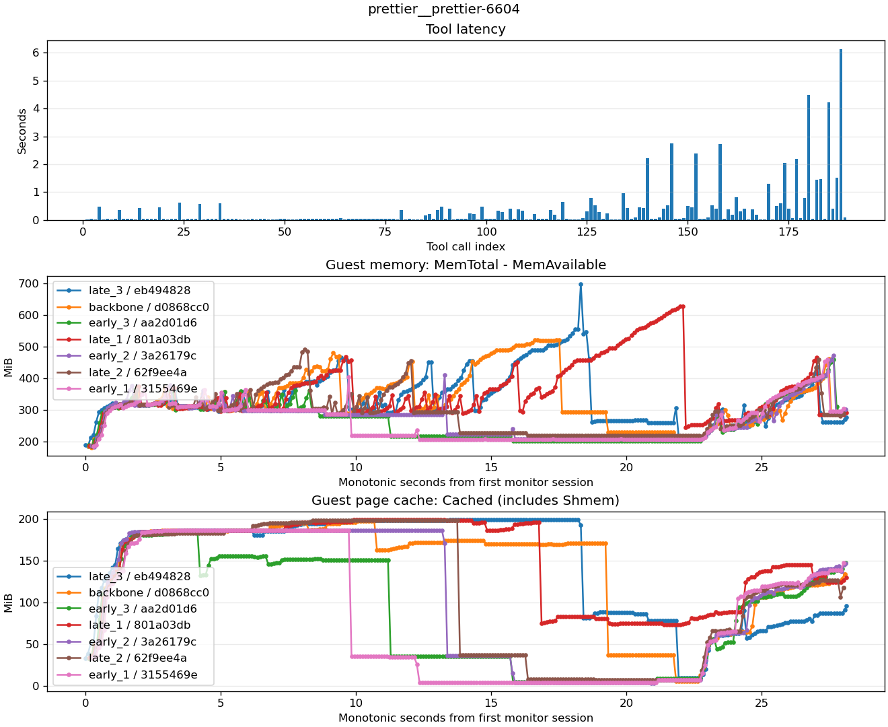

# 七沙箱GRPO采样开关：一对真实实验完成（2026-10-25）

**关闭→开启两组均通过：共378个原动作，开启组七个会话1954个采样点，关闭组没有采样或伪造内存曲线。** 本对工具累计耗时增加3.53%，rollout窗口增加9.49%，控制程序整轮增加10.18%（2.869秒）。它是一次固定顺序对照的观察，不能只用工具累计的3.53%描述整个并发任务成本。

## 实验条件保持

两组都是普通guest-only七沙箱GRPO，原七条冻结工具路径各执行一次、189动作／组；没有模型推理或训练。使用相同2 CPU／4096 MiB、16 GiB私有卷、源镜像和冻结输入，默认回收保持。并发创建、原动作调度、原结果检查和并发删除相同，没有host周期采样、PSS、物理查询或缓存控制。

关闭组作为新入口的首个真实验证，通过后才运行开启组，没有额外短任务、失败或重试。两组路径、每角色最终补丁和官方结果相同；原动作／顺序／退出码／关键输出、七个独立实例、并发创建及清理通过原完整审核，官方每实例仍为0通过2失败。

开启组0.1秒采样，各会话277～281点，最大间隔0.105648秒，所有采样进程正常回收。关闭组无周期／边界内存或vmstat记录，无采样控制调用、采样进程及内存图，报告标为`NOT_MEASURED`。

## 先看并发任务的完成时延

变化按`(开启/关闭−1)×100%`，单位秒：

| 指标 | 关闭 | 开启 | 变化 |
| --- | ---: | ---: | ---: |
| 原工具命令累计 | 59.048088 | 61.132942 | **+3.53%** |
| 首个原动作派发至最后结果下载 | 17.450965 | 20.315292 | **+16.41%** |
| rollout窗口 | 27.735408 | 30.367035 | **+9.49%** |
| 控制程序整轮 | 28.189963 | 31.059414 | **+10.18%** |
| 七个冷启动请求的墙钟跨度 | 2.807670 | 2.672335 | −4.82% |
| 最终并发收尾 | 0.251957 | 0.485417 | +0.233461秒 |

工具累计是并发命令时间之和，不能当作批任务完成时间。原动作及下载窗口包含路径间等待和调用，不是纯命令时间；rollout从创建沙箱前到全部分支检查结束，控制程序整轮还包含外围准备和最终收尾，均不含外层镜像缓存准备及私有服务部署。计时范围与原实现保持。

## 整轮多出的2.869秒发生在哪里

以下互不重复的阶段之和精确等于原控制程序纳秒计时。表中显示值四舍五入：

| 阶段 | 关闭/秒 | 开启/秒 | 开启减关闭/秒 |
| --- | ---: | ---: | ---: |
| rollout开始至首个原动作，含创建和准备 | 4.942677 | 4.944254 | +0.001577 |
| 原动作执行及下载窗口 | 17.451863 | 20.315804 | **+2.863941** |
| 路径结束后的检查 | 5.340868 | 5.106977 | −0.233891 |
| 最终并发收尾 | 0.251957 | 0.485417 | +0.233461 |
| 其他控制程序时间 | 0.202598 | 0.206961 | +0.004363 |
| 合计 | 28.189963 | 31.059414 | **+2.869451** |

这一对的增量主要在执行／下载窗口，不是冷启动，也不能完全解释成采样启停等待。最长原工具累计路径late_1由15.538642增至17.598591秒；并发任务要等待较慢路径，因此工具总和变化较小也可能伴随更大的完成时延变化。这里只定位了时间增长的位置，一对数据不足以分离稳定采样影响与运行波动。

## 低CPU不等于整轮开销同样低

开启组35次阻塞采样控制调用（每guest五次）累计3.573291秒；考虑它们彼此重叠，调用执行时间的墙钟并集为0.870006秒。它仍可能和其他guest操作重叠，不能再加到rollout或整轮上当额外总量。关闭组确实没有这些调用。

七个采样器合计1.440859 CPU秒，各自约占一个核心的0.69%～0.81%，峰值RSS16.18～16.74 MiB。RSS含共享部分，不当作净增物理内存，也不将七个RSS简单相加表示host物理开销。

当前判断是：采样器自身CPU和控制调用已经较轻，但这对七沙箱任务的整轮观察差仍有10.18%。单沙箱三对的+2.05%工具中位数不能直接套用，也不能从本对得出固定10.18%的因果减速率。需要准确性能数据时可使用关闭组；内存曲线来自开启组，性能影响按本轮范围单列。

固定展示本对开启组，实际图已查看，关闭组不画零曲线：



## 证据与复现

- [脱敏数值及逐阶段纳秒数据](evidence/grpo-light-pair-20261025.json)。
- 总目录：`.artifacts/grpo-light-pair-20261025/`，含固定计划、执行源码、两组日志、检查后的原目录绑定、对照和分析。
- 关闭组原始：`.artifacts/storage-isolated-service/20261025T150346Z-1064368/`。
- 开启组原始：`.artifacts/storage-isolated-service/20261025T150554Z-1067360/`。
- 命令及退出码：`.artifacts/grpo-light-pair-20261025-launch/`。
- 原[关闭入口的离线验证](GRPO_MONITOR_OFF.md)及[收尾／host查询优化](MULTI_HOST_OVERHEAD.md)保留各自范围。

新入口只运行这一对，不自动扩展轮数：

```bash
bash scripts/run-grpo-light-pair.sh --output .artifacts/grpo-light-pair-new
# 只复算已有、已检查的保存结果：
bash scripts/run-grpo-light-pair.sh --output .artifacts/grpo-light-pair-20261025 --report-only
```

新增三项小JSON／区间回归通过，确认并行调用不重复计时、零分母不伪造百分比、补丁不一致或顺序不符会失败。原58项离线证据直接复用，两组实际执行源码与本机版本相同，没有为报告重跑任务。

源服务恢复停止，自有沙箱、私有服务、成功卷、挂载、loop和准备缓存清理，无Firecracker。最低可用磁盘114.885 GiB，结束130.876 GiB；旧失败现场、原发布包及其他工作保持，不暂存、提交或推送。

## 下一步建议

本对作为第一对保留。后续已按用户确认的范围完成开启→关闭、关闭→开启两对，新增756动作；[三对汇总](GRPO_LIGHT_REPEATS.md)给出整轮变化中位数+2.60%、范围+2.20%～+10.18%。本页仍保留第一对的实际数值，不改采样频率、后端或任务，不删除较大差值；后续范围见汇总报告。
