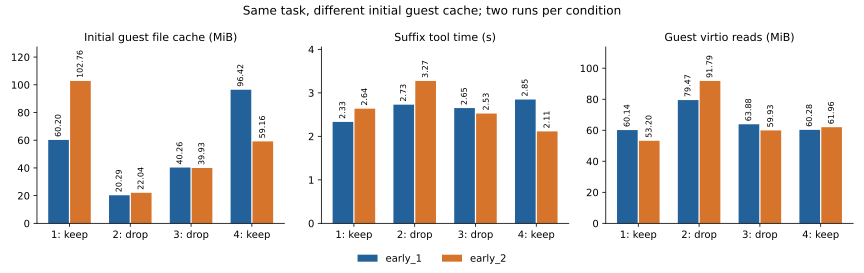

# 起始缓存对照完成：缓存量可改变，耗时影响随运行变化（2026-10-18）

**已完成约定的四次运行，共124个实际动作。清理组的任务前缓存确实较少，但两对耗时变化不同，当前结果不支持一个固定的减速比例。** 第一次对照中两个分支均变慢；反向顺序的第二次对照中，分支A略快、分支B变慢，双分支并行总耗时基本相同。

四次均保持原动作、顺序、退出码、补丁、完整恢复和原进程连续性检查通过；原官方结果仍为0通过/2失败，没有把任务原有失败改写为修复成功。现有测量阶段的验收结论保持，本页是新增的缓存干预结果。

## 只改变任务开始前的缓存处理

使用AgentENV、2 CPU/4096 MiB、24 GiB私有卷和`6.1.175-asb-cache-v3`诊断guest内核；四来源采集、GET_DATA、批量查询及2页合并均开启。每次重新执行相同11动作前缀、保存、恢复两个guest，再执行两个原10动作后缀。分支A为`early_1`，分支B为`early_2`；只比较不同运行中的同名分支，不把A和B当成同一个任务。

两组都先在专用guest同步写回。保留组随后不清理；清理组只写一次`drop_caches=1`，不主动清理目录项等slab对象。任务文件没有预读或锁定，host全局缓存未清理，也未增加采集暂停；原生保存仍有自己的暂停过程。旧入口未指定新选项时不增加同步或清理。

“起始缓存”指后缀执行前的边界读数，不是第一条指令执行瞬间的原子读数。干预结束至该读数间隔约82–252 ms，其后还有控制器启动后缀的调度间隔。清理后存在剩余缓存及快速回升，不能按零缓存或完整冷启动解释。

## 起始缓存与原后缀执行结果

缓存为guest独立成员表容量，包含普通文件和shmem。读取量为guest非分区virtio设备扇区差值乘512，不是host物理磁盘读取量。工具耗时是同名分支10个原动作的耗时之和；并行执行时间另列，不能将这两种时间相加。

| 次序 | 处理 | 分支 | 起始缓存/MiB | 工具耗时/秒 | guest设备读取/MiB |
| --- | --- | --- | ---: | ---: | ---: |
| 1 | 保留 | A | 60.195 | 2.331 | 60.145 |
| 1 | 保留 | B | 102.758 | 2.637 | 53.203 |
| 2 | 清理 | A | 20.285 | 2.728 | 79.469 |
| 2 | 清理 | B | 22.043 | 3.273 | 91.789 |
| 3 | 清理 | A | 40.258 | 2.650 | 63.883 |
| 3 | 清理 | B | 39.926 | 2.525 | 59.926 |
| 4 | 保留 | A | 96.418 | 2.847 | 60.281 |
| 4 | 保留 | B | 59.164 | 2.113 | 61.961 |

按相邻的两对计算，变化方向均为“清理−保留”，百分比以对应保留组为分母。

| 对照 | A工具耗时变化 | B工具耗时变化 | 双后缀并行执行：保留→清理 | 并行耗时变化 |
| --- | ---: | ---: | --- | ---: |
| 第2次对第1次 | +17.03% | +24.13% | 3.678→4.757秒 | +29.35% |
| 第3次对第4次 | −6.90% | +19.49% | 4.022→4.023秒 | +0.012% |

第一对设备读取分别增加32.13%和72.53%；第二对分别增加5.97%和减少3.28%。因此“缓存更少时读取及耗时总会按固定比例增加”不符合这四次数据。清理组两个任务前缓存均值分别降低61.34%和61.73%；对应工具耗时均值增加3.88%和22.06%，这些均值只描述本批数据，不能掩盖A的两对方向相反。



## 干预前差异与清理后回升必须保留

干预前的缓存量已经不同。以第2次B为例，同步前41.230 MiB，同步后16.652 MiB，清理后15.504 MiB，任务前又回到22.043 MiB；不能将它与第1次B的全部缓存差异都算作清理命令的效果。第3次两个guest清理后约38 MiB，任务前约40 MiB，也不是第2次的20–22 MiB。

保留组同样会变化：第4次A从同步后185.680 MiB降到任务前96.418 MiB。保存的启动参数包含`damon_reclaim.enabled=Y`、100 ms的最短未访问时间和后台回收配额；四次保持相同设置。本轮没有读取其运行时工作线程和回收计数，不能把每一段下降都确定归因于DAMON。该默认后台回收及运行波动未单独控制，这是后续容量控制需要解决的条件。

实际6.1.175源码中的DAMON_RECLAIM也没有启动命令行携带的`skip_anon`参数；不能凭命令行断言它跳过匿名页。相关源码核对留在本机结果的`capacity-design/`，下一阶段须核对实际接口再选择控制方法。

## 采集、正确性和成本

四次分别获得14/13、16/14、16/14、14/13个物理采样点，共114点；重叠配对分别11、13、13、11对，共48对。456次后端查询没有缺失返回，每次四张查询表独立，四来源物理集合及跨guest去重均通过原独立检查。任务前后边界同时保存缓存成员数、Cached、Shmem、Dirty、Writeback、缺页及逐设备计数。

host曲线继续表示当前guest缓存内容的已确认物理并集；未知容量不补零。报告按guest元数据时间选择边界窗口内的样本，host读取可能延伸到该元数据区间之外。所选样本中的未知guest容量最高19.684 MiB。guest移出缓存也不代表VMM立即向host归还同等容量，不能用本轮缓存下降计算主机可释放内存。

两次清理运行的每个guest实际清理用时19.522–35.585 ms；两组都执行的同步写回用时58.804–96.239 ms。包括边界读取和控制器调用的缓存准备阶段，四次分别为0.341、0.585、0.488、0.361秒，均在双后缀执行计时之外。控制器生命周期分别为35.277、36.714、36.511、35.632秒，仍不包含输入镜像和私有服务准备或离线报告。

49项相关离线检查通过。第一对之后，检查器曾因清理后缓存回升而错误要求“任务前仍低于同步后”，导致执行入口停止；任务和采集当时均成功。现已补回归用例，保留“清理确实降低缓存”并与同名保留组核对任务前缓存差异，同时报告回升。两次成功任务离线复用，只续做第3、4次，实际实跑仍为四次，没有重跑成功任务。原失败回执留在`checker-before-repair/`。

每次启动前可用磁盘均超过50 GiB，运行中最低30.633 GiB，高于20 GiB保护量加6 GiB余量。自有VM、snapshot、私有服务、卷、挂载、loop及RAM输入缓存已回收，原服务和12个VMM保持。

## 证据与复现

- 本机结果：`.artifacts/guest-cache-start-20261018/`；最终报告为`report-final/summary.json`和`report-final/runs.csv`。
- [脱敏数值、配置及验证结果](evidence/guest-cache-start-20261018.json)。原始物理页号只在本机。
- 当前执行入口：`scripts/run_guest_cache_start.py`；离线报告入口：`scripts/report_guest_cache_start.py`；图表入口：`scripts/plot_guest_cache_start.py`。

以下命令只读取已有结果，不启动沙箱，输出目录须不存在：

```bash
python3 -B scripts/report_guest_cache_start.py \
  --runs .artifacts/guest-cache-start-20261018/runs.json \
  --output .artifacts/guest-cache-start-report-new
```

本阶段按四次范围结束，不为得到一致百分比追加运行。**下一步必做持续容量控制**：先在一个专用guest核对实际回收接口、cgroup版本、交换区和后台回收状态，再选择只针对文件缓存的方法。短验证只比较两个容量目标，记录实际容量区间、超过目标的时间、匿名内存/交换量和控制开销；达到作用范围明确且容量确实可调的条件后，再安排同一任务对照。严格上限与周期回收的近似目标分开报告，不用减少总内存或填充匿名内存替代。

上述持续周期控制随后已完成，见[两类实验汇总与推荐入口](CACHE_CONTROL_SUMMARY.md)。本页四次起始状态结果按原条件保留，不与后续持续目标结果合并计算减速率。
