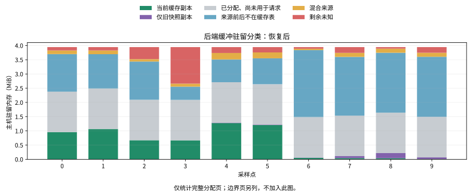

# 跨段映射的一次短恢复通过，已取得对应驻留物理页号（2026-10-17）

一次既有短恢复取得保存前3点、恢复后10点。106条跨段请求记录均进入原始层前后查询，并返回相同的非零驻留物理页号。40次查询及统计、文件内容、原guest进程恢复、独立物理去重、缓冲六类和清理通过。采集源码与[已验证的跨段实现](GUEST_SOURCE_OFFSETS.md)一致，29项离线测试直接复用，未追加实跑或完整任务。

跨段映射在本次真实查询中可用。每点它对当前物理并集的贡献为4–60 KiB，前三点分别补齐8、8、4 KiB的guest确认容量；其余点主要增加已确认内容的物理副本。每点平均308.906 ms线程CPU、339.174 ms耗时。缓存规模和请求数量与旧运行不同，不用旧234.159 ms的差值判断优化收益。

见[脱敏结果](evidence/guest-source-offsets-live-20261017.json)。原始运行为`.artifacts/storage-isolated-service/20261017T050937Z-2413433/`，启动、分析及核对脚本位于`.artifacts/guest-source-offsets-live-20261017/`。原页身份和物理页号明细仅保存在本机。

## 跨段偏移已得到真实物理结果

沿用2 CPU/4096 MiB、`6.1.175-asb-cache-v3`诊断内核、私有GET_DATA后端、批量查询及合并1页空隙策略。负载仍为既有16 MiB文件的等待、读取4 MiB和修改4 MiB三个阶段。

按本次保存索引，将旧单段条件返回UNKNOWN、新映射返回有效文件偏移的行选为跨段记录。106行均满足非零、同一文件、逻辑与文件地址连续且起点对齐的条件；新偏移与保存请求一致。原始层20次前后查询的请求数、无文件偏移数和缺失统计均与保存行吻合，106行前后均取得相同驻留物理页号。

下表的“补齐”由同点保存数据复算：只移除跨段原始层结果，保留其余来源，再与实际完整结果比较。guest补齐量按页身份计数，物理补齐量按物理页号去重；不是另一次运行，也不跨点累计。

| 点 | 跨段记录/行 | 补齐guest容量/KiB | 补齐当前物理并集/KiB | 实际未确认guest/KiB |
| ---: | ---: | ---: | ---: | ---: |
| 0 | 15 | 8 | 60 | 332 |
| 1 | 15 | 8 | 60 | 0 |
| 2 | 15 | 4 | 48 | 28 |
| 3 | 12 | 0 | 44 | 6036 |
| 4 | 12 | 0 | 48 | 3284 |
| 5 | 12 | 0 | 48 | 1224 |
| 6 | 2 | 0 | 8 | 0 |
| 7 | 5 | 0 | 8 | 6488 |
| 8 | 9 | 0 | 8 | 0 |
| 9 | 9 | 0 | 4 | 0 |

第1点在当前来源组合下所有guest缓存成员均已确认；本次恢复布局和缓存成员不同，不把新物理页号追溯套用到旧运行的4张页或旧16 KiB未知容量。其余未确认容量仍按本次观测保留，最大6488 KiB，后续只需用保存数据分类。

## 物理并集与未知缓冲分开报告

本次guest逻辑缓存为22.223–124.125 MiB，当前内容的host驻留物理并集为31.387–192.297 MiB。逻辑量是guest文件缓存成员容量；物理量包含这些内容在VMM、直接后端、原始层及可归属provider缓冲中的驻留副本，经物理页号去重。不同副本使物理并集可能大于逻辑量，旧快照内容不计入当前并集。

provider完整缓冲每点4040 KiB驻留，21张混合边界页另列。当前副本8–1308 KiB、旧副本0–184 KiB、尚未用于请求1456 KiB、来源前后不在缓存表476–2412 KiB、混合来源48–232 KiB、剩余未知56–1316 KiB。六类互斥且合计完整覆盖驻留的完整分配页；剩余未知不计零、不加入当前物理并集。

26份元数据的重复加入、缺失删除、越界、迁移及导出身份失效计数均为0。这些计数为0不等于缓存成员和映射在整个采样区间没有变化；本次guest未知容量的具体原因尚未分类。

## 实际CPU和采集器内存已记录

恢复后每点平均308.906 ms线程CPU、339.174 ms耗时。四次查询合计218.380 ms CPU，其中mincore查询循环136.299 ms，偏移换算合计17.532 ms；mincore阶段包含Python整理，不单独解释为内核CPU。

保存前/恢复后的完整采集线程分别为0.222/3.172 CPU秒。两张接收数组容量合计6 MiB，覆盖页驻留物理并集2.949–3.043 MiB；整个控制器RSS为95.426–113.035 MiB，另列临时数组容量，不当作新增缓存占用。两张实际表均为键8字节、值16字节、容量131072的HASH表，最终每张66035键；40次整表读取的条数与跨层请求前缀并集一致，缺失结果为0。

原生checkpoint暂停边界359.044–359.507 ms，前后采样空缺8.411秒，没有新增采集暂停、预读负载、清缓存或强制驻留。本次没有关闭采集对照，不把成本换算成任务减速。

## 验证完成，资源已回收

文件内容、原guest PID、启动标识和进程启动时刻保持，恢复到新VMM后继续原等待及读写过程。10点独立物理集合与在线结果一致，13点原分项、40条内部计时、40次输出编码及统计、缓冲六类和释放状态通过核对。历史审计按本次保存的映射源码解释新偏移；旧记录的兼容证据继续复用。

离线分析直接解析保存头、尾和索引，核对字段、排序、边界及文件身份，不重复计算索引哈希；没有读取内存层内容。运行路径未再改动，源码与上一阶段29项测试对应。

启动前55.542 GiB可用，运行最低31.541 GiB，24 GiB卷及20 GiB保护量、6 GiB余量保持。自有VM、snapshot、私有服务、卷、挂载及loop已回收，收尾约55.503 GiB可用；原服务和12个已有VMM身份保持。三任务完整采集、完整恢复及双分支继续复用，本阶段结束。

建议的10点未确认容量分类随后已按新授权完成，见[分类与改进方向](GUEST_UNCONFIRMED_CROSS.md)。本批剩余部分全部来自成员/映射变化，稳定来源缺口为0；本页原未知容量及物理量保持。
