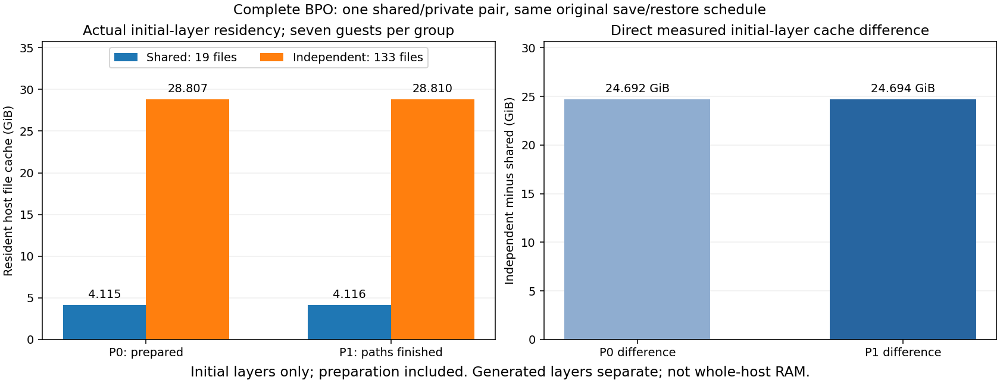

# 完整BPO文件共享对照：指定缓存驻留少24.694 GiB（2026-10-25）

**共享／独立各一次完整BPO已完成，共168个新原动作、4次保存、12次恢复。任务结束时，指定初始系统盘文件的host缓存驻留，共享组比独立组少24.693775 GiB，减少85.712214%。** 两组功能、恢复、实际文件关系、两阶段测量及清理均通过，没有重跑任务或追加轮次。

每组一个新私有服务、七个原角色。只改变初始19层是否共用：共享19文件、每个7使用者；独立133文件、每个1使用者。两个生成层保持原共享、分别7／4使用者，单列驻留，不混入主收益。原保存位置、恢复批次和并发后缀不变，0.1秒guest／host采样、PSS关闭和AgentENV默认回收保持。

## 实际驻留差主要在准备阶段形成

单位MiB；差值为实际独立驻留减实际共享驻留，没有按7倍单沙箱换算。

| 阶段 | 共享19文件 | 独立133文件 | 实际差值 |
| --- | ---: | ---: | ---: |
| P0：副本准备及同步后、guest创建前 | 4214.035156 | 29498.246094 | 25284.210938 |
| P1：全部原后缀结束、官方检查前 | 4215.117188 | 29501.542969 | 25286.425781 |
| P1−P0 | +1.082031 | +3.296875 | +2.214844 |

P1差值25286.425781 MiB，即24.693775 GiB；比例为该差值除以独立组P1驻留，为85.712214%。P0已经形成25284.210938 MiB差，运行期间差值只再增加2.214844 MiB，因此这是包含准备缓存的共享容量收益，不是工具运行新增的24.694 GiB节省。

该物理量是指定初始文件在host全局文件缓存中的驻留，由`mincore`查询；不是cgroup记账差、guest Cached逐页归属或整个host RAM。匿名页、可写盘、工具盘、内存设备和内存层不并入此数。两阶段是顺序观察，不是冻结快照或0.1秒物理驻留曲线。

## 生成层另列，内容不同不当成共享差值

P0时两生成层均为`NOT_CREATED`，驻留为空、不补0。P1记录如下，单位MiB；本次各文件驻留均等于其长度。

| 生成层 | 实际使用者 | 共享组驻留 | 独立组驻留 |
| --- | --- | ---: | ---: |
| 第11步 | 原主＋3早恢复＋3晚恢复，共7 | 9.179688 | 9.007813 |
| 第24步 | 原主＋3晚恢复，共4 | 0.550781 | 0.582031 |

同一组内每个生成层只查询一次。两组本次生成的内容及大小不同，保留各自原值，不把差值解释为初始文件共享收益。整个系统盘lower最终清单为共享21／独立135，而主指标始终只取19／133。

## 原保存／恢复、功能与身份均通过

每组84实际动作、189逻辑动作，原动作顺序、退出码、最终补丁和官方每实例0通过2失败保持；官方原失败与重放、恢复和测量成功分开报告。两次原保存、六次恢复的文件、进度和原进程检查通过。

实际七个VMM、系统盘配置、打开描述符、有序初始层来源及程序分配记录已关联。独立组七套均使用且每套独占，没有在恢复时被仓库路径重新合并；共享组实际共用一套。两个生成层为不同文件，7／4使用者和早／晚快照来源正确，不与初始目标重叠；所有配置、文件、块设备及VMM身份在查询后复核通过。

中间7阶段仅采元数据，不查驻留、不增加暂停。P1先查初始集合，再查生成集合，最后复核身份，均在原官方检查和删除之前。独立组所有单使用者文件已查询，没有共享筛选漏查。

共享host1567点、guest连续2268点；独立host2638点、guest连续2396点。每组7实际沙箱、9个采样会话：原主在两次保存前后共3段，6恢复实例各1段；均0.1秒，PSS未请求。工具时延、guest逻辑内存／Cached图分别位于：

- 共享：`.artifacts/storage-isolated-service/20261025T042752Z-952495/report/`。
- 独立：`.artifacts/storage-isolated-service/20261025T043037Z-956058/report/`。

这些guest曲线与上表的host文件驻留分层解释，不相加。主驻留图已实际查看。

## 准备、查询及任务时间分别统计

单位秒，均为墙钟用时；原始CPU字段保留在JSON中。

| 操作 | 共享 | 独立 |
| --- | ---: | ---: |
| 初始缓存复制及原核对 | 6.667 | 7.132 |
| 显式清单／额外副本准备 | 0.006 | 8.195 |
| 自有文件系统同步 | 2.986 | 92.029 |
| P0初始文件查询 | 0.185924 | 1.146581 |
| P1初始文件查询 | 0.191324 | 1.157563 |
| P1两生成层查询 | 0.000620 | 0.000658 |
| 全部驻留查询合计 | 0.377868 | 2.304801 |
| P0身份准备 | 0.000430 | 0.002761 |
| P1实际关联 | 0.095501 | 0.095907 |
| P1查询后核对 | 0.022636 | 0.022435 |
| 中间7阶段元数据合计 | 0.093591 | 0.097142 |
| 七沙箱创建、保存／恢复及原路径 | 49.038 | 48.061 |
| 含查询和原检查的阶段 | 58.628 | 58.045 |
| 控制程序 | 63.775 | 64.015 |
| 工具累计 | 59.712 | 58.510 |

准备成本另列；原工具累计只含原动作。查询及元数据没有从相应原计时区间扣除，CPU是调用线程CPU，不含复制／同步子进程CPU。两组都开启相同采样，本次时间构成不能换算成采样减速率或共享导致的工具提速。

独立组准备同步92.028952秒，在显式完整模式300秒上限内成功，旧入口60秒保持。没有增加固定等待、预读、清缓存、强制驻留或运行中回收控制。

## 结果位置、清理和完成范围

- [脱敏数值与逐项判定](evidence/host-bpo-copy-live-20261025.json)。
- 成对原始结果：`.artifacts/host-full-rootfs-pairs/20261025T042632Z-951259/`，PASS。
- 共享／独立组：`host-full-rootfs/20261025T042633Z-shared-951707/`、`host-full-rootfs/20261025T042911Z-private-955234/`。
- 执行、原始数据复核、图表及复算脚本：`.artifacts/host-bpo-copy-live-20261025/`。

本轮没有修改采集代码，复用已通过的71项Python及4项Rust离线证据；实际两组及保存结果复核均通过。构建、恢复接口、恢复状态、功能、测量及清理的判定分别保留，不用接口返回代替应用恢复成功。

自有沙箱、快照、私有服务、成功卷、挂载、loop及RAM准备已清理，源服务恢复停止，外部服务未动。当前约100.5 GiB可用，无本轮失败卷，也没有删除已有其他工作内容。

本阶段按一对BPO收尾，不自动追加重复。与[已完成的GRPO对照](HOST_FULL_GRPO_PRIVATE_LIVE.md)分别提供各自调度内部的指定文件收益，不相减当作BPO相对GRPO优化。下一步建议只做离线汇总：统一两种调度的结果表、图注和复现入口，明确准备收益、运行新增量及未覆盖范围；复用现有数据，不再启动相近实验。
