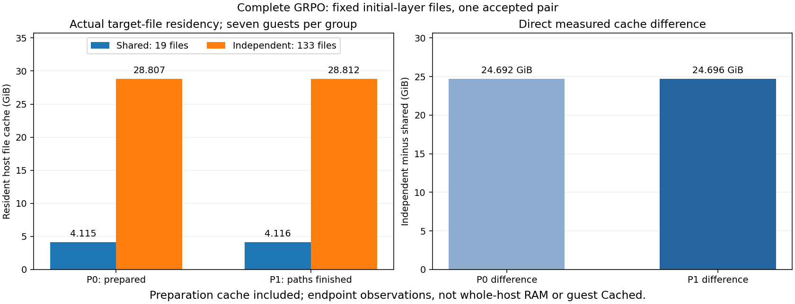
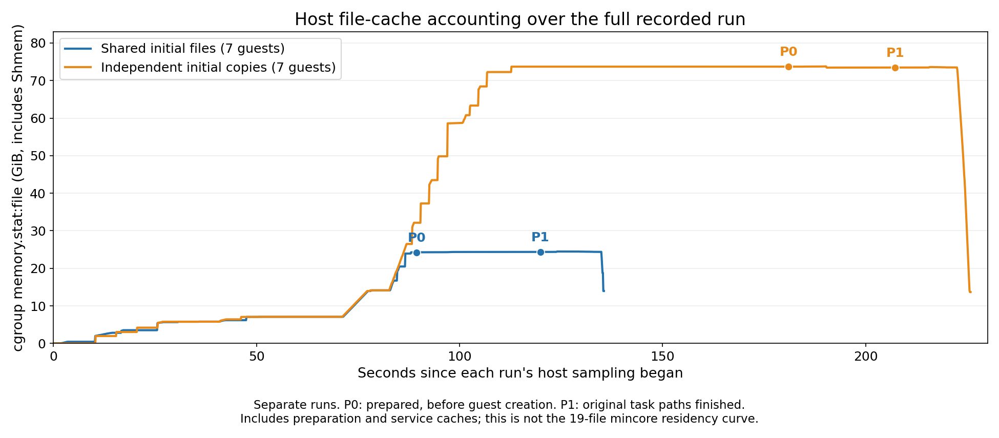

# 完整GRPO文件共享对照：实际缓存驻留少24.696 GiB（2026-10-25）

**同一GRPO调度下，一对共享／独立文件对照已完成，共378个原动作。任务结束时，指定初始系统盘文件的host缓存驻留，共享组比独立组少24.695663 GiB，减少85.713071%。** 本次只补跑独立组189动作，共享189动作直接复用此前通过的结果；首次独立准备失败的原FAIL和记录保留，没有重跑成功任务或追加轮次。

每组一个新私有服务、七个原角色，原并发及完整路径不变。共享组共用19个不可变系统盘下层文件；独立组各guest一套，共133个不同文件身份，每文件1使用者。只改变初始19层是否共用，匿名页、可写上层、工具盘及其他对象保持原行为，不并入主容量差。0.1秒guest／host采样、PSS关闭和AgentENV默认回收保持。

## 实际驻留差主要在准备阶段形成

单位MiB；差值为实际独立驻留减实际共享驻留，不使用7倍单沙箱换算。

| 观察阶段 | 共享19文件 | 独立133文件 | 实际差值 |
| --- | ---: | ---: | ---: |
| P0：副本准备及同步后、guest创建前 | 4214.035156 | 29498.246094 | 25284.210938 |
| P1：全部原路径结束、官方检查前 | 4215.144531 | 29503.503906 | 25288.359375 |
| P1−P0 | +1.109375 | +5.257813 | +4.148438 |

P1差值25288.359375 MiB，即24.695663 GiB；比例为该差值除以独立组P1驻留，为85.713071%。P0已有25284.210938 MiB差，任务期间差值只再增加4.148438 MiB，因此主要收益来自准备好的缓存共用，不能归为工具运行新增的24.696 GiB节省。

这是指定初始19层文件在host全局文件缓存中的驻留，不是cgroup记账差、guest Cached逐页物理归属或整个host RAM。`mincore`只查映射页的驻留状态，不读取目标数据；身份以设备编号和inode去重，不按相同内容标识合并不同副本。两次查询是顺序观察，不是冻结快照，也不是0.1秒物理驻留曲线。

## 原任务及真实副本使用均通过

两组各189动作、七角色完整路径，原动作顺序、退出码、最终补丁和官方每实例0通过2失败保持。官方原失败与轨迹重放、测量成功分开报告。

两组均核对七个活VMM、实际系统盘配置、133条有序lower引用及服务内打开描述符。共享去重19文件、每个7使用者；独立为133文件、每个1使用者，程序分配记录使用全部0—6套，无复用或闲置副本混入P1。来源及身份与P0准备清单一致，查询后配置、文件、块设备及VMM身份复核通过。独立组所有单使用者文件均查询，没有套用旧共享筛选漏查。

两组的任务、测量、报告、写入边界、原服务连续性和自有资源清理均PASS。共享host1356点、guest连续2629点；独立host2258点、guest连续2302点，均0.1秒，未请求PSS。guest逻辑内存／Cached及工具时延图已生成，共享图已查看；目录分别为：

- 共享：`.artifacts/storage-isolated-service/20261025T033849Z-931236/report/`。
- 独立：`.artifacts/storage-isolated-service/20261025T035223Z-938973/report/`。

这些guest曲线与上表的host指定文件驻留分层解释，不相加。主驻留图已实际查看。

### 补充：完整记录时段的host文件缓存记账曲线（2026-10-26离线绘图）

复用同一对的`host-file/memory.tsv`全部1356／2258点，每0.1秒记录；没有重跑任务或查询驻留。横轴分别从各组host采样开始计算，两条线不是同一时刻并发运行。P0／P1只标出准备完成和原路径结束的阶段时刻，标记纵值仍为附近采样点的`memory.stat:file`，不是指定文件的mincore容量。

本图覆盖准备、任务和私有服务／卷清理，采样在最后释放RAM准备缓存前结束，故末尾不要求降至0。蓝色共享组任务阶段约24 GiB，橙色独立组约73 GiB；file覆盖整个统计组的文件缓存及Shmem，范围还包含准备缓存、卷后备缓存和其他文件。这两条线的差不能全部归为指定19文件的收益；该对象集合已验证的实际驻留差仍为上表24.696 GiB，也不将本图视为整体host RAM曲线。

离线绘图脚本与来源记录在`.artifacts/host-grpo-file-curves-20261026/`，图已查看。[SVG版本](evidence/host-grpo-file-timeline-20261026.svg)可放大。guest自己的内存和Cached全程曲线仍看上方两个`report/overview.png`。

为方便查看，host曲线、共享／独立guest图及目标驻留图另复制到[独立小目录](../../results/shared-file-demo/README.md)，不用展开`.artifacts`。目录中的05为后续[两沙箱冷缓存新页验证](HOST_COLD_FILE_READ.md)，与本页七沙箱热准备对照分开。目录中的06是[七沙箱从零驻留开始的完整对照](HOST_GRPO_COLD_LIVE.md)，初始均0、结束共享268.891／独立1693.668 MiB，少1.391 GiB；与本页准备已热的24.696 GiB结果属于不同起点，不相互替换。

## 准备、查询和任务时间分别统计

单位秒，均为墙钟用时；CPU另保留在证据JSON中。

| 操作 | 共享 | 独立 |
| --- | ---: | ---: |
| 初始缓存复制及原核对 | 6.614 | 6.672 |
| 显式清单／额外副本准备 | 0.006 | 12.548 |
| 自有文件系统同步 | 3.140 | 78.570 |
| P0驻留查询 | 0.160619 | 1.165090 |
| P1驻留查询 | 0.185540 | 1.171955 |
| 两次驻留查询合计 | 0.346159 | 2.337045 |
| P0身份准备 | 0.000234 | 0.003332 |
| P1实际关联 | 0.054945 | 0.093051 |
| P1查询后核对 | 0.018032 | 0.019038 |
| 七沙箱创建及全部原路径 | 30.260 | 24.908 |
| 含查询及原检查的阶段 | 38.349 | 33.570 |
| 控制程序 | 43.473 | 39.479 |
| 工具累计 | 70.179 | 65.501 |

工具并行，累计用时可大于墙钟。两组都开启相同采样，一对运行的时间差不能当作关闭／开启采样的减速率，也不归因于文件共享使工具变快。查询成本包含在相应原计时区间中，没有扣除后另称原运行耗时；准备成本另列。CPU字段为调用线程CPU，不包含`cp`／`sync`子进程CPU。

## 首次失败、修补和获准删除均保留

首次独立组`20261025T034107Z-934685`在133个不同身份副本准备完成后执行`sync -f`，超过原60秒上限；终止后的15秒／10秒等待也超时，最终错误显示10秒，原调用栈仍保存最初60秒超时。该次初始复制及原核对7.092秒、额外准备12.283秒；未创建服务或guest，原动作0、P0／P1均NOT_RUN，驻留为空，未作为独立组0占用进入比较。

当时组内脏页峰值25580.438 MiB、采样结束仍3020.254 MiB；共享组峰值5244.684 MiB。原清理卸载返回busy，后续无同步进程或使用者后，核对后备路径并正常卸载、解除自有loop，恢复耗时1.624秒，单列PASS，不覆盖原FAIL。底层吞吐／竞争者归属未采，不将该次超时确定归因于其他服务或磁盘故障。

仅显式完整副本模式的同步上限改为300秒，其他旧入口保持60秒。同步真正完成才进入P0，没有新增固定等待、预读、清缓存、强制驻留或运行中回收控制。相关12项离线回归通过；本次独立同步实际78.569580秒并成功，验证了新上限能够覆盖本次写回。

用户明确批准后，仅删除该次48 GiB失败卷，卷外记录完整保留，原FAIL不改。删除检查／实际释放在`.artifacts/host-full-grpo-resume-20261025/deletion-result.json`，与旧5卷清理授权分开。新独立组启动前可用约100.6 GiB，满足48 GiB固定卷及严格超过74 GiB的门槛。

离线复核还发现差值函数沿用“双服务／双guest”的说明文字；实际对象一直是每组一服务七guest。已修正完整入口及派生证据中的范围文字，数值不变，原运行JSON保留；新增说明回归后相关11项检查通过，没有为此重跑任务。

## 证据、清理与下一步

- [完整数值和完成判定](evidence/host-full-grpo-private-20261025.json)、[首次未完成时的独立证据](evidence/host-full-grpo-private-partial-20261025.json)。
- 原成对入口`.artifacts/host-full-rootfs-pairs/20261025T033730Z-929880/`仍为FAIL；本次续跑及合并结果`.artifacts/host-full-grpo-resume-20261025/`为PASS，明确189新动作＋189复用动作。
- 有效共享／独立组：`host-full-rootfs/20261025T033732Z-shared-930308/`、`host-full-rootfs/20261025T035106Z-private-938217/`。
- 原执行、失败诊断和清理恢复：`.artifacts/host-full-grpo-live-20261025/`；本次复现脚本、复算、图表、删除记录和检查：`.artifacts/host-full-grpo-resume-20261025/`。

自有沙箱、私有服务、挂载、loop、成功卷和RAM准备已清理，源服务恢复停止，外部服务保持运行。当前约100.6 GiB可用，没有本轮新失败卷待清理。

本阶段一对GRPO按约定收尾，不自动追加重复。下一步建议只离线接入BPO副本控制：初始19层独立7套，两个生成层保持原共享并单列，验证恢复配置不把初始副本重新合并、原两次保存／六次恢复及两阶段查询和成本；通过后再安排原定一对168动作。BPO实跑仍须64 GiB卷及严格超过90 GiB可用，不外推本次GRPO比例。
