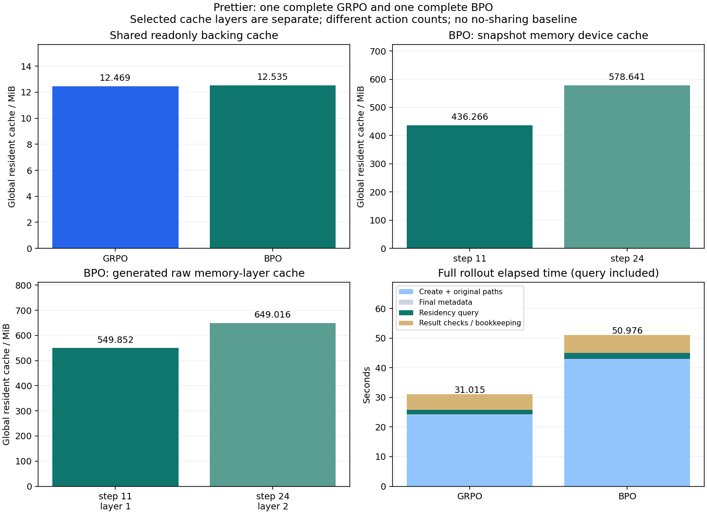

# 完整Prettier共享文件测量：GRPO／BPO各一轮验证（2026-10-23）

**后续更新：2026-10-24已完成[包含系统盘下层关联的新一轮完整GRPO／BPO采集](HOST_FULL_SHARED_ROOTFS_LIVE.md)。下文保留本阶段原记录，旧数据不回填。**

**新版显式模式的完整GRPO和BPO各一轮已完成，共273个原动作，实际对象、恢复状态、成本和清理检查通过。** BPO确认两份快照分别对应一个共享4 GiB内存设备，每个设备由三个恢复实例使用；两份原始层按实际文件身份各查询一次。PSS关闭、默认缓存回收保持。

本阶段验证完成，不追加短测、重复完整任务或新参数组。原每实例官方结果仍为0通过、2失败；本页通过的是原动作一致性、恢复及测量检查。

## 看指定对象物理驻留用这张图



图中前三幅分别是只读盘、BPO快照内存设备、BPO原始层的全局缓存驻留；不是guest Cached，也不是匿名页。右下图为整轮时间构成。不同缓存层分开列出，原始层是本轮保存产物，不扣成公共准备，不与设备缓存或组内file相加。

| 调度／对象 | 实际使用者 | 原路径结束后驻留／MiB |
| --- | --- | ---: |
| GRPO／共享只读系统／工具盘 | 全部7个实例 | 12.468750 |
| BPO／共享只读系统／工具盘 | 全部7个实例 | 12.535156 |
| BPO／快照内存设备／第11步快照 | early_1, early_2, early_3 | 436.265625 |
| BPO／快照内存设备／第24步快照 | late_1, late_2, late_3 | 578.640625 |
| BPO／本轮保存的原始内存层／第11步快照 | early_1, early_2, early_3 | 549.851562 |
| BPO／本轮保存的原始内存层／第24步快照 | late_1, late_2, late_3 | 649.015625 |

两组只读盘逻辑容量均64 GiB；两个BPO内存设备各4 GiB。两份原始层文件大小分别549.852／649.016 MiB，查询时都全部驻留。BPO的原主沙箱不冒充恢复实例，GRPO没有快照对象，也未补造相应的零值。

每组另有35个独立可写驱动后备：7个`user_rootfs`块设备和28个普通文件形式的`agentenv_volume_slot_*`保留槽，不是35块实际挂载的数据盘。它们的身份与使用者均保存，未做驻留扫描，状态为NOT_REQUESTED、驻留字段为null。7个系统盘的不可变下层文件可能共享，当前选中对象没有完整覆盖；不能将未查询项说成零占用。后续[离线核对](HOST_ROOTFS_LOWER_AUDIT.md)已明确分类和最小补采来源，未回填当时驻留。

这些数值是所选缓存对象的驻留量。两种调度执行的动作量和快照使用不同，且各只有一次，没有不共享后端或同阶段N=1参照，因此不据此计算整体物理节省比例。

## 原动作、查询和整轮时间分开

| 指标／秒 | GRPO | BPO |
| --- | ---: | ---: |
| 原工具累计耗时 | 61.163323 | 48.824775 |
| 创建及全部原路径完成 | 24.126606 | 42.920842 |
| 末尾驻留查询 | 1.615341 | 1.883613 |
| 全部阶段元数据读取 | 0.228576 | 0.307201 |
| 驻留查询线程CPU | 1.607258 | 1.872132 |
| 元数据读取线程CPU | 0.208641 | 0.278836 |
| 整轮用时（含查询及结果检查） | 31.015320 | 50.976343 |

工具累计是并发原命令耗时求和，不等于墙钟时间。创建及原路径用时包含其间的元数据读取；末尾驻留查询在原动作结束后、官方检查及删除之前。全部元数据读取成本已按阶段记录，不能再次整体加到整轮用时上。整轮不含外层输入准备、报告生成和资源清理。

驻留查询占当轮整轮用时5.21%／3.70%。这是实际时间构成，本轮没有关闭测量对照，不能把该比例当成任务减速率。只读盘查询约1.55–1.60秒，是两组查询的主要成本；BPO两个内存设备分别约0.142／0.109秒，两个原始层约0.024／0.026秒。

## 0.1秒曲线和保存／恢复记录齐全

| 项目 | GRPO | BPO |
| --- | ---: | ---: |
| 原工具动作 | 189 | 84 |
| 完整逻辑路径 | 7 | 7 |
| 采样会话 | 7 | 9 |
| guest周期点数 | 2103 | 1910 |
| host周期点数 | 1397 | 1625 |
| host最大采样间隔／毫秒 | 100.444063 | 100.135058 |
| 固定阶段记录 | 3 | 9 |
| 无guest基线脏页／MiB | 0.878906 | 0.894531 |

BPO实际执行84个动作，继承快照前缀后对应七条完整逻辑路径的189动作；没有重跑继承前缀。两次保存和六次恢复的文件、进度、原进程检查均通过，最终补丁和原官方失败保持。

第11／24步保存前后没有驻留扫描，新增计数读取在原暂停段之外。保存后、恢复前的阶段记录明确为设备尚未创建、配置尚未物化；恢复后才取得实际设备与层文件，没有把初始未知写成零。新模式没有添加暂停、缓存清理、预读、锁页或DAMON配置更改。

曲线位置：

- GRPO：[guest工具时延／内存／Cached](evidence/prettier-grpo-shared-20261023-guest.png)、[host原段派发后的file与基线变化](evidence/prettier-grpo-shared-20261023-host-task.png)、[含外层准备的host完整曲线](evidence/prettier-grpo-shared-20261023-host.png)。
- BPO：[guest工具时延／内存／Cached](evidence/prettier-bpo-shared-20261023-guest.png)、[host原段派发后的file与基线变化](evidence/prettier-bpo-shared-20261023-host-task.png)、[含外层准备的host完整曲线](evidence/prettier-bpo-shared-20261023-host.png)。

guest曲线按实际采样会话排列，快照采样空缺不补点；host用host单调时钟。会话准备延迟未校准，横轴零点不视为精确同时。guest Cached是guest逻辑缓存；host file是组内记账，包含公共准备和Shmem；物理图则是原路径末尾一次选中对象的全局驻留，不能互相替代。

## 资源与验收

- GRPO16 GiB卷和BPO32 GiB卷启动前可用磁盘分别约80.586／80.577 GiB，满足超过42／58 GiB的预算。准备同步、内存及I/O记账、关闭预启动池和guest创建前验证均有实际回执。
- 两组全程未生成PSS文件，guest轻量会话均正常结束并回收，host采样及最终普通文件清单均通过。
- 自有guest、两份BPO快照、私有服务、挂载、loop、成功卷和准备资源均清理；源服务恢复原停止状态，没有删除旧失败卷。收尾后可用磁盘约81 GiB，无活动Firecracker。
- 本次采集代码没有修改，复用原60项离线证据；另以保存的实际数据独立核对原结果、阶段顺序、身份、去重、容量、成本和清理。图片已实际查看。

## 原始结果与复算

- [脱敏独立验收结果](evidence/host-full-shared-live-20261023.json)。
- 成对执行目录：`.artifacts/host-full-shared-live-20261023/`。
- 独立核对、绘图和修改前状态：`.artifacts/host-full-shared-live-validation-20261023/`。
- GRPO原始工作流：`.artifacts/platform-tasks/20261022T170658Z-431791/`；任务：`.artifacts/storage-isolated-service/20261022T170816Z-432474/prettier6604/`；自动报告：`.artifacts/platform-tasks/report-20261022T170658Z-431791/shared-files/REPORT.md`。
- BPO原始工作流：`.artifacts/platform-tasks/20261022T170921Z-435044/`；任务：`.artifacts/storage-isolated-service/20261022T171040Z-435758/prettier6604/`；自动报告：`.artifacts/platform-tasks/report-20261022T170921Z-435044/shared-files/REPORT.md`。

以下只读已保存数据，不启动服务或查询当前缓存：

```bash
python3 -B .artifacts/host-full-shared-live-validation-20261023/analyze.py
python3 -B .artifacts/host-full-shared-live-validation-20261023/plot.py
```

## 下一步建议

本轮约定的指定共享对象轻量测量已通过完整任务验证，可以按此范围使用，不再追加相同短测或完整运行。[系统盘下层离线核对](HOST_ROOTFS_LOWER_AUDIT.md)已完成：范围收窄到7个可写系统盘，28个保留卷槽不作为实际数据卷追查。下一步仅建议离线实现最终阶段的系统盘下层文件／使用者关联表及分类测试，按文件身份整批去重；不自动启动沙箱、扫描整设备或重跑273动作，也不扩大为整体RAM归属。
