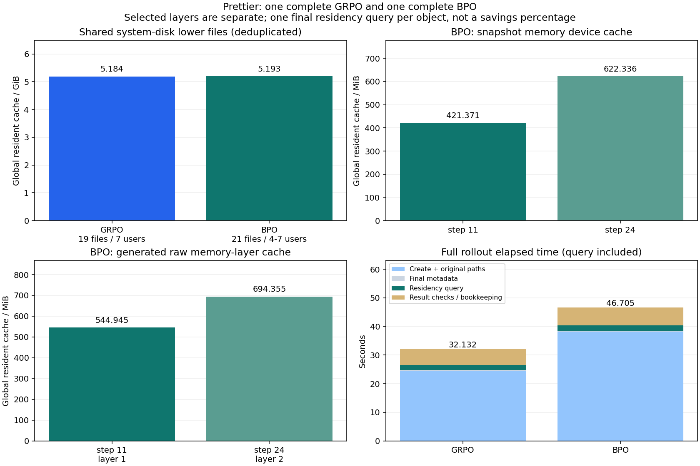
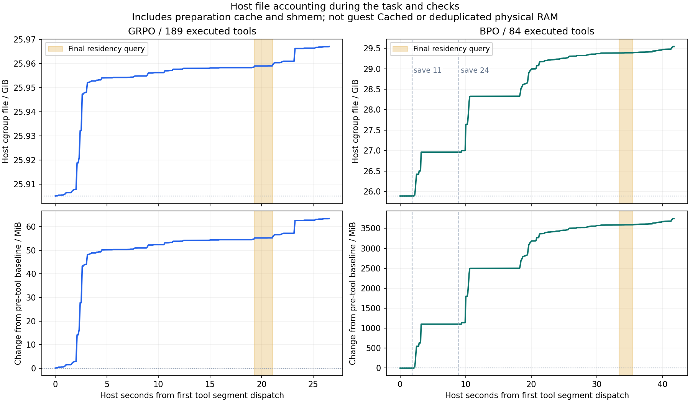

# Prettier完整轻量采集：含共享系统盘文件（2026-10-24）

**后续已完成：[同配置GRPO／BPO各5轮的统计和曲线](HOST_FULL_SHARED_ROOTFS_REPEATS.md)。本页保留首轮原值；首轮直接计入五轮，没有重新采集。**

**GRPO、BPO各完成一轮新采集，共273个原动作。两个模式的共享系统盘文件均已取得实际使用者、去重驻留和成本；0.1秒guest／host曲线齐全。** PSS关闭，AgentENV默认回收保持。原动作、补丁和恢复检查通过，官方检查仍每实例0通过、2失败，与原预期一致。

## 看共享文件的物理驻留



左上是系统盘不可变下层文件去重后的宿主缓存驻留；右上是BPO两份快照内存设备缓存；左下是本轮生成的原始内存层文件缓存。三个缓存层分开报告，不相加，也不与cgroup file相加。右下为整轮时间构成。

| 对象／MiB | GRPO | BPO |
| --- | ---: | ---: |
| 共享系统盘下层文件 | 5308.066406 | 5317.812500 |
| 共享只读系统／工具盘后备 | 12.480469 | 12.527344 |
| 第11步快照内存设备 | 无此对象 | 421.371094 |
| 第24步快照内存设备 | 无此对象 | 622.335938 |
| 第11步原始内存层文件 | 无此对象 | 544.945312 |
| 第24步原始内存层文件 | 无此对象 | 694.355469 |

- GRPO：7个活实例各引用19个下层文件，133条引用按`device,inode`合并为19个实际文件，全部由7实例共享。
- BPO：原主实例及3个晚恢复实例各引用21个文件，3个早恢复实例各引用20个文件。144条引用合并为21个文件；其中20个由7实例引用，驻留5309.187500 MiB；另1个由原主实例及3个晚恢复实例引用，驻留8.625000 MiB。
- 两组每个选中对象均只查询一次，按4 KiB页计驻留，尾页按整页计。所有下层引用都已解析，有自有服务打开文件的依据，查询前后配置、设备及文件身份稳定。
- BPO两份4 GiB快照内存设备各由3个恢复实例共享，原始内存层为本轮保存产物。原主实例不冒充恢复实例，GRPO不补造快照零值。

这些文件容量包括准备阶段带入的缓存，不是任务新增缓存。两组有不同的实际动作量和快照使用；当前各一次，没有同阶段不共享对照，因此本页不计算共享节省率。

每组7个可写系统盘设备、28个普通保留卷槽及各实例可写upper未做驻留查询，保持空值。系统盘关联已覆盖本次元数据列出的全部不可变下层；不由此扩大到可写数据、整个host RAM或guest Cached的逐页物理归属。

## 看运行中的host记账趋势



上排为各实验组的`memory.stat:file`，下排减去同组首次工具段派发前的file基线。浅黄色区域为末尾驻留查询，BPO虚线为第11／24步保存前的记录位置。横轴是host单调时钟，覆盖任务段、附加查询和原结果检查。

GRPO／BPO基线分别25.905018／25.887272 GiB，末尾相对基线增加63.477／3744.883 MiB。file包含输入准备、私有服务及所有沙箱的文件缓存和Shmem；BPO期间还会生成保存／恢复产物。这条记账曲线不等于上图的指定共享文件驻留，也不等于guest Cached。

两列纵轴范围不同，读取变化量用下排数值，不凭曲线斜率比较。新增系统盘驻留只在末尾查询一次，本轮没有共享文件物理驻留的连续曲线。

## 工具时延、guest内存和Cached曲线

- [GRPO三项曲线](evidence/prettier-grpo-shared-rootfs-20261024-guest.png)；[SVG放大版](evidence/prettier-grpo-shared-rootfs-20261024-guest.svg)。
- [BPO三项曲线](evidence/prettier-bpo-shared-rootfs-20261024-guest.png)；[SVG放大版](evidence/prettier-bpo-shared-rootfs-20261024-guest.svg)。

顶部每根柱为一个实际执行的工具动作。中图为每个guest的`MemTotal - MemAvailable`，下图为guest的`Cached`（包含Shmem）。每条线是一个实例，不把七条线相加为物理内存。

guest横轴由各采样会话的本地单调时钟与host会话起点构造，保留快照期间的缺口，不插值补点。会话准备延迟未单独校准，不能把它与host图的零点视为严格同时。

| 采集项 | GRPO | BPO |
| --- | ---: | ---: |
| 实际工具动作 | 189 | 84 |
| 完整逻辑路径 | 7 | 7 |
| guest采样会话 | 7 | 9 |
| guest采样点 | 2189 | 1920 |
| host采样点 | 1486 | 1558 |
| host最大采样间隔／毫秒 | 100.137709 | 100.116979 |
| 无guest基线脏页／MiB | 0.894531 | 0.925781 |

BPO通过两次保存、六次恢复继承前缀，84个实际动作对应七条完整路径的189个逻辑动作。第11／24步保存前后只有原范围的计数和元数据记录；末尾驻留查询位于原动作之后、原检查和删除之前，没有增加暂停、清缓存、预读、强制驻留或回收设置修改。

## 查询成本与任务用时

| 用时／秒 | GRPO | BPO |
| --- | ---: | ---: |
| 原工具累计 | 60.158916 | 45.447107 |
| 创建及原路径完成 | 24.573978 | 38.197495 |
| 整轮，包含查询及原结果检查 | 32.132389 | 46.704689 |
| 全部阶段元数据读取 | 0.291425 | 0.291425 |
| 其中：末尾系统盘元数据关联 | 0.020603 | 0.013119 |
| 全部选中对象驻留查询 | 1.807463 | 2.045009 |
| 其中：新增系统盘文件查询 | 0.186186 | 0.178150 |
| 驻留查询线程CPU | 1.799526 | 2.035111 |
| host周期采样线程CPU | 0.454621 | 0.496426 |
| guest采样CPU累计 | 1.612829 | 1.807478 |

工具累计是并发动作耗时求和，不等于墙钟时间。元数据及系统盘查询均已包含在相应合计和整轮时间中，不重复相加；整轮不含外层输入准备、报告生成和清理。guest采样CPU是各会话用户态与内核态CPU之和，host采样CPU覆盖包括准备在内的完整采集周期。

本轮记录实际采集成本，没有关闭测量对照，不把查询占整轮的比例解释为任务减速率。

## 复核、报告修补与清理

- 使用原显式共享文件配置和成对入口，采集代码未新增执行路径。GRPO16 GiB卷、BPO32 GiB卷开始前分别约75.300／75.286 GiB可用，满足超过42／58 GiB要求。
- 实验组在输入准备前创建，内存及I/O记账开启；准备后同步自有文件系统，私有服务和guest创建前确认没有预启动VMM，池和预热关闭。
- 根据保存结果核对原动作／退出码／补丁、两次保存／六次恢复、全部文件使用者、整批去重、时序、驻留容量、采样及清理，均通过。图片已经实际查看。
- 自动报告仍有一条旧文案笼统声称“rootfs下层未完整覆盖”。已改为有新关联表时显示实际识别状态，缺少关联表的旧报告保持原行为。13项相关离线检查及两份报告数值完全一致检查通过；只重生成派生报告，不重跑成功任务，原自动报告和原始数据保留。
- 自有guest、两份BPO快照、私有服务、挂载、loop、成功卷和准备资源已清理，源服务恢复停止。结束时约75.3 GiB可用，无本轮失败卷待删除。

本阶段达到新一轮完整采集的完成条件，不追加轮次。若需要均值与波动，下一步可在同一配置下各补4轮，形成5轮统计；以逐轮原值、样本标准差、对象／任务／清理一致为完成条件，不混入缺少系统盘关联的旧轮次。重复实验需另行确定范围后再运行。

## 数据、图片与复算位置

- [脱敏验收及逐对象记录](evidence/host-full-shared-rootfs-20261024.json)。
- 成对入口目录：`.artifacts/host-full-shared-rootfs-live-20261024/`。
- 复核、派生报告、绘图及报告修补记录：`.artifacts/host-full-shared-rootfs-validation-20261024/`。
- GRPO工作流：`.artifacts/platform-tasks/20261024T032517Z-700651/`；任务：`.artifacts/storage-isolated-service/20261024T032643Z-701407/prettier6604/`。
- BPO工作流：`.artifacts/platform-tasks/20261024T032749Z-703881/`；任务：`.artifacts/storage-isolated-service/20261024T032905Z-704559/prettier6604/`。
- 两份只修正文案的派生逐对象报告：复核目录下`grpo-shared-report/REPORT.md`、`bpo-shared-report/REPORT.md`。

只读保存数据，不启动服务或查询当前缓存：

```bash
python3 -B .artifacts/host-full-shared-rootfs-validation-20261024/analyze.py
python3 -B .artifacts/host-full-shared-rootfs-validation-20261024/plot.py
```
