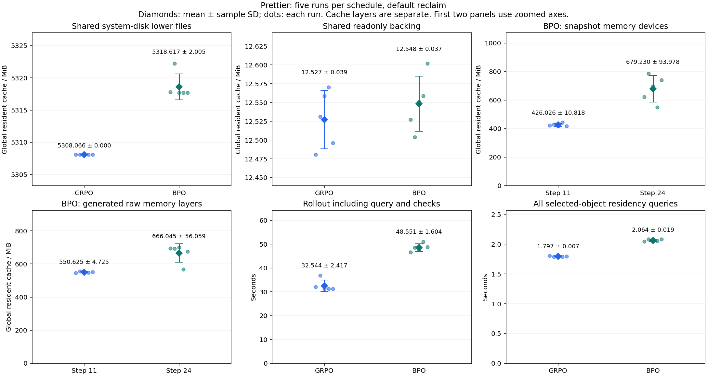
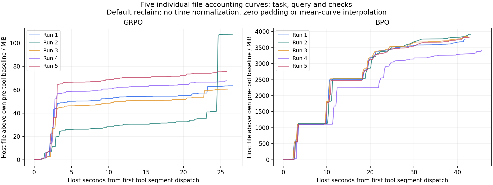

# Prettier共享文件轻量测量：GRPO／BPO各5轮（2026-10-24）

**后续已完成：[同阶段1→7沙箱的共享容量参照](HOST_SHARING_REFERENCE.md)。它单独测量相同原动作阶段，不与本页完整GRPO／BPO五轮统计合并。**

**按原计划新增4对实验，与有效首轮组成GRPO、BPO各5轮，共1365个原动作，其中本次新增1092个。10次完整采集、原动作／补丁、10次保存及30次恢复、对象关联与去重、采样和清理验收均通过。** 原官方每实例0通过、2失败保持。

采集配置、0.1秒guest／host周期、关闭PSS和AgentENV默认回收保持；没有清缓存、预读、强制驻留或增加暂停。首轮直接复用，不混入缺少系统盘关联的旧轮次。达到5轮后停止，没有替换或追加轮次。

## 指定共享文件的物理驻留：均值与样本标准差



菱形与误差线是均值±样本标准差，圆点为每轮原值，不是置信区间。前两幅放大了纵轴范围以显示小幅波动；各缓存层单列，不相加为整体RAM。

| 指定对象／MiB | GRPO，均值 ± 标准差 | BPO，均值 ± 标准差 |
| --- | ---: | ---: |
| 共享系统盘下层文件 | 5308.066 ± 0.000 | 5318.617 ± 2.005 |
| 共享只读系统／工具盘后备 | 12.527 ± 0.039 | 12.548 ± 0.037 |
| 第11步快照内存设备 | 无此对象 | 426.026 ± 10.818 |
| 第24步快照内存设备 | 无此对象 | 679.230 ± 93.978 |
| 第11步原始内存层文件 | 无此对象 | 550.625 ± 4.725 |
| 第24步原始内存层文件 | 无此对象 | 666.045 ± 56.059 |

系统盘文件按各轮实际device,inode和活实例使用者去重；同一轮多条引用只查一次，跨轮分别统计。查询复用mincore，只检查已有缓存页的驻留状态，不主动读入文件数据。BPO两份快照各由3个恢复实例使用，生成层不当作公共准备扣除。全部引用的身份、打开文件依据、前后稳定性及单实例排除状态由原检查器逐轮核对。

这些数值是原路径结束后指定文件／设备的全局缓存驻留，包括准备阶段带入的缓存，不是后缀新增量。可写系统盘、保留卷槽及upper不扫描，仍为空值。没有同阶段不共享对照，不把驻留均值换算为整体物理节省率。

## 五轮结果说明了什么

GRPO／BPO每轮分别识别19／21个共享系统盘文件，约5.2 GiB的系统盘驻留较稳定：GRPO这5轮的原值完全一致，BPO标准差约2 MiB。组内file曲线仍有明显变化，它与指定文件驻留不是同一指标。

BPO第24步快照内存设备驻留为679.230 ± 93.978 MiB，范围549.762—784.969 MiB，波动大于第11步设备；所有设备容量仍为4 GiB，因此这里变化的是当前驻留页数。

原始内存层的情况不同：5轮每个原始层查询时的驻留都等于文件容量，第24步层文件容量本身在567.133—700.949 MiB之间。这部分变化是各轮生成文件大小不同，不能一概解释为同一文件被回收。具体回收事件未在轻量方案中采集，不由这些端点推断DAMON触发次数。

## 每轮原值完整保留

| 轮次 | GRPO系统盘／MiB | BPO系统盘／MiB | GRPO整轮／秒 | BPO整轮／秒 |
| --- | ---: | ---: | ---: | ---: |
| 1 | 5308.066406 | 5317.812500 | 32.132389 | 46.704689 |
| 2 | 5308.066406 | 5322.203125 | 36.814564 | 48.552770 |
| 3 | 5308.066406 | 5317.683594 | 31.247951 | 47.660896 |
| 4 | 5308.066406 | 5317.710938 | 31.206501 | 51.002562 |
| 5 | 5308.066406 | 5317.675781 | 31.319791 | 48.836536 |

所有5轮都进入统计，没有因高值、低值或回收波动剔除。标准差按n−1计算；逐对象、逐阶段、每轮样本数和全部原值见JSON。首轮在此前单独采集，后4轮连续按GRPO→BPO顺序执行。默认回收不等于每轮都从冷缓存开始，顺序、间隔和背景状态的影响保留在本组数据中。

## 工具、整轮及测量成本分别统计

| 用时／秒，均值 ± 标准差 | GRPO | BPO |
| --- | ---: | ---: |
| 原工具累计 | 60.939 ± 0.853 | 46.552 ± 2.042 |
| 创建及原路径完成 | 25.005 ± 2.269 | 39.759 ± 1.551 |
| 整轮，含查询及原检查 | 32.544 ± 2.417 | 48.551 ± 1.604 |
| 全部元数据读取 | 0.288 ± 0.016 | 0.332 ± 0.037 |
| 其中：系统盘元数据 | 0.021 ± 0.000 | 0.020 ± 0.004 |
| 全部驻留查询 | 1.797 ± 0.007 | 2.064 ± 0.019 |
| 其中：系统盘文件查询 | 0.184 ± 0.009 | 0.187 ± 0.009 |
| 驻留查询线程CPU | 1.788 ± 0.007 | 2.053 ± 0.019 |
| host周期采样线程CPU | 0.472 ± 0.029 | 0.510 ± 0.014 |
| guest采样CPU累计 | 1.647 ± 0.092 | 1.875 ± 0.054 |

工具累计为并发动作耗时求和，不等于墙钟时间。系统盘元数据和查询已包含在各自合计中，合计也已包含在整轮内，不重复相加。整轮不含外层准备、报告生成和资源清理；采样CPU覆盖各自采样生命周期。没有关闭测量对照，不将这些构成比例解释为任务减速率。

## host曲线逐轮展示，不硬对齐求平均



每条线减去本轮首次工具段派发前的file基线，保留任务、末尾查询和原检查时段。曲线长度和事件时间不同，不补0、不插值、不把不同阶段混为一条平均曲线。file是实验组记账，包含准备、服务、全部沙箱及Shmem，与上图指定文件物理驻留及guest Cached层次不同。

guest内存／Cached和工具时延的每轮原曲线保留在各自自动报告中；首轮图见[首轮报告](HOST_FULL_SHARED_ROOTFS_LIVE.md)。峰值统计是先取每轮观测峰值，再对5轮取均值，不是平均曲线的峰值。

| guest角色：Cached观测峰值／MiB，均值 ± 标准差 | GRPO | BPO |
| --- | ---: | ---: |
| backbone | 194.623 ± 6.073 | 195.407 ± 4.726 |
| early_1 | 186.423 ± 0.360 | 188.391 ± 1.935 |
| early_2 | 188.435 ± 2.713 | 188.403 ± 2.013 |
| early_3 | 187.518 ± 2.223 | 188.416 ± 1.940 |
| late_1 | 193.105 ± 8.702 | 180.530 ± 44.118 |
| late_2 | 198.843 ± 1.710 | 183.938 ± 38.144 |
| late_3 | 189.653 ± 6.969 | 186.771 ± 31.756 |

guest Cached为逻辑缓存，包含Shmem，不把各实例峰值相加为宿主物理内存。快照缺口及采样会话准备延迟沿用原记录，未补造精确跨guest时钟对齐。

## 资源与验收

- 每对使用原成对入口，先GRPO后BPO；新cgroup和私有服务在guest创建前建立，准备后同步自有文件系统，确认无预启动VMM，内存和I/O记账开启。每轮16／32 GiB卷启动前分别检查超过42／58 GiB可用，实际预算与负载保存在原目录。
- 原GRPO189动作、BPO84实际动作对应各7条完整逻辑路径；原动作、退出码、补丁及官方预期保持。BPO每轮两次保存、六次恢复和恢复进程检查通过。
- 每对完成后先复用首轮独立检查器验收，再继续下一对。采集代码未修改，不新加校准或重跑有效首轮，所有失败／未知规则保持。
- 各轮guest、快照、私有服务、挂载、loop、成功卷及准备缓存均按原流程清理，源服务每对恢复停止。没有本次失败卷需要删除。

## 数据与复算

- [五轮统计、全部原值和逐对象记录](evidence/host-full-shared-rootfs-repeats-20261024.json)。
- 本次执行、每对结果、逐对独立复核及原日志：`.artifacts/host-full-shared-rootfs-repeats-20261024/`。
- 第1轮：`.artifacts/host-full-shared-rootfs-live-20261024/`；第2—5轮为本次目录下`round-2/`至`round-5/`。
- 每个成对目录的`grpo/summary.json`和`bpo/summary.json`记录对应自动报告、任务与工作流位置；原图及tools.tsv／memory.tsv均可直接查看。

只读现有结果，不启动服务或查询当前缓存：

```bash
python3 -B .artifacts/host-full-shared-rootfs-repeats-20261024/summarize.py
python3 -B .artifacts/host-full-shared-rootfs-repeats-20261024/plot.py
```

## 下一步建议

本阶段已完成，停止追加相同轮次。下一步若要回答“共享省了多少”，可另行安排同一任务阶段的N=1／N=7参照，使用同一候选共享对象清单，分别记录准备与任务阶段；以取得同范围指定对象的驻留容量差为完成条件。范围另定，不从本组两种调度的均值直接推算共享收益。
