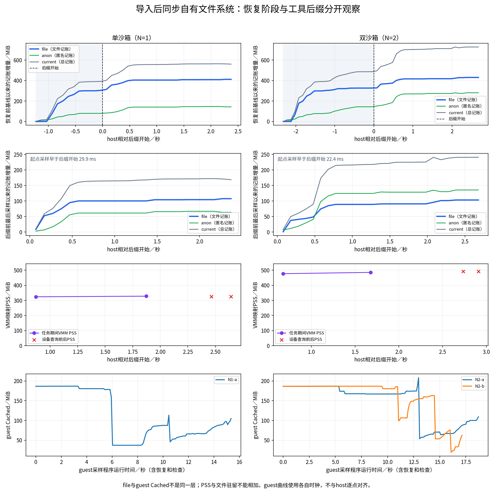

# 导入快照后同步：准备写回与任务变化已分开（2026-10-21）

后续已完成[同步后物理分项与查询时差的离线核算](HOST_PHYSICAL_BREAKDOWN.md)，明确可交付分项和整体总量缺口。本页原设计／实跑条件、数值和判定保留。


**新增的单／双沙箱30个后缀动作已完成。导入后同步自有文件系统，使恢复前两组的file差异从752.016 MiB降至3.379 MiB；上一轮双沙箱约5 GiB的突增未再出现。恢复、原动作、补丁及收尾扫描通过，原官方每实例0通过／2失败保持。**

[本轮曲线](evidence/host-import-sync-20261021.png) · [脱敏结果](evidence/host-import-sync-20261021.json) · [上一轮未在导入后同步的结果](HOST_INDEPENDENT_PAIR_VALIDATION.md)



## 改动只有准备阶段的一次同步

`scripts/validate_isolated_agentenv.py`在原生快照导入成功后，仅对独立卷的`single`／`dual`阶段执行：

```bash
sync -f <本次自有卷的挂载目录>
```

命令等待这个文件系统的待写数据完成同步，有60秒超时；失败会终止本次准备，不创建guest。记录命令退出码、耗时及单调时钟起止时间，保存为`checkpoint_import_sync`。实际顺序均为：

```text
导入并验证快照 → 同步自有文件系统 → 创建并启动私有服务
→ 核对尚无VMM → 恢复前普通文件驻留 → file基线 → 创建恢复guest → 后缀
```

本轮同步用时单沙箱8.517秒、双沙箱8.479秒，均在服务和guest创建前完成，不计入工具或后缀用时。没有全局同步、缓存清理、预读任务文件、强制驻留、guest暂停或DAMON修改，也没有用额外等待延长测量有效期。旧普通任务、共享卷入口、快照制作及原生导入函数的调用条件保持。

复用同一已验证的第11步快照和归档，两组各用全新私有服务／24 GiB可写卷；单沙箱10动作、双沙箱各10动作，本轮只新增30动作，原11步不重跑。guest及host仍0.1秒采样，PSS每1秒采样；PSS是按共享比例分摊的进程映射内存。

## 准备写回干扰明显减小

MiB为2²⁰字节。下表的“同步前”指上一轮没有在导入后主动同步，两轮均各一组固定先单后双的观察，不是重复均值。

| 指标 | 同步前单沙箱 | 同步前双沙箱 | 本轮单沙箱 | 本轮双沙箱 |
| --- | ---: | ---: | ---: | ---: |
| 恢复前file | 32363.742 | 33115.758 | 38232.250 | 38235.629 |
| 恢复前脏文件页file_dirty | 5869.500 | 5120.895 | 0.906 | 0.898 |
| 恢复前自有loop后备镜像驻留 | 5189.543 | 5938.156 | 11058.957 | 11059.031 |
| 后缀开始前最近采样的file相对基线增量 | 300.719 | 4984.438 | 304.492 | 327.125 |
| 后缀前最近采样至后缀最后采样的file增长 | 113.215 | 103.180 | 107.547 | 103.250 |
| 后缀结束、设备扫描前file相对基线增量 | 413.934 | 5087.617 | 412.555 | 430.691 |
| 运行中前／后清单之间loop镜像驻留增加 | 1066.109 | 4658.703 | 1.527 | 1.969 |

本轮两组基线file相差**3.378906 MiB**，其中loop镜像驻留差**0.074219 MiB**。导入后的几GiB脏页已在基线前写回，代价是恢复前file绝对值更高；不能将两轮绝对基线直接相减当作内存优化。恢复至后缀结束的周期样本均未观测到非零`file_writeback`，不代表采样间隔中绝无短暂写回。

后缀窗口的两组增量107.547／103.250 MiB来自开始前29.899／22.446毫秒的最近样本，到结束前56.758／16.804毫秒的最后样本，不是精确同步端点。恢复及后缀全部结束后、设备扫描前的file增量412.555／430.691 MiB同时包含恢复成本。

**本轮干预结果支持：上一轮大幅差异主要受快照导入后延迟写回影响。** 同一快照、独立卷加准备同步已提供更一致的比较起点；不同组仍有恢复和内存状态差别，不把曲线相等设为验收条件，也不追加轮次追求更小百分比。

## 任务计时、指定设备及匿名内存

| 本轮实测 | 单沙箱 | 双沙箱合计 |
| --- | ---: | ---: |
| 新执行动作 | 10 | 20 |
| 工具累计用时 | 1.718秒 | 3.598秒 |
| 后缀墙钟，到本组全部结束 | 2.429秒 | 2.696秒 |
| 后缀期间host计数点／完整周期PSS点 | 24／2 | 27／2 |
| 扫描前anon相对恢复前增量 | 140.703 MiB | 277.883 MiB |
| 同时memory.current增量，上下文 | 560.398 MiB | 725.398 MiB |
| 指定4 GiB内存设备的全局驻留 | 407.703 MiB | 420.676 MiB |
| 设备查询前／后VMM匿名PSS | 117.859／117.902 MiB | 245.563／245.566 MiB |
| 设备查询前非VMM匿名PSS | 123.520 MiB | 133.113 MiB |
| 运行中普通清单：恢复前／后文件数 | 192／205 | 192／208 |

双沙箱的两个VMM实际共用同一个4 GiB设备；按其身份去重后只计一次。若以单沙箱线性外推作参考，`2×407.703125−420.675781=394.730469 MiB`，即**48.409%**。它只说明指定设备相对线性参考的减少，不是实测不共享后端或整体host节省。运行中原始内存层555.457 MiB已在普通清单内，不重复加入。

图中guest Cached使用各采样器自己的时钟，覆盖恢复检查和官方评测，不与host后缀逐点对齐。采样器整个存活期峰值为单沙箱186.855 MiB、双沙箱208.180／186.754 MiB。**guest Cached是guest内部缓存；host file是宿主统计组文件记账，包含shmem和公共准备成本。guest缓存还可能在host记为VMM匿名内存。** file、PSS和mincore不能混加。

原动作、退出码、恢复文件／进度／进程连续性、最终补丁及独立检查全部保持。原官方每实例仍为0通过／2失败。一次观察的工具和墙钟变化不用于计算采样减速；此前开关对照按原范围引用。

## 剩余记账差额未被同步修正

| 最终普通文件扫描 | 单沙箱 | 双沙箱 |
| --- | ---: | ---: |
| 文件数 | 201 | 204 |
| mincore全局驻留 | 39983.250 MiB | 39985.238 MiB |
| 查询前／后组内file | 38235.348／38235.348 MiB | 38240.020／38240.023 MiB |
| 超过两次file较大值的净差 | 1747.902344 MiB | 1745.214844 MiB |
| 归档文件自身全局驻留 | 1746.109375 MiB | 1746.109375 MiB |

mincore只查询页是否驻留，范围包含组外缓存；两组仍为`SHORTFALL_REQUIRES_RESOLUTION`。归档在新统计组建立之前生成，能解释大部分净差，但本轮没有逐页记账归属证据。即使作“归档全部记在组外”的条件计算，差额减去归档也分别为+1.792969／−0.894531 MiB，不能把此计算当作记账通过或总误差界限。

最终清单仍执行此前已验证的收尾顺序：停止服务、扫描内层文件、同步自有文件系统、最后扫描后备卷。两组清单均稳定、无错误。准备同步没有放宽清单判断，也没有改写上一轮或原前缀失败。

因此本阶段完成的是**准备写回干扰修正和同快照独立环境比较**。整体host物理节省、guest文件缓存对应的host物理页集合仍为`NOT_MEASURED`，没有把设备比例扩展为总体比例。

## 证据与运行入口

- 外层工作流程：`.artifacts/host-file-independent-pair/20261021T043400Z-3941125/`，退出0，`PASS_INDEPENDENT_WRITABLE_PAIR`。
- 单沙箱：`.artifacts/storage-isolated-service/20261021T043518Z-3941973/`。
- 双沙箱：`.artifacts/storage-isolated-service/20261021T043646Z-3943882/`。
- 改动前后代码、最小差异、8项相关离线检查、运行驱动、原始数据核对、绘图及资源检查：`.artifacts/host-import-sync-20261021/`。

新回归仅用小型文件、源码顺序检查和模拟调用，不触碰服务或设备，覆盖新路径同步、旧路径不增加同步、命令失败不记成功。真实数据进一步核对同步完成早于服务及guest创建、基线和恢复，原动作与结果、身份去重、PSS顺序和清理均通过。整段2568个host点、257次PSS，其中4次不完整扫描保留，不补零；图已实际查看。

已验证归档继续使用：

```bash
export ASB_AGENTENV_SOURCE_SERVICE=asb-source-rebuilt-20261018T160925Z-2726362
bash scripts/run-host-file-monitor.sh configs/platform-prettier6604-host-file.json \
  --independent-matched-task \
  --resume-prefix .artifacts/storage-isolated-service/20261021T031738Z-3920554
```

此命令已完成本轮，不需立即重跑。源服务需预先健康，入口不自动启动或替换；24 GiB新卷启动前仍须超过50 GiB可用磁盘。本轮开始54.094 GiB，最低30.086 GiB，成功卷及自有服务、挂载、loop、准备RAM均已释放，同一源服务重新停止；结束54.080 GiB可用。没有新删除失败卷。

## 下一步计划供检查

不再追加相近短测。下一步只用本轮保存数据离线核算整体占用的可用范围：核对设备、普通文件及匿名PSS查询之间的时间变化，列出互不重叠的物理分项、归档公共成本和未覆盖项。以明确“现有证据能给出什么总量、还差什么”为完成条件，不启动沙箱或增加探针，不把记账差额扣除后改判。
