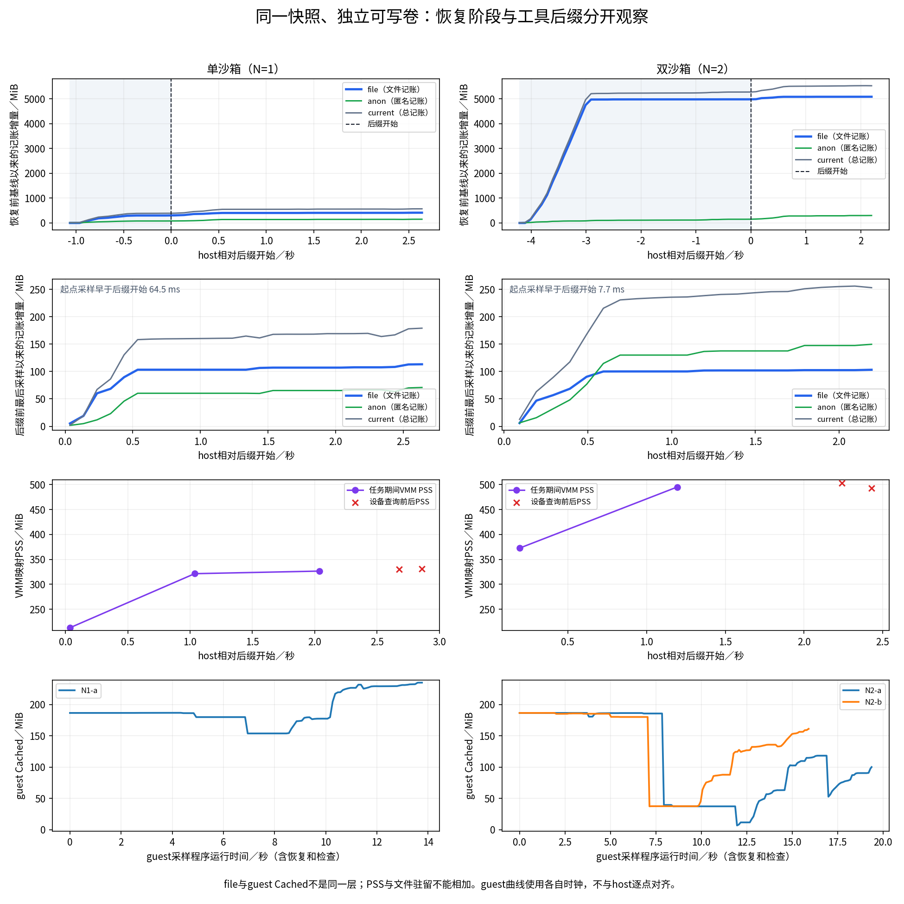

# 同一快照、独立可写卷的单／双沙箱验证（2026-10-21）

后续已完成[导入后同步及30动作验证](HOST_IMPORT_SYNC_VALIDATION.md)：两组恢复前file差降至3.379 MiB，准备写回干扰明显减小。本页保留此前实现与实验条件、数字及判定。

**单沙箱和双沙箱两组均已完成，共新增30个后缀动作；复用此前11步，共41个实际动作。两组从同一份快照恢复，使用各自全新的私有服务和可写卷，恢复、原动作、补丁检查及清理通过。收尾扫描修补在两组均实跑通过。** 原官方测试每实例仍为0通过／2失败，未改写为测试通过。

[对比图](evidence/host-independent-pair-20261021.png) · [脱敏数字与状态](evidence/host-independent-pair-20261021.json) · [前缀、首次失败及恢复经过](HOST_INDEPENDENT_PAIR.md)

## 执行范围与通过条件

用户授权后，只删除此前失败目录`20261021T031738Z-3920554/volume.ext4`这一个24 GiB卷。日志、原FAIL、11步前缀、已验证快照归档及校验记录保留。删除后54.105 GiB可用，满足新卷启动前超过50 GiB的条件；两组顺序执行，不同时保留两个大卷。

两组导入同一快照`01a15c77-4be9-78c1-a0e6-5af6d502a0ab`。单沙箱执行原10步后缀；双沙箱各执行相同10步，共20步。没有重跑11步，没有增加事件探针、完整任务或开销对照。guest与host均每0.1秒采样，进程PSS每1秒采样；PSS是按共享比例分摊的进程映射内存。

已逐项核对：

- 新服务及VMM创建前统计组已建立，实际内存和I/O记账启用，预启动池关闭；两组服务和可写卷身份不同。
- 三个恢复实例的文件、进度和原进程连续性检查通过；原后缀文本、顺序、退出码和补丁保持。原官方检查在运行中扫描之后执行，每实例0通过／2失败保持。
- 双沙箱的两个VMM共用同一个4 GiB内存后备设备。运行中普通文件清单按设备号和inode去重，原始内存层已经在其中，不再加一次。
- 收尾先停止自有服务，扫描内层文件，再仅对自有文件系统执行`sync -f`，最后扫描后备卷镜像。两组最终清单均稳定、无查询错误；同步分别用时0.680／0.257秒。同步只发生在服务停止后，最终结果代表同步后的状态，不追溯修正旧未同步读数。

本轮没有暂停运行中的guest、预读任务文件、强制驻留、改变DAMON或清理全局缓存。任务原生恢复过程与测量附加操作分开理解。

## 实测量与计时

MiB为2²⁰字节。下列各量来自不同观察窗口，不能相加为物理总量。

| 指标 | 单沙箱 | 双沙箱合计 |
| --- | ---: | ---: |
| 新执行动作 | 10 | 20 |
| 工具累计用时 | 1.774秒 | 2.941秒 |
| 后缀运行墙钟，双沙箱到两者均结束 | 2.645秒 | 2.198秒 |
| 后缀期间host点／完整周期PSS点 | 27／3 | 22／2 |
| 恢复前host file基线 | 32363.742 MiB | 33115.758 MiB |
| 后缀结束、扫描前file相对恢复前增量 | 413.934 MiB | 5087.617 MiB |
| 同时anon增量 | 150.578 MiB | 301.238 MiB |
| 同时memory.current增量 | 566.801 MiB | 5527.820 MiB |
| 指定内存设备全局驻留 | 409.285 MiB | 421.543 MiB |
| 设备查询前／后VMM匿名PSS | 124.309／124.324 MiB | 266.219／256.188 MiB |
| 设备查询前非VMM匿名PSS | 122.965 MiB | 131.605 MiB |
| 运行中普通清单：恢复前／任务后文件数 | 192／205 | 192／208 |

两台并行沙箱的工具用时相加可以超过墙钟。这不是完整29步任务计时，也不是采样开启／关闭对照，不能据此计算减速率。整个外层采集包含准备、检查及收尾，共2393个host计数点、240次PSS扫描，其中4次不完整扫描原样保留，不补零。

guest采样器整个存活期的Cached峰值：单沙箱235.020 MiB，双沙箱两个实例186.574／186.594 MiB；这段还包含恢复检查及官方评测，不只后缀。图中guest使用各自采样器时钟，不假装与host任务起止精确对齐。**guest Cached是guest内部缓存；host file是宿主统计组记账，含shmem及公共准备成本；guest RAM中的缓存还可能在host记为匿名内存。**

## 关键发现：大部分增长发生在后缀开始之前

独立卷消除了第一组可写状态直接传给第二组的问题，但没有让两组缓存和写回状态自动一致：

| 从恢复前基线开始观察 | 单沙箱 | 双沙箱 |
| --- | ---: | ---: |
| 基线至后缀开始 | 1.153秒 | 4.262秒 |
| 后缀开始前最近采样的file增量 | 300.719 MiB | 4984.438 MiB |
| 该采样至后缀最后采样的file增长 | 113.215 MiB | 103.180 MiB |
| 最近开始前采样距后缀开始 | 64.529毫秒 | 7.669毫秒 |
| 最后采样距后缀结束 | 6.894毫秒 | 3.843毫秒 |
| 恢复前脏文件页file_dirty | 5869.500 MiB | 5120.895 MiB |

因此双沙箱约5 GiB的增长主要不在后缀命令执行期间。上表113／103 MiB是邻近采样间变化，不是精确同步端点，也不是节省量。

两组恢复前file相差752.016 MiB，其中自有loop后备镜像驻留相差748.613 MiB；不同查询范围与时刻使两者不要求逐字节相等。运行中该后备镜像驻留从5189.543／5938.156 MiB增至6255.652／10596.859 MiB。双沙箱开始后缀前，脏页已降至约474.395 MiB；恢复到后缀结束间观测到的在写回页最多57.547 MiB。单沙箱任务末仍有约5875 MiB脏页，更多写回发生在后续查询与收尾。最终同步后，两组后备镜像驻留接近，分别11063.723／11065.977 MiB。

源码`scripts/native_checkpoint_bundle.py:61–75`确认导入会解压并核对5.731 GiB仓库，但返回前没有文件系统同步。**数据支持的解释是：准备阶段留下的脏页与延后写入loop后备文件的过程影响了恢复基线和曲线。** 现有记录没有逐页事件，不能把每一字节的变化全部归给这一机制。只减去各组基线仍不足以建立整体物理节省对照。

## 驻留检查完整，记账差额仍须保留

| 最终扫描，均为自有文件系统同步后 | 单沙箱 | 双沙箱 |
| --- | ---: | ---: |
| 普通文件数 | 201 | 204 |
| mincore全局驻留 | 39.046211 GiB | 39.048431 GiB |
| 查询前／后组内file | 34.142719／37.340923 GiB | 36.891102／37.346252 GiB |
| 超过两次file较大值的净差 | 1746.214844 MiB | 1743.031250 MiB |
| 其中归档文件自身全局驻留 | 1746.109375 MiB | 1746.109375 MiB |

mincore只查询页是否驻留，不读取文件内容。它包括组外驻留，不能与组内file直接相加。两组均保持`SHORTFALL_REQUIRES_RESOLUTION`；任务与最终清单通过不代表记账完整。

本轮把先前在新统计组之外生成的归档加入清单，共12类根。归档驻留足以解释大部分净差，**但本轮没有逐页记账归属证据**，不能直接扣除后宣布通过。若假设归档全部记在组外，差额减归档分别为+0.105469／−3.078125 MiB，这只是条件计算，不是已证明的剩余组外容量，也不是总误差上限。历史共享卷0.480469 MiB净不足按原范围保留，不与本轮新范围替换。

指定内存设备若采用用户提出的单沙箱线性外推：`2×409.285156=818.570312 MiB`，相对双沙箱421.542969 MiB，减少397.027344 MiB，即**48.503%**。这是这一设备相对线性参考的数值，不是实测不共享后端，也不是整体host物理节省。设备缓存包含多种guest RAM内容，不能当作guest Cached对应页集合。整体物理节省及guest缓存对应物理集合仍为`NOT_MEASURED`。

## 证据、资源与本阶段完成情况

- 工作流程：`.artifacts/host-file-independent-pair/20261021T034211Z-3929367/`，实际退出0，原生摘要`PASS_INDEPENDENT_WRITABLE_PAIR`。
- 两组原始结果：`.artifacts/storage-isolated-service/20261021T034328Z-3930066/`、`20261021T034446Z-3931877/`。
- 删除授权落实、运行驱动、逐项离线核对、绘图及资源检查：`.artifacts/host-independent-pair-resume-20261021/`。

本轮未改运行代码，复用上轮80项不同离线检查；新增对真实结果、身份、原动作、时间顺序、清单、差额及清理的离线核对通过，图已实际查看。原前缀平台FAIL仍保留。本轮两个成功卷、服务、挂载、loop及输入RAM均已释放，同一源服务已重新停止；结束54.089 GiB可用。

本阶段约定的同一快照、独立可写环境、恢复前后清单、原结果、收尾修补和清理均齐全，停止追加实验。已交付独立环境验证及准备写回差异的定量说明，未输出整体物理节省比例。

## 下一步计划供检查

只修正已发现的起点问题：导入快照后、创建guest及读取基线前，对自有文件系统执行一次`sync -f`并记录结果，不做全局同步、不靠等待扩大有效时间。离线检查顺序后，如用户同意，只复用同一归档再执行单／双两组30个后缀动作，不重跑前缀、不加探针或开销轮次。完成条件是准备写回与任务窗口分开、基线和后备镜像分项齐全，原结果及清理保持；仍有差异就照实报告，不为得到相近曲线追加轮次。归档记账与总体物理覆盖另保留缺口。
