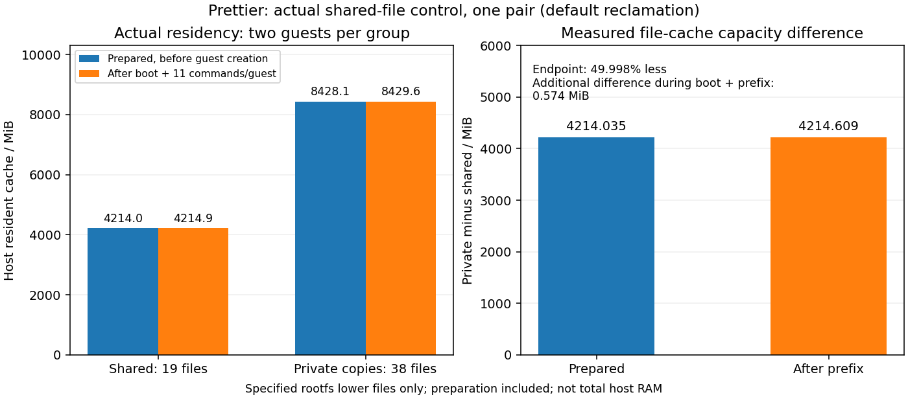

# 两个沙箱共享文件的真实副本对照（2026-10-24）

**后续已完成：[交替顺序三对的原值、均值及样本标准差](HOST_PRIVATE_FILE_REPEATS.md)。本页保留首对结果和报告修复事实，不与旧七倍参照混合。**

**一对对照的44个原动作完成。任务结束时，共用19个系统盘下层文件驻留4214.949 MiB，两个独立副本共驻留8429.559 MiB，实际容量差4214.609 MiB，即4.116 GiB、49.998%。差异主要在准备阶段已经存在。**

这是两组真实文件驻留之差，不再是七倍单沙箱的换算。共享组的原报告生成失败，已从保存数据修复报告并复核动作，没有重跑其22动作；原外层FAIL及未执行的后续检查保留。独立副本组的新入口、任务、报告和清理通过。

## 测了哪些文件

两组各两个相同私有AgentENV服务，每服务一个新建guest；只改变Prettier固定19个系统盘不可变下层文件是否共用。共享组的两个guest实际引用同一套19个inode；独立组各用一套、共38个不同文件身份。两组目标都在自有磁盘ext4卷中，以只读绑定提供给服务，容器内路径和层顺序不变。

P0在准备并同步自有文件系统后、guest创建前；P1在两个guest均完成原`read_repo`、`read_typescript`共11动作后、删除前。两点均对实际文件身份去重后用`mincore`查询已有缓存驻留，不读取文件数据页。P1另核对活VMM配置、实际使用者、服务打开描述符、查询前后文件及VMM身份。独立组的单使用者对象也全部查询，不套用旧的“至少两个使用者”过滤。

默认回收、0.1秒guest／host采样、PSS关闭保持。不暂停guest、不清缓存、不预读、不强制驻留；没有快照保存／恢复或后缀。准备源、其他层和工具盘不计入这19个目标的容量差，匿名页和整体RAM不在本次范围。

## 实际容量差主要出现在准备阶段

| 指标／MiB | 共享一套 | 各用一套 | 独立减共享 |
| --- | ---: | ---: | ---: |
| P0：准备后、guest创建前 | 4214.035 | 8428.070 | 4214.035 |
| P1：启动及11动作结束后 | 4214.949 | 8429.559 | 4214.609 |
| P0→P1的变化 | +0.914 | +1.488 | +0.574 |

比例按P1的`(独立驻留−共享驻留)/独立驻留`计算，为49.997984%。所有差值保留符号；没有把容量参考当成实测值，也没有将不同缓存层相加。



这表明：在本次准备流程下，共用指定文件确实避免了第二套约4.116 GiB的host文件缓存；约4.115 GiB的差在guest启动前就已存在。不能把整个差值归为11个工具动作新增的收益。

旧五轮的每套5308.066 MiB是当时全驻留的容量，本轮19个文件在两点均只有部分页驻留。新入口复制目标后核对完成状态和长度，不再对目的层文件做全量校验读取；两组使用相同规则。旧准备流程的全量读取会改变缓存状态，因此两批不混合统计。本轮没有区分稀疏文件洞页与回收对未驻留页的各自贡献，不从端点数据归因某次DAMON回收。

## 查询成本与任务时间分开

| 指标／秒 | 共享组 | 独立副本组 |
| --- | ---: | ---: |
| P0驻留查询 | 0.274 | 0.397 |
| P1驻留查询 | 0.216 | 0.380 |
| 两次驻留查询合计 | 0.490 | 0.778 |
| P1实际引用核对 | 0.095 | 0.099 |
| 原工具累计，22动作 | 1.849 | 1.826 |
| 首次guest创建至两个前缀结束 | 18.177 | 14.942 |
| host周期采样线程CPU | 0.450 | 0.480 |

P0身份准备没有单独CPU计时；由保存的同步结束与查询开始时间可知，其所在区间分别不超过4.226／4.189毫秒，不记成零或精确耗时。后续入口已补直接计时，未为此重跑本轮。P1元数据与两次驻留查询分别记录，表中没有把同步、准备复制、报告或清理混进查询成本。工具并发，累计时间不等于墙钟时间；本轮无关闭测量对照，不给任务减速率。

组内`memory.stat:file`曲线另保存在各组`host-file/memory.tsv`，覆盖准备、服务、guest及Shmem。两组虽执行了`sync -f`，P0的file_dirty仍分别为963.652／0.125 MiB；不能认为整个组的脏页已经一样或为零。此处主结果来自指定文件的直接驻留查询，不用两组file基线差推算节省，也不将file与目标驻留相加。

## 原报告故障、修复与清理的判定

共享组的两个任务各11动作均为PASS，P0／P1与活对象关联已完成。随后`report_task_overview.py`按旧前缀入口读取`prefix_before`，因新入口没有执行旧宽范围扫描而报KeyError。协调器因此保留FAIL并停止，未自动启动独立组。

修复仅为新模式增加明确的报告分支，复用原动作、顺序、预期退出码、输出及清理检查；旧前缀仍调用原检查器。利用保存数据生成了两份完整guest曲线与时延报告。共享组原外层及组结果仍是FAIL；报告失败之后的活进程可写文件检查没有执行，保留`NOT_RUN`，不能从事后报告修复补成PASS。创建时的只读容器／挂载边界、原任务、实际目标驻留和自有资源清理均有独立证据。

独立组在修正版上完成22动作、两个报告、活进程写入范围检查、只读根检查、固定卷分配及清理，外层为PASS。全机VMM身份比较中，第二个服务退出时仍有本组第一个guest，原比较为false；保存身份已核实该进程正是本组另一个guest，不是原服务被改变。源服务身份及原服务所属VMM检查保持，两组结束后无活动自有guest／服务。

最初保留了两个16 GiB报告失败卷。用户明确授权删除第二个卷后，已核对无挂载、loop、文件使用者及容器，再删除`20261024T140550Z-831831/volume.ext4`；日志及删除记录保留。第一份`20261024T140541Z-831053/volume.ext4`仍保留。独立组两个成功卷已按原流程清理，源服务恢复停止，收尾约62.4 GiB可用。本轮总计只执行44个新原动作，没有重跑共享组。

## 交付与剩余范围

本阶段已取得真实文件副本对照、19／38对象去重、两阶段驻留、原动作和查询成本，可以使用上述指定文件缓存结论。共享组原外层流程的报告故障和后续检查缺失单列，不称两组原流程全部通过。

本页保留首对原值，不单独估计均值或波动；该对先共享、后独立，且中间有报告修复和定向清理。后续已按授权补两对并交替实际顺序，三对均值、样本标准差和全部原值见[三对报告](HOST_PRIVATE_FILE_REPEATS.md)，首对间隔及原流程状态仍单列。

本阶段已按三对收尾，停止追加同类实跑。这些容量不是整个host RAM节省，也不是guest Cached的逐页物理归属；不自动扩到七沙箱、恢复层或完整调度。

## 报告、证据与入口

- [逐对象驻留、两个阶段、动作与成本](evidence/host-private-file-control-20261024.json)。
- [设计、源码依据与资源边界](HOST_PRIVATE_FILE_CONTROL_DESIGN.md)。
- 共享组：`.artifacts/host-private-files/20261024T140421Z-shared-830229/`；离线恢复报告在其`report-recovery/`，原FAIL未改。
- 独立组：`.artifacts/host-private-files/20261024T141120Z-private-836854/`。
- 成对记录：`.artifacts/host-private-file-pairs/20261024T141118Z-836377/`；最初失败记录`20261024T140420Z-829753/`保留。
- 实现、测试、分析、修复和定向删除脚本：`.artifacts/host-private-files-implementation-20261024/`。

普通新对照入口如下，运行前仍检查两个16 GiB卷的合计预算：可用磁盘严格超过58 GiB，沿用原RAM准备、卷内余量、失败保留及删除授权规则。

```bash
bash scripts/run-host-private-files.sh configs/platform-prettier6604-host-file.json
```

新增`--order private-first`时实际先执行独立组，再执行共享组；默认`--order shared-first`保留原顺序，旧的共享组报告恢复入口仍按原顺序工作。计算始终按模式取“独立减共享”，不依赖结果数组的位置。14项相关离线检查通过，包含反向执行后的差值方向及旧默认兼容。

授权新增的两对已完成，顺序为独立→共享、共享→独立，复用本页首对形成三对；执行及逐对复核保存在`.artifacts/host-private-file-repeats-20261024/`，见上方三对报告。采集配置和文件清单不变，没有重采首对、替换高低值或删除旧卷。

只离线复算本轮结果与图，不启动服务：

```bash
python3 -B .artifacts/host-private-files-implementation-20261024/analyze.py
python3 -B .artifacts/host-private-files-implementation-20261024/plot.py
```
