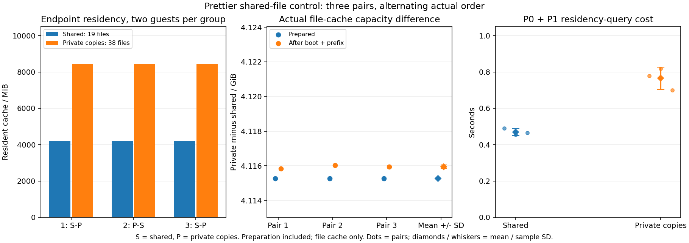

# 共享文件真实副本对照：交替顺序三对结果（2026-10-24）

**按计划新增两对、88个原动作，与有效首对组成三对、共132动作。指定19个下层文件在两个沙箱共用时，相对各自一套副本，结束时实际少占4214.720 ± 0.109 MiB（约4.116 GiB），少占比例49.998648%，标准差0.000660个百分点。** 表中及正文的±均为样本标准差（n−1），百分比的标准差单位为百分点。

新增两对的任务、19／38对象身份与使用者、两阶段驻留、报告、写入边界及清理逐对通过。首对共享组保留原报告FAIL、离线恢复记录及其后未执行的活写入检查；其有效任务和目标驻留参与本次指定文件统计，不把原外层流程改成PASS。

## 三对原值与执行顺序

| 对次 | 实际执行顺序 | 结束时共享驻留／MiB | 结束时独立驻留／MiB | 独立减共享／MiB | 相对独立少占／% |
| --- | --- | ---: | ---: | ---: | ---: |
| 1 | 共享→独立 | 4214.949219 | 8429.558594 | 4214.609375 | 49.997984 |
| 2 | 独立→共享 | 4214.945312 | 8429.773438 | 4214.828125 | 49.999305 |
| 3 | 共享→独立 | 4214.949219 | 8429.671875 | 4214.722656 | 49.998656 |

第一对复用此前原值，没有重采。第二对先独立后共享，第三对先共享后独立；不仅交换图例。每组仍是两个相同私有服务、各一个新建guest，每guest执行相同原11动作。一对44动作，不运行后缀、快照或完整官方检查。



中图纵轴放大显示小幅变化；圆点是每对原值，菱形和误差线为均值与样本标准差，不是置信区间。各轮file曲线和guest曲线保留在原报告，不补0、不对不同持续时间强行求平均。

## 准备阶段和运行阶段分开

令共享／独立组在准备后、guest创建前的驻留为S0／U0，两个guest完成前缀后的驻留为S1／U1。每对先计算实际差，再做三对统计：

| 指标 | 均值 ± 样本标准差 |
| --- | ---: |
| 准备后容量差U0−S0／MiB | 4214.035156 ± 0.000000 |
| 前缀结束容量差U1−S1／MiB | 4214.720052 ± 0.109398 |
| 共享组启动及前缀期间增长S1−S0／MiB | 0.912760 ± 0.002255 |
| 独立组启动及前缀期间增长U1−U0／MiB | 1.597656 ± 0.107475 |
| 容量差的期间变化／MiB | 0.684896 ± 0.109398 |
| 相对独立组少占／% | 49.998648 ± 0.000660 |

比例是逐对计算`(U1−S1)/U1`再求均值，不是均值之比。正负值全部进入统计，零分母保持未定义，不为接近50%增加、替换或剔除轮次。

当前结果支持在本次准备流程和指定文件范围下的实际缓存共享收益。主要差值在guest创建前就已存在，不归为11个工具动作新增量。对象是系统盘不可变下层的host文件缓存，不是整个host RAM，也不是guest Cached的逐页物理归属。

## 配置、对象与旧结果的关系

保持19个文件的内容来源、层顺序、大小、普通复制和只读绑定、默认回收、0.1秒guest／host及PSS关闭。每阶段按实际device,inode（设备编号与文件编号）去重：共享组19个、每文件两个使用者；独立组38个、每文件一个使用者，均显式查询。两阶段身份稳定，P1有实际VMM（运行虚拟机的宿主进程）引用、打开描述符和查询前后身份依据。`mincore`只查询已有驻留，不读数据页；不清缓存、预读、强制驻留或暂停guest。

本组三对没有对目的层做额外全量校验读取；与旧全驻留5308.066 MiB／套的五轮参照不同，不混合求均值。公共种子、归档、其他层、工具盘和匿名页不并入目标容量差；cgroup file只作整组上下文，不与目标驻留相加。

准备后虽然已同步自有文件系统，组内脏页仍可能不同；三对共享组P0的file_dirty分别为963.652／5.219／0.090 MiB。因此不使用两组file基线差代替指定文件驻留差，也不把同步理解为整个组脏页清零。未采逐次回收事件，不从这些端点断言某次DAMON回收是变化原因。

## 查询成本与计时范围

| 指标／秒，均值 ± 样本标准差 | 共享组 | 独立组 |
| --- | ---: | ---: |
| 两次驻留查询合计 | 0.469 ± 0.018 | 0.765 ± 0.061 |
| P1活对象关联 | 0.097 ± 0.003 | 0.097 ± 0.002 |
| 原工具累计，22动作 | 1.831 ± 0.112 | 1.897 ± 0.117 |
| 首次guest创建至两个前缀结束 | 15.135 ± 2.665 | 14.109 ± 0.867 |

查询合计仅包括P0／P1驻留查询，元数据分列；并发工具累计不等于墙钟时间。首对P0身份准备仅有保存时间戳给出的上界，新两对有单独墙钟／线程CPU计时；JSON保留精确值与上界的区别，缺失不补0。采样CPU和脏页上下文亦逐对保留。本组没有关闭采样的成对对照，不从时间构成或顺序差推算任务减速率。

## 原流程状态与资源收尾

新增四组均是正常入口完成报告、实际写入范围、只读根、固定卷分配和自有资源清理。原动作和退出码检查保持。第二个服务退出时，第一个本组guest仍存在；全机VMM列表比较false的原值保留，已按保存PID／启动身份核对为本组同伴，原服务及其VMM检查保持。

首对共享组在P1和原22动作完成后，旧报告因读取`prefix_before`失败；修复后只用保存数据恢复报告。原FAIL和其后NOT_RUN检查仍保留，详见[首对报告](HOST_PRIVATE_FILE_CONTROL.md)。本组三对的统计对象是有效的指定文件驻留，不把这份原外层失败改写为全流程通过。

本轮未删除任何旧卷；此前保留的16 GiB卷`20261024T140541Z-831053/volume.ext4`继续保留。每组两个16 GiB卷启动前按合计32 GiB检查可用磁盘严格超过58 GiB，源服务每对恢复停止，自有guest、服务、挂载、loop、成功卷及准备RAM缓存清理。原结果和失败日志不改写，没有暂存、提交或推送。

## 完成范围与下一步

三对及约定统计已完成，停止追加同类实跑。交替执行后可以描述本流程下观察到的波动；三对不是随机化大样本，也不能单独区分执行顺序与背景状态的因果贡献。首对中途的报告修复和清理间隔仍记录，不从统计中隐去。

这组报告可直接用于说明指定共享文件缓存的实际容量差。后续已完成[完整同调度的离线清单与安排](HOST_FULL_PRIVATE_SCOPE.md)：初始19层作为主对照，BPO生成层保持默认共享、单列，原调度和观察阶段固定。新完整入口尚未实现且空间不足，未启动完整对照；不直接外推本组比例。

## 数据、入口与复算

- [三对逐对象、逐阶段原值及统计](evidence/host-private-file-repeats-20261024.json)。
- 原方法、首对及报告修复：[首对报告](HOST_PRIVATE_FILE_CONTROL.md)。
- 新增两对的命令、日志、预算、逐对复核与复算脚本：`.artifacts/host-private-file-repeats-20261024/`；每个`round-N-audit.json`记录实际工作流和存储目录。
- 顺序开关及容量差方向的14项相关离线检查通过，原默认及共享恢复入口保持。采集核心未变，不重复旧完整测试或有效首对。

只离线读取保存结果，不启动服务或查询当前缓存：

```bash
python3 -B .artifacts/host-private-file-repeats-20261024/summarize.py
python3 -B .artifacts/host-private-file-repeats-20261024/plot.py
```

实际反向执行入口如下，须有对应实验授权且满足原资源预算：

```bash
bash scripts/run-host-private-files.sh configs/platform-prettier6604-host-file.json --order private-first
```
