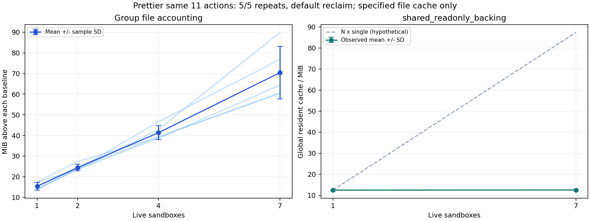

# 共享文件缓存轻量测量与五轮短实验（2026-10-22）

本阶段只研究指定共享文件／设备的host缓存驻留，不再追求匿名内存或整体host物理节省。guest每0.1秒读取meminfo，host每0.1秒读取整组memory.stat／current；anon保留原始计数，不作主要分析。新的递增模式不请求周期、检查点或指定对象查询中的PSS；旧入口默认采样及解释保持。

## 对象分类和去重

| 分类字段 | 对象和依据 | 怎样使用 |
| --- | --- | --- |
| shared_readonly_backing | 全部实际VMM的只读驱动指向同一缓存对象 | 主要比较对象；N=1为候选，N=7须核实七个实际使用者 |
| prepared_input | 原只读输入层清单，冷启动使用源image-cache/commits | 公共准备单列，不乘七、不算本轮节省 |
| snapshot_memory_device | 恢复VMM实际共用的内存后备设备 | 与系统盘分开；本轮五次冷启动不涉及 |
| snapshot_memory_layer | 后端实际打开的不可变原始内存层 | 公共导入单列，不乘七；不与内存设备混成guest Cached物理量 |
| other_owned_backing | 恢复入口观察到的其余自有设备 | 不算共享对象，不参加线性参考 |

普通文件以device＋inode去重；块设备以实际rdev去重，同时保留节点身份和容量证据。在同轮N=1和N=7间核对目标身份集合与容量；同内容不同inode不合并。同一设备的多个驱动名只查询一次。身份变化、清单缺失或查询不完整保留失败，不补0。不同类别不合成整体物理总量，也不与cgroup file相加。

## 阶段、计时与重复统计

每轮使用一个新统计组、一个私有服务、一个16 GiB卷；准备后sync -f自有文件系统，服务创建前生效。确认无预启动VMM后取基线，同组按1→2→4→7递增。每guest只执行原相同11步前缀，共77动作，不做后缀、快照或官方测试。老guest不删除、不暂停；每批原动作／顺序／退出码检查通过后才继续。

固定9次计数／身份／guest meminfo检查点；N=1与N=7各做一次指定对象mincore，不按0.1秒扫描大设备。每次保存起止时刻、耗时、查询线程CPU、前后cgroup计数和逐对象查询时段。N=1查询发生在继续扩展之前，计入整体递增序列用时；N=7查询发生在最后原动作结束后，两次成本各列。工具时间不包含这两次host查询，但N=1查询会延长老guest等待时间。

计划固定5次，全部成功对应385条原工具动作。不以额外成功重跑替代失败；失败先停止扩展并定位边界。第一轮N=1直接作为新路径验证，不另加试跑。保持AgentENV默认回收，不清缓存、不预读、不强制驻留、不额外暂停。这里“冷启动”指新guest，不承诺每轮文件缓存为空。

共享只读盘及快照内存设备分别计算F1、F7以及7F1−F7，再报告均值、样本标准差、各轮数值及有效轮数。公共输入和导入原始层只列驻留，不乘七。主汇总图展示各数量检查点的file变化，以及N=1／7对象驻留的均值±标准差和各轮线；N=2／4未测物理驻留，不插值冒充实测。峰值先取每轮峰值再平均，不使用平均曲线峰值。工具／guest原曲线保存在各轮报告，不按采样编号或退出后补0做平均。

默认回收和文件冷热状态可造成波动；重复不能消除先后顺序及老guest运行时间更长的影响。因此7F1−F7是相对七份单沙箱容量的线性参考差，不是实测不共享后端，也不是整体RAM节省率。

## 入口

```bash
bash scripts/run-host-shared-repeats.sh \
  --output .artifacts/host-shared-repeats-<新的标识>
```

入口仅暂时启动已确认身份、原本停止的源服务，不更换服务；五轮各自新建组／服务，结束恢复源服务停止状态。每轮预算仍由既有保护检查，16 GiB卷启动须超过42 GiB可用；失败卷不自动删除，24 GiB恢复模式仍须超过50 GiB。恢复与采样关闭对照未在本轮追加。

离线重建汇总（不启动服务、不查询当前缓存）：

```bash
python3 -B scripts/report_host_shared_repeats.py \
  .artifacts/host-scaling/<第一轮> .artifacts/host-scaling/<第二轮> \
  .artifacts/host-scaling/<第三轮> .artifacts/host-scaling/<第四轮> \
  .artifacts/host-scaling/<第五轮> --output .artifacts/<新的汇总目录>
```

## 当前验证

离线修改、19项新模式及统计相关用例、27项旧采样／只读前缀／恢复兼容用例通过，共46项。最初4项失败为测试mock保留了可变字典引用，导致事后把N=1看作N=7；修正测试记录当时数量后通过，生产代码未为测试放宽条件。保留原失败日志。脚本语法检查通过。

证据与修改前副本：`.artifacts/host-shared-files-20261022/`。五轮实跑与实际成本已取得，结果见下。旧[递增入口报告](HOST_SCALING_ENTRY.md)保留原实现过程；其中anon／PSS主指标安排由本页新范围替代，既有旧数据不重定义。


## 五轮结果：共享系统／工具盘缓存基本不随数量增长

五轮全部通过，每轮原77动作，共385动作；无失败任务或替代轮次。每轮七个实际VMM的只读系统／工具盘都指向同一个64 GiB设备，N=1和N=7间身份、容量保持；每阶段对该缓存对象只查询一次。每阶段分类为31个公共准备文件＋1个共享只读设备，无重复对象。每轮9次固定检查点、五轮合计10次驻留查询齐全；7281个host样本、6040个guest样本，最大host采样间隔100.144340毫秒。guest保持轻量模式，未请求逐VMM采样，PSS文件均未生成。

| 轮次 | N=1驻留／MiB | N=7驻留／MiB | 相对七份单沙箱参考少占／MiB |
| --- | ---: | ---: | ---: |
| 1 | 12.500000 | 12.523438 | 74.976562 |
| 2 | 12.425781 | 12.550781 | 74.429688 |
| 3 | 12.527344 | 12.535156 | 75.156250 |
| 4 | 12.460938 | 12.601562 | 74.625000 |
| 5 | 12.484375 | 12.542969 | 74.847656 |
| 平均±样本标准差 | 12.480 ± 0.039 | 12.551 ± 0.030 | 74.807 ± 0.286 |

相对七份单沙箱容量参考，平均少85.633%，样本标准差0.068个百分点。该结果对应指定共享只读系统／工具盘的host缓存；设备创建前的驻留未观测，不将其补0，也不把端点差称为从空缓存开始的净增长差。独立可写任务卷不在这个共享对象中，未据此推断任务仓库缓存或全部guest缓存的物理节省。

公共输入层两阶段均驻留6845.805 MiB，作为公共准备单列，不乘七。整组file在N=7的增量平均70.423 MiB、标准差12.779 MiB；它还包含独立卷、服务等文件缓存，不能替代图右侧的指定对象驻留。图左是数量检查点之间的趋势，不是平均时间曲线；浅线是每轮，深线及误差线是均值和样本标准差。



### 查询和任务时间分开报告

| 指标 | 五轮平均±样本标准差／秒 | 范围说明 |
| --- | ---: | --- |
| 原工具累计 | 5.856 ± 0.248 | 77动作执行时长之和，含并发，不是任务墙钟 |
| 递增序列用时 | 34.813 ± 4.721 | 无沙箱基线结束至最后原动作结束，包含创建、检查点和N=1查询 |
| N=1驻留查询 | 1.878 ± 0.017 | 在继续扩展前，已包含在上一行 |
| N=7驻留查询 | 1.885 ± 0.024 | 在最后原动作结束后，未包含在序列用时 |
| 两次查询合计 | 3.764 ± 0.032 | 独立列出，不再次加到含N=1的序列时间上 |

周期host采样线程平均消耗0.472 CPU秒，覆盖包含准备／收尾的整轮流程；它不是任务减速值。指定对象查询线程每次约1.8 CPU秒，成本明显高于一次cgroup计数读取，所以只在两个阶段查询。后续已完成[关闭周期采样的一轮对照](HOST_SHARED_SAMPLING_CONTROL.md)，两种模式均保留固定查询；采样影响按该报告的实际差值和样本范围理解。

五轮创建前脏页均低于1 MiB，实际为0.809／0.816／0.797／0.809／0.227 MiB。原默认回收设置保持，无清缓存、预读、锁页或额外暂停。每轮自有VM／服务、挂载、loop、成功卷和准备资源均已释放，源服务恢复原停止状态。

[脱敏数值及成本](evidence/host-shared-files-repeats-20261022.json)。原始总目录`.artifacts/host-shared-repeats-20261022/`，每轮入口、任务及报告路径在其`result.json`和脱敏JSON中。独立复核脚本`.artifacts/host-shared-files-20261022/verify_results.py`仅读已保存元数据，已确认原动作数、身份、去重、页数换算、时段、同步顺序、清理与重复统计。汇总和第一轮实际图片已查看。

## 后续对照已完成

已按后续授权补充[关闭host周期采样的一轮77动作对照](HOST_SHARED_SAMPLING_CONTROL.md)，guest、固定检查点和两次驻留查询保持。新结果不并入上方五轮平均数；工具和递增序列时间均落在开启五轮的实际范围内，观察差与归因条件见新报告。下一步建议以新报告为准。

后续已完成[一轮已有快照递增恢复验证](HOST_SHARED_RESTORE.md)，原始层公共准备规则及独立盘查询成本见该报告；未将恢复结果并入上方五轮冷启动统计。
