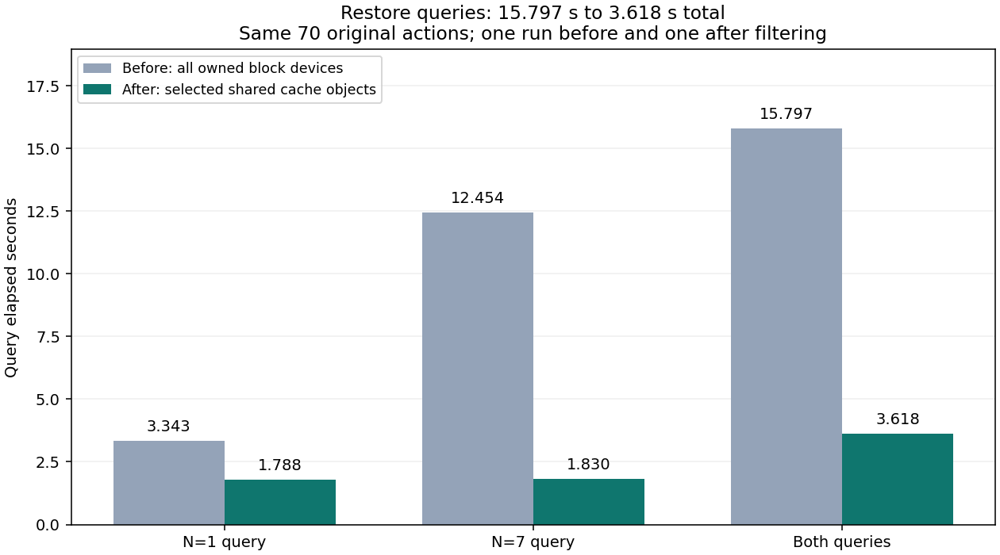
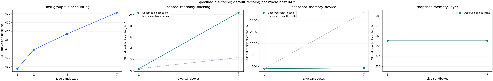

# 共享文件恢复测量：过滤后的真实成本验证（2026-10-23）

**一轮70个原后缀动作的恢复序列通过，过滤后的两次查询共3.618秒，比上一轮15.797秒少77.10%。** 每阶段保留3个共享／公共目标对象；N=1跳过1个独立盘，N=7跳过7个，均明确记为未查询，驻留字段为空。原恢复状态、动作／顺序／退出码、补丁、每guest原官方0通过／2失败和清理保持。

本轮仅验证一次新路径，复用已有第11步快照，不重跑前缀、不制作新快照，也未追加相近轮次。已有31项离线检查证据复用，本次采集代码没有再改。

## 查询成本已实际降下来

| 阶段 | 上轮完整范围／秒 | 本轮共享目标／秒 | 查询用时减少 |
| --- | ---: | ---: | ---: |
| N=1 | 3.343 | 1.788 | 46.52% |
| N=7 | 12.454 | 1.830 | 85.30% |
| 合计 | 15.797 | 3.618 | 77.10% |



两次查询线程CPU合计从15.763秒降为3.593秒。保留对象的查询成本基本相近：本轮快照内存设备每次约0.15–0.19秒、只读系统盘约1.56–1.57秒、公共原始层约0.017秒；减少主要来自不再扫描独立盘。上轮完整范围及逐类成本见[原恢复报告](HOST_SHARED_RESTORE.md)。

这是相同快照、相同有效配置下各一轮的实际查询成本比较。新旧设备身份分别在各自存活期内核对，不跨轮强行认作同一设备；共享对象角色和容量相同。没有用旧独立盘耗时作减法冒充本轮实测，也不将查询耗时减少77.10%称为整个任务加速77.10%。

本轮原工具累计12.584秒，递增序列17.124秒；N=1查询1.788秒已包含在序列中，N=7查询1.830秒发生在最后原动作之后。两次查询合计不能再次整体加到已含N=1的序列用时上。

## 三类目标都保留，跳过项不补零

| 对象 | N=1驻留／MiB | N=7驻留／MiB |
| --- | ---: | ---: |
| 共享快照内存设备 | 403.750000 | 433.046875 |
| 共享只读系统／工具盘 | 0.332031 | 10.324219 |
| 公共导入原始内存层 | 555.457031 | 555.457031 |

快照内存设备逻辑容量4 GiB，只读盘64 GiB；所有活跃guest在两个阶段都确认使用对应共享对象，身份和容量在同轮中保持。公共原始层按实际打开的文件确认，inode和容量在同轮中保持。每阶段恰好2个共享块设备＋1份公共原始层，未漏查或重复累计。

每个排除设备的身份与实际可写驱动集合对应，且不出现在实际查询清单中。`residency_scope=SHARED_FILES_ONLY`，排除项为`NOT_REQUESTED`，`resident_pages`和`resident_bytes`均为null；本轮不再报告这些盘的缓存为0。旧入口不传新选项，默认仍保留完整范围。

相对七份单沙箱容量参考，快照设备缓存少2393.203 MiB、84.678%；这只对应指定后备缓存。只读盘参考差为−8.000 MiB，如实保留，不据此推断稳定共享收益。公共导入层只列555.457 MiB驻留，不乘七算新增收益，也不与内存设备或整组file相加。



四幅图依次是整组file检查点、只读盘、快照内存设备和公共原始层。对象驻留只测N=1／7，未补造N=2／4物理量。不同轮次和阶段的自然回收／访问会改变驻留数值；本轮不要求它们与上轮恰好相等，也不把范围不同的新旧两轮合并求平均。

## 原任务与轻量采样保持

- 每guest只执行原early_1的相同10步后缀，共70个新动作；原前缀新增动作0，导入模板在结束时删除，未制作新快照。原源记录的外层FAIL和已有导出恢复证据保持。
- 新统计组、私有服务和24 GiB卷；准备／导入后同步自有文件系统，guest创建前无预启动虚拟机，内存及I/O控制器状态有效，基线脏页0.809 MiB。
- guest和host每0.1秒轻量采样，9个固定检查点；1822个host点、1300个guest点，最大host采样间隔100.119281毫秒。未请求PSS、逐VMM采样或逐页探针。
- N=1恢复、原动作及对象查询通过后，才扩展到2／4／7；两阶段分别保存开始／结束、查询线程CPU、逐对象时段和前后计数。默认回收保持，无清缓存、额外预读、锁页或暂停。
- 七个guest的恢复进度／文件／进程检查、原动作、最终补丁及原每实例官方0通过／2失败均保持；未把官方任务失败写成任务成功。
- 自有guest、导入模板、私有服务、挂载、loop、成功卷和准备资源均回收，源服务恢复原停止状态，旧归档和旧失败结果不改写。

## 证据与复现

- [脱敏结果、逐对象成本及范围核对](evidence/host-shared-filter-live-20261023.json)。
- 总目录：`.artifacts/host-shared-filter-live-20261023/`；`run.py`管理唯一一次执行及定向收尾，`analyze.py`只读保存数据复核，`plot.py`只绘制已验收数值。
- 实际入口：`.artifacts/host-scaling/20261022T161046Z-397110/`。
- 实际任务：`.artifacts/storage-isolated-service/20261022T161203Z-398657/prettier6604/`。
- 旧完整范围结果：`.artifacts/host-shared-restore-20261022/`，离线修改：[过滤说明](HOST_SHARED_FILTER.md)。

复算及重绘不启动服务，也不查询当前缓存：

```bash
python3 -B .artifacts/host-shared-filter-live-20261023/analyze.py
python3 -B .artifacts/host-shared-filter-live-20261023/plot.py
```

本阶段已完成新路径、实际对象覆盖、未查询状态和真实查询成本验证。图片已实际查看；没有为改善数值追加试跑或重复完整测试。

## 后续五轮统计已完成

按此处原建议新增4轮相同恢复序列，共280个原后缀动作，与本轮组成5轮统计。完整结果见[五轮报告](HOST_SHARED_RESTORE_REPEATS.md)，旧完整扫描结果未混入；本报告的单轮数值和修改前后成本比较保持。
