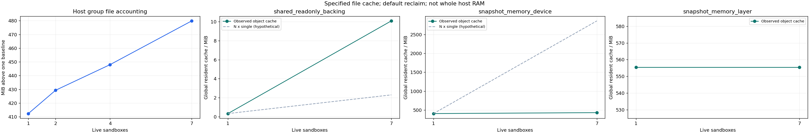

# 共享文件轻量模式：已有快照递增恢复短验证（2026-10-22）

**一轮同组1→2→4→7恢复序列已完成，共70个原后缀动作。** 七个guest的恢复状态、动作／顺序／退出码、最终补丁及原每实例官方0通过／2失败保持；采集、共享身份、对象去重和清理通过。没有重跑11步前缀或制作新快照，没有追加重复轮次。

## 先看分开的共享对象

| 对象 | N=1驻留／MiB | N=7驻留／MiB | 相对七份单沙箱容量参考少占／MiB |
| --- | ---: | ---: | ---: |
| 共享只读系统／工具盘 | 0.328125 | 10.089844 | -7.792969 |
| 共享快照内存设备缓存 | 408.359375 | 433.285156 | 2425.230469 |
| 公共导入的原始内存层 | 555.457031 | 555.457031 | 不外推 |

**共享快照内存设备的缓存从408.359 MiB增到433.285 MiB，没有随七个沙箱成倍增长。** 相对七份单沙箱容量参考，少2425.230 MiB、84.842%。这里测的是host上的共享快照后备缓存，不是整个4 GiB guest RAM、guest Cached对应的完整物理量或整体host内存节省。

只读盘缓存本轮由0.328 MiB增到10.090 MiB，单次线性参考差为负数−7.793 MiB，如实保留。单沙箱端点的驻留量不能充分代表七沙箱阶段后续访问的缓存量；本轮只报告实际身份、两阶段驻留和算术差，不将该项解释为稳定共享收益。未采集逐次访问／回收事件，不能把增长归因于DAMON或某条具体命令。

原始内存层属于创建guest前导入的一份公共快照，两个端点均驻留555.457 MiB。缺少该对象在创建guest前的驻留基线，不能将其乘七算本次新增收益，也不与快照设备相加。初次自动报告曾对该层也列出七份线性算术值；本轮已只离线修正图表展示，公共层不再绘制该参考或填写节省值，原始JSON算术值和任务结果保留。



四幅图依次是整组file趋势、共享只读盘、共享快照内存设备、公共原始层。实测物理驻留只有N=1／7两个阶段，N=2／4没有补造对象驻留。虚线为单沙箱容量的线性参考；公共原始层只画实测线。整组file在四个阶段的基线增量为412.297／429.301／447.977／479.887 MiB，不与对象驻留相加。

## 恢复和身份怎样核对

- 复用`.artifacts/storage-isolated-service/20261021T031738Z-3920554/checkpoint-bundle/`及原第11步证据。该源记录的原外层FAIL保持，按已有导出恢复和归档验证记录复用；本轮新增前缀动作0。
- 每个guest都从同一个已导入模板恢复，再执行原early_1的相同10步后缀；首个guest恢复状态、原动作及N=1测量通过后，才扩展下一批。原动作总计70，原前缀不复制成本轮执行。
- 实际进程映射确认所有活跃guest共用一个4 GiB内存设备；只读驱动确认共用一个64 GiB系统／工具盘。两阶段设备身份和容量保持，公共原始层的device＋inode也保持。
- 新统计组／私有服务在guest前创建，内存及I/O记账开启，无预启动VMM；准备／导入后同步自有文件系统，创建前file_dirty为0.734 MiB。
- 保持guest和host每0.1秒轻量计数，不请求PSS或逐VMM监控；9个固定检查点、1981个host点、2395个guest点。默认回收保持，不清缓存、不预读、不锁页、不额外暂停。

## 查到了明确的非必要扫描成本

| 指标 | 实际用时／秒 | 计时范围 |
| --- | ---: | --- |
| 原工具累计 | 13.087 | 70条原命令时长之和，包含并发 |
| 递增序列 | 18.788 | 基线结束至最后原动作结束，包含创建、检查点和N=1查询 |
| N=1对象查询 | 3.343 | 已包含在递增序列中 |
| N=7对象查询 | 12.454 | 最后原动作结束之后，未包含在序列中 |
| 两次查询合计 | 15.797 | 不再次整体加到含N=1的序列时间上 |

现有恢复查询复用了“枚举自有服务打开的所有块设备”的旧实现。N=1扫描1个独立可写设备，N=7扫描7个，每个逻辑容量64 GiB。它们本轮实测缓存均为0，但完整mincore仍分别需要约1.5秒；不是查询读入了数据。

两次查询在这些独立盘上共耗时12.228秒，占全部对象查询时间77.41%。独立盘不是本阶段的共享文件目标，这笔成本可以明确定位。不能把去掉它后的理论差额当作已经实测的优化用时。

本轮保留实际成本，没有增加相近实跑改善数字。后续已完成[新模式离线过滤](HOST_SHARED_FILTER.md)，保留共享只读盘、快照内存设备和公共原始层；旧入口默认完整范围保持。过滤后的真实成本尚未实测。

## 证据和完成状态

- [脱敏数值、逐类成本及实际路径](evidence/host-shared-restore-20261022.json)。
- 总目录：`.artifacts/host-shared-restore-20261022/`，`run.py`保存唯一一次运行和源服务收尾；`analyze.py`只读已保存数据复核。
- 入口结果：`.artifacts/host-scaling/20261022T143050Z-378112/`。
- 实际任务：`.artifacts/storage-isolated-service/20261022T143209Z-378938/prettier6604/`。
- 修正展示：`.artifacts/host-shared-restore-20261022/report-corrected/`；自动原报告和原始结果保留。

已有采集代码的有效离线证据直接复用；本轮实跑后仅修正公共导入层的报告展示，新增该项回归并运行8项相关报告用例及1项旧冷启动报告兼容用例，均通过。检查器和图表修补没有引起任务重跑。原始动作、每guest官方0通过／2失败、同步顺序、去重、页数换算、查询时段和成本复核通过，实际图已查看。

自有guest、导入模板、私有服务、挂载、loop、成功24 GiB卷及准备资源均释放，源服务恢复原停止状态。旧前缀归档及原失败结果保持，不删除旧失败卷。

后续获准运行时仍使用已有入口，24 GiB卷启动前须超过50 GiB可用：

```bash
export ASB_AGENTENV_SOURCE_SERVICE=asb-source-rebuilt-20261018T160925Z-2726362
bash scripts/run-host-file-monitor.sh \
  configs/platform-prettier6604-host-file.json --scaling restore \
  --resume-prefix .artifacts/storage-isolated-service/20261021T031738Z-3920554
```

## 后续离线过滤已完成

[独立盘扫描的离线过滤](HOST_SHARED_FILTER.md)已完成，31项相关检查及上轮两阶段元数据重放通过；共享／公共对象的身份和原驻留保持，跳过独立盘的驻留为空而不是0。下一步仅建议一轮相同70动作验证实际成本，范围和完成条件见新报告，不自动启动。
