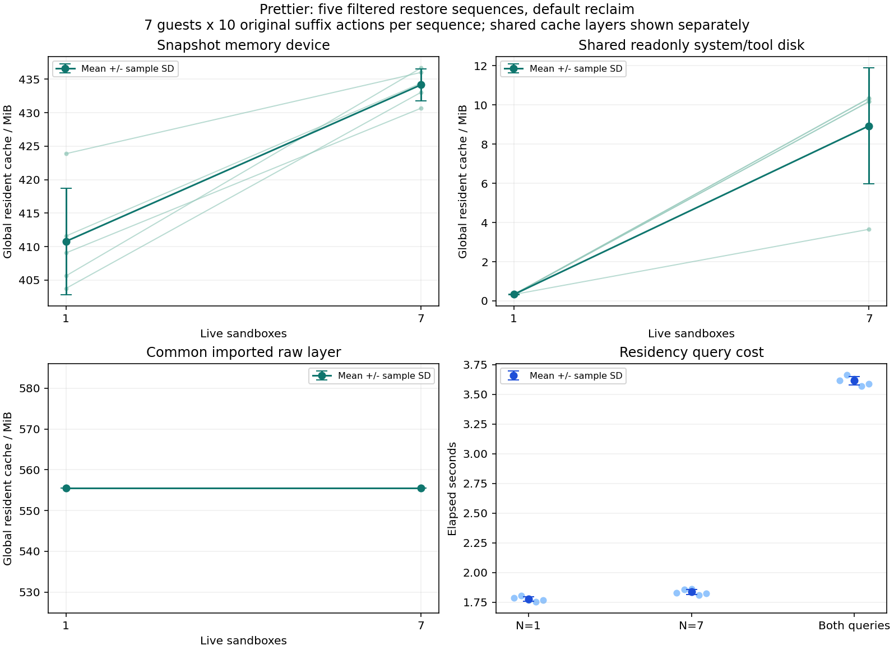

# 共享文件缓存：五轮恢复短实验（2026-10-23）

**新版恢复模式的5轮统计已完成，本次新增4轮、280个原后缀动作，连同已完成首轮共350个动作。** 每轮使用同一已有第11步快照，七个guest各执行原10步后缀，在同一个统计组和私有服务中依次增加到1、2、4、7个；驻留查询只在N=1和N=7进行。没有重跑前缀或制作新快照，旧完整扫描轮次没有混入。

## 三类对象分别统计

以下“±”为5轮的样本标准差，用于表示轮次间波动；不是误差上界或置信区间。MiB按2²⁰字节计算。

| 对象 | N=1平均±标准差／MiB | N=7平均±标准差／MiB |
| --- | ---: | ---: |
| 共享快照内存设备 | 410.773 ± 7.924 | 434.163 ± 2.412 |
| 共享只读系统／工具盘 | 0.329 ± 0.002 | 8.932 ± 2.953 |
| 公共导入原始内存层 | 555.457 ± 0.000 | 555.457 ± 0.000 |

方法保持轻量模式：每0.1秒读取guest的`/proc/meminfo`和host统计组计数；指定共享后备的实际缓存驻留用`mincore`查询。`mincore`检查当前缓存页是否驻留，不读取文件内容来填充缓存。每阶段按实际身份去重，查询2个共享块设备和1份公共原始层；1／7个独立可写盘明确为`NOT_REQUESTED`，驻留字段为空，不写成零。

三类对象分别属于不同缓存层，不相加为整体物理内存。公共原始层是导入准备，只列实际驻留，不乘七计算收益。N=2／4仅有统计组计数，未补造这两个阶段的对象驻留。



浅色线表示各轮N=1与N=7的两个观测点，深色点和误差线表示均值与样本标准差；连线不代表中间阶段已做驻留查询。右下图为查询实际耗时。

## 相对七份单沙箱容量参考的差值

每轮先计算`7 × N=1驻留 − N=7驻留`，再统计5轮均值和样本标准差。这个参考没有运行独立、不共享的七沙箱后端；N=1与N=7也是顺序观测，因此它描述容量参考差，不是严格的因果节省或整机RAM节省。

| 对象 | 容量参考差平均±标准差／MiB |
| --- | ---: |
| 共享快照内存设备 | 2441.251 ± 54.713 |
| 共享只读系统／工具盘 | -6.630 ± 2.949 |

共享快照设备的每轮参考比例平均为84.897%、样本标准差0.272个百分点。只读盘的参考差为负，保留原值；单沙箱端点仅约0.329 MiB，而七沙箱端点访问及回收过程不同，这组参考不能证明该盘的稳定共享收益。公共原始层不参与上述计算。

## 默认回收下的波动保留在结果中

| 轮次 | 快照设备N=1／MiB | 快照设备N=7／MiB | 只读盘N=1／MiB | 只读盘N=7／MiB |
| --- | ---: | ---: | ---: | ---: |
| 1 | 403.750000 | 433.046875 | 0.332031 | 10.324219 |
| 2 | 409.050781 | 430.671875 | 0.328125 | 10.343750 |
| 3 | 411.570312 | 434.398438 | 0.328125 | 10.164062 |
| 4 | 405.621094 | 436.683594 | 0.328125 | 10.175781 |
| 5 | 423.875000 | 436.015625 | 0.328125 | 3.652344 |

只读盘第5轮N=7为3.652 MiB，前4轮为10.164–10.344 MiB；第5轮仍通过同样的动作、身份、查询与清理检查，完整纳入平均，没有删除或补跑替换。实验保持AgentENV默认回收，没有清缓存、额外预读、锁页、暂停或修改DAMON配置；也未增加回收事件探针，因此不能把这一差异具体归因于DAMON。轮次间冷热状态可能不同，不将这些轮次称为“每轮冷缓存”；固定递增顺序的影响也不会因取平均而消失。

## 查询成本和原工具用时分开

| 指标 | 五轮平均±标准差／秒 |
| --- | ---: |
| 原工具累计耗时 | 12.849 ± 0.511 |
| 递增序列墙钟用时 | 17.275 ± 0.391 |
| N=1驻留查询 | 1.777 ± 0.019 |
| N=7驻留查询 | 1.838 ± 0.022 |
| 两次驻留查询合计 | 3.614 ± 0.036 |
| 两次查询线程CPU合计 | 3.591 ± 0.038 |
| host周期采样线程CPU（完整采集窗口） | 0.603 ± 0.014 |

原工具累计是并发工具调用耗时的求和，不等于整轮墙钟用时。递增序列从基线结束计到最后原动作结束，已含N=1查询，不含N=7查询；两次查询合计不能再次整体加到序列用时上。采样线程CPU涵盖准备、任务与收尾，不直接作为任务减速率。

| 轮次 | 工具累计／秒 | 递增序列／秒 | 两次查询合计／秒 | host点数 | guest点数 |
| --- | ---: | ---: | ---: | ---: | ---: |
| 1 | 12.584068 | 17.123577 | 3.617923 | 1822 | 1300 |
| 2 | 12.904744 | 17.863696 | 3.662409 | 1814 | 1297 |
| 3 | 12.923871 | 17.054589 | 3.632524 | 1816 | 1293 |
| 4 | 13.608099 | 17.456441 | 3.568773 | 1884 | 1314 |
| 5 | 12.225503 | 16.875344 | 3.590492 | 1810 | 1292 |

过滤后的两次查询合计范围为3.569–3.662秒，成本已稳定记录。原[单轮修改前后成本比较](HOST_SHARED_FILTER_LIVE.md)保持原范围；本次没有新增关闭采样组，不从五轮结果推导整个任务的测量减速率。

## 完成条件与证据

- 5轮均使用相同有效配置、相同导入快照、不同的新统计组；每轮9个固定检查点，host与guest均为0.1秒轻量采样，PSS未请求。准备后仅同步自有文件系统，取基线时脏页均低于1 MiB。
- 每轮两个阶段均验证三类目标实际身份、容量及去重；跳过设备与活跃guest的独立可写盘集合一致。查询开始／结束、线程CPU、逐对象成本和前后计数保持。
- 每轮七个guest的恢复状态、原动作／顺序／退出码、最终补丁与原结果保持。原官方测试每实例仍为0通过、2失败；恢复和测量检查通过不改写任务本身的失败。
- 每轮启动24 GiB卷前可用磁盘均超过50 GiB；自有guest、导入模板、服务、挂载、loop、成功卷和准备资源均清理，源服务恢复原停止状态。没有删除旧失败卷。
- 原31项离线用例证据继续有效，采集代码未改。本次复用原执行和保存数据检查脚本，另以只读汇总核对5轮配置、统计组、对象和状态；没有重复完整测试。

证据：

- [五轮逐值、均值和样本标准差](evidence/host-shared-restore-repeats-20261023.json)。
- 总目录：`.artifacts/host-shared-restore-repeats-20261023/`；`run.py`只新增4轮并遇首个失败停止，`report.py`只读保存结果汇总与绘图。
- 第1轮：`.artifacts/host-shared-filter-live-20261023/`。
- 新增第2–5轮：`.artifacts/host-shared-filter-repeat2-20261023/`至`.artifacts/host-shared-filter-repeat5-20261023/`；各自保存执行、独立检查、资源预算及源服务收尾。
- 各轮实际工作流和任务目录见JSON中的`runs`。旧完整扫描、冷启动和关闭host周期采样结果均未混入本次统计。

离线复算（不启动服务或查询当前缓存）：

```bash
python3 -B .artifacts/host-shared-restore-repeats-20261023/report.py
```

## 后续离线核对已完成

完整Prettier GRPO／BPO的对象分类、保存／恢复查询位置和成本已[离线核对](HOST_FULL_SHARED_ALIGNMENT.md)。完整BPO需要处理两份快照及原主沙箱，不能直接套用本页单快照查询。下一步以该报告的显式新模式离线实现建议为准；本页五轮原值和结论保持，不再追加同类短测。
