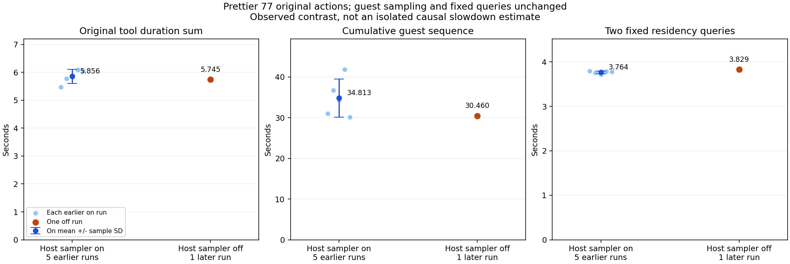

# 共享文件轻量模式：关闭host周期采样对照（2026-10-22）

**关闭周期采样的一轮77条原工具动作、固定检查点、共享对象驻留和清理均通过。** 工具累计5.745秒，递增序列30.460秒；两项都在此前开启五轮的实际范围内。本轮完成了开关对照和耗时差量化，现有样本无法将稳定的周期采样影响与运行间波动分开。

## 只关闭了什么

复用已验证的递增入口、完全相同的代码和有效配置。只把`--host-sampling`设为`off`，不创建host每0.1秒读取cgroup计数的采样线程；没有host周期样本或PSS。以下保持：

- 一个新统计组、一个私有服务、一个16 GiB卷；准备后同步自有文件系统，同组1→2→4→7。
- 七个guest各执行原相同11步，共77动作；动作、顺序、退出码和原任务输出检查通过，不执行后缀或官方测试。
- guest每0.1秒meminfo采样，七个会话均正常回收，合计1152个样本。
- 9次固定计数／身份／guest meminfo检查点，N=1／7各一次mincore对象驻留查询，前后计数和成本保持。
- 默认回收行为，不清缓存、不预读、不强制驻留、不增加暂停。

这不是“关闭全部测量”的实验。此前五轮开启结果直接复用；新的关闭结果不并入原五轮平均数，没有补跑开启组或追加重复次数。

## 开启五轮与关闭一次的实际耗时

| 指标／秒 | 开启：五轮平均±样本标准差 | 关闭：一次 | 开启均值相对关闭单次的耗时差 |
| --- | ---: | ---: | ---: |
| 原工具累计 | 5.856 ± 0.248 | 5.745 | +1.93% |
| 递增序列 | 34.813 ± 4.721 | 30.460 | +14.29% |
| N=1驻留查询 | 1.878 ± 0.017 | 1.885 | -0.38% |
| N=7驻留查询 | 1.885 ± 0.024 | 1.944 | -3.01% |
| 两次查询合计 | 3.764 ± 0.032 | 3.829 | -1.72% |

百分比统一按`（开启五轮平均−关闭单次）÷关闭单次`计算。工具累计是并发命令时长之和；递增序列是无沙箱基线结束至最后原动作结束，包含创建、检查点和N=1查询，不包含N=7查询。两次查询合计不是再加到序列上的额外总量。

工具开启五轮范围为5.476–6.096秒，关闭5.745秒；序列开启范围30.171–41.842秒，关闭30.460秒。作为另一项直接比较，最近一次开启序列30.171秒反而比关闭30.460秒短约0.95%。因此表中的+1.93%与+14.29%是这批样本的观察差，不能据此将其全部归为采样造成的减速；关闭组只有一次，也不是交替重复对照。

开启时host采样线程平均消耗0.472 CPU秒，覆盖整轮准备／任务／收尾，而不是仅任务区间。固定对象查询在开关两种模式下都约3.8秒，本次关闭组两次查询线程合计3.762 CPU秒。要降低明确存在的查询成本，应减少完整对象扫描次数或缩小扫描范围；本轮保持两次查询，没有改动测量含义。

开启入口还会在私有服务停止后做普通文件驻留清单，关闭入口按原约定跳过该清单。这发生在原任务计时区间之外，所以比较工具和递增序列时间，而不拿整个外层工作流时间相减计算采样成本。



图中浅蓝点为此前五轮，深蓝点和误差线为均值及样本标准差，橙色点为本轮单次结果；关闭组没有补造标准差。

## 共享对象和测量内容保持

本轮七个实际虚拟机进程确认共用同一个64 GiB只读系统／工具盘后备，N=1／7间身份和容量保持。指定对象驻留分别12.417969／12.503906 MiB，相对七份单沙箱容量参考少74.421875 MiB、85.615%。这是指定共享只读后备缓存，不是任务仓库或整体host内存节省。

每阶段仍为31个公共准备文件＋1个共享设备，按缓存身份去重，公共输入两阶段均6845.805 MiB，不乘七。创建前脏页0.809 MiB；组内计数保留在固定检查点，没有把关闭周期采样解释为缓存为0，也没有补造连续host曲线。

## 证据、执行与完成状态

- [脱敏数值与原始路径](evidence/host-shared-sampling-control-20261022.json)。
- 本次总目录：`.artifacts/host-shared-sampling-control-20261022/`。
- 实际入口结果：`.artifacts/host-scaling/20261022T142206Z-370761/`。
- 实际隔离任务：`.artifacts/storage-isolated-service/20261022T142324Z-371568/`。
- 开启五轮：[原报告](HOST_SHARED_FILE_REPEATS.md)，原始`.artifacts/host-shared-repeats-20261022/`。

本次没有修改采集代码，复用此前46项相关检查的有效证据。运行前直接比较实际旧运行保留的代码副本，代码及五轮有效配置一致；检查负载和磁盘后，使用现有命令完成唯一一次实跑：

```bash
# 源服务身份、健康及停止状态由本次run.py按原规则管理。
ASB_AGENTENV_SOURCE_SERVICE=asb-source-rebuilt-20261018T160925Z-2726362 \
  bash scripts/run-host-file-monitor.sh \
  configs/platform-prettier6604-host-file.json --scaling cold --host-sampling off
```

本次源服务管理、日志及定向收尾过程保存在总目录的`run.py`，固定单次、无自动替代轮次。只读已保存元数据的复算入口：

```bash
python3 -B .artifacts/host-shared-sampling-control-20261022/analyze.py
```

已确认原动作检查、开关实际生效、guest会话、9次检查点、两次对象查询、身份／去重、计时、同步顺序和资源释放。独立可写边界检查通过，自有guest、私有服务、挂载、loop、成功卷及准备资源已释放；源服务恢复原停止状态。图片实际查看后，调整了标签留白，仅重绘已验收结果，没有重跑任务。

## 后续恢复验证已完成

未为更小的开销比例追加采样对照。后续按授权复用已有第11步快照，已完成[一轮70个原后缀动作的递增恢复验证](HOST_SHARED_RESTORE.md)，未重跑前缀或制作新快照。下一步以恢复报告中已定位的独立盘扫描成本为准，不扩展完整任务或整体host归属研究。
