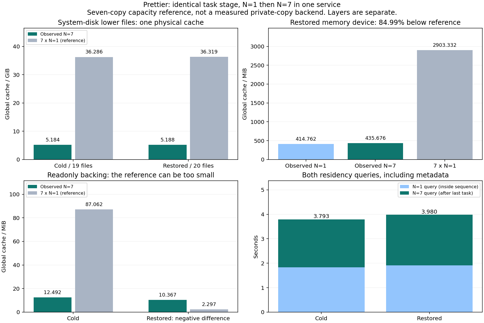

# 共享文件缓存收益：同阶段1→7沙箱参照（2026-10-24）

**后续已完成：[同配置冷启动／恢复各5轮统计](HOST_SHARING_REFERENCE_REPEATS.md)。本页保留首轮原值，已直接计入五轮；恢复只读后备的负值在5轮均出现。**

**同一批系统盘文件从1个实例扩展到7个实例，驻留没有增加；恢复内存设备缓存只增加20.914 MiB。** 按“七份单沙箱缓存”的线性参考，系统盘文件少占约31.1 GiB、85.71%，恢复内存设备少占2.410 GiB、84.99%。恢复组只读盘出现负参考差，完整保留。

本次冷启动和恢复各一轮，分别执行相同原11动作和相同原10后缀；是同阶段的指定缓存容量参照，不是完整GRPO／BPO两种不同调度的均值比较。两组共147个新动作，原结果、对象身份／去重、驻留和清理检查通过。

## 先看实际增加了多少缓存

| 阶段／对象 | N=1驻留A／MiB | N=7驻留B／MiB | 实际变化B−A／MiB |
| --- | ---: | ---: | ---: |
| 冷启动／19个系统盘下层文件 | 5308.066406 | 5308.066406 | 0.000000 |
| 冷启动／共享只读后备 | 12.437500 | 12.492188 | 0.054688 |
| 恢复／20个系统盘下层文件 | 5312.964844 | 5312.964844 | 0.000000 |
| 恢复／共享只读后备 | 0.328125 | 10.367188 | 10.039062 |
| 恢复／4 GiB快照内存设备 | 414.761719 | 435.675781 | 20.914062 |

每组N=1和N=7使用同一服务、同一cgroup、同一批缓存对象。逐文件／设备身份与容量保持，N=7确认每个目标有7个实际使用者；不是按文件名或digest合并不同文件。可写盘、upper、保留卷槽不查、不补0。

冷启动指新建guest，不表示host缓存已清空。目标下层文件的驻留包含准备阶段带入的缓存；本表不是任务独自产生的新增量。各缓存层分别列出，不相加为整体host RAM，也不等同于guest Cached。

## 如何换算共享容量参考差

定义：

- `A`：一个沙箱完成指定原动作后的目标缓存驻留。
- `B`：七个沙箱分别完成同样原动作后的同一目标缓存驻留。
- `R = 7 × A`：假设七份独立缓存各与单沙箱观测A相同的容量参考。
- `参考差 = R − B`，`参考少占比例 = (R − B) / R`。

| 阶段／对象 | 七份单沙箱参考R／MiB | 参考差R−B／MiB | 相对R少占 |
| --- | ---: | ---: | ---: |
| 冷启动／系统盘下层文件 | 37156.464844 | 31848.398438（31.102 GiB） | 85.71% |
| 冷启动／共享只读后备 | 87.062500 | 74.570312 | 85.65% |
| 恢复／系统盘下层文件 | 37190.753906 | 31877.789062（31.131 GiB） | 85.71% |
| 恢复／共享只读后备 | 2.296875 | −8.070312 | −351.36% |
| 恢复／快照内存设备 | 2903.332031 | 2467.656250（2.410 GiB） | 84.99% |

这是相对七份相同缓存的容量差，依赖“每份独立缓存与A相同”的假设。没有运行不共享后端，不把这些百分比称为整个host实际少用的比例。公共准备归档和输入复制件不加入参考；导入的原始内存层在N=1／7均为555.457031 MiB，每阶段按实际文件身份只查一份，不乘七。系统盘下层按活实例实际引用另行分类。



图中灰柱为线性参考，绿色为N=7实测。只读后备的恢复组保留了参考小于实测的情况。

## 为什么恢复只读盘是负值

该组N=1只观察到84页，0.328125 MiB；N=7观察到2654页，10.367188 MiB。七份N=1观测只有2.296875 MiB，因此算术参考差为−8.070312 MiB。此对象的单沙箱参照不足以支持正向收益结论；负值不表示“不共享后端反而省内存”。

同样原动作并不保证两个时刻缓存状态相同。第一恢复实例在N=1／N=7检查点之间经过约13.323秒，guest Cached从187.789降到14.293 MiB；冷启动组第一实例也在约22.511秒间从186.227降到14.973 MiB。它们证明缓存状态在变化，不能将所有差异只归于新增实例。轻量记录没有逐次回收和块访问事件，无法从这两个端点确定哪些额外读入或回收造成了只读盘增长。

本次没有预读、等待缓存变暖、禁用回收或重复到正值；保持负结果，不把它夹成零，也不与其他类别合并抵消。

## 最小实现和验证范围

新增显式`--rootfs-reference`，仅允许配合同组递增采集：

```bash
# 在既有源服务已按原流程启动并通过健康检查后运行。
export ASB_AGENTENV_SOURCE_SERVICE=asb-source-rebuilt-20261018T160925Z-2726362
bash scripts/run-host-file-monitor.sh \
  configs/platform-prettier6604-host-file.json \
  --scaling cold --rootfs-reference

bash scripts/run-host-file-monitor.sh \
  configs/platform-prettier6604-host-file.json \
  --scaling restore --rootfs-reference \
  --resume-prefix .artifacts/storage-isolated-service/20261021T031738Z-3920554
```

新模式直接复用`SharedRollout`及系统盘关联／mincore查询，不执行旧模式的准备文件全清单或独立盘扫描。N=1明确查询单使用者文件作为参照候选；N=7必须确认相同对象集合、容量和7个使用者，再计算参考差。未开启该标志时，原入口、单使用者过滤及旧报告行为保持。

两个阶段都在原动作之后、原检查与删除之前查询；保留原1→2→4→7顺序，N=2／4只有计数和guest meminfo，没有补造物理驻留。N=1阶段作为新路径必要验证，通过后才扩展。0.1秒采样、关闭PSS、默认回收保持，没有增加暂停、清缓存、预读或强制驻留。

- 冷启动：7实例各原11动作，共77动作，仅前缀，官方检查按原规则未运行。
- 恢复：复用现有第11步快照，不执行前缀、不新建快照；7实例各同一原10动作后缀，共70动作，恢复文件／进度／进程及补丁检查通过，官方每实例0通过2失败保持。
- 39项相关离线检查通过，其中5项覆盖新增参照、公共层排除、对象／容量／使用者改变、零参照及旧入口行为。实跑后只补清晰的N=1参照说明文字，5项针对性回归通过，不重跑任务。

| 测量及任务记录／秒 | 冷启动 | 恢复 |
| --- | ---: | ---: |
| 两次查询合计，含元数据 | 3.792756 | 3.979816 |
| 原工具累计 | 6.337961 | 12.656985 |
| 创建至最后原动作结束 | 29.641868 | 17.263688 |

N=1查询包含在递增序列用时内；最后N=7查询在原动作结束之后。表中查询合计不重复加到序列，工具累计不等于墙钟时间；本轮没有关闭采样对照，不推算减速率。host点数为1409／1765，两阶段各文件查询、元数据时段、线程CPU和前后计数见JSON。

## 数据与收尾

- [脱敏对象、端点及有符号参考差](evidence/host-sharing-reference-20261024.json)。
- 本次执行、源服务生命周期、离线测试、复核与绘图：`.artifacts/host-sharing-reference-20261024/`。
- 冷启动工作流：`.artifacts/host-scaling/20261024T051927Z-746105/`；平台记录：`.artifacts/storage-isolated-service/20261024T052045Z-746827/`。
- 恢复工作流：`.artifacts/host-scaling/20261024T052150Z-749080/`；平台记录：`.artifacts/storage-isolated-service/20261024T052307Z-749285/`。
- 新采集／计算：`scripts/host_scaling_reference.py`；新增回归：`tests/test_host_scaling_reference.py`。

两组自有guest、导入快照、私有服务、挂载、loop、成功卷和准备资源均已清理；源服务恢复停止，没有新失败卷待删除。既有完整五轮结果保持，不与本次不同阶段的参照合并。

只读保存结果，不启动沙箱或查询当前缓存：

```bash
python3 -B .artifacts/host-sharing-reference-20261024/analyze.py
python3 -B .artifacts/host-sharing-reference-20261024/plot.py
```

## 下一步建议

本轮同阶段参照完成，停止追加。若需要这些容量参考差的均值和波动，可另定重复范围，继续固定动作和默认回收，并把负参考差原样计入；如果需要实测不共享后端的因果收益，则须另定后端及对象复制方式，不能由重复当前线性参考代替。
