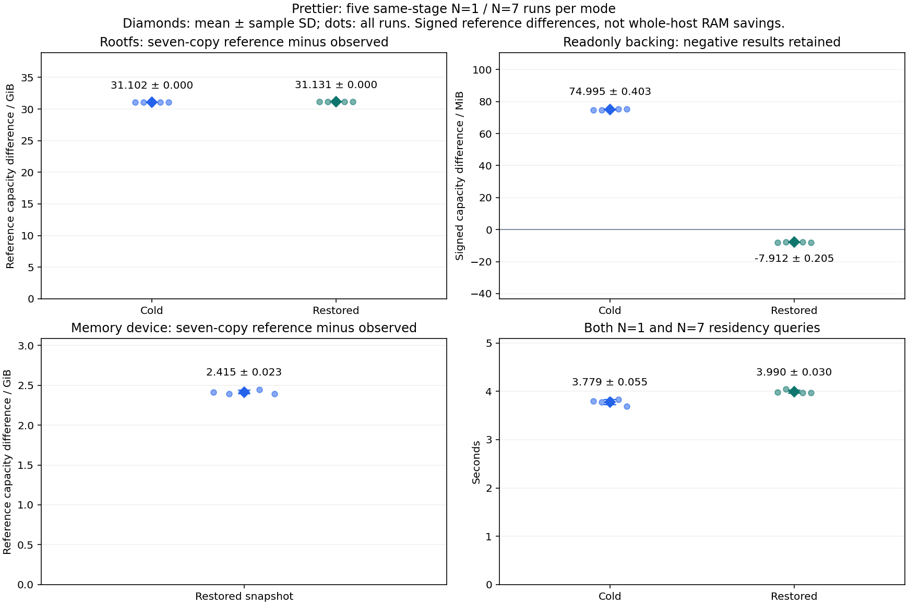

# 共享缓存容量参照：冷启动／恢复各5轮（2026-10-24）

**按计划新增4对参照，588个新原动作；与有效首轮形成冷启动、恢复各5轮，共735动作。每轮使用同组1→2→4→7序列，任务、实际共享对象及清理检查通过。** 所有正负结果都保留，没有重采首轮、剔除轮次或追加到正值。

## 先看实际缓存增长，不先套参考

| 模式／对象 | N=1驻留A／MiB | N=7驻留B／MiB | 实际增长B−A／MiB |
| --- | ---: | ---: | ---: |
| 冷启动／系统盘下层文件 | 5308.066 ± 0.000 | 5308.066 ± 0.000 | 0.000 ± 0.000 |
| 冷启动／共享只读后备 | 12.509 ± 0.069 | 12.565 ± 0.093 | 0.056 ± 0.049 |
| 恢复／系统盘下层文件 | 5312.965 ± 0.000 | 5312.965 ± 0.000 | 0.000 ± 0.000 |
| 恢复／共享只读后备 | 0.328 ± 0.000 | 10.209 ± 0.205 | 9.880 ± 0.205 |
| 恢复／快照内存设备 | 415.384 ± 3.317 | 434.862 ± 1.827 | 19.478 ± 3.931 |

表中为均值±样本标准差。每轮同一批对象在N=1／7的身份、容量保持，N=7有七个实际使用者，按device,inode或块设备实际身份去重。目标驻留包含准备阶段带入的缓存，不等于任务新增量。

## 相对七份单沙箱缓存的容量差

每轮先计算`R = 7 × A`、`D = R − B`及`D / R`，再对5轮求均值和样本标准差（n−1）。容量差使用配对的A／B计算；百分比是逐轮比例的均值，不用均值之比替代。分母为零的比例保留未定义，不补0。

| 模式／对象 | 参考差D／MiB，均值 ± 标准差 | 相对R少占／%，均值 ± 标准差 | 负参考差轮数 |
| --- | ---: | ---: | ---: |
| 冷启动／系统盘下层文件 | 31848.398 ± 0.000 | 85.714 ± 0.000 | 0/5 |
| 冷启动／共享只读后备 | 74.995 ± 0.403 | 85.650 ± 0.056 | 0/5 |
| 恢复／系统盘下层文件 | 31877.789 ± 0.000 | 85.714 ± 0.000 | 0/5 |
| 恢复／共享只读后备 | -7.912 ± 0.205 | -344.456 ± 8.940 | 5/5 |
| 恢复／快照内存设备 | 2472.823 ± 23.460 | 85.044 ± 0.139 | 0/5 |

这里假设七份独立缓存各与本轮单沙箱观测A相同。它是明确的容量参考，不是实测不共享后端或整个host RAM因果节省。公共归档、准备复制件及导入的原始内存层不乘七；各缓存层不相加。冷启动指新建guest，不表示host缓存已清空。



菱形和误差线为均值±样本标准差，圆点是每轮原值，不是置信区间。负容量差保持负值，不夹成零，不与其他类别相抵后输出总收益。

## 每轮有符号原值

| 轮次 | 冷启动系统盘参考差／GiB | 恢复系统盘参考差／GiB | 恢复内存设备参考差／GiB | 恢复只读后备参考差／MiB |
| --- | ---: | ---: | ---: | ---: |
| 1 | 31.101952 | 31.130653 | 2.409821 | -8.070312 |
| 2 | 31.101952 | 31.130653 | 2.394360 | -7.796875 |
| 3 | 31.101952 | 31.130653 | 2.430050 | -8.105469 |
| 4 | 31.101952 | 31.130653 | 2.446217 | -7.613281 |
| 5 | 31.101952 | 31.130653 | 2.393887 | -7.972656 |

完整A、B、7A、B−A、7A−B、逐轮比例以及对象明细均在JSON中。有效首轮在此前单独采集，后4轮连续按冷启动→恢复顺序执行；不混入完整GRPO／BPO五轮或旧的不同查询范围。

## 恢复只读后备的负值如何解释

5轮中5轮的7A小于B。平均N=1为0.328 MiB，N=7为10.209 MiB，参考差-7.912 MiB。该单沙箱参照不能稳定代表七实例阶段的缓存需求，负值不表示不共享后端更省内存。

相同原动作不保证两个时刻的缓存状态相同：较早启动的实例经历了更长时间，默认回收、后台活动和后续读入都可能改变驻留。轻量方案没有逐次回收／块访问事件，不从这些端点归因于某次DAMON操作。重复统计描述了本流程的波动，不消除该参照的系统性限制。没有为提高比例预读、延迟查询、禁用回收或修改负载。

## 查询、任务和采样成本分开

| 指标／秒，均值 ± 标准差 | 冷启动 | 恢复 |
| --- | ---: | ---: |
| 原工具累计 | 5.838 ± 0.326 | 12.719 ± 0.542 |
| 创建至最后原动作结束 | 31.698 ± 5.401 | 17.317 ± 0.460 |
| N=1／7查询合计，含元数据 | 3.779 ± 0.055 | 3.990 ± 0.030 |
| host周期采样线程CPU | 0.459 ± 0.024 | 0.580 ± 0.055 |
| 其中：N=1查询 | 1.829 ± 0.016 | 1.927 ± 0.012 |
| 其中：N=7查询 | 1.950 ± 0.043 | 2.063 ± 0.035 |

N=1查询在递增序列内，N=7查询在最后原动作结束后；查询合计和工具累计不能再次整体加到序列时间。任务并发，工具累计不是墙钟时间。没有关闭采样对照，不推算测量减速率。

## 配置、正确性和清理

- 冷启动每轮7实例各原11动作，共77动作，仅前缀，官方检查按原规则未运行。恢复每轮7实例各同一原10后缀，共70动作；共35次恢复，复用原第11步快照，没有新增快照保存。恢复文件／进度／进程、补丁及官方每实例0通过2失败保持。
- 默认回收、0.1秒guest／host、关闭PSS、实际共享对象分类、两阶段查询与成本不变；不暂停、清缓存、预读、强制驻留或增加等待。每个模式独立新cgroup和私有服务，同模式内部保持同一初始基线和递增对象身份。
- 采集代码未修改，复用首轮39项离线证据及说明文字的5项回归。结果提取只去掉首轮专用的“恰有一个负参考差”断言，允许所有实际符号组合；原动作、身份、容量、去重、时序及清理检查保持。
- 每轮检查实际负载及磁盘预算：16／24 GiB卷分别须超过42／50 GiB可用。所有成功卷、自有guest、导入快照、私有服务、挂载、loop与准备缓存均按原流程清理；每对源服务恢复停止，无本次失败卷待删除。

## 数据与复算

- [五轮统计、所有有符号原值与逐对象记录](evidence/host-sharing-reference-repeats-20261024.json)。
- 执行、进度、逐轮原始结果提取和日志：`.artifacts/host-sharing-reference-repeats-20261024/`。
- 第1轮：`.artifacts/host-sharing-reference-20261024/`；第2—5轮为本次目录下`round-2/`至`round-5/`。每轮`result.json`保留冷启动／恢复工作流和存储目录。
- [首轮方法、公式和负值说明](HOST_SHARING_REFERENCE.md)。

以下只读保存结果，不启动沙箱或查询当前缓存：

```bash
python3 -B .artifacts/host-sharing-reference-repeats-20261024/summarize.py
python3 -B .artifacts/host-sharing-reference-repeats-20261024/plot.py
```

## 下一步建议

本阶段按5轮收尾，不建议继续增加相同重复组。若后续需要实测不共享后端的因果收益，应另定对照后端及对象复制范围；更多相同线性参考不能代替该对照。当前容量参考、实际增长和负结果可直接分别使用。
