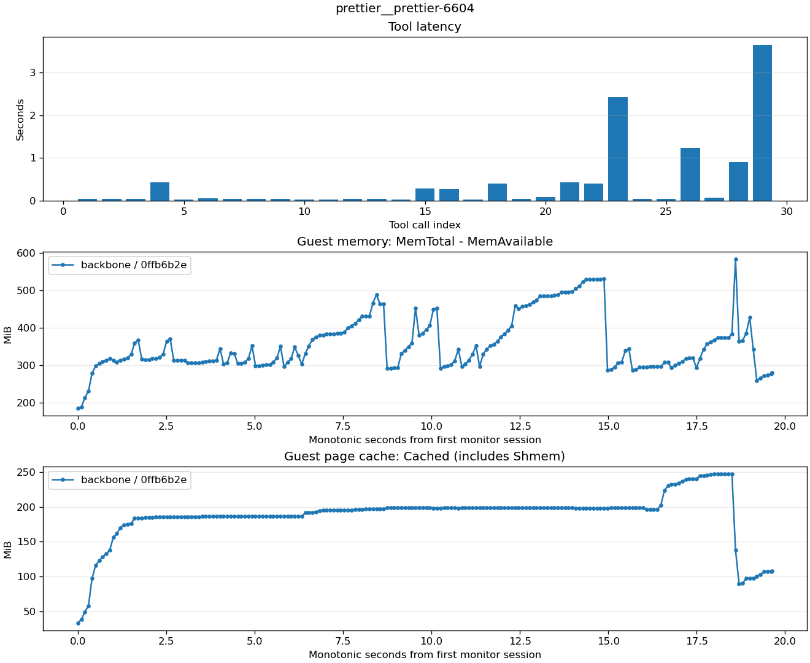

# Prettier新版轻量采样：三对实跑完成（2026-10-25）

**新版合并调用已在真实AgentENV中通过：六次完整运行、174个原动作，开启组共601个采样点。** 直接采样控制耗时中位数0.422秒，旧三次为0.724秒，观察下降41.71%；本轮开关对照的工具耗时配对变化中位数为+2.05%，控制程序整轮为+5.87%。两种比较分别报告，不把41.71%写成任务提速。

当前0.1秒meminfo方案可继续作为普通单沙箱的默认测量方式：采样器CPU小于一个核心的1%，直接启停控制约0.4秒。结论覆盖本轮Prettier普通轻量模式，不替代多沙箱或host物理驻留查询的开销结果。

## 执行范围和检查

固定三对顺序为开启→关闭、关闭→开启、开启→关闭。每次一个新guest，2 CPU／4096 MiB、8 GiB私有卷，执行原29步及原检查。默认回收保持，不清host缓存、不预读、不锁页、不增加暂停，不启动host、PSS、CPU／I/O或精细物理采集。

第一组直接验证新路径，没有另加短任务。三次开启组均确认实际运行本轮采样代码，并且阻塞调用恰好为：一次两文件目录上传、等待首样本、官方检查阶段标记、finish、日志下载。finish的末尾标记、停止及回收通过，host也确认原采集命令结束；没有残留僵尸进程。

六次原动作、退出码、关键输出和最终补丁通过现有检查，配对补丁及原测试结果相同。官方每次仍为0通过、2失败，平台采集成功没有改写任务结果。关闭组无周期或边界内存样本，三次开启组分别197／193／211点，最大采样间隔分别0.103429／0.101737／0.106010秒。

## 本轮开关对照

单位秒。变化逐对按`(开启/关闭−1)×100%`计算，再取三对中位数，不用两列中位数相除。

| 轮次 | 关闭工具时间 | 开启工具时间 | 工具变化 | 关闭整轮时间 | 开启整轮时间 | 整轮变化 |
| --- | ---: | ---: | ---: | ---: | ---: | ---: |
| 1 | 11.826768 | 11.159973 | −5.64% | 22.445663 | 24.084599 | +7.30% |
| 2 | 11.059058 | 11.552505 | +4.46% | 21.820345 | 23.100517 | +5.87% |
| 3 | 12.000023 | 12.246276 | +2.05% | 26.990471 | 24.186452 | −10.39% |

| 计时范围 | 配对变化中位数 | 三对范围 |
| --- | ---: | ---: |
| 原工具命令合计 | +2.05% | −5.64%～+4.46% |
| 原动作重放经过时间 | +5.43% | −1.35%～+9.97% |
| 控制程序整轮 | +5.87% | −10.39%～+7.30% |

整轮包括guest创建、准备、任务、选定检查、监控启停／下载和删除，不包括外层镜像缓存准备及私有服务部署。三对是这批实际观察，不承诺每次都落在这个范围；负差值不解释为采样加速。

## 直接控制成本确实减少，冷启动单列

| 开启组 | 上传 | 等待就绪 | 阶段标记 | finish | 下载 | 合计 |
| --- | ---: | ---: | ---: | ---: | ---: | ---: |
| 第1轮 | 0.040315 | 0.130575 | 0.036715 | 0.114224 | 0.036562 | 0.358392 |
| 第2轮 | 0.046842 | 0.159535 | 0.035486 | 0.166580 | 0.036069 | 0.444513 |
| 第3轮 | 0.041533 | 0.150335 | 0.042794 | 0.152279 | 0.035183 | 0.422124 |

旧三次控制合计为0.794516／0.724133／0.574751秒，新三次为0.358392／0.444513／0.422124秒；中位数减少0.302009秒，约41.71%。这里是历史批次与本轮的直接调用时间比较，不是同批随机化的旧代码／新代码对照，也不是整轮速度提高41.71%。调用次数10→5已在真实日志中确认，后台常驻采集命令的存活时间不重复加入控制成本。

为保留整轮变化的解释，下表分开列出冷启动。最后一列是原整轮时间减去冷启动，仅用于定位耗时，不替代原整轮指标：

| 轮次／模式 | 冷启动 | 整轮减冷启动 |
| --- | ---: | ---: |
| 1／开启 | 3.982512 | 20.102086 |
| 1／关闭 | 2.639075 | 19.806589 |
| 2／开启 | 3.389250 | 19.711267 |
| 2／关闭 | 3.548167 | 18.272178 |
| 3／开启 | 2.635678 | 21.550774 |
| 3／关闭 | 6.692126 | 20.298344 |

第三对关闭组冷启动比开启组长4.056448秒，足以影响整轮正负方向。第二对动作段开启多1.227904秒，也不能全算作新增控制调用。完整分类在数值JSON中精确相加到原纳秒总量，内部调用和后台采样存活时间不重复累计。

## 采样器自身资源和曲线

采样器累计CPU三次为0.131683／0.164735／0.167233秒，按累计CPU除以采样持续时间估算为一个核心的0.67%～0.86%。进程峰值RSS为16.26～16.75 MiB；它含共享部分，不是净增物理内存，不能从guest曲线直接扣掉。采样器自身占用包含在guest全局读数中。

固定展示第一轮开启组，不按耗时或曲线形状挑选；实际图已查看。guest内存为`MemTotal−MemAvailable`，Cached包含Shmem，两者不相加，也不是host物理共享收益：



## 证据和复现

- [本轮脱敏数值、原目录及逐轮分解](evidence/light-prettier-optimized-20261025.json)。
- 总目录：`.artifacts/light-prettier-controls-optimized-20261025/`，`runs.json`指向六份原任务／报告；`plan.json`保存固定顺序，`code/`保存本轮源代码。
- `analysis/summary.json`及`finalize.py`保存本轮汇总和离线分析，`cleanup-check.json`保存资源核对；外层命令及退出码在`.artifacts/light-prettier-controls-optimized-20261025-launch/`。
- [旧成本分解与优化实现](LIGHT_MONITOR_OVERHEAD.md)、[原三任务18次对照](LIGHT_MONITOR_CONTROLS.md)。

只有需要重新开展同范围实跑并获得授权时，使用新目录：

```bash
bash scripts/run-light-monitor-controls.sh --tasks prettier6604 \
  --output .artifacts/prettier-light-controls-new
```

默认不传`--tasks`仍保留原三任务18次范围。本轮新增任务选择功能的两项小检查及原默认汇总回归通过；真实六次单任务计划也已完成。只复算保存记录时：

```bash
bash scripts/run-light-monitor-controls.sh --tasks prettier6604 \
  --output .artifacts/light-prettier-controls-optimized-20261025 --report-only
```

## 完成状态与下一步

六次自有沙箱、私有服务、成功卷、挂载、loop及准备缓存均已清理，源服务恢复停止，无Firecracker进程。实跑最低可用磁盘122.906 GiB，结束约130.905 GiB。没有失败或重试，没有额外任务、host采样、暂存、提交或推送。

本阶段达到约定的正确性和开销量化条件，保留当前轻量方案，不追加Prettier重复。下一步建议只把本轮数字纳入日常测量说明；以后确需多沙箱并发或host物理测量时，再单独评估相应成本，不套用本轮单沙箱数值。
