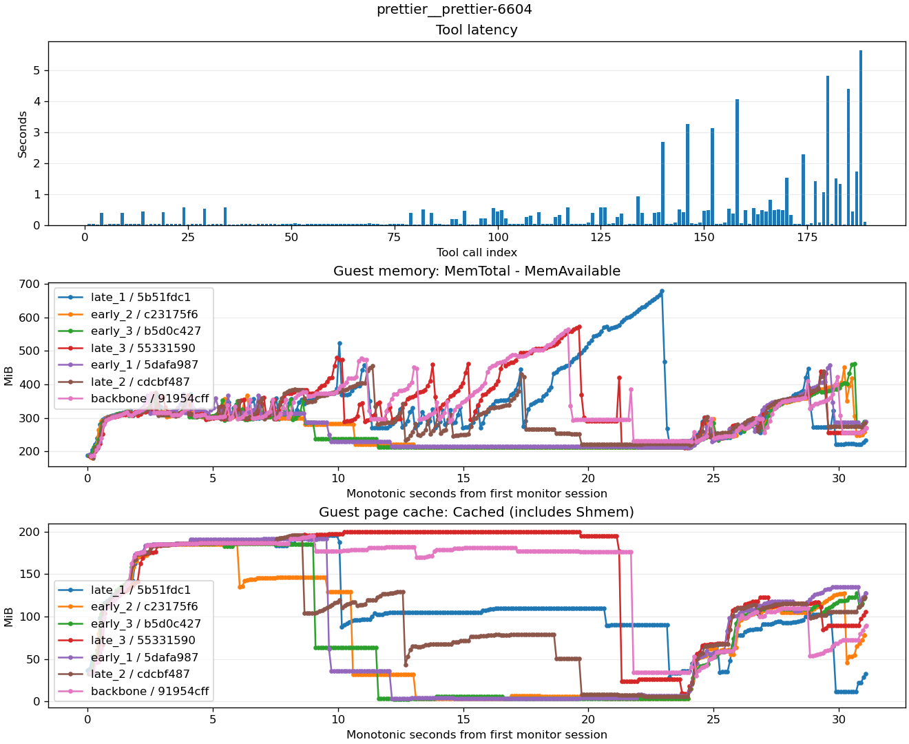

# 多沙箱收尾与host查询成本优化（2026-10-25）

**七沙箱完整GRPO一次通过：189个原动作、2166个guest采样点，原结果和进程回收保持。** 最终收尾墙钟0.514秒，历史同类GRPO为4.48～4.73秒；两次host指定文件查询合计0.144秒，历史共享组为0.346秒。它们是直接成本的观察，不是整轮任务提速比例。

## 先定位实际瓶颈

复用当天已有完整GRPO／BPO原始事件和驻留记录，未重新运行旧任务。原任务与官方检查结束后，七个沙箱逐个停采样、下载、删除；host查询使用Python逐页统计mincore返回向量的最低位，查询时间几乎都是CPU时间。

| 历史运行 | 目标对象数 | 最终串行收尾/秒 | P0＋P1查询/秒 |
| --- | ---: | ---: | ---: |
| GRPO共享 | 19 | 4.734 | 0.346 |
| GRPO独立副本 | 133 | 4.480 | 2.337 |
| BPO共享 | 19 | 4.714 | 0.377 |
| BPO独立副本 | 133 | 4.572 | 2.304 |

收尾时间从全部官方检查结束后的第一个采样控制调用开始，到最后一次删除结束；后台采样命令的存活时间不重复加入。BPO上表只含初始文件两次查询，不含生成层。原始路径与数值在[数据记录](evidence/multi-host-overhead-20261025.json)。

## 两处修改

1. **轻量多沙箱最终收尾并发执行。** 复用标准线程池，最多同时处理七个沙箱；每个沙箱内部仍然先停采样、确认进程回收并下载，再删除。一个沙箱失败会记录错误，其他沙箱仍完成清理，删除失败的实例不会从controller清单移除。任务、快照、查询和官方检查仍在原顺序完成后才进入最终收尾。旧完整采样模式保留原串行行为。
2. **驻留位改用原生字节运算统计。** `bytes.translate`先将每个字节映射为最低位，再用`bytes.count`计数；不再用Python逐页循环。高位仍然忽略，可选驻留页索引保留原逻辑。查询次数、每次对象集合、device/inode去重、页大小、文件／设备身份检查、`mmap(PROT_NONE)+mincore`均不改；没有读取数据页、预读、锁页或增加暂停。

对所有256种字节值、空向量、全驻留／非驻留以及可选页索引做了回归。模拟向量按初始19文件的页数构造，只测试统计计算：

| 模拟对象规模 | 旧统计中位数/秒 | 新统计中位数/秒 | 原统计/新统计 |
| --- | ---: | ---: | ---: |
| 19文件，1,358,865页 | 0.113250 | 0.001677 | 67.55倍 |
| 133文件，9,512,055页 | 0.793856 | 0.011567 | 68.63倍 |

两种统计页数相同。这不是文件的真实驻留，也不是完整查询快68倍；完整查询还需要内核mincore和元数据核对。

## 一组真实七沙箱验证

只做一组共享模式的完整GRPO，沿用一个新私有服务、七个原角色、189动作和默认回收。host／guest计数间隔0.1秒，PSS关闭，指定初始19文件各有7个使用者，仍只在P0／P1查询。没有新增独立副本组、BPO、开关对照或额外短任务。

**并发收尾实际生效：** 七个沙箱的独立收尾耗时相加为3.278秒，而重叠执行的墙钟只有0.514秒；每个实例均停止、回收并删除成功。原任务与检查流程在最终收尾之前的源码与修改前直接比较相同。收尾更快会缩短末尾空闲采样时间，不能要求末尾点数和旧运行相等；仍按每个沙箱自己的实际时间和阶段记录。

| host查询 | 对象／使用者 | 墙钟/秒 | 线程CPU/秒 | 实际驻留/MiB |
| --- | --- | ---: | ---: | ---: |
| P0：准备完成、guest创建前 | 19／每文件7 | 0.068692 | 0.068693 | 4214.035156 |
| P1：原路径结束、官方检查前 | 19／每文件7 | 0.075510 | 0.074366 | 4214.832031 |
| 合计 | — | **0.144202** | **0.143059** | 不相加 |

相对历史同类共享组0.346159秒，直接查询合计观察下降58.34%。这是历史前后比较，不是本轮旧代码／新代码交替对照。独立133文件的新版真实查询和BPO新版联动本轮没有运行；上面的133文件结果仅为模拟统计计算。

## 周期采样本身的成本

- 七个guest采样器合计1.544486 CPU秒，各自约占一个核心的0.65%～0.77%；峰值RSS16.09～16.80 MiB。RSS包含共享部分，不当作净增物理内存，也不直接求和当host独占物理量。
- host计数共1275点，线程CPU合计0.501929秒；其中读取计数墙钟合计0.399183秒，平均每点约0.313毫秒。覆盖整个准备／运行／收尾，而非仅任务窗口。
- 本次没有PSS采集，也没有额外清理后的大范围扫描；显式副本模式原本就只保留两次目标查询，本次没有为降低成本缩小范围。

七沙箱工具时长合计与并发墙钟不能相加；本轮控制程序34.508秒，rollout窗口33.690秒。因为没有同批关闭测量组，本轮不报告整体减速率，也不把新的驻留数值变化解释为新增共享收益。既有组外记账缺口和未覆盖内存的判断保持。

## 正确性、记录与复现

51项不同离线检查通过：新5项、host文件14项、完整副本控制11项、BPO分类3项、文件层9项、原多路径9项。新测试覆盖并发重叠、停止后才删除、停止／删除失败继续回收其他实例，以及三个真实本地采样子进程的并发回收。首次本地模拟错误地共享phase文件，按真实沙箱的独立目录修正后复验通过；这不是沙箱实验失败，初始日志保留。

真实运行的七个角色、原命令顺序、退出码、关键输出和最终补丁通过原检查，官方每实例仍0通过2失败。全部采样会话确认回收，无guest CPU／I/O采样，图已实际查看：



- 总目录：`.artifacts/multi-host-overhead-20261025/`，含原源码副本、测试、模拟统计、实际命令、退出码和分析脚本。
- 组结果：`.artifacts/host-full-rootfs/20261025T141514Z-shared-1050198/`。
- 原任务／报告：`.artifacts/storage-isolated-service/20261025T141633Z-1050414/`。
- [脱敏成本、查询与回收记录](evidence/multi-host-overhead-20261025.json)。保存的三份实际运行源码与本机修改版逐字节比较相同。

模拟统计可独立运行，不启动沙箱或查询文件数据：

```bash
python3 -B scripts/benchmark_mincore_count.py \
  --output .artifacts/mincore-count-new.json
```

实际一次验证复用原显式共享组入口与已验证的实验程序，source服务按原身份和停止状态管理，完整命令见总目录`command.json`。它会创建48 GiB卷，启动前须严格超过74 GiB可用磁盘；本轮最低82.907 GiB，结束130.898 GiB。源服务恢复停止，自有沙箱、私有服务、成功卷、挂载、loop和准备缓存均已清理，无Firecracker。本轮不暂存、提交或推送，原发布包保留。

## 下一步

这次两处优化已完成最小真实验证，保留当前实现，不追加相近组。后续[关闭采样入口](GRPO_MONITOR_OFF.md)已接通并通过回归，[七沙箱三对汇总](GRPO_LIGHT_REPEATS.md)也已完成，整轮配对变化中位数+2.60%、范围+2.20%～+10.18%。其中[第一对](GRPO_LIGHT_PAIR.md)仍按原值保留。

新对照两组都不含host查询，采用16 GiB卷；本报告这一组含host查询、48 GiB卷的结果不拼入新对照。直接收尾／查询成本优化与实际整轮差值保持分开；下一步建议见三对报告，本报告不再追加实验。
