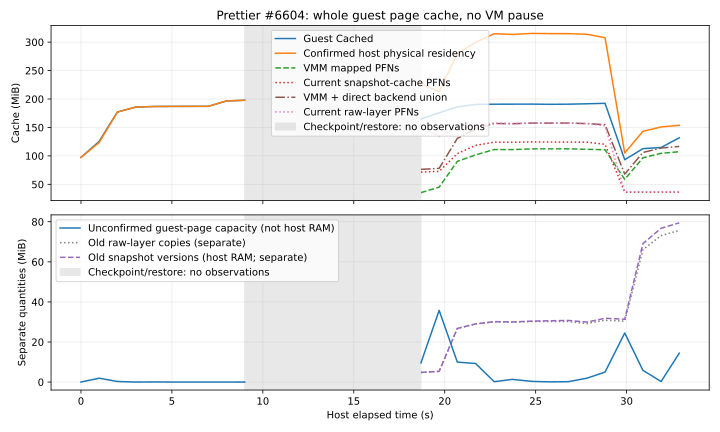

# Prettier恢复后的原始内存层测量（2026-10-15）

后续磁盘清理：用户已授权回收失去用途的旧镜像备份；本页提到的部分失败归档现已删除，原FAIL和raw保留，具体以[清理清单](IMAGE_BACKUP_CLEANUP_20261015.md)为准。

后续一次真实双分支复验已经通过，见[最新双分支报告](PRETTIER_REAL_PAIR_CACHE.md)。以下保留单次恢复及首次双分支失败时的完整记录。

原始内存层读取已作为显式配置接入统一入口。一次Prettier #6604第24步恢复及29步完整核对通过：保存前10点、恢复后15点，没有为采集增加暂停或预读任务文件。一次真实双分支尝试在进程计数检查处失败，尚无有效双分支物理结果；已定位并修复检查器竞态，仅做本地回归，没有追加实验轮次。原三任务完整单路径和此前恢复证据保留。

脱敏计数及核对结果见[证据](evidence/prettier-raw-layer-cache-20261015.json)。本机总核对为`.artifacts/task-layer-cache-20261015/verification.json`；其中核对通过与双分支实验失败分别记录。

## 统一配置与单次恢复结果

新增`configs/platform-prettier6604-checkpoint-layer-cache.json`，明确设置`live_cache_lower: true`。只允许配合诊断内核、Prettier单路径及第24步恢复使用，旧配置默认不变。统一入口将开关传给隔离服务及任务采集器。报告按每点实际数据选择VMM、直接File后端和原始层的物理页并集；混合会话的报告分别记录保存前v3、恢复后v4采集器，保留原raw不改写。

沿用2 CPU、4096 MiB、4 KiB页、约1秒采样和24 GiB固定卷。AgentENV仍为`2f48c9c78ec58e4d73c49aa07cb81d984a4a4184`，后端checkout无修改。地址换算、KVM RAM中的MMIO空洞、只读设备与原始LSMT层偏移及逐页身份规则复用[前阶段已验证的方法](CACHE_RESIDENCY_FOLLOWUP.md)。只读层索引和驻留查询没有读取任务数据内容，写时复制后的旧快照副本单列。

本次统一运行`.artifacts/platform-tasks/20261015T140810Z-1989450`，实际任务`.artifacts/storage-isolated-service/20261015T140929Z-1989958/prettier6604`。29步动作、原退出码、关键输出、最终补丁、独立性质、保存前后文件与进程连续性均通过；官方原结果仍0通过、2失败，与参考一致，平台通过不等于官方任务通过。

| 恢复后首点 | MiB |
| --- | ---: |
| guest逻辑Cached | 164.805 |
| VMM映射确认物理量 | 35.434 |
| VMM与直接后端当前物理并集 | 76.309 |
| 原始内存层当前物理量 | 150.301 |
| 三层当前物理并集 | 226.609 |
| 仅按VMM与直接后端仍未知的guest容量 | 88.438 |
| 加入原始层后仍未知的guest容量 | 9.594 |
| 旧直接后端副本，单列 | 4.816 |
| 旧原始层副本，单列 | 4.816 |

首点原始层补充确认20,184个guest页。各层先按物理页号去重再求并集；该点原始层与另两层无相同物理页。不同后端中的物理副本可以使host并集大于guest逻辑容量。两个旧副本分项不加入当前并集，也未单独断言其跨层可直接相加。全程guest逻辑观测峰值197.785 MiB、host确认并集峰值315.301 MiB，二者不是同点比较；恢复后未知guest容量最大35.766 MiB，继续单列，不当作host内存或估算值补齐。旧120.703 MiB缺口没有事后补算。



正常checkpoint暂停按Firecracker日志单列：暂停请求至动作完成、恢复请求至动作完成给出的暂停范围为460.456–460.980 ms。这是日志时间推算的边界，非原子计时。保存接口完整耗时3.313秒；采集停止到恢复采集就绪8.654秒，相邻观测最大空缺9.693秒。图中保留空缺，这些量不混作同一暂停时长。

| 采集成本 | 保存前，10点 | 恢复后，15点 |
| --- | ---: | ---: |
| host采集线程CPU秒 | 0.794 | 12.632 |
| 独立BPF查询进程CPU秒 | 0 | 0.970 |
| guest发布CPU秒 | 0.0386 | 0.0849 |
| 每点配对读取平均毫秒 | 109.055 | 884.093 |
| 每点配对读取最大毫秒 | 126.455 | 1079.551 |

恢复后直接后端及原始层两次前后查询共2,476,068页次，缺失内核查询结果0。guest重复加入、遗漏移出和越界计数均0；导出期间失效记录最大1条，已留在未知量，不当作缓存事件丢失。独立表从guest启动开始记录，仍按前后页身份排除采集中变化的记录。guest导出器锁定的约16 MiB匿名内存不属于文件缓存，任务文件没有被锁定。

工具累计13.121秒、冻结重放25.316秒、控制器40.764秒。本轮没有关闭采集对照，局部CPU成本和恢复后读数不能推出端到端减速百分比，也不与历史运行作冷热状态因果比较。

两份最终统一报告`.artifacts/task-layer-cache-20261015/single-report-final-{a,b}`的13文件一致；全部25点重新解析raw，并对恢复点独立核对原始层偏移、查询文件身份和PFN集合，与在线计数一致。本次472份任务/采集文件及原来448份Prettier任务文件哈希保持。旧直接后端报告兼容；旧原始层校准的13点读数及曲线保持，混合会话的采集器描述补全；旧合成双guest报告4文件复算一致。离线调用曾因传入相对报告路径被拒，收尾检查曾误匹配自身shell命令；均只修正离线调用/检查，不重跑任务，原错误日志保留。

## 一次真实双分支尝试与首个失败边界

新增`run-prettier-snapshot-cache-pair.sh`，复用冻结导出与现有严格检查：共同前11步保存一次，删除父VM，再恢复early_1、early_2各10步，计划实际执行31动作。两采集器使用独立host进程，后续报告只对时间窗口重叠的样本去重。预算保持24 GiB，不借用前阶段合成负载的22 GiB卷；复制输入后要求超过14 GiB，覆盖4 GiB内存快照、4 GiB可写层、4 GiB恢复临时量及2 GiB余量。

本轮仅执行一次，包装目录`.artifacts/prettier-snapshot-cache-pair/20261015T141102Z-1994284`，隔离结果`.artifacts/storage-isolated-service/20261015T141220Z-1994798`，状态FAIL。共同11步已离线核对；保存、删除父VM及第一条分支恢复接口返回成功，文件/进度边界离线核对通过。第一条分支进程检查读到保存前`count=`、恢复后`count=36`，PID、启动时间和boot ID一致，但缺少保存前有效计数，严格进度比较不能通过。两条分支后缀、最终补丁及联合物理采样均未执行完成，不记PASS，不生成双分支物理曲线。

首个原因是进程探针用`> count`先截断文件再写数字，同时读取可能见到空内容，检查器随后在整数转换处失败。将写入改为同目录临时文件加原子替换，数字比较与进程身份要求保持。新增本地并发读取回归，确认计数始终为数字、递增且进程身份保持；尚未在guest恢复路径复验此修改。此前等待分配sandbox ID的采集器不检查停止文件，导致失败清理等到超时；已增加等待期间停止检查及信号清理，并用不接触BPF/服务的回归确认会关闭采集器。

失败原日志、快照及运行时文件保存在完整卷备份中。备份2,389,207,283字节，解压后24 GiB内容哈希匹配源卷；核对容器已删、挂载及loop已解除、保护标记和归属后，按既有授权只回收源卷。保留FAIL、所有任务/采集日志、备份及删除收据，没有将身份匹配改判为完整恢复进度通过。

## 资源、检查与后续

82项相关本地检查通过，涵盖入口、分支动作、进程计数回归、采集器取消、页身份、原始层、直接后端、隔离存储及VMM关联；新停止/原子写路径只有本地验证，真实双分支仍待复验。Python编译、bash语法和JSON/SVG结构检查通过。

启动前回收一份无保护标记、无代码/输入引用且未打开的旧成功运行镜像归档：`v1-clean-trenvx-20261001-verified`中的`20261001T065156Z-2889585/data.tar.gz`，3.007 GiB，删除前哈希与原归档清单一致。原结果、重放数据与日志保留；规范输入、失败备份及有保留标记的checkpoint未动。收据为`.artifacts/task-layer-cache-20261015/cleanup-obsolete-archive.json`。

单次恢复与失败双分支启动时host分别51.432/51.320 GiB可用，均超过50 GiB；卷内观测占用峰值6.463/6.172 GiB，host空闲最低27.430/27.319 GiB。两个服务的VM、采集器、容器、挂载、loop及RAM输入副本均已释放，成功快照已删，失败快照包含在备份中。原服务和12个VMM保持。保留新失败备份后收尾约49.09 GiB，未暂存、提交或推送。

本轮到此停止。下一步先恢复超过50 GiB磁盘预算，再只复验这一条真实双分支路径，重点确认原子计数写入后的恢复进度、两个原始后缀及联合物理测量。第24步单次恢复已经通过，不再重跑；压缩/多层、provider内部缓冲、Sphinx/Xarray恢复和统计性能比较仍属后续范围。

只离线重算本次成功报告的命令：

```bash
bash scripts/use-platform.sh report \
  .artifacts/platform-tasks/20261015T140810Z-1989450 \
  --output .artifacts/prettier-raw-layer-cache-recheck
```

新增实验入口是`bash scripts/use-platform.sh run configs/platform-prettier6604-checkpoint-layer-cache.json`及`bash scripts/run-prettier-snapshot-cache-pair.sh`。本轮各已执行一次，当前空间不满足再次启动，以上命令仅保留作复现说明。
