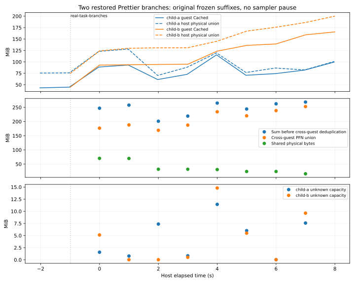

# 真实Prettier双分支的不暂停缓存测量（2026-10-15）

2026-10-17已另行完成[最新provider与2页策略的四来源双分支](PROVIDER_REAL_PAIR.md)。本页保留原三层运行的结果和成本，不追溯补算。

后续磁盘清理：用户已授权回收失去用途的旧镜像备份；本页提到的部分失败归档现已删除，原FAIL和raw保留，具体以[清理清单](IMAGE_BACKUP_CLEANUP_20261015.md)为准。

按计划仅复验一次，真实双分支、物理页去重、两份报告复算及资源清理全部通过。前次计数文件空读导致的FAIL和完整备份保留；本次原子计数写入已在真实保存/恢复路径通过。三任务完整单路径及第24步单次恢复直接复用，没有重复运行。

脱敏数据和曲线见[证据](evidence/prettier-real-pair-cache-20261015.json)。包装目录为`.artifacts/prettier-snapshot-cache-pair/20261015T142908Z-2008914`，实际任务为`.artifacts/storage-isolated-service/20261015T143027Z-2009384/prettier6604`。本机核对记录为`.artifacts/prettier-pair-retry-20261015/verification.json`。

## 路径与恢复正确性

沿用AgentENV `2f48c9c78ec58e4d73c49aa07cb81d984a4a4184`、2 CPU/4096 MiB、诊断内核`6.1.175-asb-cache-v3`、4 KiB页、约1秒配对采样和24 GiB固定卷。先执行共同11步，保存一次、删除父VM，再恢复early_1与early_2，分别执行原始10步后缀。两条逻辑路径各21步；共同前缀只实际执行一次，因此实际31动作、逻辑42动作，不是完整七路径调度。

动作清单、顺序、原退出码、分段补丁与最终源码/独立性质检查通过。early_1形成原参考修改，early_2保留原未修改源码；两条分支的官方结果均0通过、2失败，任务失败保持。保存前计数21，两个恢复实例分别递增到33、34，PID、启动时间及guest启动身份一致，文件及进度边界一致；host虚拟机进程（VMM）身份分别重新关联且不同。

原子计数修复没有降低恢复进度比较要求。上次等待分配时停止处理的本地回归证据继续保留，本次采集器正常启动并结束，没有再触发该失败清理路径。原82项本地检查复用，本轮未修改实验代码；新增证据来自这一次真实复验和离线复算。

## 逻辑量、当前物理量及共享

两个guest分别11点、10点。每点读取guest缓存元数据、VMM映射、直接File后端及单个原始内存层，按PFN（物理页号）求当前物理并集；写时复制留下的旧快照副本单列。两个实例实际使用同一只读内存设备和同一原始层，设备/文件身份及层索引哈希已离线核对。

仅对完整落在真实分支阶段、且两个采样窗口有重叠的样本配对，每个样本使用一次，共8对，窗口重叠409.014–566.811 ms。配对阶段包括原后缀、最终性质和官方检查。它们是运行中的区间观测，不是同时暂停取得的原子快照。未配对时段不补值，物理并集图只画有效配对点。

| 首个有效配对点 | early_1（MiB） | early_2（MiB） |
| --- | ---: | ---: |
| guest逻辑Cached | 88.699 | 93.031 |
| 该guest的三层确认物理并集 | 122.961 | 124.016 |
| 仍未知的guest页容量 | 1.566 | 5.125 |

该点两个host量相加246.977 MiB，跨guest并集176.738 MiB，相同PFN的重复计数扣除70.238 MiB。8对均独立复算`并集=两量相加−交集`，并核对各guest当前集合；旧版本未混入。不同层的物理副本可使host量大于guest逻辑量，未知guest容量不当作host内存。共享量随任务读取、修改及回收变化，本轮没有独立冷启动对照，不把这种变化全部归因于分支修改。

| 全部已采样点的范围 | early_1 | early_2 |
| --- | ---: | ---: |
| guest逻辑Cached，MiB | 43.195–115.430 | 44.340–165.668 |
| 三层确认物理并集，MiB | 70.328–128.062 | 74.453–200.105 |
| 未知guest容量最大值，MiB | 11.434 | 14.805 |



图的零点为首个有效配对点，负时间部分是此前已经开始的恢复后采样。图中仅覆盖两个恢复实例；父VM保存前没有新增物理采样。提供快照内存的后端服务（provider）内部临时/匿名缓冲、压缩及多层快照仍未归属，不能据此称所有可能的host副本均已覆盖，也不把现有未知guest容量全部归给这些来源。

## 成本与暂停

| 采集成本 | early_1 | early_2 |
| --- | ---: | ---: |
| host采集线程CPU秒 | 5.074 | 5.921 |
| 独立BPF查询进程CPU秒 | 0.970 | 0.890 |
| guest发布CPU秒 | 0.0457 | 0.0473 |
| 每点配对读取平均毫秒 | 492.512 | 623.592 |
| 每点配对读取最大毫秒 | 591.484 | 871.398 |
| 后端请求页次 | 823,158 | 1,111,614 |
| 缺失内核查询结果 | 0 | 0 |

guest元数据表从启动开始记录普通文件和共享内存缓存页，并随快照恢复。两个guest首次单独采样分别导出11,058/11,322条记录，对应43.195/44.227 MiB；相邻读取的guest Cached为43.195/44.340 MiB，差0/−0.113 MiB。两项并非同一时刻读取，差值来源未进一步分解。两边初始共享内存缓存均284页。重复加入、遗漏移出及越界计数两边均0。导出期间失效记录最大分别1、0条，已进入未知容量，未当作事件丢失。两个host采集器为独立进程，BPF查询表不混用。每guest导出器约16 MiB锁定匿名内存不属于文件缓存；任务文件没有锁定或由采集器预读。

采集没有额外暂停。正常checkpoint暂停按Firecracker请求/动作日志推算为342.200–342.743 ms；完整保存接口2.622秒，二者单列。控制器总耗时32.019秒。本轮没有关闭采集对照，局部CPU时间不表示任务减速百分比；没有新增性能门槛或追加轮次。

## 复算、磁盘和清理

包装入口的报告与两个新目录`.artifacts/prettier-pair-retry-20261015/report-{a,b}`均为4文件，逐字节一致；全部21点从raw重算，并独立核对原始层偏移、查询文件身份、每guest物理集合及8次跨guest集合运算。610份本次任务/采集文件哈希保持；此前448份直接后端任务文件、472份单次原始层恢复文件以及上次失败备份哈希保持。

启动前空闲约49.09 GiB。较大现存归档均属失败备份或受保护输入，因此保留。对较早成功诊断中未挂载、未打开的72个临时磁盘镜像，将全零块改为文件空洞，释放947.707 MiB；逻辑长度、路径、inode（文件编号）、修改时间及前后内容哈希保持。8个多链接文件的全部3个路径都核对属于同一已结束诊断，内容及硬链接关系保持；初次保护检查在这些文件处停止，核对归属后继续，没有绕过保护。没有删除镜像、日志、失败备份或checkpoint。收据为`.artifacts/prettier-pair-retry-20261015/sparse-images.json`。

本次隔离服务启动时实际空闲50.014 GiB，满足超过50 GiB要求；24 GiB卷、20 GiB主机保护量及6 GiB余量保持。复制输入后超过14 GiB的原双分支预算检查通过。卷内观测占用峰值6.236 GiB，host空闲最低26.013 GiB。成功VM、快照、采集器、私有服务、挂载、loop及RAM输入副本全部释放，原服务与12个VMM保持。收尾约49.96 GiB；新运行仍须重新满足启动预算，不能以本次成功降低要求。

本阶段结束。后续可先离线检查现有provider版本和日志，明确其内部缓冲是否存在可验证的逐页归属接口；不预设其能够补齐未知量，不自动启动实验。压缩/多层、Sphinx/Xarray恢复及稳定性能比较分别后置，需先明确范围、轮次和预算。未暂存、提交或推送。

离线复算命令：

```bash
python3 -B scripts/report_snapshot_cache_pair.py \
  .artifacts/storage-isolated-service/20261015T143027Z-2009384/prettier6604 \
  --output .artifacts/prettier-real-pair-cache-recheck
```

后续只读核查已完成：原始层后的未知量分类及后端缓冲接口边界见[离线报告](PROVIDER_CACHE_AUDIT.md)，没有新增VM或改写本次物理读数。
