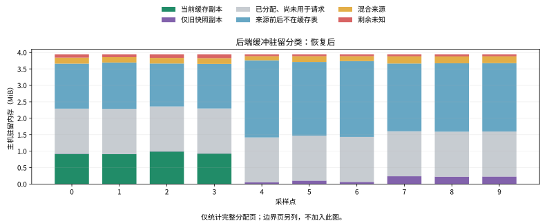

# BPF批量读取私有接入与一次短恢复通过（2026-10-16）

**批量读取已在私有短恢复中通过，保留显式启用、默认逐项读取。** 保存前3点、恢复后10点；实际表布局、40次查询完整性、文件内容、原guest进程恢复、独立物理去重及清理均通过。恢复后单点平均263.929 ms CPU、289.403 ms耗时；本阶段结束，不追加轮次或完整任务。

[脱敏数据](evidence/provider-bpf-batch-live-20261016.json)包含分项成本、查询数量、内存和逐点物理量，原始成功运行是`.artifacts/storage-isolated-service/20261016T133007Z-2338631/`；执行、分析和源码副本位于`.artifacts/provider-bpf-batch-live-20261016/`。三任务、完整Prettier恢复和双分支结果继续复用。

## 两张实际表均一趟读到表尾

复用已通过的[批量读取实现和小表验证](PROVIDER_BPF_BATCH_VALIDATION.md)，本轮没有修改该读取器。新增`--snapshot-bpf-batch`，只允许与私有provider GET_DATA短恢复组合；经校准入口传给恢复后的`LiveTaskCache`，直接后端和原始层同时显式启用。原入口不传新选项，调用条件和逐项读取保持。

实际两张表都是普通HASH、键8/值16字节、容量131072、标志0。每张接收容量3 MiB，复用缓冲；每张20次查询，共40次均返回`-ENOENT`并带有效条数。直接后端返回23079–52857条，原始层45871–52857条，合计读出1941899条，包含历史记录；仍只使用当前查询号和请求偏移。

按本次请求数组计算，原逐项方式需要577610次表读取，本次为40次批量读取；87070次`mincore`调用保持。`mincore`只查询驻留，不读取文件内容。40次查询的`missing_kernel_results`均为0，查询号顺序连续；它只说明已请求的内核结果齐全，不代表所有guest缓存页都确认了host驻留。

原BPF程序、采集查询次数和相对顺序、缓冲覆盖前失效及归属条件保持。新增内存观测在原单点计时结束后执行，不缩短或扩大缓存有效窗口，没有新增采集暂停、预读任务文件、清空缓存或强制驻留。

## 分项成本：四次查询仍占单点CPU的72.0%

沿用2 CPU/4096 MiB、诊断内核`6.1.175-asb-cache-v3`、私有GET_DATA分段后端、约1秒间隔，以及既有16 MiB校准文件的等待、读4 MiB和写4 MiB流程。

| 恢复后每点平均 | CPU/ms | 耗时/ms |
| --- | ---: | ---: |
| guest发布请求及导出读取 | 0.871 | 25.132 |
| 三次VMM页表查询 | 19.812 | 19.859 |
| 映射表读取 | 0.762 | 0.763 |
| 三次偏移换算 | 12.482 | 12.567 |
| 两次直接后端查询 | 108.098 | 108.615 |
| 两次原始层查询 | 81.828 | 82.320 |
| 两次provider缓冲查询 | 4.083 | 4.107 |
| 解码与数组组装 | 0.922 | 0.926 |
| 各层归属计数 | 33.720 | 33.782 |
| 未分项部分 | 1.352 | 1.331 |
| **原计时范围合计** | **263.929** | **289.403** |

四次缓存查询合计189.925 ms CPU，占71.961%；其中仍包括`mincore`、批量系统调用、筛选和逐行结果还原，不能全部算作内核CPU。

完整采集线程保存前/恢复后为0.232/2.720 CPU秒。恢复后原单点计时以外合计80.856 ms CPU，其中新增内存观测9.035 ms，剩余71.821 ms包括编码、写盘及循环处理，未单独测量写盘CPU。两个bpftrace辅助进程整个恢复会话合计0.940 CPU秒，另列，不在采集线程CPU内。

上次逐项运行单点396.368 ms、四次查询300.538 ms保留；但上次对应829584次逐项表读取、76290次`mincore`，本次请求页数、碎片程度和缓存容量均不同。这两次总量差异不用于计算隔离加速比，也没有关闭采集的任务减速对照。

## 新增接收内存单列，不进入guest缓存并集

只读采集器自身`pagemap`，根据两张表的键、值接收数组的地址和长度计算覆盖页，再按物理页号（PFN）去重；内存观测不读取数组内容，也不触碰尚未驻留页。这里测的是采集器自己的接收数组，与provider的4 MiB请求缓冲不同。

| 恢复后观测 | 数量 |
| --- | ---: |
| 两张表接收容量 | 6 MiB |
| 接收数组覆盖的虚拟页 | 每点1537张 |
| 已驻留覆盖页 | 543–625张 |
| 覆盖页驻留物理并集 | 2.121–2.441 MiB |
| 其中完整属于接收数组的页 | 2.102–2.422 MiB |
| 仅混合边界页贡献 | 每点20 KiB，另列 |
| 控制器整个进程的VmRSS | 94.520–105.410 MiB |
| 内存观测自身平均CPU/耗时 | 0.904/0.904 ms每点 |

覆盖页并集包含边界页的整页容量，不能全算成数组独占内存。6 MiB是容量，不是全部驻留。VmRSS包括控制线程、采集器及Python临时对象，不是单独隔离出的新增RSS；BPF表本身沿用原容量，也未测其物理增量。上述观测位于原单点计时之外，完整线程CPU包含它，`bpf_batch_memory`另存各点及自身成本。

## 缓存物理量仍按原条件确认

每点guest逻辑容量来自独立缓存成员表，host量来自当前内容对应的VMM、直接后端、原始层和provider缓冲副本按PFN合并。旧副本和未知容量另列；跨采样期间变化仍可能留下未知量。

| 点 | guest逻辑/MiB | guest Cached/MiB | host当前并集/MiB | 未确认guest/KiB | 当前缓冲/KiB | 旧缓冲/KiB | 剩余未知缓冲/KiB |
| ---: | ---: | ---: | ---: | ---: | ---: | ---: | ---: |
| 0 | 90.449 | 90.438 | 135.520 | 2404 | 940 | 8 | 100 |
| 1 | 90.449 | 90.449 | 138.922 | 8 | 932 | 8 | 84 |
| 2 | 90.453 | 90.449 | 139.371 | 64 | 1012 | 4 | 108 |
| 3 | 90.453 | 90.453 | 130.035 | 6136 | 948 | 4 | 116 |
| 4 | 21.297 | 21.297 | 29.168 | 0 | 0 | 52 | 56 |
| 5 | 28.586 | 28.586 | 36.461 | 0 | 0 | 108 | 56 |
| 6 | 23.859 | 23.859 | 29.195 | 208 | 0 | 68 | 56 |
| 7 | 42.961 | 42.961 | 48.496 | 0 | 0 | 244 | 60 |
| 8 | 44.348 | 44.320 | 48.496 | 1420 | 0 | 232 | 64 |
| 9 | 43.586 | 43.586 | 49.121 | 0 | 0 | 236 | 60 |

provider完整缓冲页每点4036 KiB驻留，22张混合边界页另列。原未归属字段为3020–3984 KiB；细分初始化开销、来源前后不在缓存表等后，解释性剩余未知为56–116 KiB。当前缓冲副本为0的点只表示本次未确认其当前缓存归属，不是缓冲零占用。旧副本为4–244 KiB；本次仍没有新增确认guest页，观察到的缓冲副本只增加了已确认内容的额外物理副本。



缓冲前后观测平均间隔10.302 ms。原生checkpoint暂停边界332.776–333.286 ms，采样点空缺8.589秒；暂停只来自原生保存流程，没有添加采集暂停。

## 验证、资源和后续

76项相关回归通过，覆盖默认参数、两张表的选项传递、父会话不创建查询、私有入口限制、内存覆盖/物理别名/边界页、隐藏页号及短读失败，以及内存观测不改变原计时和顺序。原批量错误、归属和计时回归一并通过。实际13点分项边界和求和、10点独立PFN集合、原始数据复算及缓冲六类划分通过；元数据加入重复、缺失删除、越界、迁移及失效记录计数均为0，旧13点仍可离线复算。

启动前55.718 GiB可用，运行中最低31.717 GiB，24 GiB卷、20 GiB保护量和6 GiB余量保持。自有VM、snapshot、私有服务、卷、挂载和loop已回收，收尾约55.69 GiB可用；原服务和12个已有VMM身份保持。未安装或替换原服务，未暂存、提交或推送。

复现一次同范围实验使用本机脚本：

```bash
bash .artifacts/provider-bpf-batch-live-20261016/run-calibration.sh
```

本阶段的私有功能、物理计数及成本记录已完成。下一步建议供检查：只用现有日志、源码和本次10点，核对剩余查询中哪些Python处理可按真实保存输入重放，哪些仍缺原始表或内核时序；对证据齐全的部分做一次离线分项计时，决定是否值得数组化结果还原。以输入来源明确、原输出及缺失统计保持、给出一处最小改动或保留现状的理由为结束条件，不启动新沙箱、不修改当前归属规则。

上述离线核查已按后续授权完成，见[真实可重放范围、一次分项计时和最小改动](PROVIDER_QUERY_REPLAY.md)。本页在线成本和物理量保持。
