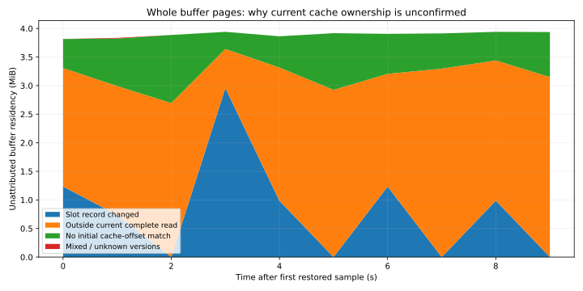

# 后端未归属缓冲的离线分类（2026-10-16）

**10个恢复点的未归属缓冲已全部分类，逐点与原3.816–3.941 MiB一致。** 9个点中最大的一类是“整页超出当前完整读取的有效范围”；另一个点主要因槽位记录在配对读取期间变化而未归属。有效内容未匹配采集起点guest缓存候选的部分为308–1220 KiB。一个点另有12 KiB混合版本页。

本轮只读取已保存的元数据和物理页号，没有启动沙箱、设备或新校准，没有读取负载缓冲或任务文件内容。原来确认的当前/旧快照副本、缓存物理并集和未知guest页容量都不变。

证据为[脱敏分类数据](evidence/provider-buffer-unknown-20261016.json)，本机结果在`.artifacts/provider-buffer-unknown-20261016/`。输入沿用短恢复`20261016T033725Z-2170673`的`guest-cache/live-cache/restored/`；协议、构建和原校准结果见[GET_DATA验证报告](PROVIDER_GET_DATA_VALIDATION.md)。

## 统计的是实际驻留物理页，不是缓冲容量或guest未知容量

原指标`provider_unattributed_resident_bytes`的范围是：两次页表查询均确认驻留、物理页号不变、完全落在缓冲分配范围内，但没有归入当前缓存或旧快照缓存副本的host页。每个点按物理页号去重，不把多个槽位数相加代替物理并集。

本次10点都确认1009张完整缓冲页，共4036 KiB；每点减去原来确认的当前及旧快照副本，得到977–1009张未归属页。当前和旧副本的物理页集合在这10点没有交集。

分配边界驻留页每点均为22张，不按整页加入缓冲占用。点1另有3张完整页包含混合版本内容；这3张已经属于未归属完整页，不能再加一次。这也解释了旧指标“混合或边界页”为22–25张。

缓冲页表读数变化、无可用驻留物理页号及已释放状态都不在原未归属物理量中；本次保存数据没有出现这些排除情况。它们不能用虚拟页数换算成已测host占用。

## 按第一个缺口分类，避免重复计数

新脚本为`scripts/report_provider_unknown.py`，不修改运行时采集器。它沿用原准入规则，按以下顺序判断每张完整物理页：

1. **槽位记录变化。** 四次元数据读取不一致，或代次为奇数，说明不能用单次偏移和长度描述整个配对区间。先归入这一类，不再用不稳定记录推断后面的原因。
2. **内容记录无效。** 稳定记录不是完整读取成功状态，或有效长度不合法。本次为0。
3. **超出当前读取有效范围。** 稳定的完整读取成功，只保证这一次填写的字节范围；某张分配内整页没有被该范围完全覆盖，就不能沿用当前偏移给整页归属。这包含有效区段末端只覆盖部分字节的情况。旧尾部可能保留此前内容，但现有单条记录没有它的分段归属。
4. **快照偏移未匹配起点缓存候选。** 整页内容有效，但它涉及的一个或多个快照页偏移未出现在本次采集起点的guest缓存候选中。原采集器只为起点缓存页保存三次VMM页表及后端查询；后端偏移以页编号保存，槽位内容偏移以字节保存，分类时明确换算。
5. **guest身份、VMM映射或文件页号冲突。** 偏移有候选，但未通过原缓存页身份或物理映射一致性条件。本次落到这三类的缓冲页均为0。
6. **混合或无法统一的版本。** 一个完整host页涉及多个guest页，候选的当前/旧内容状态不能统一。本次点1为3页，其他点为0。

物理页若有多个别名，先扣除已经确认的当前和旧副本，再对剩余页去重；不同别名给出不同未归属原因时单列。本次没有这种情况。分类计数表示第一个未满足的条件，后续类别为0只适用于前面条件已通过的缓冲页，不代表整个guest没有页面变化。

## 逐点分类与原未归属量一致

下表单位均为KiB，只对同一点求和，不跨时间累计。

| 恢复点 | 槽位记录变化 | 超出当前读取范围 | 未匹配起点缓存候选 | 混合版本 | 原未归属总量 |
| --- | ---: | ---: | ---: | ---: | ---: |
| 0 | 1264 | 2124 | 520 | 0 | 3908 |
| 1 | 756 | 2308 | 852 | 12 | 3928 |
| 2 | 0 | 2760 | 1220 | 0 | 3980 |
| 3 | 3028 | 700 | 308 | 0 | 4036 |
| 4 | 1008 | 2388 | 560 | 0 | 3956 |
| 5 | 0 | 2996 | 1016 | 0 | 4012 |
| 6 | 1264 | 2020 | 716 | 0 | 4000 |
| 7 | 0 | 3376 | 632 | 0 | 4008 |
| 8 | 1012 | 2512 | 512 | 0 | 4036 |
| 9 | 0 | 3224 | 808 | 0 | 4032 |

首点仍为128 KiB当前缓存副本加3908 KiB未归属完整页，共4036 KiB。其他点的当前及旧副本也与原数据一致，没有把分类结果追加到缓存物理并集。



## 已回答的问题与剩余证据缺口

**有效窗口不足并不是全部原因。** 点2、5、7、9的16个槽位记录都稳定有效，但仍分别有2760、2996、3376、3224 KiB整页超出当前读取范围。每槽分配256 KiB，而这些稳定记录的本次完整读取长度为4–128 KiB；一次读取成功不等于整个分配区都有这次内容。

现有证据已经足以确定这些页被哪一道归属条件排除，也确认它们确实驻留。它没有给出所有旧尾部当前保存的字节身份，不能把这部分统一改为零占用、已确认非缓存或当前缓存副本。

同样，308–1220 KiB“未匹配起点候选”只证明本次偏移关联缺少候选，不直接证明内容属于匿名内存，也没有覆盖整个配对期间所有新增、移出或复用的缓存页。若要给它们内容身份，需要进一步关联缓存变化与快照偏移，而不是简单增加采样时长。

本轮没有修改原先5个点、最多128 KiB的当前缓存副本结论；原首点物理并集163.914→164.039 MiB及未知guest容量0.250 MiB保持。

## 验证与完成范围

11项纯离线合成测试通过，覆盖读取尾部、部分整页、元数据变化及奇数代次、无效内容、页编号换算、guest身份变化、VMM映射变化、文件页号冲突、混合版本、缺失/变化物理页号、释放及物理别名去重。测试中与原计数函数逐项比较驻留、当前/旧副本及未归属量。

另外使用独立的地址区间计算核对这一次运行：按整页边界直接求分配区、读取区间及尾部页数，不调用分类函数；再用原始后端偏移集合检查未匹配页数。10点均与分类一致，总量与原`provider_unattributed_resident_bytes`逐点相同。实际图已查看，106份输入文件的路径、inode、大小及修改时间保持，未另算文件哈希。

本阶段仅新增离线脚本、测试和报告；既有私有实现、补丁及二进制没有修改，原始结果保持。检查时主机负载0.23/0.36/0.50、可用内存约471 GiB、可用磁盘约55.6 GiB。本轮没有申请实验卷、操作服务、暂停采集、预读或强制驻留，也没有暂存、提交或推送。

只用保存数据复算：

```bash
python3 -B scripts/report_provider_unknown.py \
  .artifacts/storage-isolated-service/20261016T033725Z-2170673/guest-cache/live-cache/restored \
  --output .artifacts/provider-buffer-unknown-recheck
```

## 当时的下一步建议及执行结果

先做一次离线时序核对：利用这16个槽位已保存的代次和完整读取次数，判断相邻观测之间能否证明部分旧尾部没有被覆盖。只处理现有10点，不改变原缓存物理并集；完成条件是列出可证明的区段及其条件，或给出证据不足的明确原因。若仍需新增分段记录，再单独提出最小改动和一次短验证范围，不自动启动新校准。

此计划已按用户授权执行，见[旧尾部时序核对](PROVIDER_TAIL_CONTINUITY.md)。304次相邻比较中，27次可以证明较短读取后保留4–116 KiB旧尾部；38次跨多次读取仍缺少中间长度。本页驻留分类和原物理并集保持，后续分段记录建议以新报告为准。
