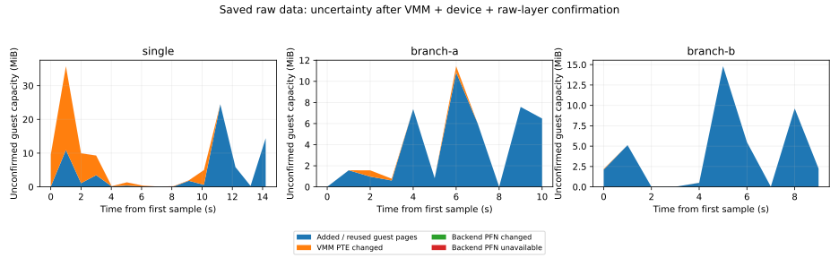

# 后端缓冲归属与剩余未知量的离线核查（2026-10-15）

完成当前版本源码、既有日志、实际二进制标识及36个已有恢复点的离线核查，没有启动VM、替换后端二进制或增加暂停。结论有两部分：真实双分支21点的剩余未知量均可归入采集期间页身份或页表变化；后端服务确有请求缓冲路径，但当前接口和已有记录不足以逐页确认其内容归属，旧点不能补算，也不能把这部分当作零占用。

数据及核对摘要见[证据](evidence/provider-cache-audit-20261015.json)，本机原始核查为`.artifacts/provider-cache-audit-20261015/`。此前已完成的三层物理并集和跨guest去重结果继续有效。

## 36个已有点：未知量主要来自采样变化

复用`report_cache_unknown.py`，只扩展原始内存层和child-a/child-b会话支持。按与已验证在线计数相同的有效性条件，逐个guest页检查元数据生命周期、三次VMM页表、直接后端及原始层的两次物理页号；再按固定先后顺序给每个未知页一个原因。每点各类之和与原始保存的三层未知容量完全相等；确认页数加未知页数等于该点导出的缓存记录数。已有直接后端报告的默认行为保持。

| 运行 | 点数 | 最大未知guest容量（MiB） | 该点新增/复用页 | 该点VMM页表变化页 | 该点后端物理页号变化页 | 该点后端无可用物理页号页 |
| --- | ---: | ---: | ---: | ---: | ---: | ---: |
| 第24步单次恢复 | 15 | 35.766 | 2,803 | 6,348 | 1 | 4 |
| early_1分支 | 11 | 11.434 | 2,776 | 151 | 0 | 0 |
| early_2分支 | 10 | 14.805 | 3,790 | 0 | 0 | 0 |

单次恢复首点9.594 MiB未知容量中，2,447页属于新增/复用或页表变化，2页后端物理页号变化，7页后端无可用物理页号。其全部15点中，后端无可用物理页号每点最多7页，即28 KiB guest容量；后端物理页号变化每点最多2页。真实双分支21点没有落入这两类的页。

“后端无可用物理页号”仍不能区分缓存确实不驻留和保存格式未取得物理页号，不补为0 host内存。分类按固定优先级划分，例如页身份已变化的页先归入变化类，不再推测它的后端状态。多个点的页次相加只表示观测次数，不能视为不同页数量或当前缓存容量。物理页号简称PFN。



后端缓冲可能保存已经在VMM、直接后端或原始层确认过的guest页的额外副本。因此，未知guest容量较小或没有稳定缺失页，不代表后端缓冲物理量为0；两者不能相减、相加或相互换算。

## 后端读取路径与现有接口

当前checkout为AgentENV `2f48c9c78ec58e4d73c49aa07cb81d984a4a4184`，无后端源码修改。以下为该源码的路径核查；涉及默认值的推导与历史运行的实测值分别列出。

| 位置 | 已核对行为 | 对归属测量的影响 |
| --- | --- | --- |
| `storage/ublk/src/dev.rs:119`、`io_buffer.rs:132` | 每个队列槽位分配一个UserBuffer，以512字节对齐，并向io_uring登记；循环复用，退出时释放 | 槽位地址不等于固定文件内容身份，分配量不等于属于当前guest缓存的物理量 |
| `storage/ublk/src/impls/overlaybd_target.rs:179`、`:199` | 将设备请求换成逻辑偏移和长度，再读入槽位缓冲；不支持AutoReg读取路径；额外槽位缓冲为None | 可在源码中建立请求到缓冲的关联，但当前未导出可采集的关联表 |
| `storage/overlaybd/src/lsmt/file/readonly.rs:212` | 按层索引定位数据，读入调用方缓冲，空洞/零区段直接填零 | 原始层路径不必为每次读取再创建一个独立完整数据缓存；索引和小型映射数组也不能算作任务文件内容副本 |
| `storage/overlaybd/src/backend/local.rs:486`、`:631` | 本地文件通过上下文读取到目标缓冲；非直接I/O分支使用同一目标地址 | 当前已测原始层页缓存与用户态目标缓冲是不同层级 |
| `storage/ublk/src/queue.rs:276` | 完成当前请求与获取下一请求使用同一槽位缓冲 | 必须界定内容何时有效、何时可能被kernel或后端覆盖 |
| `storage/ublk-daemon/src/protocol.rs:18` | 控制请求包含设备创建/删除、快照、功能和启动包等操作，未提供缓冲内容归属表 | 现有控制接口不能直接返回“当前缓存内容对应哪些用户态物理页” |

`ctrl.rs:119`的源码默认值为1队列、16槽、每槽256 KiB，乘积4 MiB/设备。源码以512字节对齐，且同一个内存设备可被两个恢复实例共享；不能按guest数乘以4 MiB，也不能把4 MiB直接记为旧运行的实测驻留。每个物理页可能混有其他槽位或分配内容，后续必须按实际PFN去重，并单列无法完整归属的混合页。

既有双分支日志确认内存设备`zero_copy=false`，两个guest使用同一内存设备；保存的层所有权记录确认本地单个原始层。生成全局配置的源码明确设置`ioEngine: 0`。配置中启用后台下载不代表这个本地内存层发生了远端下载；不能将根文件系统、网络或压缩路径的所有缓冲合并算作这批guest缓存的副本。

源码存在DEBUG请求日志及槽位初始化地址日志，但本轮保存的INFO日志没有缓冲地址、完整请求分配与内容有效期。即使有分配日志，也缺少覆盖前失效及成功读取后生效的完整契约。RSS、累计读取字节及缓冲容量不能替代它。

## 实际版本与结论边界

原共享服务和此前私有运行使用同一镜像ID：`sha256:db9eb044ae3d85f9b276b9d2e5dea28cb0be95263d217ea4989f095e1d828681`。只读取得原服务后端可执行文件SHA-256 `5c9ae049db0379b353e48cedca6fd3dbb712f249d2bb1459f4aef12bc3aa0349`，ELF build ID为`e523bf5b07f757ebaa5c04cb670597f995f21227`。这是当前未改动原服务的标识，没有读取历史采样点的进程内存。

镜像标签和已有日志未建立部署二进制与源码commit的一一对应；二进制有符号表，无DWARF调试信息。发现的读取相关符号多为Rust异步闭包及其清理函数，参数位置和有效生命周期尚未验证。因此本次没有把源码默认队列容量冒充历史部署实测值，也未直接给现有服务挂新的用户态函数探针。此前PFN测量依据实际KVM布局、映射和文件身份，其已验证结果不依赖这项源码默认值推导。

额外解压、远端缓存及临时分配路径是后续不同范围。本次只确认现有原始层路径和候选槽位缓冲，没有证明所有可能的后端副本都不存在，也未给出它们的物理总量或上限。

## 下一步的最小范围与可验证条件

先固定新观测代码的源码和构建产物，再为一个私有、非池化的内存设备补充最小槽位元数据；先离线验证状态规则，暂不扩展压缩、多层、根文件系统和完整任务。

元数据至少记录：进程及设备/内存层身份、队列/槽位、实际缓冲地址和容量、逻辑偏移、有效长度、代次与内容状态。开始可能覆盖内容的操作前失效，完整读取成功后才能生效；失败、部分写入、重新分配及释放均需正确更新。必须保证等待下一请求期间不会在元数据仍标有效时被kernel覆盖；若无法证明，只能保守地在提交并获取下一请求前失效。由当前循环结构推测，这样的有效窗口可能很短，需要短校准实测，不能直接承诺可用覆盖。

随后若继续实跑，只做一次已知内容的短恢复校准：元数据前后代次稳定、guest缓存页身份稳定且pagemap显示驻留时，读取PFN并与原三层去重；查询不访问任务文件内容、不强制驻留、不增加暂停。只纳入完整可归属区段，混合页、失效或不完整区段另列。内容及恢复检查、已确认量的逐页复算、采集成本、报告一致性和清理分别判定；没有有效窗口也如实记录，不为补满覆盖追加长测。此前完整任务和双分支均不重跑。

这仍是后续工作的明确范围，本轮到离线核查结束。24 GiB卷启动前继续要求超过50 GiB可用，并保留20 GiB保护量和6 GiB余量。

## 核对和复现

两项分类器本地检查通过；36点未知总数与原三层计数一致。三组分类报告各有两份4文件一致，旧直接后端报告4文件逐字节一致；本次没有覆盖旧报告。原双分支610份、单次恢复472份任务文件哈希保持，原服务和12个VMM身份保持。没有新增挂载、loop、沙箱或后端安装，约64.71 GiB可用。未暂存、提交或推送。

例如离线复算early_1：

```bash
python3 -B scripts/report_cache_unknown.py \
  .artifacts/storage-isolated-service/20261015T143027Z-2009384/prettier6604 \
  --session child-a --output .artifacts/provider-unknown-early1-recheck
```
