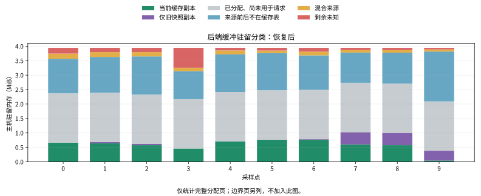

# 缓冲紧邻配对采样及一次短恢复验证（2026-10-16）

**分段缓冲的紧邻配对采样已实现，一次既有短恢复通过。** 保存前3点、恢复后10点，文件内容和原guest进程连续性正常，独立物理页号（PFN）集合复算一致。两次完整缓冲查询之间的总区间平均10.362 ms，范围8.681–15.249 ms。保留这个顺序，不放宽内容归属条件，也不追加实跑。

本次当前缓存缓冲副本为44–780 KiB，旧快照副本为0–436 KiB，二者分列；整页缓冲驻留仍为4040 KiB，21张边界页另列。单点采集至归属计数结束平均435.513 ms线程CPU，没有整体采集成本下降的证据；功能验证和成本结论分别报告。

[脱敏结果](evidence/provider-compact-pair-20261016.json)保存完整数值。本机分析和检查目录为`.artifacts/provider-compact-pair-20261016/`；成功校准为`.artifacts/storage-isolated-service/20261016T101239Z-2296002/`，采集数据在其`guest-cache/live-cache/{parent,restored}/`下。

## 只移动两次查询，I/O规则保持

依据[此前来源核对](PROVIDER_REFILL_ANALYSIS.md)，只在启用分段记录的私有路径采用以下顺序：

```text
guest前表 → VMM第一次 → 后端/原始层前查
→ 缓冲前读 → VMM第二次 → 缓冲后读
→ guest后表 → 后端/原始层后查 → VMM第三次
```

`scripts/live_task_cache.py:LiveTaskCache._run`只移动两次缓冲查询。其余查询的相对顺序和次数保持；未启用provider、未启用分段、没有快照后端的旧调用仍走原顺序。仍要求guest页身份、三次VMM映射、后端映射及缓冲四份段记录满足原一致性条件；未知不按零处理，也不补入缓存物理并集。

`scripts/provider_slot_cache.py:ProviderCache.snapshot`新增host单调时钟的`host_start_ns`、`host_end_ns`，原`elapsed_ns`等于两者之差，原字段保留。每点另保存：

- `provider_pair_elapsed_ns`：缓冲前读开始至后读结束，包含两次完整查询。
- `provider_pair_gap_ns`：缓冲前读结束至后读开始，本路径中只夹着VMM第二次查询和调用开销。

两个指标描述顺序读取的时间范围，不是原子时刻；16槽也是依次观察。旧采集没有查询起止时刻，仍可离线复算，不能据此补出原区间或计算缩短百分比。

未修改Rust段表、GET_DATA协议、覆盖前失效或请求处理，没有延迟请求。复用原私有分段二进制、`6.1.175-asb-cache-v3`内核、2 CPU/4096 MiB、约1秒间隔及既有16 MiB文件负载。等待、读取4 MiB、修改4 MiB三个阶段保持，没有额外预读或强制驻留。

## 10点结果：确认副本增加不等于补齐未知guest页

下表单位为KiB。新增当前副本是同一点相对原单条槽位记录的增加量；当前合计按PFN取并集，不直接相加各层。旧副本不加入当前缓存并集。完整缓冲驻留每点均为4040 KiB。

| 点 | 缓冲配对区间/ms | 当前合计 | 分段新增当前 | 仅旧副本 | 分类后剩余未知 |
| --- | ---: | ---: | ---: | ---: | ---: |
| 0 | 8.807 | 680 | 372 | 0 | 204 |
| 1 | 8.681 | 656 | 296 | 44 | 152 |
| 2 | 15.128 | 588 | 280 | 44 | 152 |
| 3 | 9.484 | 472 | 152 | 0 | 704 |
| 4 | 8.929 | 720 | 224 | 8 | 92 |
| 5 | 9.067 | 780 | 232 | 8 | 96 |
| 6 | 15.249 | 780 | 464 | 20 | 136 |
| 7 | 9.247 | 616 | 340 | 436 | 80 |
| 8 | 9.055 | 588 | 340 | 436 | 80 |
| 9 | 9.977 | 44 | 12 | 348 | 56 |

恢复首点guest独立表容量90.523 MiB、`Cached`90.402 MiB，四部分当前缓存物理并集137.477 MiB，未确认guest页容量2.242 MiB。10点都没有因分段缓冲而额外确认完整guest页；这些副本对应的是已有覆盖的guest页。本轮guest容量本身也有变化，末点为22.793 MiB，未将各点数量当作同一时刻相加。

原缓冲“未归属”字段仍为2988–3648 KiB，含初始未用、其他来源及未解部分。六类解释表中，1748 KiB为分配后尚未用于请求，992–1768 KiB的来源在前后guest缓存表中均不存在，另有混合来源和56–704 KiB剩余未知。这些解释不改变原字段含义或当前并集；前后不在表不表示连续不在表，也不推断具体内存类型。保存前3点没有分段观测，标为不适用，不记零。



图表由现有`provider_residency_report.py`生成，逐点六类互斥、合计对齐4040 KiB，实际PNG已查看。CSV和PNG保存在本机`report/`目录。156/160个槽位配对的完整READ计数差为0，另4个差值为6–8，均在点3；计数相同不代替段记录稳定检查。

本次最大当前副本780 KiB，高于此前短校准的564 KiB；两次运行的缓存状态和任务时刻不同，这不是顺序调整带来的因果增益。

## 成本、恢复和资源

| 项目 | 恢复后平均每点 |
| --- | ---: |
| 两次缓冲查询线程CPU | 4.672 ms |
| 两次缓冲查询自身耗时 | 4.676 ms |
| 两次查询之间的间隔 | 5.686 ms |
| 缓冲配对总区间 | 10.362 ms |
| 单点采集至归属计数结束的线程CPU | 435.513 ms |
| 同一区间耗时 | 461.536 ms |
| guest每次发布CPU（后表） | 1.460 ms |

后续[离线成本拆分](PROVIDER_COST_BREAKDOWN.md)核实了上述计时范围：字段在编码、写盘前记录，不包含随后保存数据的成本。原字段、数值及计时位置保持；“完整配对”不应被理解为采集全部CPU。

16槽元数据映射仍为192 KiB，每点读取516 KiB，没有增加查询次数或读取量。完整线程保存前/恢复后分别使用0.202/4.429 CPU秒。本次同时使用此前已实现的共享数组/候选计数优化，不能把与旧413.026 ms CPU的差值归因于本次顺序调整。没有关闭采集对照，也没有任务减速结论。

原生checkpoint暂停边界为349.285–349.852 ms，前后采样点空缺8.500秒；这是保存/恢复过程，不是采集器新增暂停。进程PID、启动时刻、guest启动身份及最终16 MiB内容检查均通过；恢复后重新绑定新VMM，不把新VMM当作旧host进程。

启动前可用55.810 GiB，24 GiB卷运行中最低31.808 GiB，20 GiB保护量和6 GiB余量保持。VM、snapshot、私有服务、卷、挂载和loop已回收；收尾约55.76 GiB可用，原服务及12个VMM身份保持。没有替换原服务，没有暂存、提交或推送。

## 检查与本阶段结束条件

- 4项新增单轮模拟顺序测试覆盖分段、旧provider、无provider和无后端；连同时间字段、计数和报告兼容回归，共50项通过。只用合成数据和模拟调用，不触碰真实设备。
- 真实校准只执行一次；3/10点、三个阶段及内容、原guest进程恢复、接口和清理均通过，没有失败后重跑。
- 10点由独立逐字节覆盖计数器复算原单条/分段指标及物理集合；使用修改前代码重新计数本次raw，结果和PFN集合相同。旧3/10点无时间字段的采集仍可复算，原指标相同。
- 10点起止时间、区间加法、六类集合和驻留量对齐；诊断表的重复加入、缺失删除、越界、迁移和失效记录计数均为0。资源释放另有实际检查收据。

离线复算入口如下，只读取保存元数据。输出目录须尚不存在：

```bash
python3 -B .artifacts/provider-compact-pair-20261016/analyze.py \
  .artifacts/storage-isolated-service/20261016T101239Z-2296002 \
  --output .artifacts/provider-compact-pair-recheck
```

本阶段的采样顺序、兼容性、一次真实恢复、独立物理去重、区间和成本已核实，达到结束条件。三任务完整采集、第24步完整恢复和双分支结果继续复用，不追加完整任务或相近短校准。

### 下一步建议，供检查

只用本次10点保存数据，离线分开测量解析、各层计数、缓冲归属和序列化成本，找出完整配对435.513 ms CPU中可由离线重放解释的主要部分，并提出一处最小改动。以计时可复查、原指标及物理集合保持、在线读取/等待等未解释成本明确列出为完成条件；本步不启动沙箱、不扩大采集、不修改在线路径或准入。

上述离线拆分建议随后已完成，结果及后续范围见[成本拆分记录](PROVIDER_COST_BREAKDOWN.md)。
