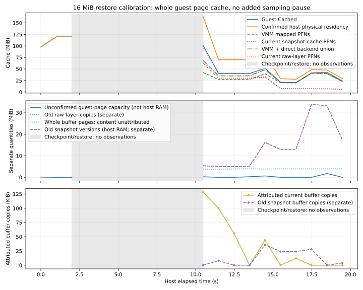

# GET_DATA缓冲归属方案验证（2026-10-16）

**方案在当前配置的短恢复路径上可用。** 私有设备验证确认：内核复制WRITE（写请求）数据前，归属记录已经失效；READ（读请求）提交期间可以保留有效记录。随后一次短恢复校准通过文件内容、原进程身份和清理，恢复后10点中有5点确认了属于当前guest缓存的缓冲物理页，最多128 KiB。没有为采集增加暂停，也没有等待采集器完成才处理请求。

本次只运行一次小型设备对照和一次短恢复校准。三任务完整采集、Prettier第24步恢复和真实双分支去重直接复用。旧校准的3.9375 MiB及23张混合边界页仍按原证据列为内容归属未知，不用本次结果追溯改写。

脱敏结果见[汇总数据](evidence/provider-get-data-20261016.json)。本机证据为`.artifacts/provider-get-data-20261016/`；短恢复运行是`.artifacts/storage-isolated-service/20261016T033725Z-2170673/`。

## 实现只改变私有观测设备

host仍为已核对的`6.19.9+`，内核源码及构建身份见[协议核查](PROVIDER_SLOT_PROTOCOL.md)。AgentENV固定提交`2f48c9c78ec58e4d73c49aa07cb81d984a4a4184`，先应用原[槽位观测补丁](../../patches/agentenv-provider-slot-observation.patch)，再应用[本次增量补丁](../../patches/agentenv-provider-get-data.patch)。原补丁及旧构建保留。

新增`AENV_PROVIDER_NEED_GET_DATA=1`，只有同时启用槽位观测、使用非池化`memory/image.json`时才申请GET_DATA协议。设备创建后以实际协商的功能标志为准，并写入身份记录。未启用或未协商成功时继续在提交获取请求前失效，旧调用方式不变。实际短恢复的功能标志为24646，包含NEED_GET_DATA。

初次FETCH和后续COMMIT_AND_FETCH都处理返回值1：先使归属记录失效，再发送GET_DATA允许内核复制。再次通知也走同一顺序；错误、取消和释放不留下有效旧记录。完整READ后保留记录，下一次用户态填充前仍执行原有失效操作。没有增加睡眠、等待采样、缓冲复制或强制驻留。

表仍为原8个64位字段，身份文件新增协议说明；旧身份文件按原方法读取。采集器继续要求元数据代次、内容状态、guest页身份和物理页号在配对读取期间稳定。只纳入完整host页，并与VMM、直接后端、原始内存层按物理页号去重。

以非root用户yyxie、原Rust 1.99.0工具链离线构建，dev配置、关闭调试信息及增量编译、8个构建任务。实际复制进私有服务的二进制标识为`bfed41393c1cc279ecef101ac1770d086ab076378535b146ad550caa282a3360`，与采集器记录一致。未安装到原服务。源码副本、日志和两个诊断二进制保留；12 GiB限额的编译内存盘已卸载。

## 真实设备验证：覆盖之前已经失效

新增独立的128 KiB内存目标设备，分别关闭、开启GET_DATA，各1队列/1槽/4 KiB缓冲。每组执行32次直接写入及读回，另检查READ→READ、读错误后恢复读取、槽位释放。所有内容及退出结果通过；创建的两个设备均已删除。编译和设备程序均以非root用户执行，设备程序仅增加所需能力及本进程的kvm组访问权限。

内核探针只跟踪这个诊断进程，在`ublk_copy_user_pages.isra.0`入口读取元数据，不读取负载缓冲。结果如下：

| 模式 | 复制方向及次数 | 复制开始时的归属状态 |
| --- | --- | --- |
| 原默认协议 | 32次WRITE，内核写入用户缓冲 | 全部已失效，有效长度0 |
| GET_DATA协议 | 32次WRITE，内核写入用户缓冲 | 全部已失效，有效长度0 |
| 原默认协议 | 40次READ，内核从用户缓冲取数据 | 全部已失效 |
| GET_DATA协议 | 40次READ，内核从用户缓冲取数据 | 全部仍为完整读取有效状态 |

40次READ复制包含设备启动期间的读取。所有记录的标识正确、代次为偶数，未见跟踪事件丢失告警。原模式和新模式均通过读写及错误恢复；这既核对了新路径的完成能力，也直接验证了失效位置。数据为`device-check.log`及`device-check/`，复算见`audit.json`的`device`部分。

两组先关闭后开启，且均带内核跟踪。直接写入中位数为36.911→56.815 µs，读取为36.216→42.762 µs；本次写入中位数多19.904 µs。这些是小型内存目标的观测值，不换算成沙箱任务减速，也不作为稳定性能统计。GET_DATA只为需要复制数据的WRITE增加协议往返，不要求READ经过这一步。

## 短恢复：取得正值归属，主要确认额外物理副本

沿用2 CPU/4096 MiB、`6.1.175-asb-cache-v3`诊断guest内核、约1秒采样及既有16 MiB文件的等待、读取4 MiB、修改4 MiB三个阶段。保存前3点、恢复后10点，后端完成3,748次完整读取；文件内容、原进程PID/启动身份、恢复接口和清理均通过。没有观察到请求卡住；验证范围是这一次短负载。

| 恢复首点 | 结果 |
| --- | ---: |
| guest逻辑Cached | 101.000 MiB |
| 原三层确认物理并集 | 163.914 MiB |
| 当前guest缓存的缓冲物理副本 | 128 KiB |
| 缓冲与原三层的重复物理页 | 0 |
| 加入缓冲后的确认物理并集 | 164.039 MiB |
| 未确认guest页容量 | 0.250 MiB，保持不变 |
| 完整缓冲页驻留 | 3.941406 MiB |
| 完整缓冲页中未归属部分 | 3.816406 MiB |

这里确认的是已知guest缓存页的另一份host物理副本，所以物理并集增加，但没有新增确认的guest页；10点的`provider_resolved_guest_pages`均为0。不同物理副本也解释了host并集可以大于guest逻辑缓存量。整块设备缓冲不能全部算作guest文件缓存。

| 恢复点 | 配对期间有效槽位 | 当前缓存副本（KiB） | 旧快照副本（KiB，单列） | 未归属完整缓冲页（KiB） |
| --- | ---: | ---: | ---: | ---: |
| 0 | 11 | 128 | 0 | 3908 |
| 1 | 13 | 100 | 8 | 3928 |
| 2 | 16 | 56 | 0 | 3980 |
| 3 | 4 | 0 | 0 | 4036 |
| 4 | 12 | 44 | 36 | 3956 |
| 5 | 16 | 0 | 24 | 4012 |
| 6 | 11 | 12 | 24 | 4000 |
| 7 | 16 | 0 | 28 | 4008 |
| 8 | 12 | 0 | 0 | 4036 |
| 9 | 16 | 0 | 4 | 4032 |

完整缓冲页驻留每点均为4036 KiB，未归属部分为3.816–3.941 MiB；另有22–25张混合内容或分配边界页，不按整页加入当前缓存并集。6点观察到旧快照缓冲副本，最多36 KiB，继续与当前内容分开。未知guest容量为0–1.770 MiB，各点都未因新增缓冲观测而减少。上述容量不相加、不跨时间累加。



## 成本、复算与失败记录

host恢复后每点平均296.913 ms线程CPU、325.083 ms配对耗时；其中两次槽位查询合计平均0.600 ms CPU、0.602 ms耗时。保存前/恢复后采集线程分别0.229/2.979 CPU秒。guest每次发布平均1.581/1.494 ms CPU，仍为原16.008 MiB锁定匿名导出区，没有锁定任务文件。本轮没有关闭采集的沙箱对照，未计算任务减速。

正常checkpoint的日志暂停边界为331.507–332.055 ms，保存接口3.198秒，前后采样空缺8.479秒，三者分开报告。采样没有增加暂停、预读、清空缓存或强制驻留。

3项Rust生命周期测试、7项Python归属/独立复算测试和27项Python隔离入口测试通过。格式、构建和带原`async_trait double_must_use`例外的clippy通过，旧依赖警告保留。没有运行会触及其他真实服务的全量测试。

独立检查器逐字节标记guest页的覆盖范围，未调用在线缓冲归属函数；10点的当前/旧副本、驻留、混合页、物理并集和未知容量全部一致。两份最终报告各3文件逐字节相同，实际曲线已查看。报告将小量缓冲副本另用KiB坐标展示，并修正合并多阶段时误写成三层采集版本的说明，计数含义不变。

准备和检查失败均保留：格式准备及示例clippy问题在真实执行前修正；跟踪启动器有两次参数错误，均未创建设备；独立检查器首次把已经是页编号的后端偏移又除以页大小，随后用保存的原始数据修复并补回归。成功设备任务和短恢复均未因检查器错误重跑。

启动空闲55.664 GiB，24 GiB卷运行中最低31.663 GiB，20 GiB保护量及6 GiB余量保持；结束约55.64 GiB。私有服务、VM、snapshot、卷、loop、设备及编译内存盘已清理，原服务和12个VMM身份保持。原始数据、失败日志及二进制保留，未暂存、提交或推送。

## 本阶段结束，完整任务不重跑

后续已完成[10点未归属缓冲离线分类](PROVIDER_BUFFER_UNKNOWN.md)，明确了读取范围外、槽位变化及未匹配起点候选等原因。本页原始测量、并集和未知量保持。

已验证新协议可以在当前短恢复路径正常推进，并取得可独立复算的正值缓存缓冲归属。当前方案仍不能解释所有缓冲驻留，剩余部分继续单列；不为提高覆盖追加轮次。长期稳定性、完整任务性能、压缩/多层和其他任务扩展另列，不改变本次功能结论。

仅用已保存数据复算：

```bash
python3 -B scripts/audit_provider_get_data.py \
  --device .artifacts/provider-get-data-20261016/device-check \
  --storage .artifacts/storage-isolated-service/20261016T033725Z-2170673 \
  --output .artifacts/provider-get-data-audit-recheck.json
```

构建入口为`bash scripts/build-provider-get-data.sh <构建目录>`，要求非root用户、既有工具链和cargo缓存；本次目录为`.artifacts/provider-get-data-build-20261016`。真实小设备入口为`bash scripts/run-provider-slot-protocol.sh <构建目录> <新结果目录>`；短恢复入口为`validate_isolated_agentenv.py`的`--snapshot-provider-binary`加`--snapshot-provider-get-data`，沿用超过50 GiB启动条件。它们不是离线复算命令，均不替换原服务。
