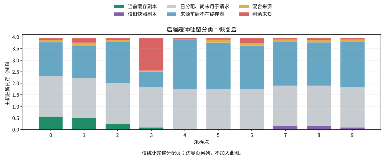

# 1页空隙合并的一次短恢复通过，实际成本已记录（2026-10-17）

一次既有短恢复取得保存前3点、恢复后10点。两张表均记录`mincore_max_gap_pages: 1`，40次查询完整返回，缺失结果为0；文件内容、原guest进程恢复、独立物理去重、缓冲六类及清理通过。运行代码未改，复用[实现阶段的69项模拟回归](PROVIDER_MINCORE_GAP_ONE.md)，没有追加轮次或完整任务。

按本次保存偏移和实际策略计算，mincore调用数为57258次；同一输入若只查询连续区段则为79150次，减少27.66%，额外查页21892页次（+3.72%）。恢复后每点平均273.743 ms线程CPU、303.539 ms耗时。请求规模和缓存状态与前轮不同，不能用前轮227.624 ms计算优化收益；本阶段以功能、计数通过和成本有记录结束。

[脱敏数据](evidence/provider-mincore-gap-one-live-20261017.json)保留全部分项、容量和物理量。原始运行为`.artifacts/storage-isolated-service/20261016T163123Z-2376843/`；启动脚本、源码副本、离线分析与检查在`.artifacts/provider-mincore-gap-one-live-20261017/`。运行目录按UTC命名，本地日期为10月17日。

## 本次输入下调用减少，表容量和原请求统计保持正确

沿用2 CPU/4096 MiB、`6.1.175-asb-cache-v3`诊断内核、私有GET_DATA，以及既有16 MiB文件的等待、读取4 MiB、修改4 MiB负载。只合并中间隔1页的区段，额外页不进入原请求的驻留字典、输出或统计。

40次查询合计原请求588104页次，合并区段覆盖609996页次。两张BPF表都会记录本进程两层查询，按整个会话的跨层偏移并集复算，40次前缀键数与实际整表返回条数全部相符，最后每张63457键，低于131072容量。两张实际HASH表仍为键8字节、值16字节、标志0；40次批量读取均一次读到表尾，返回`ENOENT`及有效条数，共复制2454062条记录。

调用数由保存偏移和实际代码区段规则计算，没有新增逐系统调用事件计数器。实际表条数如实保留，不要求与旧运行相同。40份保存输出的编码、未知偏移、请求数、确认数及缺失统计与日志一致，前后偏移变化行数为0。

## mincore循环仍占四次查询CPU的60.7%

下表是恢复后每点四次查询合计的平均值，内部阶段不重复加到原外层总量上。

| 步骤 | CPU/ms | 耗时/ms |
| --- | ---: | ---: |
| 请求准备 | 1.240 | 1.243 |
| mincore查询循环 | 119.757 | 120.186 |
| 批量库调用 | 36.315 | 36.770 |
| 查询号/偏移筛选及字典构建 | 17.117 | 17.160 |
| 数组结果还原及原统计 | 21.742 | 22.146 |
| 内部未分项差额 | 0.076 | 0.059 |
| 外层减内部总量 | 1.069 | 1.073 |
| **四次查询外层合计** | **197.315** | **198.637** |

mincore段包括区段拆分、驻留位缓冲分配、内核查询和Python驻留字典整理，不是纯内核CPU。批量库调用含参数求值、库分派和结果复制；外层减内部总量还含末尾记录整理、返回及局部对象释放，不解释成纯计时器成本。40条内部计时的查询号、阶段顺序、边界、求和和外层对应均通过。

四次查询占原单点CPU的72.08%。其余主要步骤为VMM页表读取20.203 ms、偏移换算14.580 ms、provider查询5.526 ms和归属计数31.537 ms，其余完整分项见脱敏数据。

完整采集线程保存前/恢复后为0.222/2.818 CPU秒。恢复后单点范围之外共80.338 ms CPU，其中接收数组内存观测9.553 ms，其余70.785 ms含编码、写盘和循环处理。两层BPF辅助进程各0.490 CPU秒，另列。本轮没有关闭采集或不合并的同状态性能对照，不将本地成本换算成任务减速。

## 接收数组驻留、临时容量和控制器RSS分开

两张接收数组容量仍合计6 MiB，覆盖1537张虚拟页，725–749张驻留。按物理页号（PFN）去重的覆盖页驻留并集为2.832–2.926 MiB，其中完整数组页2.813–2.906 MiB，仅混合边界页贡献每点20 KiB；边界整页可能含其他对象，不视为数组独占。

整个控制器RSS为94.949–107.820 MiB，不是新增物理内存。内存观测平均0.955 ms CPU、0.967 ms耗时，位于原单点计时之外、完整采集线程CPU之内。

按保存行数计算，结果还原的具名临时数组单次容量87.514–797.476 KiB，返回结果25.938–236.289 KiB，输入有序偏移另列。合并mincore区段所需的单个驻留字节向量最大容量，逐次查询为192–3073字节。以上是逻辑容量，不是同时存活的物理峰值；表达式临时数组、Python容器和分配器开销未计入，也不与接收数组驻留或RSS相加。

## 48条导出时身份失效记录已保留为未知

26份前后元数据中，仅恢复后第1点的后份数据出现48条`stale_records`。原始48行的身份标记均为0，前份对应标记均为正值；标量和数组路径的候选集合相同，这48个guest页身份全部被拒绝，未通过VMM、直接后端、原始层或provider候选准入。

源码`asb_open`先在锁内复制成员位图、页数和代次，再在锁外读取身份标记；若标记已清零或其代次超过位图代次，就写入0并增加本份导出的`stale_records`。因此这是导出期间身份变化的逐份计数，不是累计丢失事件数。成员表逻辑容量仍是位图复制时的页数，`Cached`读取更晚，两者不是同一原子时点。

证据为[内核补丁中的`asb_open`](../../patches/agentenv-cache-metadata/linux-6.1.175.patch)、`fast_cache_metadata.join_arrays`、`snapshot_cache_residency.account`及`provider_slot_cache.provider_context`。本次启动器已有的内核身份收据与v3构建收据相符；另直接核对该有效内核二进制的`asb_open`反汇编，确认先解锁、再读取标记，以及清零/超代次时置0并计数的分支。反汇编和逐份核对保存在本机分析目录，没有重新构建或计算哈希。

48页合计192 KiB，已包含在该点212 KiB未确认guest容量内，其余为20 KiB，不能再加一次或记为零。这是guest容量，不是测得的host未知物理量。若另一个有效guest身份指向相同host PFN，它仍可正常计入；不按失效guest身份全局删除物理别名。重复加入、缺失删除、越界及迁移计数均为0。

## 当前物理并集和缓冲六类保持原含义

guest逻辑量来自缓存成员表；host量为这批当前内容在VMM、直接后端、原始层及可归属provider缓冲中的驻留副本按PFN去重后的并集。旧内容、初始化开销和无法确认的内容另列。

| 点 | guest逻辑/MiB | guest Cached/MiB | host当前并集/MiB | 未确认guest/KiB | 当前缓冲/KiB | 旧缓冲/KiB | 剩余未知缓冲/KiB |
| ---: | ---: | ---: | ---: | ---: | ---: | ---: | ---: |
| 0 | 118.145 | 118.145 | 184.000 | 384 | 576 | 0 | 64 |
| 1 | 106.613 | 106.051 | 163.008 | 212 | 512 | 0 | 188 |
| 2 | 84.375 | 84.375 | 131.793 | 8 | 276 | 0 | 64 |
| 3 | 86.379 | 86.305 | 127.785 | 6000 | 88 | 0 | 1428 |
| 4 | 12.969 | 12.969 | 23.445 | 0 | 0 | 0 | 56 |
| 5 | 20.125 | 20.090 | 30.164 | 448 | 0 | 4 | 60 |
| 6 | 23.254 | 23.164 | 31.320 | 2468 | 0 | 8 | 212 |
| 7 | 44.609 | 44.609 | 54.492 | 0 | 0 | 152 | 56 |
| 8 | 45.223 | 45.191 | 54.492 | 628 | 0 | 152 | 76 |
| 9 | 26.914 | 26.914 | 32.191 | 0 | 0 | 88 | 56 |

provider完整缓冲每点4040 KiB驻留，21张边界页单列。当前副本0–576 KiB、旧副本0–152 KiB；尚未用于请求的分配页每点1792 KiB，来源前后均不在缓存表684–2184 KiB，混合来源8–144 KiB，剩余未知56–1428 KiB。六类互斥且完整覆盖已驻留的完整分配页。

第3点剩余未知1428 KiB来自区段记录变化1172 KiB、VMM映射变化220 KiB、尚未填充28 KiB和混合版本8 KiB，继续保留未知，不通过延长有效时间补入并集。本次没有新增确认guest页，缓冲只增加已确认内容的额外副本。当前副本为0不代表缓冲零占用；guest未确认容量和缓冲未知物理量也不能相加。

缓冲配对区间平均11.292 ms。原生checkpoint暂停边界346.461–346.984 ms，采样空缺8.088秒；没有新增采集暂停、任务预读、清缓存或强制驻留。

## 资源已回收，本阶段结束

文件内容和原guest进程恢复通过；恢复到新VMM后，guest PID、启动标识和进程启动时刻保持，继续原等待/读写过程。10点独立PFN集合与在线计数相同，13点原分项及40条内部计时核对通过；原69项模拟回归和旧格式兼容证据直接复用。

启动前55.619 GiB可用，运行中最低31.618 GiB，24 GiB卷、20 GiB保护量及6 GiB余量保持。自有VM、snapshot、私有服务、卷、挂载和loop已回收，收尾55.586 GiB可用，原服务和12个已有VMM身份保持。没有替换原服务，三任务完整采集、完整恢复及双分支去重继续复用。

本机同范围启动入口为`bash .artifacts/provider-mincore-gap-one-live-20261017/run-calibration.sh`；本阶段已完成，不自动再次执行。

下一步建议供检查：仅离线核查驻留字典整理是否值得简化。用40份保存偏移和明确标注的合成驻留字节，对比现实现与一处最小候选，核对额外页不进入结果、逐项值和类型一致，每种实现各做一次离线计时；给出小改动或保持现状的决定即结束。原逐页驻留向量没有保存，不补造真实输入；不调用真实mincore/BPF、不启动沙箱，不把子步骤计时当整体收益。

该离线对照随后已按新授权完成，见[一次整数转换的候选与字典子步骤结果](PROVIDER_MINCORE_RESIDENCY.md)。本页在线成本、物理量及失效记录结论保持。
