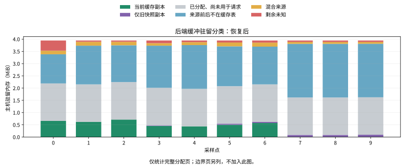

# 2页空隙合并的一次短恢复通过，现行配置成本已记录（2026-10-17）

一次既有短恢复取得保存前3点、恢复后10点。两张表均记录`mincore_max_gap_pages: 2`，40次查询完整返回、缺失结果为0；文件内容、原guest进程恢复、独立物理页并集、缓冲六类和资源回收通过。每点平均294.529 ms线程CPU、327.133 ms耗时，guest前后读取覆盖的host时间平均188.732 ms。

**保留2页策略，本阶段结束。** 功能和物理计数通过，真实成本已有记录，不扩大合并范围或追加轮次。原[52项模拟检查](PROVIDER_MINCORE_GAP_TWO.md)直接复用，运行代码本轮未改。新旧缓存状态和请求规模不同，不用与旧308.906 ms的差值判断加速或未知容量改善。

见[脱敏数列和成本](evidence/provider-mincore-gap-two-live-20261017.json)。原始运行为`.artifacts/storage-isolated-service/20261017T065143Z-2431526/`；启动、分析、验证和收尾记录在`.artifacts/provider-mincore-gap-two-live-20261017/`。没有执行完整任务、额外采集暂停、预读、强制驻留或清缓存。

## 真实策略、请求统计和表容量一致

沿用2 CPU/4096 MiB、`6.1.175-asb-cache-v3`诊断guest内核、私有GET_DATA后端和批量入口；负载仍为既有16 MiB文件的等待、读取4 MiB、修改4 MiB三个阶段。

本次40次查询的原请求共658932页次，按实际2页策略覆盖701364页次。调用数由保存偏移和运行源码的区段规则计算，没有新增系统调用事件计数器。同一输入的1页策略仅作数量对照：

| 本批输入的数量 | 1页策略，离线推算 | 实际2页策略对应数量 |
| --- | ---: | ---: |
| mincore调用次数 | 55808 | 46216 |
| 查询页次 | 682180 | 701364 |

2页策略少9592次调用（17.19%），多查19184页次（2.81%）；这些是同输入数量差，不是同状态性能对照。本轮请求量也不同于上一轮806414页次，因此旧CPU和观察范围不用于归因比较。

两张HASH表仍为键8字节、值16字节、标志0、容量131072。每张表都会捕获两层查询，按全会话跨层偏移并集复算，40个逐次键数全部与实际整表返回相符，最后每张61152键；40次共复制2356584条记录。所有读取一次到表尾，缺失结果为0，没有扩大表、清表或回退。

40份保存输出的编码、原请求数、未知偏移数和确认数均与查询统计一致；前后偏移变化行数为0。额外空隙页没有进入原请求统计。实际单个返回向量最大2692字节，按本次调用跨度单独分配，没有使用向量复用。

## 时间和采集器内存分开报告

恢复后每点平均294.529 ms线程CPU、327.133 ms耗时。四次查询外层合计206.946 ms CPU，内部各段如下；内部成本不再加到外层总量上。

| 每点四次查询内部合计均值 | CPU/ms | 耗时/ms |
| --- | ---: | ---: |
| 请求准备 | 1.402 | 1.628 |
| mincore循环 | 126.936 | 127.515 |
| 批量库调用 | 34.888 | 35.154 |
| 查询号/偏移筛选和字典构建 | 18.322 | 18.390 |
| 结果还原和原统计 | 24.223 | 24.243 |

mincore循环含区段拆分、向量分配、内核查询和Python整理，不是纯内核CPU。完整内部差额、外层差额和单点其他分项保存在JSON；40条内部计时的查询号、顺序、边界、求和及外层对应通过核对。

guest前后读取覆盖的host时间平均188.732 ms，其中前置两次查询119.417 ms、其mincore循环75.224 ms。guest自己的两次发布覆盖时间平均174.216 ms，发布间隔170.800 ms；两种时钟分别计算，不相减绝对读数。首末VMM读取覆盖时间平均266.053 ms，provider配对范围平均10.443 ms。保存数据仍不足以给出某页变化的准确时刻。

保存前/恢复后的完整采集线程分别0.228/3.027 CPU秒。恢复后单点范围外合计81.369 ms CPU，包含编码、写盘、循环及接收数组内存观测；内存观测平均0.939 ms CPU，处于原单点计时之外。两层BPF辅助进程分别0.480/0.450 CPU秒，另列。

接收数组容量合计6 MiB，覆盖页驻留物理并集2.691–2.824 MiB；控制器整体RSS为97.414–109.398 MiB。数组边界页和具名临时数组容量单列，不把RSS或逻辑分配容量当作新增缓存物理量，也未测临时内存物理峰值。

## 物理量、变化身份和未知量保持原含义

guest逻辑量是缓存成员表容量；host当前物理量是这批内容在VMM、直接后端、原始层和可归属provider缓冲中的驻留副本，按物理页号去重。不同副本可使host并集大于guest容量，旧快照内容不混入当前并集。

| 点 | guest逻辑/MiB | host当前并集/MiB | 未确认guest/KiB | 当前缓冲/KiB | 旧缓冲/KiB | 未知缓冲/KiB |
| ---: | ---: | ---: | ---: | ---: | ---: | ---: |
| 0 | 109.027 | 171.594 | 468 | 676 | 0 | 424 |
| 1 | 109.027 | 172.652 | 44 | 636 | 0 | 52 |
| 2 | 99.559 | 155.781 | 256 | 732 | 0 | 52 |
| 3 | 54.562 | 86.461 | 4580 | 468 | 24 | 112 |
| 4 | 56.406 | 101.367 | 0 | 448 | 0 | 68 |
| 5 | 61.230 | 105.980 | 0 | 512 | 48 | 84 |
| 6 | 63.605 | 108.668 | 0 | 588 | 48 | 88 |
| 7 | 26.629 | 37.203 | 0 | 8 | 80 | 60 |
| 8 | 26.684 | 37.258 | 0 | 8 | 80 | 60 |
| 9 | 28.207 | 38.781 | 0 | 8 | 88 | 60 |

26份guest导出中，第2点后表有32条身份失效记录，共128 KiB；标量和数组路径均在归属前拒绝这些身份，已包含在该点256 KiB未知容量中，不再额外相加。这是成员位图复制后身份发生变化的逐份计数，不是累计丢失事件数。重复加入、缺失删除、越界和迁移计数均为0。逻辑成员容量和后读的guest Cached不是同一原子时点，两者分别保留。

provider每点完整缓冲4040 KiB驻留，21张混合边界页另列。六类互斥且合计完整覆盖：当前副本8–732 KiB、旧副本0–88 KiB、尚未用于请求1568 KiB、来源前后均不在缓存表1220–2244 KiB、混合来源76–168 KiB、剩余未知52–424 KiB。guest未知容量与缓冲未知物理量不能相加；未知不计零，也不加入当前物理并集。

## 清理完成，下一步只需离线分类

原guest PID、启动标识和进程启动时刻在恢复后保持，恢复到新VMM后继续原等待和读写。10点独立物理页集合与在线结果一致，13点分项、40次输出及内部计时、26份元数据和缓冲释放状态通过。

原生checkpoint暂停边界346.758–347.227 ms，采样空缺8.071秒；没有新增采集暂停。启动前55.491 GiB可用，运行最低31.490 GiB，24 GiB卷、20 GiB保护量及6 GiB余量保持。自有VM、snapshot、服务、卷、挂载和loop已回收，收尾约55.457 GiB可用，原服务和12个已有VMM身份保持。原始数据、脚本和图保留，未追加实跑。

下一步建议供检查：只用本次10点保存数据，复用互斥分类工具拆分0–4580 KiB未确认guest容量，区分成员、身份、映射变化和稳定来源缺口。逐点分项等于原总量、给出保持当前采集或修复具体缺陷的决定即结束，不改在线路径、不调用真实接口、不启动沙箱或性能实验。三任务完整采集、完整恢复及真实双分支继续复用。

该分类随后已按新授权完成，见[新10点分类与保持现行采集的决定](GUEST_UNCONFIRMED_GAP_TWO.md)。本批未知均来自成员/身份或映射变化，没有稳定来源缺口；本页原未知容量及物理量保持。
