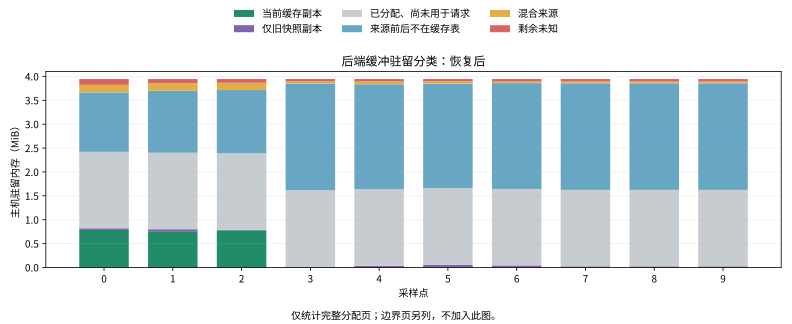

# 单次整数转换短恢复通过，实际CPU和物理量已记录（2026-10-17）

一次既有短恢复取得保存前3点、恢复后10点。40次查询、请求/缺失统计、内部分项、文件内容、原guest进程恢复、独立物理去重、缓冲六类及清理通过。实际采集源码与[已验证的单行接入](PROVIDER_MINCORE_SINGLE_INT.md)一致，运行代码未改，40项模拟回归直接复用，没有追加轮次或完整任务。

恢复后每点平均234.159 ms线程CPU、265.222 ms耗时，其中四次查询166.959 ms CPU。原273.743 ms运行与本次请求规模、缓存状态不同，不能用差值计算单行改动的整体收益。本阶段功能和计数通过，实际成本已记录，实验结束。

见[脱敏数值](evidence/provider-mincore-single-int-live-20261017.json)。原始运行为`.artifacts/storage-isolated-service/20261016T170523Z-2385480/`；分析、源码副本、启动及检查脚本在`.artifacts/provider-mincore-single-int-live-20261017/`。目录按UTC命名，本地日期为10月17日。

## 原查询条件、顺序和统计保持

沿用2 CPU/4096 MiB、`6.1.175-asb-cache-v3`诊断内核、私有GET_DATA和批量模式，负载仍为16 MiB文件的等待、读取4 MiB、修改4 MiB。两张表的元数据均记录合并1页空隙，采集源码确认使用单次整数转换语句。

两张实际HASH表均为键8字节、值16字节、容量131072、标志0。40次查询均一次读到表尾，返回`ENOENT`及有效条数，缺失结果为0，共复制1945377条表记录。输出编码、未知偏移、原请求/确认数与日志一致，前后偏移变化行数为0。

按保存偏移和实际策略计算，438854个请求页次覆盖457332个查询页次，mincore调用53508次；同输入若仅查询连续区段则为71986次，减少25.67%，额外查询18478页次（+4.21%）。这些是代码与保存输入的数量核对，没有新增逐系统调用事件计数器。整个会话跨层偏移并集的40次前缀键数与实际整表条数全部相符，最后每张表51369键，低于容量。

## mincore循环仍是查询的主要CPU成本

下表为恢复后每点四次查询合计的平均值，内部阶段不重复加到外层总量上。

| 步骤 | CPU/ms | 耗时/ms |
| --- | ---: | ---: |
| 请求准备 | 1.010 | 1.014 |
| mincore查询循环 | 100.737 | 100.990 |
| 批量库调用 | 32.718 | 32.845 |
| 查询号/偏移筛选及字典构建 | 14.491 | 14.513 |
| 数组结果还原及原统计 | 17.126 | 17.432 |
| 内部未分项差额 | 0.075 | 0.058 |
| 外层减内部总量 | 0.803 | 0.804 |
| **四次查询外层合计** | **166.959** | **167.656** |

mincore循环占四次查询CPU的60.34%，包含分段、向量分配、内核查询和Python字典整理，不是纯内核CPU。批量库调用含参数求值、库分派和结果复制；外层与内部的差额还包括末尾记录整理、返回及局部对象释放，不单独解释为计时器成本。40条内部记录的查询号、阶段顺序、边界、求和和外层对应均通过。

四次查询占单点CPU的71.30%。其余主要步骤为VMM页表读取20.639 ms、偏移换算11.229 ms、provider查询3.527 ms及归属计数27.725 ms，完整分项保存在脱敏数据中。

完整采集线程保存前/恢复后为0.226/2.421 CPU秒。恢复后单点范围之外共79.136 ms CPU，其中接收数组内存观测9.061 ms，其余70.076 ms含编码、写盘和循环处理。两个BPF辅助进程各0.490 CPU秒，另列。本次没有关闭采集或同缓存状态的旧语句对照，实际成本不换算成任务减速或隔离加速比。

## 控制器内存单列

两张接收数组容量仍合计6 MiB，覆盖1537张虚拟页，555–609张驻留。按物理页号（PFN）去重的覆盖页驻留并集为2.168–2.379 MiB，其中完整数组页2.148–2.359 MiB，仅混合边界页贡献每点20 KiB；边界整页可能含其他对象，不视为数组独占。

整个控制器RSS为94.629–104.738 MiB，不是新增物理内存。接收数组观测平均0.906 ms CPU、0.952 ms耗时，仍位于原单点计时之外、完整采集线程CPU之内。

按保存行数计算，结果还原的具名临时数组单次容量91.311–609.108 KiB，返回结果27.063–180.477 KiB，有序输入另列。每次查询最大单个mincore驻留字节向量容量为142–1409字节。以上是逻辑容量，不是同时存活的物理峰值；表达式临时数组、Python容器和分配器开销未计入，不与接收数组驻留或RSS相加。

## 首点通过provider补齐1张guest页，未知量继续分开

guest逻辑量来自缓存成员表；host量是这批当前内容在VMM、直接后端、原始层和可归属provider缓冲中的驻留副本按PFN去重后的并集。旧内容、初始化开销和未知内容另列。

| 点 | guest逻辑/MiB | guest Cached/MiB | host当前并集/MiB | 未确认guest/KiB | 当前缓冲/KiB | 旧缓冲/KiB | 剩余未知缓冲/KiB |
| ---: | ---: | ---: | ---: | ---: | ---: | ---: | ---: |
| 0 | 90.238 | 90.156 | 134.879 | 2264 | 804 | 36 | 124 |
| 1 | 90.238 | 90.238 | 138.828 | 16 | 764 | 56 | 88 |
| 2 | 89.855 | 89.855 | 138.445 | 28 | 796 | 12 | 80 |
| 3 | 13.531 | 13.531 | 19.375 | 0 | 0 | 12 | 52 |
| 4 | 22.242 | 22.242 | 28.090 | 0 | 0 | 36 | 52 |
| 5 | 29.820 | 29.820 | 35.668 | 0 | 0 | 60 | 52 |
| 6 | 26.285 | 26.285 | 32.004 | 0 | 0 | 44 | 52 |
| 7 | 21.945 | 21.945 | 26.867 | 0 | 0 | 24 | 52 |
| 8 | 21.715 | 21.715 | 26.609 | 0 | 0 | 24 | 52 |
| 9 | 24.965 | 24.965 | 29.859 | 0 | 0 | 24 | 52 |

首点provider完整覆盖并新增确认1张guest页，三层未确认guest容量从2268降至2264 KiB。原槽位路径已补齐这一页，加入区段路径后仍合计1页，不重复相加；其余点新增确认页为0。首点原槽位路径确认236 KiB当前缓冲副本，区段记录另增加568 KiB，合计804 KiB。这些是本轮采样观察，不归因于整数转换优化。

provider完整缓冲每点4040 KiB驻留，21张混合边界页单列。当前副本0–804 KiB、旧副本12–60 KiB；尚未用于请求的分配页每点1640 KiB，来源前后均不在缓存表1272–2292 KiB，混合来源36–164 KiB，剩余未知52–124 KiB。六类互斥且完整覆盖已驻留的完整分配页。

首点剩余未知124 KiB包括尚未填充52 KiB、缺少初始guest候选68 KiB、混合版本4 KiB；后两点为尚未填充及混合版本，其余点均剩尚未填充52 KiB。未知量不计零或补入当前物理并集。未确认guest容量、缓冲未知物理量和采集器内存是不同的量，不能相加。

26份前后元数据的重复加入、缺失删除、越界、迁移及导出身份失效计数均为0。缓冲配对区间平均9.611 ms；原生checkpoint暂停边界347.140–347.659 ms，采样空缺8.015秒，没有新增采集暂停、预读负载、清缓存或强制驻留。

## 资源已回收，本轮结束

文件内容和原guest进程恢复通过；恢复到新VMM后，guest PID、启动标识及进程启动时刻保持，并继续原等待/读写过程。10点独立PFN集合与在线计数相同，13点原分项及40条内部计时通过核对；原40项模拟回归和旧格式兼容证据直接复用。

启动前55.578 GiB可用，运行中最低31.577 GiB，24 GiB卷、20 GiB保护量和6 GiB余量保持。自有VM、snapshot、私有服务、卷、挂载及loop已回收，收尾55.550 GiB可用；原服务和12个已有VMM身份保持。三任务完整采集、完整恢复和双分支结果继续复用，没有追加实跑。

本机启动记录为`bash .artifacts/provider-mincore-single-int-live-20261017/run-calibration.sh`，本轮已完成，不自动再次执行。

下一步建议供检查：先不继续微调CPU，仅用本轮10点已有raw，按互斥条件拆分未确认guest页，重点核对首点2264 KiB中哪些来自身份/映射变化，哪些仍是来源覆盖缺口。分项合计须与原总量一致，并据此决定是否需要改采集；不改在线路径、不调用真实接口或启动沙箱。

该离线分类随后已按新授权完成，见[未确认guest容量的互斥拆分与4页来源缺口](GUEST_UNCONFIRMED_PARTITION.md)。本页在线成本和物理量保持。
