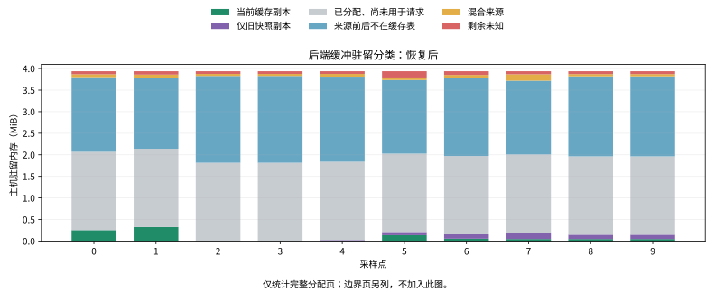

# 查询内部分项短恢复完成：优先核查mincore调用数量（2026-10-17）

一次既有短恢复取得保存前3点、恢复后10点，40次查询均有完整的五段计时，查询号、阶段边界、总量/差额及外层范围逐条通过。文件内容、原guest进程恢复、独立物理去重、缓冲六类划分和资源回收通过。本次没有修改运行代码，复用[计时实现阶段的56项模拟回归](PROVIDER_QUERY_STAGES.md)，未追加轮次或完整任务。

恢复后每点平均227.624 ms线程CPU、255.841 ms耗时。四次查询占162.700 ms CPU，其中mincore查询循环101.366 ms，占查询CPU的62.3%。下一步首选离线核查能否减少mincore调用；结果还原15.240 ms，暂不继续微调这一段。

[脱敏数值](evidence/provider-query-stages-live-20261017.json)保存全部分项和物理量；原始运行是`.artifacts/storage-isolated-service/20261016T160337Z-2367134/`，分析、源码副本、启动和检查脚本在`.artifacts/provider-query-stages-live-20261017/`。运行目录按UTC命名，实际本地日期为10月17日。

## 五段真实成本已能与原外层查询对齐

沿用2 CPU/4096 MiB、`6.1.175-asb-cache-v3`诊断内核、私有GET_DATA及既有16 MiB文件的等待、读取4 MiB、修改4 MiB负载。下表为恢复后每点四次查询合计的平均值，百分比以四次查询外层CPU为分母。

| 步骤 | CPU/ms | 耗时/ms | 查询CPU占比 |
| --- | ---: | ---: | ---: |
| 请求准备 | 0.957 | 0.989 | 0.59% |
| mincore查询循环 | 101.366 | 101.545 | 62.30% |
| 批量库调用 | 31.303 | 31.465 | 19.24% |
| 查询号/偏移筛选及字典构建 | 13.059 | 13.063 | 8.03% |
| 数组结果还原及原统计 | 15.240 | 15.743 | 9.37% |
| 内部未分项差额 | 0.073 | 0.056 | 0.04% |
| 外层减内部总量 | 0.703 | 0.704 | 0.43% |
| **四次查询外层合计** | **162.700** | **163.565** | **100%** |

mincore段包括连续区段拆分、驻留位缓冲分配、全部mincore调用及Python驻留字典整理，不是纯内核CPU。批量库调用也包含参数求值、库分派和结果复制。内部差额包括阶段间记录和返回码/条数检查；外层与内部的差额还包含末尾记录整理、函数返回和局部对象释放等工作，未单独隔离计时器开销。[完整范围定义](PROVIDER_QUERY_STAGES.md)保持。

直接后端两次查询平均93.054 ms CPU，其中mincore循环58.430 ms；原始层两次查询69.646 ms，其中mincore循环42.936 ms。瓶颈在两层都出现。实际共79802次mincore调用，按输入对应416042次原逐项读取的工作现由40次批量读取完成，合计复制2004100条表记录。

两张实际HASH表仍为键8字节、值16字节、容量131072、标志0。40次都一趟读到表尾，返回`ENOENT`及有效条数，缺失结果均为0。40份保存输出的编码、未知偏移、请求数和确认数与查询日志一致；前后映射换算没有变化行，不存在最后输出被偏移变化清零而无法对照的行。

## 原单点成本与内部计时分开使用

四次查询占原单点CPU的71.48%。其余主要步骤为三次VMM页表读取20.284 ms、偏移换算10.681 ms、provider查询3.880 ms及归属计数26.149 ms，其余分项保存在脱敏数据中。内部阶段只用于拆解查询，不再加到外层合计上。

完整采集线程保存前/恢复后为0.222/2.355 CPU秒。恢复后单点计时之外共78.641 ms CPU，其中内存观测9.369 ms，其余69.272 ms包含编码、写盘和循环处理。两个BPF辅助进程分别0.490/0.480 CPU秒，覆盖整个恢复会话，另列。

此前单点248.242 ms及四次查询179.276 ms保留。本次请求行数、连续区段数和缓存状态均不同，不用运行间差值计算优化收益或新增计时的独立成本。本次没有关闭采集或关闭内部计时的对照组。

## 控制器内存单列，不进入guest缓存并集

两张接收数组容量仍为6 MiB，覆盖1537张虚拟页；其中575–637张驻留。按物理页号（PFN）去重的覆盖页驻留并集为2.246–2.488 MiB，其中完整属于接收数组的页2.227–2.469 MiB，仅混合边界页贡献每点20 KiB。边界整页可能含其他对象，不视为数组独占。

整个控制器进程RSS为91.977–104.027 MiB，不是新增物理内存。接收数组观测平均0.937 ms CPU、0.942 ms耗时，仍在原单点计时之外、完整线程CPU之内。

按原公式和保存行数计算，结果还原中具名临时数组单次容量114.250–641.619 KiB；返回数组33.859–190.109 KiB，输入有序偏移另列。这里不包含表达式中间数组、Python容器和分配器开销，未测临时物理峰值；[原容量定义](PROVIDER_RESULT_ARRAY_LIVE.md)保持。

## 当前缓存、旧副本和未知量仍按原规则分开

guest逻辑容量来自独立缓存成员表；host量为这批当前内容在VMM、直接后端、原始层及可归属provider缓冲中的驻留副本按PFN去重后的并集。旧内容、初始化开销和无法确认的内容不加入该并集。

| 点 | guest逻辑/MiB | guest Cached/MiB | host当前并集/MiB | 未确认guest/KiB | 当前缓冲/KiB | 旧缓冲/KiB | 剩余未知缓冲/KiB |
| ---: | ---: | ---: | ---: | ---: | ---: | ---: | ---: |
| 0 | 95.055 | 95.016 | 160.500 | 292 | 260 | 0 | 72 |
| 1 | 95.055 | 95.055 | 161.035 | 8 | 332 | 0 | 80 |
| 2 | 21.492 | 21.367 | 30.918 | 4676 | 0 | 0 | 64 |
| 3 | 21.824 | 21.824 | 35.820 | 0 | 0 | 0 | 64 |
| 4 | 27.684 | 27.754 | 41.082 | 0 | 0 | 24 | 64 |
| 5 | 19.961 | 19.938 | 25.527 | 824 | 140 | 76 | 148 |
| 6 | 37.422 | 37.422 | 43.707 | 0 | 56 | 104 | 88 |
| 7 | 43.176 | 43.176 | 49.371 | 0 | 48 | 148 | 72 |
| 8 | 25.520 | 25.473 | 30.660 | 48 | 48 | 104 | 68 |
| 9 | 24.742 | 24.742 | 29.926 | 0 | 48 | 104 | 68 |

provider完整缓冲每点4032 KiB驻留，23张混合边界页单列。当前副本0–332 KiB、旧副本0–148 KiB；原未归属字段3700–4032 KiB，细分后剩余未知64–148 KiB。尚未用于请求的分配页每点1860 KiB明确单列，来源前后不在缓存表、混合来源也分别保留。

本次没有新增确认guest页；确认到的缓冲只增加已确认内容的额外副本。当前缓冲为0表示未确认到满足归属条件的当前副本，不表示缓冲零占用。guest未确认容量、缓冲未知物理量及采集器自身内存不是同一个量。



缓冲配对区间平均9.838 ms。原生checkpoint暂停边界364.400–364.874 ms，采样空缺8.775秒；没有新增采集暂停、预读负载或强制驻留。

## 检查、资源与下一步

40条内部计时与查询号、外层调用一一对应，五段顺序/边界和总量/差额逐条核对；13点原分项计时、10点独立PFN集合和六类缓冲集合完整分割通过。元数据重复加入、缺失删除、越界、迁移及失效计数均为0。已有56项模拟回归及旧格式兼容证据直接复用。

文件内容和原guest进程恢复通过：恢复到新VMM后，guest的PID、启动标识、进程启动时刻保持，并继续原等待/读写过程。

启动前55.647 GiB可用，运行中最低31.646 GiB，保持24 GiB卷、20 GiB保护量和6 GiB余量。自有VM、snapshot、私有服务、卷、挂载和loop已回收，收尾55.619 GiB可用；原服务和12个已有VMM身份保持。

本机复现同范围一次实验：

```bash
bash .artifacts/provider-query-stages-live-20261017/run-calibration.sh
```

下一步建议供检查：只离线核查合并相邻mincore查询区段是否可行。用实际内核源码和这40份保存偏移，核对不读取或载入文件内容及原结果含义的条件，计算减少的调用数、额外查询页数和BPF表容量需求；给出一处最小可行方案或保留现状的理由。以源码条件和真实输入的数量核对清楚为结束标准，不修改运行路径、不调用真实mincore/BPF、不启动沙箱或追加实测。

该离线核查随后已按新授权完成，见[合并1页空隙的源码条件、数量和最小方案](PROVIDER_MINCORE_MERGE_REVIEW.md)。本页真实计时和物理量保持。
