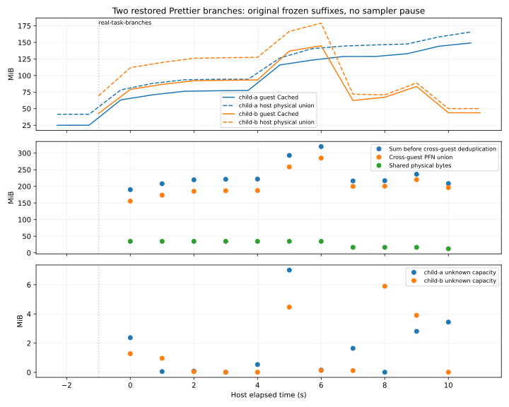
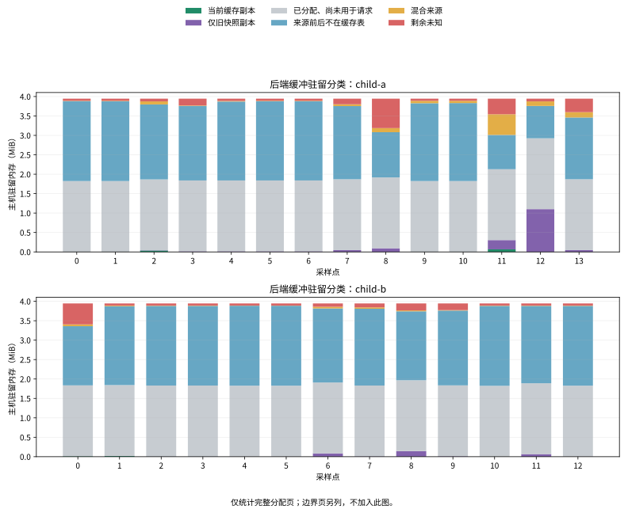

# 最新四来源测量在真实Prettier双分支通过（2026-10-17）

**一次真实双分支完成，最新版provider缓冲归属、2页查询策略及跨guest物理去重均通过。** 共同11步保存一次，删除父VM后恢复两个guest，各执行原有10步后缀；实际31动作。两个guest分别14点和13点，得到11对有效重叠观测。本阶段结束，不追加校准或完整三任务。

本次补上了此前“最新版只验证过短恢复”的范围缺口。两边均为`snapshot-provider-segment-pfn-union-v6`，显式启用GET_DATA和批量查询，四张独立BPF表均记录`mincore_max_gap_pages: 2`。没有修改采样顺序、归属条件、guest内核或provider二进制。

脱敏数列见[本轮证据](evidence/provider-real-pair-20261017.json)。运行入口及联合报告位于`.artifacts/prettier-snapshot-cache-pair/20261017T105623Z-2449781/`；原始结果为`.artifacts/storage-isolated-service/20261017T105741Z-2450246/prettier6604/`；离线检查、源码备份和成本分项位于`.artifacts/provider-real-pair-20261017/`。

## 原任务和原进程恢复保持

沿用AgentENV、2 CPU/4096 MiB、`6.1.175-asb-cache-v3`诊断guest内核、4096字节基页及约1秒采样间隔。私有服务使用既有`.artifacts/provider-segments-build-20261016/uvm-ublk-daemon`，未替换原服务。

共同前缀与两个后缀的动作、顺序、原退出码、关键输出、源码、最终补丁及独立属性检查通过。两个后缀的官方结果均保持0通过/2失败；最终补丁与原三层双分支结果一致，不把采集成功写成修复任务成功。

两个恢复检查均确认原guest探针PID、启动时间和boot ID保持，保存边界的59份文件及进度相同，原进程继续前进；host侧重新关联到两个新VMM。控制器生命周期35.136秒，包括启动、保存、恢复、采样准备和后续评测，不能当作任务工具耗时。

## 联合物理集合包含provider，不再只算前三层

旧联合报告只用VMM、直接快照设备和单个原始内存层。现按实际采集字段选择独立四来源复算，将当前provider物理副本并入每个guest集合，再取跨guest并集。旧入口仍默认三层；新模式才增加provider六类报告和输入状态清单`raw_stat`，旧模式的`raw_sha256`接口保持。新清单记录inode、大小和修改时间，不将它描述为内容摘要校验。

| 首对有效观测 | MiB |
| --- | ---: |
| guest A的Cached | 63.266 |
| guest B的Cached | 79.008 |
| A的四来源物理并集 | 78.336 |
| B的四来源物理并集 | 111.738 |
| 两边直接相加 | 190.074 |
| 跨guest去重后 | 155.531 |
| 重复物理页对应容量 | 34.543 |

11对逐字节满足`联合量 = A物理量 + B物理量 − 交集`，各采样只配对使用一次。重叠范围29.598–321.623 ms；它是区间观测，不是同时冻结的原子快照，不以重叠较短为理由放宽身份和映射条件。

provider贡献取得正值：A在第2、11点分别补入36、68 KiB，B在第0–3点补入12、20、4、4 KiB；这里是同点四来源并集相对前三层的增量。当前缓冲可以保存已确认guest内容的额外副本，因此有物理增量不要求同时减少未知guest容量。



## 未知量和同一块共享缓冲分开解释

两个guest实际关联到同一个provider进程和同一个内存设备。每边观测到的完整缓冲均为4040 KiB，另有21张边界页；这些是同一分配的两份观察，不能相加成8080 KiB。各guest只把可确认属于自己当前缓存内容的物理页并入集合，跨guest再去重。

| 项目 | A：early_1 | B：early_2 |
| --- | ---: | ---: |
| 未确认guest容量范围/KiB | 0–7172 | 4–6040 |
| 当前provider副本/KiB | 0–68 | 0–20 |
| 仅旧provider副本/KiB | 0–1128 | 0–148 |
| provider剩余未知驻留/KiB | 56–776 | 56–552 |
| 导出身份失效记录最大值/条 | 1 | 0 |

全部54份导出的重复加入、遗漏移出、越界及迁移计数为0；A的一份导出有1条身份失效，按原检查拒绝归属。原在线量与独立物理集合一致。未确认guest容量、provider未知驻留和边界页继续另列，不记零，也不相加成host实测总量。

当前副本、仅旧副本、尚未用于请求、来源前后均不在缓存表、混合来源和剩余未知六类在27点均互斥且合计为完整缓冲驻留量。来源前后不在表只说明两个端点，不代表整个区间持续不在缓存中。



## 成本有实测，功能与性能分别判断

| 成本 | A | B |
| --- | ---: | ---: |
| 每点采集线程CPU/ms | 393.401 | 385.627 |
| 每点耗时/ms | 421.994 | 415.087 |
| 整段采集线程CPU/秒 | 5.629 | 5.126 |
| BPF辅助进程CPU/秒，另计 | 0.890 | 0.930 |
| guest发布CPU/秒，另计 | 0.0524 | 0.0369 |

每个采集进程的接收数组容量6 MiB，观测驻留分别0.656–3.586 MiB和1.031–3.961 MiB；没有测量两个采集进程所有临时对象的联合内存峰值。缓存规模与旧三层双分支和短恢复不同，不据这些时延差计算优化收益或完整任务减速比例。

108次查询全部返回，缺失内核结果为0；每次整表返回条数与本进程请求区段累计得到的键数相等。两边最终每表78295/86374键，均低于131072容量。四张表的ID各不相同，两个采集进程的数据没有串用。查询输出、原统计、内部计时边界、provider紧邻中间VMM读取的顺序以及六类分项核对通过。

原生checkpoint暂停371.289–371.820 ms，没有新增采集暂停。43项相关离线检查通过，既有52项查询检查直接复用。唯一一次真实运行及后续离线核对均通过。

## 资源已回收，按一次实验收尾

24 GiB卷启动前55.448 GiB可用，运行中观测最低31.446 GiB，清理后约55.347 GiB。自有VM、snapshot、服务、卷、挂载、loop及只读RAM输入缓存已释放；16个槽位和所有512字节段记录在设备释放后均失效。原服务与12个已有VMM身份保持。

需要重新执行本实验时，使用以下显式入口；查看已有结果无需运行它：

```bash
bash scripts/run-prettier-snapshot-cache-pair.sh \
  --snapshot-provider-binary .artifacts/provider-segments-build-20261016/uvm-ublk-daemon \
  --snapshot-provider-get-data --snapshot-bpf-batch
```

未来运行前仍检查实际负载和空间，24 GiB卷要求超过50 GiB可用，保留20 GiB保护量及6 GiB余量。

随后按新授权完成的[关闭/开启各一次耗时对照](PROVIDER_PAIR_TIMING.md)显示：控制器生命周期增加6.610秒（23.27%），主要落在恢复/采集就绪及停止阶段；工具合计本次减少12.22%，只作单对观察。该对照已结束，本页正确性运行和成本不追溯改写。下一步直接整理研究结果；压缩、多层、其他任务恢复及稳定减速率留作后续范围。
