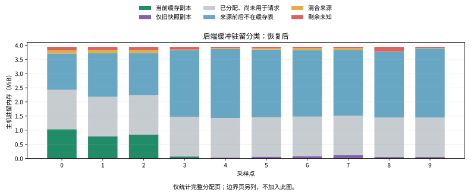

# 数组结果还原的一次私有短恢复验证（2026-10-16）

数组结果还原已通过一次保存前3点、恢复后10点的真实短恢复。40次批量查询均完整返回，缺失结果为0；文件内容、原guest进程恢复、独立物理页集合、缓冲六类计数和资源回收通过。本次没有修改运行代码，复用[上一阶段74项回归和20份真实输入对照](PROVIDER_RESULT_ARRAY.md)。

恢复后单点平均248.242 ms线程CPU、273.841 ms耗时；接收数组覆盖页的驻留物理并集为2.887–3.066 MiB。临时数组只计算明确范围的逻辑容量，没有测其物理峰值。达到本阶段功能、计数和实际成本记录条件后结束，没有追加轮次或完整任务。

原始运行：`.artifacts/storage-isolated-service/20261016T154243Z-2359975/`。分析、源码快照、启动脚本和检查结果：`.artifacts/provider-result-array-live-20261016/`。[脱敏数值](evidence/provider-result-array-live-20261016.json)保存全部逐点数据。

## 一次运行的范围与检查

沿用2 CPU/4096 MiB、`6.1.175-asb-cache-v3`诊断guest内核、原16 MiB文件的等待/读取4 MiB/修改4 MiB负载，以及私有GET_DATA provider。只显式批量入口使用数组还原，默认逐项入口保持；没有新增采集暂停、任务文件预读或强制驻留。

两张实际BPF HASH表均为键8字节、值16字节、容量131072、标志0。直接后端和原始层各20次查询，一次读到表尾，返回`ENOENT`及有效条数；40次合计复制2548440条表记录。按实际输入，原逐项调用数为517194，现为40次批量调用；81822次`mincore`（查询文件页驻留状态）保持。每次查询号、请求数、未知偏移数及缺失统计均核对。

独立计数器逐点重建物理页号（PFN）集合，与在线并集相同；不是只比较总字节数。13点分项计时边界/求和、10点紧邻缓冲查询顺序、六类缓冲集合完整分割、实际采集源码与当前源码一致均通过。元数据重复加入、缺失删除、越界、迁移及失效记录计数均为0。既有13点旧格式仍可复算。

恢复到新VMM后，guest的PID、启动标识和进程启动时刻保持，原进程继续等待、读取及写入；文件内容检查通过。这是原guest进程状态恢复，不是原host VMM进程原地继续运行。

## 实际CPU：四次缓存查询仍占72.2%

原计时范围仍为采集线程开始取样至归属计数结束，不含随后内存观测、编码和写盘。下表为恢复后10点平均值。

| 步骤 | CPU/ms | 耗时/ms |
| --- | ---: | ---: |
| 两次guest发布/读取 | 0.837 | 25.616 |
| 三次VMM页表读取 | 19.849 | 19.895 |
| 两次映射读取 | 0.730 | 0.731 |
| 后端及原始层偏移换算 | 10.989 | 10.997 |
| 两次直接后端查询 | 100.329 | 100.621 |
| 两次原始层查询 | 78.947 | 79.403 |
| 两次provider缓冲查询 | 4.549 | 4.552 |
| 解码与数组组装 | 0.831 | 0.834 |
| 各层归属计数 | 29.862 | 29.892 |
| 未分项部分 | 1.321 | 1.298 |
| **原计时范围合计** | **248.242** | **273.841** |

四次缓存查询合计179.276 ms CPU，占72.218%，包含`mincore`、批量读取、筛选和结果还原。现有计时没有分开这些内部步骤，不能把全部时间归给内核或Python。

完整采集线程保存前/恢复后为0.204/2.562 CPU秒。恢复后原单点计时之外共79.762 ms CPU，其中内存观测9.445 ms，其余70.317 ms包括编码、写盘和循环处理。两个BPF辅助进程整个恢复会话分别0.490/0.480 CPU秒，另列。

此前批量逐行还原的263.929 ms在线成本保持。本次请求规模为517194行，前次为577610行，连续区段数及缓存状态也不同；两个在线总量的差值不作为数组优化的隔离收益。可直接复用的同输入子步骤结果仍为此前离线原始层两次还原13.827→8.171 ms，见[离线证据及范围](PROVIDER_QUERY_REPLAY.md)。本次未做关闭采集的任务减速对照。

## 三种控制器内存分别报告

接收数组是BPF表的键/值接收区，与provider的4 MiB请求缓冲不同。只读取采集器自身`pagemap`，按数组地址和长度找覆盖页，再按PFN去重；没有读取数组内容或触碰未驻留页。

| 实际观测 | 数量 |
| --- | ---: |
| 两张表的接收容量 | 6 MiB |
| 接收数组覆盖虚拟页 | 每点1537张 |
| 已驻留覆盖页 | 739–785张 |
| 覆盖页驻留物理并集 | 2.887–3.066 MiB |
| 其中完整属于接收数组的页 | 2.867–3.047 MiB |
| 仅混合边界页贡献 | 每点20 KiB，另列 |
| 整个控制器进程VmRSS | 90.469–105.602 MiB |
| 内存观测自身平均CPU/耗时 | 0.944/0.945 ms每点 |

物理并集中的边界页可能还存有其他对象，不是数组独占内存。6 MiB容量不等于全部驻留，整个进程RSS也不是新增内存。内存观测位于原单点计时之外，完整线程CPU包含它。

临时数组容量由保存的真实查询行数和`SnapshotCache._batch_result`源码离线计算，不在采样中插入新操作。令N为原始行数、F为有文件偏移的行数、U为唯一文件偏移数。返回前仍同时存活的具名临时数组为：`found`、`pfns`、`resident`、`entries`共18U字节，`file_mask`为N字节，`indices`为8F字节，合计**18U + N + 8F**。

| 单次调用的数组容量 | 直接后端/KiB | 原始层/KiB |
| --- | ---: | ---: |
| 上述具名临时数组合计 | 70.348–828.404 | 70.297–827.896 |
| 返回结果，8N字节 | 20.844–245.453 | 20.844–245.453 |
| 调用者的有序偏移输入，8U字节 | 20.844–245.453 | 20.828–245.297 |

四次查询顺序执行，不将它们的临时容量相加作为峰值。公式不包含表达式中间数组、Python列表/字典、分配器开销或调用者的其他对象；它是明确范围的数组容量，不是完整临时内存峰值或新增物理驻留。后续进程RSS观测也不能补出这些已释放对象的峰值。

## 缓存物理量与未知量保持分开

guest逻辑量来自独立缓存成员表；host量为这批当前内容在VMM、直接后端、原始层及可归属provider缓冲中的驻留副本按PFN去重后的并集。它不是整个VMM的RSS，也不是可立即回收或独占内存。配对期间变化或证据不足的guest容量另列。

| 点 | guest逻辑/MiB | guest Cached/MiB | host当前并集/MiB | 未确认guest/KiB | 当前缓冲/KiB | 旧缓冲/KiB | 剩余未知缓冲/KiB |
| ---: | ---: | ---: | ---: | ---: | ---: | ---: | ---: |
| 0 | 122.922 | 122.816 | 192.105 | 376 | 1056 | 0 | 124 |
| 1 | 88.219 | 88.219 | 137.891 | 16 | 796 | 16 | 108 |
| 2 | 88.227 | 88.227 | 138.059 | 20 | 848 | 16 | 108 |
| 3 | 10.422 | 10.422 | 15.395 | 0 | 68 | 16 | 100 |
| 4 | 26.094 | 26.094 | 30.359 | 0 | 0 | 40 | 44 |
| 5 | 33.195 | 33.195 | 37.465 | 0 | 0 | 64 | 52 |
| 6 | 40.762 | 40.762 | 45.012 | 0 | 0 | 88 | 44 |
| 7 | 47.039 | 47.039 | 51.289 | 0 | 0 | 120 | 44 |
| 8 | 26.184 | 26.184 | 26.582 | 3164 | 0 | 52 | 172 |
| 9 | 25.496 | 25.496 | 28.977 | 0 | 0 | 52 | 44 |

provider完整缓冲页每点4040 KiB驻留，21张混合边界页单列。当前缓存副本0–1056 KiB，旧副本0–120 KiB；原未归属字段2984–4000 KiB，细分后剩余未知44–172 KiB。已分配但尚未用于请求的1428 KiB明确单列，来源前后不在缓存表、混合来源也不加入当前缓存并集。

本次没有新增确认guest页；确认到的缓冲只增加已确认内容的额外物理副本。当前缓冲为0的点表示没有满足归属条件的当前副本，不表示缓冲零占用。未确认guest容量、缓冲剩余未知和采集器自身内存是不同的量，不相加或互相替代。



缓冲配对区间平均10.807 ms。原生checkpoint暂停边界339.448–339.902 ms，采样空缺8.704秒；没有新增采集暂停。

## 资源与后续计划

启动前55.682 GiB可用，运行中最低31.680 GiB，保持24 GiB卷、20 GiB保护量和6 GiB余量。自有VM、snapshot、私有服务、卷、挂载和loop已回收；收尾55.651 GiB可用。原服务和12个已有VMM身份保持。

本机复现同范围的一次实验使用：

```bash
bash .artifacts/provider-result-array-live-20261016/run-calibration.sh
```

下一步建议供检查：只为现有批量查询增加内部CPU/耗时分项，分开请求准备、`mincore`、批量系统调用、筛选和结果还原；先做模拟回归，核对原输出、统计、次数、顺序及总计时范围保持。该阶段不启动沙箱，以分项覆盖完整且正确性保持为结束条件；后续是否做一次实测另定，不凭现有总量差值继续优化。

该内部计时及模拟验证随后已按新授权完成，见[五段范围和日志用法](PROVIDER_QUERY_STAGES.md)。本页在线成本和物理量保持；新分项尚未实测。
