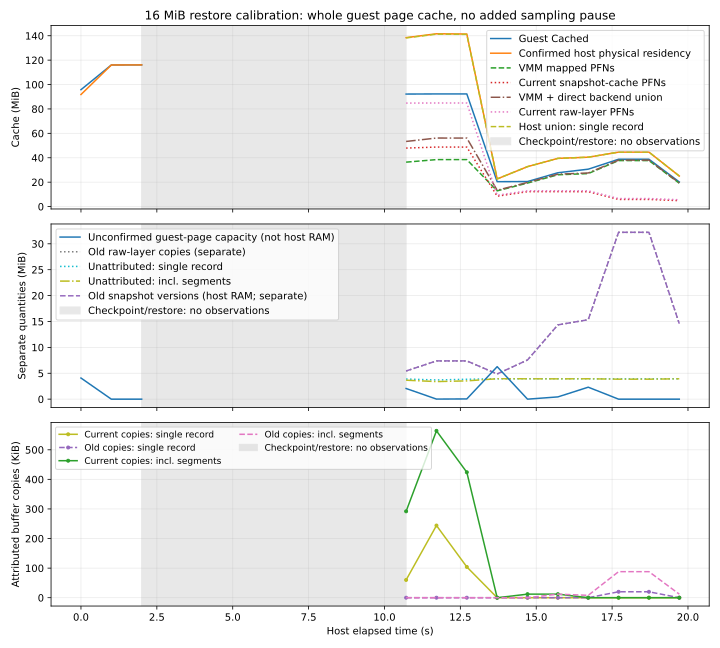

# 分段缓冲归属的私有实现与短恢复验证（2026-10-16）

**分段记录在当前只读内存设备的短恢复路径上可用。** 一次校准保存前3点、恢复后10点，5个恢复点额外确认当前guest缓存的缓冲副本，最多320 KiB；加上原单条记录，当前缓冲副本最多564 KiB。新增旧快照副本最多68 KiB，另行统计。guest文件内容、原进程连续性、物理页独立复算及资源回收通过。

本轮没有重跑三任务完整采集、Prettier第24步恢复或真实双分支，没有替换原服务，也没有增加采集暂停、任务文件预读或强制驻留。旧校准的3.9375 MiB/23张混合或边界页及后来GET_DATA校准的3.941406 MiB保持原记录，不追溯改写。

结果见[脱敏数据](evidence/provider-segments-20261016.json)和下方曲线。本机证据为`.artifacts/provider-segments-20261016/`；实际运行是`.artifacts/storage-isolated-service/20261016T050815Z-2211363/`。

## 实现保留旧首部、旧指标和原服务

AgentENV基线仍为`2f48c9c78ec58e4d73c49aa07cb81d984a4a4184`，依次应用[原槽位观测补丁](../../patches/agentenv-provider-slot-observation.patch)、[GET_DATA补丁](../../patches/agentenv-provider-get-data.patch)和[本次分段增量补丁](../../patches/agentenv-provider-segments.patch)。本次补丁只涉及`slot_observation.rs`和`dev.rs`，已经从已验证GET_DATA源码副本应用并重建出本次编译文件。

沿用私有开关`AENV_PROVIDER_OBSERVE_DIR`和`AENV_PROVIDER_NEED_GET_DATA=1`；仅非池化`memory/image.json`且实际协商GET_DATA时公布段表。实际功能标志为24646。其他设备和未协商GET_DATA的路径仍采用原提交获取请求前失效。

每512字节保存来源偏移和独立改写代次，段表从原64字节首部之后开始。READ在调用目标填充前使请求前缀失效，完整成功后才赋予新归属，尾部保持；失败、部分结果及取消不恢复前缀。GET_DATA在发送命令前读取原始`nr_sectors×512`长度并失效；部分复制后描述符缩短及重复通知均不会恢复旧内容。释放先使所有段失效，再设置原已释放状态并解除映射。

发布沿用64位原子字段的`SeqCst`顺序：代次变奇数、写来源、代次变偶数。采集器对四份段记录逐段核对，前缀变化不再自动排除未动尾部。进程、元数据文件、缓冲分配、驻留物理页号和guest缓存身份的条件继续保留，只有完整host页才计入。

Python接入位于`scripts/provider_slot_cache.py`和`live_task_cache.py`。原单条记录指标未重定义；新增`host_provider_segment_*`、合并缓冲副本及`host_four_segment_*`物理并集/未知容量。新报告采用分段后的并集，并保留原值用于同点比较。两种准入得到的物理页取并集，不要求分段结果包含全部旧结果；例如填充前已使段表失效、尚未改变旧首部时，旧内容仍可能由原规则确认。

旧格式无段表时仍使用原路径。用新代码处理旧GET_DATA校准后，`summary.json`、`cache.svg`和`cache.png`三文件与原最终报告逐字节一致。

## 本次新增确认来自旧尾部，也来自逐段稳定窗口

沿用原16 MiB校准文件和等待、读4 MiB、改4 MiB三个阶段，2 CPU/4096 MiB、诊断guest内核`6.1.175-asb-cache-v3`及约1秒采样。共记录3924次完整读取；恢复后的三个阶段分别有3个采样点。guest中的PID、启动身份和文件内容连续，恢复后的新VMM及其RAM布局另行核对。

下表单位为KiB；只比较同一采样点，不跨时间累加。

| 点 | 单条当前副本 | 分段新增当前 | 合并当前副本 | 单条旧副本 | 分段新增旧副本 | 分段后仍未归属完整缓冲页 |
| --- | ---: | ---: | ---: | ---: | ---: | ---: |
| 0 | 60 | 232 | 292 | 0 | 0 | 3748 |
| 1 | 244 | 320 | 564 | 0 | 0 | 3476 |
| 2 | 104 | 320 | 424 | 0 | 0 | 3616 |
| 3 | 0 | 0 | 0 | 0 | 0 | 4040 |
| 4 | 0 | 12 | 12 | 0 | 0 | 4028 |
| 5 | 0 | 12 | 12 | 0 | 12 | 4016 |
| 6 | 0 | 0 | 0 | 0 | 8 | 4032 |
| 7 | 0 | 0 | 0 | 20 | 68 | 3952 |
| 8 | 0 | 0 | 0 | 20 | 68 | 3952 |
| 9 | 0 | 0 | 0 | 0 | 12 | 4028 |

**点1新增的320 KiB全部依赖保留的旧尾部归属。** 其中312 KiB为完全位于旧尾部的host整页，另两张host页共8 KiB跨越本次前缀末端；补齐尾部身份后才确认整页。该点相应单条记录稳定有效，因此这部分增量不是单纯延长整槽有效窗口所得。

点0另有152 KiB、点2另有72 KiB来自“整槽记录变化，但对应段稳定”的页。逐点原因按物理页号去重后与新增量一致，保存在脱敏数据的`added_reasons`中。新增旧副本均位于稳定记录的旧尾部，合并后的旧缓冲副本最多88 KiB，不加入当前缓存物理并集。

## guest逻辑量与host物理量保持分开

恢复首点结果如下：

| 量 | 首点 |
| --- | ---: |
| 独立元数据表中的guest文件/共享内存（shmem）缓存页容量 | 92.3203125 MiB |
| guest的`Cached`读数 | 92.21484375 MiB |
| 原VMM、直接后端和原始层三层物理并集 | 138.17578125 MiB |
| 加入原单条记录后的并集 | 138.234375 MiB |
| 再加入分段记录后的并集 | 138.4609375 MiB |
| 本次分段增加的当前物理副本 | 232 KiB |
| 未确认guest页容量 | 2.05859375 MiB，保持 |

独立表容量和`Cached`分别按原定义报告，不用二者差值推算host占用。10点的分段新增物理并集为0–320 KiB，与新增当前缓冲副本量一致；本次这些新增页没有与原并集重复。`provider_segment_resolved_guest_pages`均为0：确认的是已有guest缓存页的额外host副本，没有因此补齐新的guest页。

每点均观察到1010张完整缓冲页驻留，共4040 KiB（3.9453125 MiB）。分段后仍未归属3476–4040 KiB（3.39453125–3.9453125 MiB），继续单列，既不记为零占用，也不加入当前缓存并集。21张分配边界页单列；前三点另有4、7、7张完整混合版本页，合计“混合或边界”为25、28、28张，其余点为21张。混合完整页已经计入未归属量，不重复相加。



## 采集成本和资源

二进制元数据实际文件/映射为16×12 KiB=192 KiB，比原64 KiB多128 KiB。这是观测表空间，不作为文件缓存物理占用。每点四次元数据读取共528384字节，即516 KiB，比原首部读取多512 KiB，与离线预算一致。

| 本次恢复后采集 | 平均线程CPU | 平均耗时 |
| --- | ---: | ---: |
| 两次槽位表与物理页号查询合计 | 7.348 ms | 7.368 ms |
| 完整配对采集 | 413.026 ms | 441.053 ms |

恢复后采集线程总CPU为4.201秒，guest每次发布平均1.113 ms CPU。既有guest导出区仍为锁定匿名内存，未锁定任务文件或缓冲。没有关闭分段记录的任务对照；本次完整配对成本包含其他缓存计数，不把它与旧校准的差值直接当作分段开销或任务减速。

正常checkpoint暂停边界为339.468–340.035 ms，保存接口3.345秒，保存恢复前后采样空缺8.713秒。这是原生保存恢复过程，不是新增采集暂停。

启动时约55.55 GiB可用，24 GiB卷运行期间主机最低约31.55 GiB，高于20 GiB保护量加6 GiB余量。私有VM、snapshot、服务、卷、loop及12 GiB限额编译内存盘均已回收；原服务和已有VMM身份保持，收尾约55.53 GiB可用。保留源码、二进制及日志，未暂存、提交或推送。

## 检查、失败记录及复算

以非root用户yyxie、原Rust工具链离线构建，dev、关闭调试信息与增量编译、8个构建任务。格式、8项Rust槽位测试、clippy及构建通过；clippy沿用此前已记录的`async_trait double_must_use`例外，原依赖警告保留。

Python相关回归43项通过，随后新增的独立检查器用例加入后，分段测试共11项通过。一次合成用例最初把旧层物理页误放入当前三层集合，修正该预期集合后通过；失败日志保留，没有修改实际归属规则或重跑校准。

`scripts/audit_provider_segments.py`按512字节来源独立标记guest字节；其独立计数函数不用在线区间逻辑，审计再将所得指标和物理页号集合与在线复算比较，10点均一致。原指标另由既有审计复算。16槽释放后的段来源全部未知且代次为偶数。新输入200份和旧输入106份文件状态保持，实际曲线已查看。协议复制入口的真实设备证据复用此前GET_DATA结果，本次新增范围是分段更新、读取及短恢复正值归属。

复算只读本轮保存数据，输出路径需尚不存在：

```bash
python3 -B scripts/audit_provider_segments.py \
  .artifacts/storage-isolated-service/20261016T050815Z-2211363 \
  --output .artifacts/provider-segments-audit-recheck.json
python3 -B scripts/report_live_task_cache.py \
  .artifacts/storage-isolated-service/20261016T050815Z-2211363/guest-cache \
  --output .artifacts/provider-segments-report-recheck
```

本阶段已完成私有接入、一次短恢复、物理复算和清理，停止追加实跑。完整任务性能、其他任务及压缩/多层仍未扩展。

## 当时的下一步建议及执行结果

仅离线分类本轮剩余3.395–3.945 MiB未归属缓冲：区分段记录未知、来源偏移未匹配guest缓存候选、身份变化及混合版本，确认新的主要缺口。复用现有10点，不启动沙箱；以分类逐点对齐原未知总量、列清证据边界为结束条件，不改已确认并集。

随后按用户继续优化的要求完成了[计数优化和未知分类](PROVIDER_ACCOUNTING_OPTIMIZED.md)：归属计数离线平均CPU由103.270降至21.773 ms，输出及物理集合一致；未知量主要含初始未知段或缺少缓存偏移候选。本页在线成本、校准数据和物理并集保持，不用离线收益改写原413.026 ms完整配对成本。
