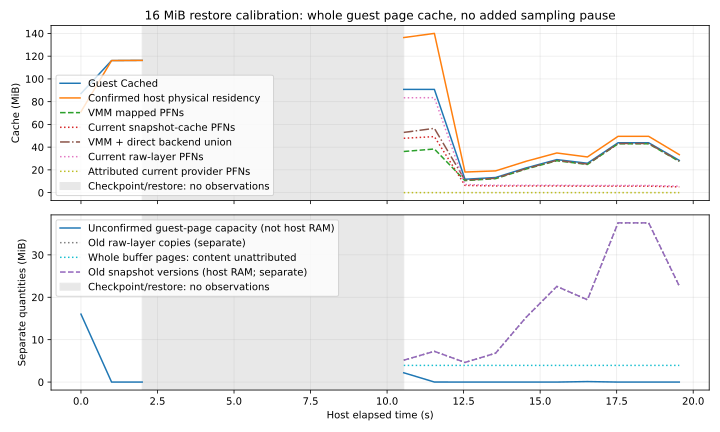

# 后端槽位缓冲的内容归属短校准（2026-10-15）

已完成最小槽位元数据、私有后端构建和一次短恢复校准。文件内容、原进程恢复、三层物理页复算及清理通过；保存前3点、恢复后10点，没有增加采集暂停或任务文件预读。**恢复后10点均没有跨配对读取保持有效的槽位内容记录，因此本次没有新增可归属的后端缓冲物理页。** 这项覆盖未验证为正值，不把它写成缓冲零占用，也不追加实验轮次。

只读查询确实观察到3.9375 MiB完整缓冲页驻留，另有23张混合边界页。这些页的当前内容归属未知，未加入已确认的缓存物理并集。此前三任务单路径、Prettier第24步恢复及真实双分支结果直接复用。

证据见[脱敏汇总](evidence/provider-slot-calibration-20261015.json)，原始记录为`.artifacts/provider-slot-calibration-20261015/`，成功运行是`.artifacts/storage-isolated-service/20261015T155211Z-2038835/`。

## 方法和构建

源码固定为AgentENV `2f48c9c78ec58e4d73c49aa07cb81d984a4a4184`加[本次补丁](../../patches/agentenv-provider-slot-observation.patch)。以非root用户yyxie、Rust 1.99.0构建，使用dev配置、关闭调试信息和增量编译；二进制SHA-256为`e1db6d7831d15dd92411be0e4c7f640c88e429c8a0370ff8c132d184a3597123`。源码、锁文件、补丁和二进制哈希分别保存，实际运行进程的二进制哈希一致。它只在本次私有服务中使用，没有替换原服务。

观测仅由私有环境变量启用，且只记录`memory/image.json`对应的内存设备；启用设备池时拒绝观测。实际为1队列、16槽、每槽256 KiB，总分配容量4 MiB，表文件共64 KiB。记录包含进程启动身份、设备及内存镜像身份、队列和槽号、地址、容量、逻辑偏移、有效长度、内容状态、改写序号和完整读取次数。常规根文件系统与其他设备没有槽位记录。

沿用2 CPU/4096 MiB、`6.1.175-asb-cache-v3`诊断guest内核和约1秒采样间隔；负载为既有16 MiB文件的等待、读取4 MiB及修改4 MiB三个阶段，不执行完整任务。

完整读取成功后才将内容标为有效；失败、短读、非读取操作及释放均无有效内容。**提交完成结果并获取下一请求前使内容记录失效**，因为下一次写请求可能由内核改写同一缓冲。没有依赖未验证的Rust异步函数参数布局，也没有为扩大有效时间而延迟请求。

host只读取这张元数据表和`pagemap`中的物理页号（PFN），不读取缓冲内容。配对读取期间表的改写序号、内容状态、物理页号及guest缓存身份均须稳定；沿用已有KVM布局到快照设备偏移换算。仅当整张host物理页的内容都属于已确认的缓存区段时才计入；512字节对齐导致的边界页单列。完整guest页的字节范围都已覆盖后，才减少其未知容量。VMM匿名写时复制后的旧快照内容另列，新增物理页与原三层按PFN去重。

## 观测结果与边界

后端共记录3,853次完整读取。恢复后10点读取到的内容状态均为“提交获取请求前已失效”，有效槽位数均为0；前后序号稳定的槽位为8–16个。说明读取路径确实运行过，但本次保守失效规则没有留下跨采集窗口可确认的内容。

| 项目 | 恢复首点 |
| --- | ---: |
| guest逻辑Cached | 90.781 MiB |
| VMM映射中的确认物理页 | 36.176 MiB |
| VMM与直接后端并集 | 52.957 MiB |
| 原始内存层中的当前内容物理页 | 83.414 MiB |
| 原三层确认物理并集 | 136.371 MiB |
| 本次新增可归属缓冲物理量 | 0，未取得有效内容窗口 |
| 未确认guest容量 | 2.191 MiB |
| 完整缓冲页驻留，内容归属未知 | 3.9375 MiB |
| 混合边界页 | 23张，不按整页容量加入缓冲占用 |

原三层并集在恢复后为18.102–140.020 MiB，未知guest容量为0–2.191 MiB；加入本次观测后这两个结果均保持。不同层的物理副本可使host并集大于guest逻辑量。完整缓冲页的未知内容与未知guest容量是不同的量，不能相加或互相换算。缓冲仍可能保存已确认guest页的额外副本；新增确认量为0不是其真实缓存占用为0的证据。

16 MiB校准文件的内容与原进程身份检查通过；写入阶段的1,024张guest页均观察到匿名写时复制。guest页缓存表从启动起记录普通文件和shmem，页大小4096字节；恢复首点记录23,240页。加入重复、缺失删除、越界、迁移及失效记录计数均为0。槽位表保存当前状态，不是完整事件流；3,853次完整读取计数不代表保留了每次内容，有效内容未被采到的部分不补算。



## 采集成本和检查

host恢复后每点平均286.935 ms线程CPU、316.306 ms配对耗时；其中两次槽位表及PFN查询合计平均0.604 ms CPU、0.605 ms耗时。完整采集线程保存前/恢复后分别0.211/2.879 CPU秒；guest每次发布平均1.590/1.212 ms CPU，仍使用16.008 MiB锁定匿名导出区，没有锁定任务文件。新增归属计数包含在完整线程成本中，没有单独拆分，也未做关闭采集对照。私有后端为dev构建，这些数字不用于计算任务减速或与旧生产构建比较。

正常checkpoint的日志暂停边界为330.005–330.516 ms，保存接口3.181秒，前后采样点空缺8.545秒，三者分别报告。没有新增采集暂停、预读、清空缓存或强制缓冲驻留。

格式检查、构建、2项Rust生命周期测试和53项Python检查通过。严格clippy因原有`async_trait`宏生成的`double_must_use`警告失败；保留失败日志，仅忽略该项后检查通过，没有修改相邻旧代码。依赖中原有`fetch_update`废弃警告保留。没有运行会触及真实设备或服务的全量测试。

原三层由独立逐页计数器复算；本次另行直接检查原始表，确认有效窗口为0，再验证新增并集保持和完整分配页的驻留PFN集合。正值归属仅由离线用例覆盖，未在本次实跑观察到。两份新报告各3文件一致，本次135份采集raw及已有单次恢复/双分支1,082份任务证据哈希保持；16个槽位释放后均为失效状态。

## 准备失败、清理与后续

第一次准备`20261015T154910Z-2037403`在私有服务创建前失败：旧配置没有`ublk.daemon_binary_path`字段，替换函数拒绝继续。未创建服务或VM，未运行校准；改为原服务已支持的`AENV_UBLK_DAEMON_BINARY_PATH`环境变量后继续首次校准。原FAIL保留，24 GiB卷完整备份为1,947,048,607字节并核对解压哈希后回收，备份和清理收据保留。

成功校准启动前61.869 GiB可用，24 GiB卷运行中最低约37.868 GiB，20 GiB保护量和6 GiB余量保持。VM、snapshot、私有服务、卷、loop及12 GiB限额的编译内存盘均已回收；原服务和12个原VMM身份保持，收尾约61.85 GiB。保留工具链、构建二进制、日志和失败备份，未暂存、提交或推送。

本阶段到此结束。2026-10-16的[实际内核协议离线核查](PROVIDER_SLOT_PROTOCOL.md)确认，现有只读设置不能保证复制前阻止缓冲覆盖；随后按新授权完成了[GET_DATA私有实现和短恢复验证](PROVIDER_GET_DATA_VALIDATION.md)。新路径只在显式启用并协商成功时保留等待期间的归属，其他情况维持原保守规则。本页旧校准数值和未知量保持，不追溯补算。压缩/多层和稳定性能比较另定范围，不以增加采样轮次补齐归属缺口。

只用已保存数据复算，不启动服务：

```bash
python3 -B scripts/audit_provider_slot_calibration.py \
  .artifacts/storage-isolated-service/20261015T155211Z-2038835 \
  --output .artifacts/provider-slot-audit-recheck.json
python3 -B scripts/report_live_task_cache.py \
  .artifacts/storage-isolated-service/20261015T155211Z-2038835/guest-cache \
  --output .artifacts/provider-slot-report-recheck
```

构建入口为`scripts/build-provider-slot-observer.sh <构建目录>`，要求非root用户、目录内已有固定工具链和cargo缓存；本次目录为`.artifacts/provider-slot-build-20261015`。仅重建二进制不会启动实验。上述审计专门验证本次“无有效窗口”的结果，不用于声称未来正值样本已独立验收。
