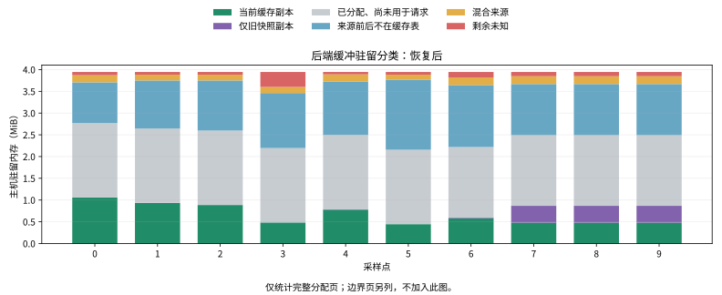

# 分项计时与一次短恢复：四次缓存查询占CPU的75.8%（2026-10-16）

**分项计时已接入，一次短恢复通过，主要开销已定位到四次后端/原始层查询。** 保存前3点、恢复后10点，文件内容、原guest进程恢复和独立物理去重检查通过。本次恢复后单点平均396.368 ms CPU，其中四次查询合计300.538 ms，占75.8%；两次批量偏移换算合计12.035 ms。保留当前实现，本阶段结束，不追加实跑。

[脱敏结果](evidence/provider-stage-cost-20261016.json)含完整分项和物理量。本机目录为`.artifacts/provider-stage-cost-20261016/`；成功校准为`.artifacts/storage-isolated-service/20261016T122440Z-2318993/`，raw在其`guest-cache/live-cache/{parent,restored}/`。

## 记录范围和原总指标保持

`scripts/live_task_cache.py`新增`_timed`，在原调用前后记录host单调时钟和线程CPU。保存前每点9个阶段，恢复后25个阶段；新增`host_sample_start_ns`和`host_stage_costs`，不增加数据读取或设备查询。阶段覆盖guest发布/导出区读取、三次VMM页号读取、映射读取、偏移换算、四次内核查询、两次缓冲查询、数组组装和归属计数。

原`host_thread_cpu_ns`和`host_elapsed_ns`仍在首次guest发布请求前开始，在归属计数完成后结束，随后才编码和写盘。未移动这个范围，也没有用分项之和替换原总值。各阶段串行、不重叠且位于原计时区间内；总量减去分项之和的部分单列，包含未分项检查、循环、导入和计时开销。

查询顺序保持：

```text
guest前表 → VMM第一次 → 后端/原始层前查
→ 缓冲前读 → VMM第二次 → 缓冲后读
→ guest后表 → 后端/原始层后查 → VMM第三次
```

旧未分段和无后端路径的原顺序也保持。仍使用两次独立批量偏移换算、原GET_DATA覆盖前失效及原缓存准入条件；没有改Rust段表、延迟请求或增加采集暂停。

## 本次在线分项成本

下表是恢复后10点的平均值，单位为ms。CPU仅指host采集线程；耗时包含该阶段等待。

| 阶段 | 线程CPU | 耗时 |
| --- | ---: | ---: |
| 两次guest发布请求及导出区读取 | 1.139 | 31.981 |
| 三次VMM页号读取 | 21.332 | 21.405 |
| 两次映射读取/解析 | 0.919 | 0.921 |
| 两次后端偏移＋一次原始层偏移换算 | 19.514 | 19.557 |
| 两次直接后端查询 | 171.550 | 172.910 |
| 两次原始内存层查询 | 128.988 | 129.313 |
| 两次缓冲查询 | 4.421 | 4.433 |
| guest表解析和数组组装 | 1.286 | 1.290 |
| 各层归属计数 | 45.679 | 45.713 |
| 未分项部分 | 1.541 | 1.517 |
| **单点总量** | **396.368** | **429.038** |

这里的查询成本是`SnapshotCache.query`整次调用，包含Python准备、驻留查询、BPF表读取和结果整理，未拆分用户态与内核态CPU。四次缓存查询合计300.538 ms CPU，是本次明确的主要开销；不再需要用离线与在线计时的差额猜测原因。其中首次直接后端查询平均99.682 ms，第二次71.868 ms；原始层两次分别67.233和61.756 ms。40次查询均保存到结果，缺失内核结果为0。

偏移换算中，两次guest到后端换算为8.604＋3.431＝12.035 ms CPU，后端到原始层换算为7.478 ms。它们与此前同输入离线对照的6.785 ms范围不同，输入和运行状态也不同，分别保留。旧在线435.513 ms同样保留；本次guest缓存及查询页数有变化，不把两次总量差值全归因于换算优化。

原始层和直接后端的两个BPF内核跟踪辅助进程另用0.470和0.490 CPU秒，覆盖整个恢复采样会话，不包含在上述线程CPU中。guest发布CPU也另记，不与host线程相加。没有关闭采集对照，本次不计算任务减速。

采集线程保存前/恢复后总CPU为0.229/4.038秒。恢复后单点计时之外合计73.926 ms，平均7.393 ms/点，包含编码、写出和循环等。新增两项计时字段在恢复后每点平均增加3345.7字节日志，保存前平均1225.3字节；没有分离计时本身的独立CPU开销。缓冲元数据映射仍为192 KiB，每点查询仍读取516 KiB。

## 物理量、恢复和资源

恢复首点guest独立表容量103.398 MiB、`Cached`103.355 MiB，四部分当前缓存物理并集157.457 MiB，未确认guest页容量2.266 MiB。10点当前缓存缓冲副本456–1084 KiB，旧快照副本0–396 KiB另列；分段缓冲没有额外补齐未知guest页。

完整缓冲驻留每点仍为4040 KiB，21张边界页另列。原未归属字段为2956–3584 KiB；解释性六类分开未用分配、来源前后不在缓存表及混合来源后，剩余未知56–352 KiB。分类互斥且逐点对齐驻留量，不把未知按零处理或加入当前并集。保存前没有缓冲分段观测，标为不适用。



原guest进程PID、启动时刻、启动身份及最终16 MiB内容检查通过；恢复重新绑定新VMM，不将其描述为旧host进程。原生checkpoint暂停边界326.910–327.391 ms，前后采样空缺8.617秒，与采集暂停分开记录。元数据表的重复加入、缺失删除、越界、迁移和失效记录计数均为0。

启动前可用55.765 GiB，24 GiB卷运行中最低31.764 GiB，20 GiB保护量和6 GiB余量保持。VM、snapshot、私有服务、卷、挂载和loop均已回收，原服务和12个VMM身份保持，收尾约55.72 GiB可用。

## 验证和离线使用

49项相关测试通过：新增时钟差值、调用/结果传递、失败传播、原总计时不含写出及分项报告检查；原四种路径顺序、内容发布和批量换算回归保持。真实短恢复只执行一次，没有失败后重跑或追加完整任务。

13点阶段覆盖、起止时刻、分项/总量和10点紧邻缓冲顺序核对通过。10点指标及PFN集合由独立逐字节覆盖计数器复算一致，六类物理集合对齐，原无分项计时的3/10点采集仍可复算。报告图已查看，实际资源释放另有收据。

新增`scripts/report_live_cache_costs.py`生成分项JSON及CSV。旧数据没有计时字段时标为`NOT_RECORDED`，不填零。原离线纯函数分析只核对实际执行的依赖源码，不再因未执行的在线循环增加计时而拒绝旧数据；其参数和计数语义保持。

只读取保存元数据，输出目录须尚不存在：

```bash
python3 -B scripts/report_live_cache_costs.py \
  .artifacts/storage-isolated-service/20261016T122440Z-2318993/guest-cache/live-cache \
  --output .artifacts/provider-stage-cost-recheck
```

本阶段的分项计时、一次真实恢复、独立物理去重及成本核对均已完成。三任务、完整恢复和双分支继续复用，没有暂存、提交或推送。

### 下一步建议，供检查

只做离线源码核对：检查实际内核、已安装libbpf及现有BPF表是否支持批量读取，能否减少四次查询中的逐页表查找，同时保留每次查询的token标记、请求偏移匹配及缺失结果保持未知的规则。给出可行性、最小改动和验证条件，以此为完成标准；不修改运行路径、不接触真实BPF表、不启动沙箱。若可行，再另定实现与一次短验证范围。

上述离线核对已按后续授权完成，见[批量读取源码依据和私有验证建议](PROVIDER_BPF_BATCH_REVIEW.md)。本页成本和物理量保持。
