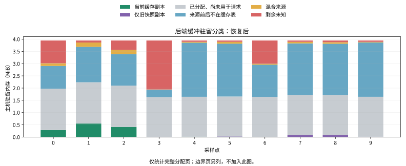

# 后端缓冲驻留分类接入统一报告（2026-10-16）

**统一报告现在会把已有分段观测的后端缓冲驻留量分成六类；恢复后10点每点均与4040 KiB完整驻留量对齐。** 原13点缓存汇总、29个原有顶层字段及原缓存曲线保持；新增分类没有改变当前缓存的物理页并集。剩余未知56–2048 KiB在新图中单列，不再与已解释的未用开销和其他来源混在一起。

结果见[分类图](evidence/provider-unified-report-20261016.svg)和[脱敏数据](evidence/provider-unified-report-20261016.json)。本机报告为`.artifacts/provider-unified-report-20261016/report/`，包含`summary.json`、原`cache.svg/png`，以及新增的`provider-buffer.csv`、`provider-buffer.svg/png`。本轮只用成功短恢复`20261016T050815Z-2211363`的已有数据，没有读取负载或启动沙箱。

## 用统一入口生成，不需要先运行两份分类报告

`scripts/report_live_task_cache.py`检测到分段缓冲观测后，直接复用已验证的[未用页条件](PROVIDER_BUFFER_INITIALIZATION.md)和[来源反查规则](PROVIDER_OFFSET_CANDIDATES.md)，在`summary.json`中加入`provider_buffer_breakdown`，同时生成新表和新图。无需手工拼接上两轮输出。

`use-platform report`原有调用无需增加配置；平台报告会在`live_cache`下列出新增图表路径。没有分段观测的旧数据继续使用原报告路径。本次保存前3点没有分段观测，在新分类中标为`NOT_APPLICABLE`，没有把未测量内容填成零；原3点数据和保存恢复空缺继续保留。

本次复算调用如下，输出目录需尚不存在：

```bash
python3 -B scripts/report_live_task_cache.py \
  .artifacts/storage-isolated-service/20261016T050815Z-2211363/guest-cache \
  --output .artifacts/provider-unified-report-recheck \
  --reuse-raw-inventory .artifacts/provider-segments-20261016/report-a/summary.json
```

`--reuse-raw-inventory`复用上次报告已保存的文件摘要，不重新计算哈希；先核对来源、文件名集合和重新计数后的全部样本。新报告明确记录复用来源，不将其表述为重新完成了摘要校验。本轮另沿用既有200份输入状态清单，核对inode、大小和修改时间。该选项只用于复用已有证据，原调用参数和默认报告入口保持。

## 六类按物理页集合划分，逐点相加等于完整缓冲驻留量

所有类别先按host物理页号去重，再确认集合互不重叠。新表字段如下：

| 类别 | 字段 | 含义 |
| --- | --- | --- |
| 当前缓存副本 | `current_cache_bytes` | 原单条记录与分段记录共同确认的当前缓冲副本 |
| 仅旧快照副本 | `old_snapshot_only_bytes` | 旧副本中扣除也被确认属于当前副本的物理页 |
| 已分配、尚未用于请求 | `unused_allocation_bytes` | 整页八段均保持初始代次和未知来源，满足已验证的分配/注册条件 |
| 来源前后不在缓存表 | `source_absent_both_bytes` | 全部来源guest页在该点前后缓存表中都缺失 |
| 混合来源 | `mixed_sources_bytes` | 至少一部分来源前后不在缓存表，同时包含其他来源，不能整页当成非缓存 |
| 剩余未知 | `unresolved_bytes` | 扣除上述集合后，仍有段变化、身份变化、部分初始段或混合版本等缺口 |

当前副本和旧副本若共用同一物理页，新分类优先放入当前副本，避免相加重复；原旧副本指标不重定义，交集另列为`current_old_overlap_bytes`。本次10点交集均为0。

“来源前后不在缓存表”只说明两个成员快照，不代表期间始终未进入缓存，也不推断是匿名页或空闲页。“未用于请求”不代表内容清零或没有物理占用。原`provider_segment_unattributed_resident_bytes`仍为3476–4040 KiB；新`unresolved_bytes`是经过解释性分类后剩下的部分，两者含义不同，原字段保持。

## 已有10点的分类

单位为KiB；每行六类之和均为4040。每点另有21张分配边界页，保持单列，不把它们按整页容量加到下表。

| 点 | 当前缓存 | 仅旧副本 | 未用于请求 | 来源前后不在缓存表 | 混合来源 | 剩余未知 |
| --- | ---: | ---: | ---: | ---: | ---: | ---: |
| 0 | 292 | 0 | 1728 | 956 | 112 | 952 |
| 1 | 564 | 0 | 1728 | 1484 | 180 | 84 |
| 2 | 424 | 0 | 1728 | 1324 | 172 | 392 |
| 3 | 0 | 0 | 1672 | 312 | 8 | 2048 |
| 4 | 12 | 0 | 1672 | 2264 | 36 | 56 |
| 5 | 12 | 12 | 1672 | 2212 | 76 | 56 |
| 6 | 0 | 8 | 1672 | 1348 | 40 | 972 |
| 7 | 0 | 88 | 1672 | 2160 | 64 | 56 |
| 8 | 0 | 88 | 1672 | 2144 | 64 | 72 |
| 9 | 0 | 12 | 1672 | 2276 | 24 | 56 |



**这张图解释的是后端缓冲，不是整guest缓存对应的全部host物理量。** 当前缓冲副本已经包含在主报告的物理并集中，不能再相加。不同采样点也不能相加为总占用。

`unresolved_reason_bytes`进一步保留剩余原因。点3的2048 KiB由1888 KiB段记录变化、132 KiB guest身份变化及28 KiB含初始段整页组成；点0、2、6、8也有段记录变化，其他点主要剩部分初始段或混合版本。没有为减少未知量放宽整页或时间条件。

## 接入与验证完成

新增`scripts/provider_residency_report.py`负责分类、集合检查、CSV和中文图；统一报告与平台报告只增加调用和图表链接。在线采集器、Rust观察器和请求顺序未改，原采集成本也没有重新测量。

7项新测试通过，覆盖集合互斥、当前/旧别名优先级、部分初始页、其他来源、未测量状态、旧指标冲突、摘要清单复用及平台图表链接；原15项采集/报告兼容测试通过。未运行触碰真实设备或服务的测试。

统一入口完整复算保存前3点及恢复后10点后，独立检查器复用上轮已验证的来源物理页清单与初始化规则，按物理页重新构造六类，确认10点互斥、完整覆盖及CSV一致。与成功运行保存的旧计数实现逐点比较，全部原指标和当前缓存物理页号集合保持；原报告29个顶层字段完全一致，原`cache.svg/png`逐字节相同。新增中文图已实际查看，文字、图例和分类高度可读。

本阶段达到统一报告接入、旧结果保持和逐点总量对齐的完成标准，不追加校准。三任务、完整恢复和双分支的原结果继续复用，24 GiB卷未来启动前仍须重新确认超过50 GiB可用并遵守已有保护规则。

## 下一步建议，供检查

仅离线核对剩余未知中的段记录变化部分，判断现有四份记录和请求计数能否区分来源不变的再次填充与真正内容变化。以给出可证明范围、是否值得修改采样及必要的最小验证范围为完成条件；不延迟请求、不扩大有效窗口、不启动沙箱。

随后按用户授权完成了[段变化来源核对](PROVIDER_REFILL_ANALYSIS.md)：本批目标页没有同来源单次填充的整页证据，主要已观察到来源变化，另有首次填充区段；建议缩短host缓冲配对读取区间，而不是放宽代次条件。本页六类数据及原物理并集保持。
