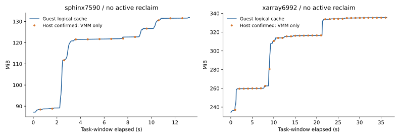

# Sphinx和Xarray不主动回收基线完成（2026-10-18）

已完成Sphinx #7590、Xarray #6992各一次完整35步基线，共70实际动作。两次都在开始采集和任务准备前停止自有guest的DAMON后台回收，50 ms周期只读取缓存和计数，没有请求容量回收；原任务后恢复原来的开启状态，再做最终状态和官方检查。

**任务执行阶段的逻辑缓存采样峰值分别为131.871和335.570 MiB。** 后续约50%/75%目标建议分别为Sphinx **65/98 MiB**、Xarray **167/251 MiB**。本次只完成基线，没有执行这些限额组。

## 参数来自各自的新基线，不沿用Prettier的64/128 MiB

两个任务都使用2 CPU/4096 MiB、`6.1.175-asb-cache-v3-reclaim`私有guest内核、相同50 ms观测程序及约1秒不暂停物理采集。基线不开容量回收，也不清理起始缓存或预读任务文件；guest内核正常的内存压力回收机制仍保留。两个任务保持各自已有的诊断退出码规则，不把诊断通过改写为严格重放通过。

独立缓存成员表从启动起记录普通文件与共享内存缓存页，容量按页数乘4096字节计算。下面只选任务前、任务后两次边界之间的完整采样，排除准备及后续官方评测；窗口含原任务执行及段间核对。P95表示95%的采样值不超过该数，不是连续时间的最大值，也不是任务最低必需缓存量。

| 任务 | 任务窗口/秒 | 采样数 | 最小值/MiB | 均值/MiB | P95/MiB | 峰值/MiB | 建议低/高目标/MiB |
| --- | ---: | ---: | ---: | ---: | ---: | ---: | --- |
| Sphinx | 13.270 | 263 | 87.207 | 118.041 | 131.605 | 131.871 | 65 / 98 |
| Xarray | 36.333 | 720 | 234.668 | 308.810 | 335.441 | 335.570 | 167 / 251 |

建议值按本任务峰值的50%和75%向下取整到MiB，作为首次容量对照的两个周期目标；实际是否达到及达到多少，须看后续回收后的曲线。Sphinx长期约122 MiB后升到约132 MiB，Xarray则约260→316→335 MiB，不能用相同绝对参数表达相同压缩程度。

此前旧运行的独立成员表全程观测峰值约98.871/334.266 MiB，内核、后台回收条件和选取窗口与本次不同，不作为新基线或差值归因依据。当前参数依据的是本次任务窗口数据。



## 不回收、状态恢复与原结果均已核对

Sphinx/Xarray观测程序分别记录338/824个周期，全部请求页数和回收写入耗时为零。冻结源码中的基线路径不调用回收函数，相关模拟检查也验证了成功及异常时均恢复原DAMON状态。实际日志显示，确认关闭早于采集启动，任务边界包围原五段重放，恢复原开启状态早于最终文件和官方检查。

两任务重复加入、缺失移出和越界计数均为零。各有3个任务阶段读数出现页身份变化，最多2页即8 KiB；内核在复制成员位图后读取生命周期标记，期间身份变化会把标记置零，并记入`stale_records`。这不是事件丢失，身份未确认容量继续单列，不强行判为零或用于物理归属。两个任务的峰值读数均没有这类未确认身份。

原动作顺序、预期退出码、关键输出和最终补丁通过既有检查，官方完整结果与各自已有成功重放数据一致。Sphinx仍为24通过/1失败，Xarray仍为945通过/12失败，均无跳过；严格重放FAIL保留，平台及本次基线检查为PASS。两次都是新建guest执行，没有做快照或进程恢复。

## 物理量和观测成本

本轮不涉及快照，物理量只确认VMM RAM映射内对应缓存页的当前host驻留；没有执行快照后端、原始内存层或provider归属，也没有跨guest重叠去重实验。统一报告已用原始成员表和物理页号独立复算全部22/66点；其中任务窗口内为13/36点。

| 任务 | 任务窗口host确认物理量/MiB | 未确认guest容量最大/MiB | 共享内存范围/MiB | 脏页峰值/MiB |
| --- | --- | ---: | --- | ---: |
| Sphinx | 88.434–131.543 | 0.680 | 0.832–0.832 | 9.434 |
| Xarray | 237.094–335.520 | 5.336 | 0.832–0.840 | 10.613 |

未知量不补入物理并集；host读取可能延伸到guest元数据区间之外。脏页和共享内存计数不是可回收量的完整分解，映射页等限制仍需在后续目标组实际观察。

原35动作工具合计耗时为10.251/33.614秒，含段间核对和边界观测的重放用时为13.285/36.344秒，控制停止操作在此计时之后。观测进程整段CPU为0.668/3.108秒，观测窗口17.024/41.592秒，包含任务前准备；相应guest设备读取114.293/319.676 MiB。设备计数不是仅原工具的精确读量，也不是host物理磁盘读取量。两任务交换使用均为零。

本次每个任务只有一次，不与旧内核、后台条件或不同任务的耗时计算控制收益；后续目标组与本次基线分别比较同名任务。

## 一次外层目录识别错误，成功任务没有重跑

Sphinx实际运行及报告均成功，外层脚本随后把平台打印的“报告成功”和“运行成功”两个目录都当作运行目录，因而在Xarray启动前停止。已修正为区分报告目录，并增加最小回归用例；显式续接只读取保存的Sphinx成功结果，再执行尚未启动的Xarray。旧错误输出保留，两任务实际仍各运行一次。

离线报告还发现少量身份变化记录，原先把`stale_records`也要求为零不符合既有内核协议，现按源码将它们单列为身份未知，重复/缺失/越界仍拒绝。该修正只作用于离线报告，未放宽任务动作、退出码、补丁或评测检查，也没有因此重跑任务。

## 资源、证据与入口

两次均使用已有完整单路径的8 GiB固定卷。启动前可用51.460/51.413 GiB，运行最低43.460/43.413 GiB，满足原预算及20 GiB保护量加6 GiB余量；24 GiB卷仍须启动前超过50 GiB可用。自有guest、私有服务、卷、挂载、loop和只读RAM输入缓存均已回收，原服务和12个VMM身份保持。

78项相关离线用例通过，实际顺序、零回收、原结果及清理回执核对通过；未替换原服务、修改host内核或暂存、提交、推送。

- Sphinx原始结果：`.artifacts/storage-isolated-service/20261018T142024Z-2666717/python-backbone/`。
- Xarray原始结果：`.artifacts/storage-isolated-service/20261018T142328Z-2670657/python-backbone/`。
- 运行绑定及原外层错误：`.artifacts/python-cache-baseline-20261018T141852Z-2666123/`。
- 比较报告、冻结源码和核对回执：`.artifacts/python-cache-baseline-20261018/`。
- [脱敏数值、配置和验证](evidence/python-cache-baseline-20261018.json)，不含原始页号或未脱敏日志。

只读重建本次基线报告，输出目录须不存在：

```bash
python3 -B scripts/report_python_cache_baseline.py \
  --runs .artifacts/python-cache-baseline-20261018T141852Z-2666123/runs.json \
  --output .artifacts/python-cache-baseline-report-new
```

新的两任务基线入口为`bash scripts/run-python-cache-baselines.sh`；单任务使用`bash scripts/use-platform.sh run configs/platform-sphinx7590-cache-baseline.json`或对应Xarray配置。已有普通配置默认行为不变。本轮已完成，不再次运行这些命令。

下一步建议供检查：仅补四次目标组，Sphinx为65/98 MiB，Xarray为167/251 MiB。先为新增Python控制入口接入这些实际目标，保留Prettier旧参数和普通入口行为；Sphinx第一组承担必要路径验证，再完成其余三组。沿用同内核、采集、后台状态处理和任务窗口，以原动作/结果保持、实际容量范围及超目标、物理量、读取/耗时、控制成本和资源回收齐全为结束条件；不重跑本次基线，不以达到严格硬上限为继续条件。本建议不视为限额组执行授权。

这四次目标组随后已按新授权[全部完成](PYTHON_CACHE_TARGETS.md)，直接复用本页两个基线，没有重跑。基线与目标组的数据、成本及单次观察条件分别保留。
