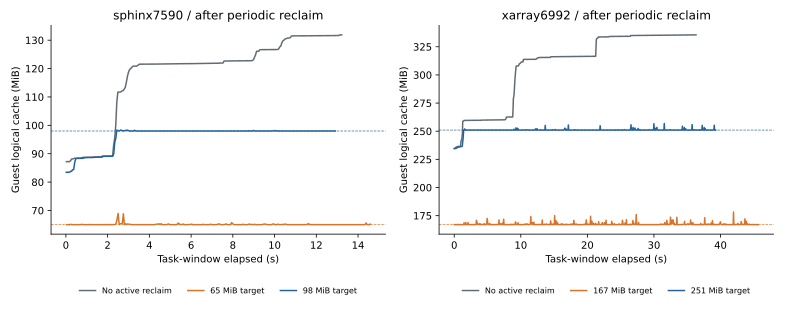

# Sphinx和Xarray两档缓存目标对照完成（2026-10-18）

已按计划完成Sphinx 65/98 MiB、Xarray 167/251 MiB四次目标组，每组完整35动作，共140实际动作；两个已完成的不主动回收基线直接复用，没有重跑。两任务的实际缓存曲线均分开，原动作、退出码、补丁和完整官方结果保持，后台回收状态正确恢复，资源已回收。

本批较低目标带来更多设备读取和控制CPU，Xarray更明显。相对各自基线，Sphinx两档工具用时变化为+9.32%/−3.48%，Xarray为+27.25%/+8.27%。这些是每条件一次的顺序观察，耗时差包含缓存容量、回收策略及控制成本，不给出稳定减速比例。

## 按各任务基线选参，保持原执行路径

目标依据[新基线](PYTHON_CACHE_BASELINES.md)任务窗口峰值的约50%/75%：Sphinx峰值131.871 MiB，选择65/98 MiB；Xarray峰值335.570 MiB，选择167/251 MiB。没有直接套用Prettier的64/128 MiB。

四组顺序为Sphinx 65、98，再Xarray 167、251；第一组承担新目标入口验证，通过后执行其余三组，没有额外启动校准或重试。每次新建私有guest，从完整35步任务开始执行，没有快照或进程恢复。配置与基线只在回收目标、是否基线及输出目录上不同，均为2 CPU/4096 MiB、`6.1.175-asb-cache-v3-reclaim`私有内核、50 ms控制周期及约1秒不暂停物理采集。

控制从guest创建后、采集和准备前开始，先停止该guest的DAMON后台回收并确认线程退出。每周期按超目标数量尝试回收干净、未映射的普通文件页；任务后恢复原DAMON状态，再进行最终文件和官方检查。它仍是按文件系统、inode及文件偏移遍历的周期目标，不是最近最少使用策略或每次缓存加入时的硬上限；不回收匿名页和共享内存，不预读填充、锁定任务页或清理host全局缓存。

基线与目标组不是同一实际快照，控制也影响任务前准备，所以开始任务时的缓存量不要求相等；读数在证据中保留。没有为了匹配初始容量另做填充或清理。

## 实际缓存均值降低，短时超目标如实保留

容量来自独立guest普通文件/共享内存缓存成员表，每页4096字节。只选任务前后边界之间的完整采样，排除准备和官方评测。基线使用其原观测值，目标组使用每周期回收后的值；窗口包含原任务及段间核对。超目标比例是采样点比例，不是连续时间占比，严格大于目标即计入，不另设容差。

| 任务 | 条件/MiB | 窗口内缓存均值/MiB | 范围/MiB | 超目标采样 |
| --- | --- | ---: | --- | --- |
| Sphinx | 不主动回收 | 118.041 | 87.207–131.871 | — |
| Sphinx | 65 | 65.076 | 65.000–68.957 | 91/289，31.49% |
| Sphinx | 98 | 96.163 | 83.449–98.348 | 36/256，14.06% |
| Xarray | 不主动回收 | 308.810 | 234.668–335.570 | — |
| Xarray | 167 | 167.375 | 166.996–178.199 | 493/907，54.36% |
| Xarray | 251 | 250.610 | 234.586–256.828 | 170/779，21.82% |

两档回收后P95分别为Sphinx 65.285/98.098 MiB、Xarray 168.977/251.551 MiB。最大超目标分别3.957/0.348及11.199/5.828 MiB，全部保留。脏页、映射页等可能使接口不能立即移出足够页，读取和写入也会并发加入缓存；当前记录未逐项分离每次剩余量，处理条目数也不直接换算成释放字节。

Sphinx 98与Xarray 251组开始时低于目标，随后随真实任务需求增长到目标附近。目标不是要求填满的下限。两档实际范围明确分开，功能验证不以每时刻都低于设定值为条件。



## 工具用时与guest设备读取

下表变化均相对同名任务已保存的不主动回收基线。Sphinx基线工具合计10.251秒、设备读取114.293 MiB；Xarray为33.614秒、319.676 MiB。工具时间为原35动作之和，不与重放、控制CPU或请求写入耗时相加。

| 任务 | 目标/MiB | 工具合计/秒 | 工具时间变化 | guest设备读取/MiB | 读取变化 |
| --- | ---: | ---: | ---: | ---: | ---: |
| Sphinx | 65 | 11.206 | +9.32% | 244.723 | +114.12% |
| Sphinx | 98 | 9.894 | −3.48% | 134.328 | +17.53% |
| Xarray | 167 | 42.773 | +27.25% | 1926.641 | +502.69% |
| Xarray | 251 | 36.395 | +8.27% | 699.223 | +118.73% |

本批每个任务的较低目标都比其较高目标读取更多、工具用时更长。但相对基线，Sphinx 98组工具略短且读取增加，不能把本批概括为所有控制都会减慢，也不把负差值解释成优化收益。固定顺序、每条件一次以及未匹配的host缓存状态仍影响比较。

含边界观测和段间核对的重放用时分别14.650/12.967及45.737/39.308秒，相对基线变化+10.28%/−2.39%及+25.85%/+8.15%。控制停止操作在此计时之后，官方检查不在其中。

设备读取量取控制进程整个窗口内guest非分区virtio设备的扇区增量，四组窗口分别18.339、16.318、51.564、44.687秒，包含准备、停止和监控活动；不是原工具的精确读量，也不是host物理磁盘读取量。

## 控制成本单列，不把差值全归因于容量

| 任务 | 目标/MiB | 控制进程CPU/秒 | 回收请求写入累计/秒 | 非零请求次数：全窗口/任务窗口 |
| --- | ---: | ---: | ---: | --- |
| Sphinx | 65 | 1.742 | 0.889 | 274 / 248 |
| Sphinx | 98 | 1.193 | 0.419 | 159 / 156 |
| Xarray | 167 | 9.903 | 6.589 | 846 / 810 |
| Xarray | 251 | 6.157 | 2.234 | 529 / 526 |

不主动回收基线的观测进程CPU为0.668/3.108秒；新目标组包含持续请求内核回收的成本。请求写入耗时与CPU及任务执行存在重叠，不加总为总用时。控制初始化CLI累计0.554/0.524/0.819/0.797秒，停止和收集CLI累计0.372/0.370/0.391/0.353秒；这些是已有调用耗时之和，不包含调用之间的调度间隔。

两任务共享内存仍约0.832–0.840 MiB，四组交换使用均为零。普通脏页、共享内存与映射页限制不能从这些数值完整拆分，本次不另加回收策略或控制周期矩阵。

## VMM物理量独立核对，未知量不补零

四组全部物理点分别23、21、76、68，共188点，统一报告已逐点从原始成员表和物理页号独立复算。其中元数据区间完整落在任务窗口内的点为14、13、46、39，共112点。

| 任务 | 目标/MiB | 任务窗口host确认物理量/MiB | 未确认guest容量最大/MiB |
| --- | ---: | --- | ---: |
| Sphinx | 65 | 64.703–65.020 | 1.363 |
| Sphinx | 98 | 88.359–98.012 | 10.418 |
| Xarray | 167 | 158.617–167.746 | 15.262 |
| Xarray | 251 | 236.359–251.055 | 6.578 |

本轮与基线一样，仅确认VMM RAM映射中的对应物理页，没有快照后端、原始内存层/provider归属或跨guest去重实验。host读取可能延伸到guest元数据区间之外；未知容量另列，不补入确认量。逻辑缓存变少不等于VMM向host归还相同大小的内存。

重复加入、缺失移出、越界计数为零。任务观测中的身份未知最多分别12/8/4/4 KiB，继续按既有协议单列，不当成事件丢失或已确认物理页。停止控制后官方检查继续采样，其缓存增长不属于控制开启期间的范围。

## 完成范围、资源与证据

四组各35动作，共140新动作，两个基线的70动作只复用证据、不计为新执行。原命令、顺序、预期退出码、关键输出、最终补丁和完整官方结果均保持：Sphinx各组24通过/1失败，Xarray各组945通过/12失败，均无跳过；原严格重放FAIL与诊断PASS边界保持。实际状态和日志顺序确认关闭早于采集、原状态恢复早于最终文件和官方检查。四次都成功，没有平台失败、任务重跑或基线重跑。

88项相关离线用例通过，涵盖正整数目标分发、请求数量、失败恢复、旧Prettier限制和旧基线路径、窗口筛选及正负差值。新增Python目标不改变旧`--serve-target-mib`的64/128选择，未指定控制的旧配置行为保持。

四次沿用8 GiB固定卷，启动前可用50.606/50.575/50.538/50.322 GiB，运行最低42.605/42.575/42.537/42.321 GiB，保护预算保持。自有guest、私有服务、成功卷、挂载、loop和只读RAM输入缓存均已回收，原服务与12个VMM身份保持；旧失败及备份未清理，没有暂存、提交或推送。

- 运行绑定：`.artifacts/python-cache-targets-20261018T145320Z-2688125/runs.json`。
- 原始目录：`.artifacts/storage-isolated-service/`下的`20261018T145444Z-2688652`、`20261018T145648Z-2692328`、`20261018T145907Z-2695963`、`20261018T150227Z-2702927`，任务数据均在`python-backbone/`。
- 比较报告、冻结源码及核对回执：`.artifacts/python-cache-targets-20261018/`。
- [脱敏数值、配置及验证](evidence/python-cache-targets-20261018.json)，原始页号及日志只留本机。

只读重建比较报告，输出目录须不存在：

```bash
python3 -B scripts/report_python_cache_targets.py \
  --runs .artifacts/python-cache-targets-20261018T145320Z-2688125/runs.json \
  --baseline .artifacts/python-cache-baseline-20261018/report/summary.json \
  --baseline-runs .artifacts/python-cache-baseline-20261018T141852Z-2666123/runs.json \
  --output .artifacts/python-cache-target-report-new
```

四组新执行入口为`bash scripts/run-python-cache-targets.sh`，单组仍使用统一入口及`configs/platform-sphinx7590-cache-65.json`等对应配置。正整数`guest_cache_target_mib`与`guest_cache_baseline`互斥，仅作用于明确指定诊断内核的完整Python单路径；已有结果应直接离线查阅，不重复这些实跑命令。

本段达到四次数据和正确性、成本及清理齐全的完成条件。下一步无需追加相近实跑，三任务各自的路径与证据范围见[控制汇总](CACHE_CONTROL_SUMMARY.md)。若新增研究目标是稳定减速比例、统一任务路径或严格硬上限，再单独确定最小对照和完成条件。
